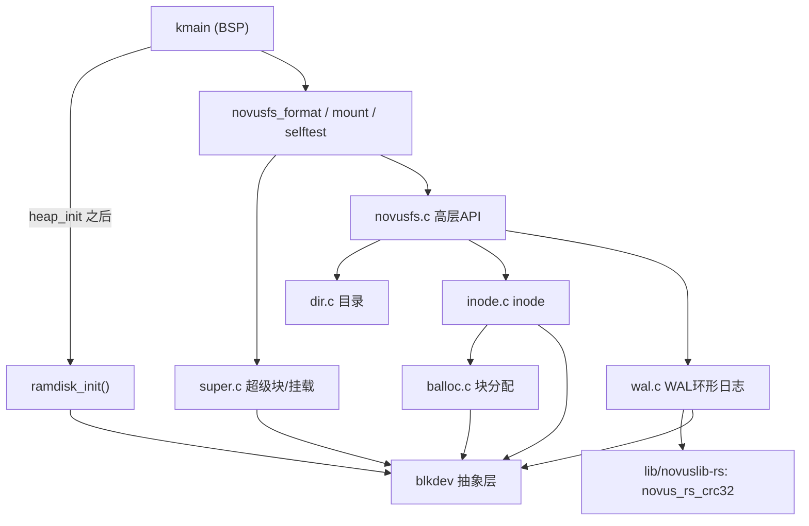

## 用户需求

读取 README 后继续开发 M2 阶段。README 第19.1 里程碑定义：**M2 = NovusFS 最小版本，WAL 基础实现**。要求在已有的 M2 Task 1（块设备抽象 + ramdisk 后端）之上，实现自研文件系统 NovusFS 的最小可用版本与预写日志（WAL）基础能力。

## 产品概述

Novus OS 在内核态提供自研文件系统 NovusFS 的最小子集：可在 ramdisk 块设备上完成格式化（mkfs）、挂载（mount）、创建目录与文件、写入/读取文件内容，并以 WAL 环形日志保证写事务的可重放与崩溃一致性基础。当前阶段仅内核内部 API + 自测（selftest）验证，不涉及系统调用（M4）或 Merkle 树（M3）。

## 核心特性

- 超级块双副本结构，含魔数、版本、块大小、块位图/inode表位置、WAL 指针、Merkle 区预留（M2 不填充）。
- WAL 预写日志：固定大小循环缓冲区，日志条目含魔数/TXID/事务类型/块号/数据长度/校验和；write_ptr==tail_ptr 视为满，满时推进 tail_ptr 至完整事务边界（不截断事务）；CRC-32 校验与损坏检测。
- 数据块分配器（free block bitmap）与 inode 管理（分配/读写/释放）。
- 目录管理：目录项增删查、mkdir（含 "." / ".."）、readdir。
- 高层文件系统 API：format / mount / creat / open / read / write / close / stat / mkdir / ls。
- 端到端自测：在 kmain 中对 ramdisk 执行格式化→挂载→建目录→建文件→写入→读出校验→WAL 追加/校验，并打印 PASS/FAIL。

## 技术栈选择

- 沿用现有内核栈：x86_64 freestanding C（mingw 交叉编译 + MS ABI），无 libc，自实现 string 辅助（kernel.h 已提供 memcpy/memset/memcmp）。
- 校验和计算复用 Rust 库 `lib/novuslib-rs` 已导出的 `novus_rs_crc32`（FFI，零依赖、纯计算）；符合 README 16.4 的 C/Rust FFI 边界约定。
- 内存分配复用内核堆 `kmalloc/kfree`（kernel/heap.h）；磁盘 IO 仅经 `blkdev_*` 抽象（kernel/blkdev.h），不直接触碰硬件。
- 构建系统沿用 Makefile + Kconfig + configs/novus_defconfig，新增 `fs/novusfs/` 源码目录并补充配置项。

## 实现方案

**总体策略**：按 README 第4部分冻结的分区布局（超级块 → WAL → Merkle预留 → 数据块）实现磁盘结构；先定义冻结头文件，再自底向上实现 WAL、块分配器、inode、目录、超级块格式化/挂载，最后用高层 API + selftest 串起闭环。

**关键技术决策**：

1. 模块位置遵循 README 16.2：`fs/novusfs/`（而非 kernel/），保持内核核心与文件系统的单向依赖（fs → kernel/blkdev/mm/heap）。
2. 超级块双副本 + 版本计数器：M2 写入主副本并记录版本，备用副本同步；为 M3 的"事务失败回滚至旧副本"预留原子写入基础。M2 仅校验魔数 + 主副本 CRC32，损坏则告警降级（不 panic）。
3. Merkle 区在 M2 仅"预留"（记录 start/length 字段，块数按容量计算但不填充节点），避免 M3 时改动布局，保证磁盘 ABI 稳定。
4. WAL 环形语义严格按 README 4.2.1：固定大小循环缓冲；追加时若剩余空间不足以容纳"整条事务"则以 tail_ptr 推进到事务边界腾出空间，绝不截断单条事务；每写一条即更新 write_ptr 并刷新对应扇区。

**性能与可靠性**：

- WAL 追加为 O(1)（指针推进 + 顺序扇区写）；块分配采用 bitmap 线性扫描（O(blocks)，对最小镜像规模可接受，M3 可换位图快速查找）。
- 校验集中在 WAL 条目与超级块，采用现有 `novus_rs_crc32`（const 查表，开销低）。
- 所有磁盘读写经 blkdev 边界校验；任何 CRC/魔数不匹配仅记录 WARN 并回退到安全状态，满足 README 3.4/17 的"不 panic 内核"。

**避免技术债**：完全复用既有 blkdev/heap/CRC 原语与 Makefile 模式，不引入新抽象；头文件声明为"冻结 M2 磁盘 API"，与 blkdev.h 注释风格一致。

## 实现注意

- 启动顺序（kernel/kmain.c）：FS 初始化必须放在 `heap_init()` 之后（依赖 kmalloc），并紧接 `ramdisk_init()`；位于 `lapic_init()`/`smp_wake_ap()` 之前，避免与 AP 并发（B核未唤醒）。
- WAL 满策略的边界：计算 `write_ptr` 环形前进时需区分"常态环形回绕"与"追平 tail_ptr 后强制推进 tail"两种情况，防止死循环与越界写（写入前用 blkdev 的扇区范围校验兜底）。
- 日志不要刷屏：selftest 只打印关键阶段 PASS/FAIL 与事务计数；WAL 错误按需 WARN，不 dump 大块载荷。
- 改动面控制：仅新增 `fs/novusfs/` 与少量构建文件，不重构 M0/M1 既有逻辑；配置项默认 y 以保证现有 `make run` 行为不变。

## 架构设计

模块依赖严格单向：`novusfs.c(高层API) → {super.c, dir.c, inode.c, balloc.c, wal.c} → blkdev/mm/heap(Rust CRC)`。BSP(kmain) 在 heap 就绪后初始化 ramdisk 并挂载 NovusFS，调用 selftest。



## 目录结构

```
novus-os/
├── fs/
│   └── novusfs/
│       ├── novusfs.h   # [NEW] 冻结的磁盘结构定义（超级块双副本、WAL条目、inode、目录项、块位图）
│       │                #       与内存态 API 声明（format/mount/creat/open/read/write/close/stat/mkdir/ls/selftest）。
│       ├── super.c     # [NEW] mkfs（写主/备超级块、清零WAL指针、初始化块位图与inode表）与
│       │                #        mount（读超级块、校验魔数+CRC、读取WAL指针、重放已提交日志）。
│       ├── balloc.c    # [NEW] 数据块分配器：free block bitmap 的分配/释放/查询，bit 操作复用 FFI 原语风格。
│       ├── inode.c     # [NEW] inode 分配/读写/释放、数据块映射、大小与类型管理。
│       ├── dir.c       # [NEW] 目录项增删查、mkdir（含 "." ".." 自/父引用）、readdir 遍历。
│       ├── wal.c       # [NEW] WAL 环形日志：条目构造/追加、commit、write/tail 指针语义、
│       │                #        "满则推进 tail 至事务边界"策略、CRC-32 校验、损坏检测。
│       └── novusfs.c   # [NEW] 高层 API 编排与 novusfs_selftest()（格式化→挂载→建目录→建文件
│                        #        →写入→读出校验→WAL追加/校验，打印 PASS/FAIL）。
├── kernel/
│   └── kmain.c         # [MODIFY] 在 heap_init() 之后插入 ramdisk_init + novusfs_format + novusfs_mount + novusfs_selftest。
├── Makefile            # [MODIFY] SRC 增加 fs/novusfs/*.c；INC 增加 -Ifs/novusfs；banner 增加 M2 配置项。
├── Kconfig             # [MODIFY] 新增 CONFIG_NOVUS_NOVUSFS / CONFIG_NOVUS_WAL（默认 y）。
└── configs/
    └── novus_defconfig # [MODIFY] 同步新增 CONFIG_NOVUS_NOVUSFS=y / CONFIG_NOVUS_WAL=y。
```

## 关键代码结构

仅给出冻结的磁盘结构（接口级，供各模块共享）：

```c
/* novusfs.h —— 冻结的 M2 磁盘结构（ABI 稳定） */
#define NOVUSFS_MAGIC        0x4E4F5653u   /* "NOVS" */
#define NOVUSFS_VERSION      0x00020000u   /* M2 */
#define NOVUSFS_BLOCK_SIZE   4096u
#define WAL_ENTRY_MAGIC      0x57414C21u   /* "WAL!" */

typedef struct PACKED {
  UINT32 magic;
  UINT32 version;
  UINT32 block_size;
  UINT64 total_blocks;
  UINT32 inode_count;
  UINT64 free_bmap_start;   /* 块位图起始块 */
  UINT64 inode_tbl_start;   /* inode 表起始块 */
  UINT64 wal_start;         /* WAL 区起始块 */
  UINT64 wal_blocks;        /* WAL 区块数 */
  UINT64 merkle_start;      /* Merkle 区起始块（M2 预留） */
  UINT64 merkle_blocks;     /* Merkle 区块数（M2=0 或预留不填充） */
  UINT64 wal_write_ptr;     /* 环形写指针（块内字节偏移） */
  UINT64 wal_tail_ptr;      /* 环形尾指针 */
  UINT32 root_inode;        /* 根目录 inode 号 */
  UINT32 sb_version;        /* 双副本版本计数器 */
  UINT32 checksum;          /* 整个超级块的 CRC-32 */
} novusfs_super_t;

typedef struct PACKED {
  UINT32 magic;             /* WAL_ENTRY_MAGIC */
  UINT64 txid;              /* 事务ID */
  UINT32 type;              /* 事务类型（块写/提交/等） */
  UINT64 block_no;          /* 目标数据块号 */
  UINT32 data_len;          /* 载荷长度 */
  UINT32 checksum;          /* 本条目 CRC-32 */
  /* 紧跟 data_len 字节载荷 */
} wal_entry_t;
```