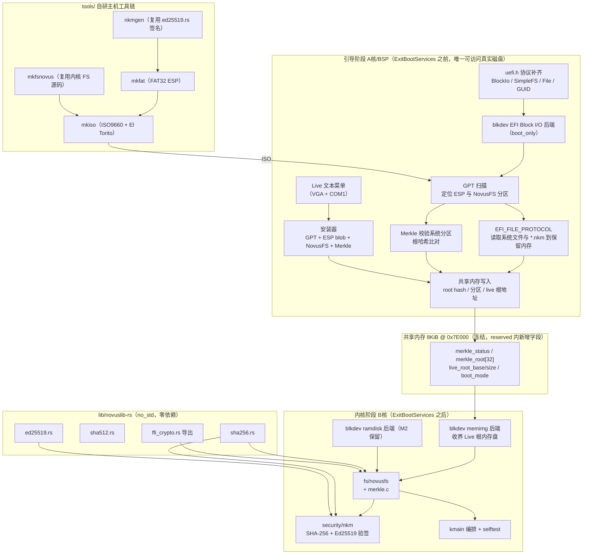

## 用户需求（原始）

"继续完成 M3 阶段，产物要有 iso 可执行的 live 系统，并且可以安装到系统。"

README 19.1 里程碑定义：**M3 = Merkle 树校验，NKM 模块加载基础框架**。

用户已确认的四项实现路径选择：

- ISO 生成：**自研主机端生成器**（`tools/` 下自研，直接产出 FAT32 与 ISO9660+El Torito 字节流，不依赖外部开源项目）
- NKM 密码学：**完整自研 + 主机签名工具**（自研 SHA-256/SHA-512/Ed25519；内核验签，主机端工具复用同一份自研代码生成测试模块）
- 安装器：**内核态安装器 + 主机写盘脚本**（两者都要）
- Live 交互：**把已实现的代码功能串起来可执行**（不等 M4 系统调用与 M12 shell）

## 产品概述

交付一个自研工具链产出的 **Novus OS M3 可启动 ISO Live 系统**：从 ISO 引导后进入文本菜单，可直接运行已实现的能力（NovusFS 自检、Merkle 完整性校验、NKM 模块验签加载、磁盘安装）；既能以 Live 方式运行（根文件系统驻留内存），也能把系统安装到真实/虚拟磁盘的 NovusFS 分区，并可从已安装磁盘再次启动并校验。

## 核心功能

1. **ISO Live 镜像**：自研工具生成 FAT32 ESP 与 ISO9660+El Torito 启动项，`make iso` 产出可引导 ISO，`make run-iso` 在 QEMU 以 `-cdrom` 启动。
2. **Merkle 树完整性校验**：按冻结规范建树与校验，根哈希写入超级块（双副本 + 版本计数器），引导阶段 A 核自检校验系统分区，篡改即告警并降级。
3. **NKM 模块加载基础框架**：头部解析 → 清零 hash/sig → SHA-256 比对 → Ed25519 多根公钥验签（支持密钥轮换）→ 注册模块表；未签名/篡改模块一律拒绝且不 panic。
4. **自研密码学**：SHA-256、SHA-512、Ed25519（Rust no_std 零外部依赖），内核侧验签，主机端签名工具复用同一份源码。
5. **安装器**：引导阶段把系统安装到目标磁盘（GPT + ESP + NovusFS 系统分区 + 建 Merkle + 写根哈希）；主机端 `make install` / `scripts/install.sh` 把预构建磁盘镜像写入设备或镜像文件。
6. **Live 交互**：VGA + COM1 文本菜单，串起已实现功能；支持 ESP 标记文件跳过菜单自动安装。
7. **自研工具链产出物可验证**：ISO 启动、安装后从磁盘启动、篡改一位即被 Merkle 检出、未签名 NKM 被拒绝。

## 技术栈选型

沿用项目现行技术栈，不引入任何外部库：

- 内核/引导：freestanding C（x86_64-w64-mingw32-gcc，PE32+ UEFI 应用，`-ffreestanding -fno-builtin -mno-red-zone -mcmodel=small -fshort-wchar`）
- 纯计算模块：Rust `no_std` + `panic=abort` + **零依赖**（`lib/novuslib-rs`，构建目标 `x86_64-pc-windows-msvc` 产出 COFF 供 mingw PE 链接），通过 C ABI FFI 边界交互
- 主机工具链：主机 gcc（生成 FAT32/ISO9660 镜像）；主机 cargo（NKM 签名工具，复用内核 crypto 源码）
- 验证：QEMU + OVMF（`scripts/run.sh` 已有）

## 实现方案

### 决定性约束（已核实，决定架构）

1. **内核阶段运行在 ExitBootServices 之后，EFI Block I/O / SimpleFileSystem 全部失效。** 因此所有真实磁盘 I/O 必须发生在**引导阶段**（`arch/x86_64/boot/main.c` 的 `efi_main`，EBS 之前）。这与 README 2.2 完全一致：A 核（BSP）负责"读取 NovusFS 超级块、Merkle 树校验系统分区"。结果经共享内存传给内核阶段。
2. `arch/x86_64/include/uefi.h` 目前只有 `EFI_GUID`、`LocateHandleBuffer`、`OpenProtocol` 骨架，**没有** `EFI_BLOCK_IO_PROTOCOL`/`EFI_BLOCK_IO_MEDIA`/`EFI_SIMPLE_FILE_SYSTEM_PROTOCOL`/`EFI_FILE_PROTOCOL` 结构体，也**没有**任何协议 GUID 常量 → M3 必须补齐（字段布局须与 UEFI 规范逐字节一致）。
3. `kernel/blkdev` 是**单设备槽**（后注册覆盖前者）→ M3 需多设备（Live 根、系统分区、安装目标盘）。
4. `fs/novusfs/super.c::alloc_buffers()` 用 `kmalloc` → 引导阶段复用 FS 代码需可替换分配器。
5. `shared_mem.h` 布局冻结（8KiB @ 0x7E000，`_Static_assert` 钉死偏移）→ 新字段只能从 `reserved[7548]`（0x284 起）划出。
6. M2 已预留 `merkle_start/merkle_blocks`，但预留公式 `ceil(2*data_blocks/64)` **不足以容纳** M3 叶子范围（需覆盖 bitmap+inode 表+数据区）→ 必须修正预留公式。

### 关键设计决策

- **两阶段分工**：引导阶段（A 核）= 唯一能碰真实磁盘的地方，负责设备枚举、GPT 扫描、系统分区 Merkle 校验、从 ESP 读取系统文件与 NKM 模块到内存、执行安装；内核阶段（B 核）= 在内存块设备上运行 NovusFS、Merkle、NKM 验签与业务逻辑。共享内存传递结果。
- **Live 根文件系统**：引导阶段经 EFI `EFI_FILE_PROTOCOL`（固件自带 FAT 驱动，无需自研 FAT 解析器）把 ESP 上的系统文件读入保留内存页；内核用新增的 `memimg` 块设备后端直接"收养"这段内存作为根盘。等价于 initramfs 的 live 方案，避免为光盘写驱动。
- **安装目标盘写入**：同样在引导阶段经 `EFI_BLOCK_IO_PROTOCOL` 完成；FS 代码通过 **分配器钩子**（显式 setter，非 weak 符号，避免链接器语义风险）切到 `AllocatePool`。
- **Merkle 叶子范围**：`[free_bmap_start, total_blocks)`（块位图 + inode 表 + 数据区），天然排除 WAL 与 Merkle 自身；`tree_height = ceil(log2(leaf_count)) + 1`，奇数叶子**复制补齐**，节点 64B，每块 64 节点。根哈希在建树完成后写入超级块（双副本 + 版本计数器）。Live 写入会使根失效，由超级块 `merkle_valid` 标志表达，安装完成与 A 核自检时刷新。
- **NKM 验签消息定义**：Ed25519 签名覆盖**32 字节 SHA-256 摘要**（而非整段镜像），语义明确；哈希输入为"清零 hash[32] 与 sig[64] 后的模块全部字节"，严格遵循 README 5 的修正规则。
- **主机 `mkfsnovus` 零重复实现**：直接把 `fs/novusfs/*.c` 编进主机程序，配合 `-Dmemcpy=novus_memcpy -Dmemset=novus_memset` 重映射避免与 libc 冲突，提供主机版 `kmalloc/kfree/kputs/blkdev`（文件后端）。这样主机生成的 NovusFS 镜像与内核实现**不可能产生格式分歧**。
- **不 panic 原则**：Merkle 校验失败、NKM 验签失败、磁盘不可读一律降级告警（README 17 / 3.4），仅"系统分区根哈希不匹配且处于 Full 模式"按 README 18 停止启动。

### 性能与可靠性

- Merkle 校验是全分区线性扫描：单次 SHA-256 per 4KiB 块 + 逐层上卷。系统分区按 8–16 MiB 规划，校验耗时在百毫秒量级；树本身一次建好、块内 64 节点连续存放，校验时按块顺序读，避免随机 I/O。
- 引导阶段读取限制在 ESP 上少量小文件，不做大块缓冲；内存预算（保留页 + FS 4 个 4KiB 缓冲）在 2GiB 最低内存下无压力。
- NKM 验签在加载时一次性完成（Ed25519 双标量乘约数十万次字段运算），仅对少量模块执行，不做热路径。
- 安装前必须确认目标盘且默认为**显式菜单确认**或**标记文件**触发，绝不自动覆盖非目标盘。

### 避免技术债

- 复用既有模式：`blkdev` 后端只需实现 `blk_read_fn/blk_write_fn` 两个钩子；FS 走 `novusfs_read_block/write_block`；日志统一 `kputs`；配置走 Kconfig/defconfig + `-DCONFIG_NOVUS_*`。
- 不提前实现 M4 调度器、M5 图形、M12 shell；Live 菜单是引导阶段文本菜单，不是 shell。
- 目录遵循 README 16.2：`security/` 放 NKM 签名校验，`fs/novusfs/` 放 Merkle，`tools/` 新增主机工具。

## 执行要点（防回归）

- **uefi.h 的 `EFI_BLOCK_IO_PROTOCOL`/`EFI_BLOCK_IO_MEDIA` 字段顺序与大小必须逐字节对齐 UEFI 规范**；写错会导致读到垃圾容量。上线前用"读 LBA0 应见保护性 MBR / 读 LBA1 应见 `EFI PART`"做冒烟断言。
- **`blkdev` 从单槽改为多设备表时保留 `blkdev_get()` 返回首个设备的语义**，M2 的 `novusfs_selftest` 才不会回归；新代码用 `blkdev_get_by_name("ramdisk"/"memimg"/"uefi0")`。
- **修正 `merkle_reserve_blocks()`**：`leaf_count = total_blocks - free_bmap_start`，`merkle_blocks = ceil(2*leaf_count/64)`；M2 的旧公式会让 M3 树越界。
- **升级 `NOVUSFS_VERSION` 到 M3 版本**并在超级块新增字段时保持 `checksum` 仍是结构体最后一个字段（CRC-32 覆盖其前所有字节），否则 M2 的 `super_crc` 逻辑失效。
- **共享内存新增字段从 `reserved[7548]` 划出**，并为新偏移补 `_Static_assert`，保证 2.3 冻结布局不破。
- **引导阶段专用后端必须防止 EBS 后被调用**：`uefi` 后端在 `blkdev` 中标记 `boot_only`，EBS 前统一 `blkdev_detach_boot_only()` 把所有 EFI 设备摘除，避免悬垂函数指针。
- **Live 根保留页必须不被 PMM 回收**：以 `EfiReservedMemoryType` 分配并在内核侧断言该区间不在 PMM 空闲范围内。
- 日志节制：Merkle/NKM 只打印阶段结论与最终根哈希前 8 字节，不逐块刷屏。

## 架构设计



## 目录结构

```
novus-os/
├── arch/x86_64/
│   ├── include/uefi.h                  # [MODIFY] 新增 EFI_BLOCK_IO_PROTOCOL、EFI_BLOCK_IO_MEDIA、
│   │                                   #          EFI_SIMPLE_FILE_SYSTEM_PROTOCOL、EFI_FILE_PROTOCOL、
│   │                                   #          EFI_FILE_INFO 与 BlockIo/SimpleFs/FileInfo/LoadedImage/
│   │                                   #          DevicePath GUID 常量；字段布局须与 UEFI 规范逐字节一致
│   └── boot/main.c                     # [MODIFY] 引导阶段编排：设备枚举 → GPT 扫描 → 分区定位 →
│                                       #          Merkle 自检 → ESP 文件装载 → Live 菜单 → 安装器 →
│                                       #          共享内存写入 → EBS 前摘除 boot_only 设备
├── kernel/
│   ├── blkdev.h                        # [MODIFY] 单槽改多设备表（BLKDEV_MAX_DEVICES）；保留 blkdev_get()
│   │                                   #          语义；新增 blkdev_register 返回索引、blkdev_get_by_name、
│   │                                   #          blkdev_detach_boot_only；声明 uefi/memimg 后端
│   ├── blkdev.c                        # [MODIFY] 多设备表实现 + blkdev_uefi_init（EFI Block I/O，boot_only）
│   │                                   #          + blkdev_memimg_init（收养保留页内存盘）
│   ├── gpt.h / gpt.c                   # [NEW]    GPT 头与分区项解析；定位 ESP 类型 GUID 与 NovusFS 类型 GUID
│   ├── shared_mem.h                    # [MODIFY] 从 reserved[7548] 划出 merkle_status/merkle_root[32]/
│   │                                   #          merkle_height/leaf_count、live_root_base/size、
│   │                                   #          boot_mode、install_target；新增偏移 _Static_assert
│   └── kmain.c                         # [MODIFY] 挂载 Live 根（memimg）替代/叠加 ramdisk；编排 Merkle 报告、
│                                       #          NKM 加载与 selftest；失败仅告警降级
├── fs/novusfs/
│   ├── novusfs.h                       # [MODIFY] NOVUSFS_VERSION 升 M3；超级块新增 merkle_root[32]、
│   │                                   #          merkle_height/leaf_count/merkle_valid；修正 Merkle 区预留
│   │                                   #          公式；新增分配器 setter 与 merkle API 声明
│   ├── super.c                         # [MODIFY] 预留公式修正（leaf_count=total_blocks-free_bmap_start）；
│   │                                   #          分配器钩子（默认 kmalloc，引导阶段切 AllocatePool）；
│   │                                   #          根哈希双副本+版本计数器写入与回滚
│   ├── merkle.c                        # [NEW]    建树/校验：叶子覆盖 [free_bmap_start,total_blocks)，
│   │                                   #          node_to_block、tree_height=ceil(log2(leaf))+1、奇数补齐、
│   │                                   #          根哈希写入与比对、单点篡改 selftest
│   └── novusfs.c                       # [MODIFY] selftest 扩展 Merkle 建树→校验→篡改→失败 四项
├── security/nkm/
│   ├── nkm.h                           # [NEW]    冻结 NKM 头部结构（魔数/版本/ABI/段数/段表/符号表/
│   │                                   #          重定位表/栈大小/compile_flag/hash[32]/sig[64]）与加载 API
│   └── nkm.c                           # [NEW]    加载流程：边界校验 → 清零 hash/sig → SHA-256 比对 →
│                                       #          Ed25519 多根公钥验签（轮换）→ 注册模块表；
│                                       #          拒绝未签名/篡改且不 panic；selftest 覆盖 4 种拒绝路径
├── lib/novuslib-rs/src/
│   ├── crypto/sha256.rs                # [NEW]    自研 SHA-256，纯 Rust no_std 零依赖
│   ├── crypto/sha512.rs                # [NEW]    自研 SHA-512（Ed25519 内部依赖）
│   ├── crypto/ed25519.rs               # [NEW]    自研 Ed25519 验签与签名（含字段运算、点解压、双标量乘）
│   ├── ffi_crypto.rs                   # [NEW]    #[no_mangle] extern "C" 导出
│   └── lib.rs                          # [MODIFY] 引入 crypto 与 ffi_crypto 模块
├── lib/novuslib_rs.h                   # [MODIFY] 新增 novus_rs_sha256/sha512/ed25519_verify 声明，与 Rust 同步
├── tools/
│   ├── mkfat/mkfat.c                   # [NEW]    自研 FAT32 ESP 镜像生成器（BPB/FAT/根目录/簇链），
│   │                                   #          写入 EFI/BOOT/BOOTX64.EFI、NOVUS/ 系统文件与 *.nkm
│   ├── mkiso/mkiso.c                   # [NEW]    自研 ISO9660（PVD/目录/路径表）+ El Torito 引导记录，
│   │                                   #          内嵌 esp.img 作为可启动镜像
│   ├── mkfsnovus/mkfsnovus.c           # [NEW]    复用 fs/novusfs/*.c（编译期 -D 重映射 memcpy/memset），
│   │                                   #          主机版 kmalloc/kputs + 文件后端 blkdev，产出 NovusFS 镜像与 Merkle
│   ├── nkmgen/                         # [NEW]    主机 cargo 工程，用 #[path] 复用 crypto/*.rs 做 Ed25519 签名，
│   │                                   #          产出测试用已签名 .nkm 模块
│   └── tools.mk                        # [NEW]    主机工具编译规则（由顶层 Makefile include）
├── scripts/
│   ├── run.sh                          # [MODIFY] 保留 ESP 目录模式；新增 -cdrom ISO 启动分支
│   ├── run-iso.sh                      # [NEW]    以 out/novus-live.iso + 可选目标盘启动 QEMU
│   └── install.sh                      # [NEW]    主机写盘：把 out/novus-disk.img 写入设备或镜像文件
├── Makefile                            # [MODIFY] SRC 增 gpt.c / merkle.c / security/nkm/nkm.c；
│                                       #          INC 增 -Isecurity/nkm；新增 tools/iso/install/run-iso 目标；
│                                       #          banner 增 merkle/nkm 配置
├── Kconfig                             # [MODIFY] 新增 CONFIG_NOVUS_MERKLE、CONFIG_NOVUS_NKM、CONFIG_NOVUS_INSTALLER
└── configs/novus_defconfig             # [MODIFY] 同步新增配置项（默认 y）
```

## 关键代码结构

```c
/* fs/novusfs/novusfs.h —— M3 超级块新增字段（checksum 仍为结构体最后一个字段） */
typedef struct NOVUSFS_PACKED novusfs_super {
  /* ... M2 冻结字段保持不变 ... */
  UINT64 wal_write_ptr;
  UINT64 wal_tail_ptr;
  UINT32 root_inode;
  UINT32 sb_version;
  /* ---- M3 新增：Merkle ---- */
  UINT8  merkle_root[32];    /* 根哈希（SHA-256） */
  UINT32 merkle_height;      /* ceil(log2(leaf_count)) + 1 */
  UINT32 merkle_leaf_count;  /* 叶子数 = total_blocks - free_bmap_start */
  UINT32 merkle_valid;       /* 1 = 根哈希与当前内容一致（写入后置 0） */
  UINT32 checksum;           /* 必须保持最后：CRC-32 覆盖其前所有字节 */
} novusfs_super_t;

/* Merkle 节点：固定 64 字节，每块 64 个节点；
   node_to_block(idx): 块 = merkle_start + idx/64，块内偏移 = (idx%64)*64 */
#define MERKLE_NODE_SIZE 64u
#define MERKLE_NODES_PER_BLOCK (NOVUSFS_BLOCK_SIZE / MERKLE_NODE_SIZE)
```

```c
/* security/nkm/nkm.h —— 冻结 NKM 头部（README 第5部分） */
#define NKM_MAGIC    0x004D4B4Eu   /* "NKM\0" */
#define NKM_HASH_LEN 32u
#define NKM_SIG_LEN  64u

typedef struct NOVUS_NKM_PACKED nkm_segment {
  UINT32 type; UINT64 vaddr; UINT64 file_off; UINT64 len; UINT32 flags;
} nkm_segment_t;

typedef struct NOVUS_NKM_PACKED nkm_header {
  UINT32 magic;
  UINT16 version;
  UINT16 abi_version;
  UINT32 seg_count;
  UINT64 seg_table_off;
  UINT64 symtab_off;  UINT64 symtab_len;
  UINT64 reloc_off;   UINT64 reloc_len;
  UINT64 stack_size;
  UINT32 compile_flag;
  UINT32 key_id;                 /* 多根公钥轮换：标识使用哪把根公钥 */
  UINT8  hash[NKM_HASH_LEN];     /* 校验前须置 0 */
  UINT8  sig[NKM_SIG_LEN];       /* 校验前须置 0 */
} nkm_header_t;

/* 加载结果：0 = 已加载；负值为拒绝原因（不 panic） */
int  nkm_load(const void *image, UINT64 len);
int  nkm_unload(UINTN slot);
UINTN nkm_loaded_count(void);
```

```c
/* kernel/shared_mem.h —— 从 reserved[7548]（0x284）划出的 M3 字段，冻结布局不变 */
typedef struct {
  /* ... M1 冻结字段 0x000..0x283 保持不变 ... */
  UINT8  log_buf[512];             /* 0x080 */
  volatile UINT32 log_head;        /* 0x280 */
  /* ---- M3：0x284 起，取自原 reserved ---- */
  UINT32 merkle_status;            /* 0x284: 0 未知 / 1 通过 / 2 不匹配 / 3 不可读 */
  UINT8  merkle_root[32];          /* 0x288: 校验得到的根哈希 */
  UINT32 merkle_height;            /* 0x2A8 */
  UINT32 merkle_leaf_count;        /* 0x2AC */
  UINT64 live_root_base;           /* 0x2B0: 引导阶段装载的 Live 根内存盘物理基址 */
  UINT64 live_root_size;           /* 0x2B8 */
  UINT32 boot_mode;                /* 0x2C0: 0 = Live / 1 = Install */
  UINT32 nkm_status;               /* 0x2C4 */
  UINT32 nkm_loaded;               /* 0x2C8 */
  UINT8  reserved[7388];           /* 0x2CC: 补足 8 KiB */
} shared_mem_t;
```

## 验证清单（端到端）

1. `make` 构建通过且无新增警告；`make iso` 产出 `out/novus-live.iso`。
2. `make run-iso` 从 ISO 启动，Live 菜单出现在 VGA 与 COM1。
3. 菜单项「Merkle 校验」对已安装/已装载系统分区返回 PASS。
4. 人为翻转系统分区一个字节 → 再次校验返回 MISMATCH 并按 README 18 降级（不 panic）。
5. NKM：签名模块加载 PASS；篡改一字节 → hash 不匹配被拒；换未授权密钥签名 → 验签被拒。
6. 菜单项「安装到磁盘」在第二块盘上完成安装；重启后从该盘启动，A 核自检 Merkle 通过。
7. `make install DEVICE=` 产出的磁盘镜像可被 QEMU 直接启动。
8. M2 既有 `novusfs_selftest` 与 WAL selftest 全部仍 PASS（防回归）。