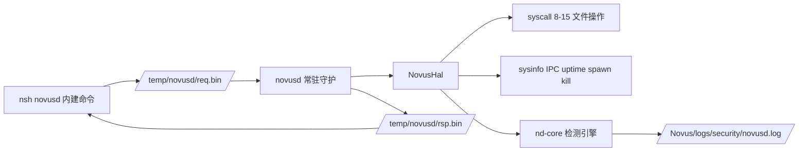

## 用户要求

把现有 `user/NovusDefender` 整体迁入 Novus OS 仓库，删除原目录，仓库中仅保留一份；将其作为内置 `novusd` 应用接入构建、启动与终端。

## 产品概述

`novusd` 在 Novus OS 后台常驻，提供签名检测、按需扫描、隔离、增量更新、定时扫描与轮询监控；命令结果通过 nsh 回显，并写入安全日志。

## 核心功能

- 支持 `status`、`selftest`、`scan <path> [--quarantine]`、`quarantine list|restore|delete`、`update <pkg>`、`schedule <path> <ms>`、`monitor [ms]`、`sandbox <app>`。
- 因内核只支持按名字启动应用、没有 argv，采用 `/temp/novusd` 下的请求/响应文件传参，并在 nsh 增加 `novusd` 内建命令包装。
- 签名库、隔离区与日志落到 Novus 已有目录：`/ProgramData/Security`、`/Novus/logs/security`；不沿用 Linux 的 `/var` 路径。
- 平台无文件事件、系统调用审计和通用强制沙盒：`monitor` 用固定容量目录元数据快照合成事件，`schedule` 用 sysinfo uptime（10 ms/tick），`sandbox`/进程控制实现 spawn/kill 子集并在 `status` 中明示降级能力。

## Tech Stack Selection

- 沿用现有栈：C11 检测热路径 + `no_std` 无分配器 Rust 用户程序，目标 `x86_64-unknown-none`，顶层 GNU Make + mingw 交叉链接生成最终镜像。
- 复用 `apps/src/{sys,fs,ipc,sinfo}.rs` 作为 syscall/IPC ABI 的唯一来源；`novusd` 不重复实现底层 wrappers。
- 使用现有 `apps/link.ld` 与 `-C link-arg=...` 风格的 `.cargo/config.toml`，而不是 NovusDefender 原骨架里的无效裸 rustflags。

## Implementation Approach

整体迁移 `user/NovusDefender` 到 `user/novusd`，保留其 workspace、C 核心、宿主 Linux 测试与文档，避免把 `ipc.rs`/`fs.rs` 平铺进 `apps/src` 造成同名冲突。`nd-platform-novus` 通过 path dependency 依赖 `../../../../apps` 的 lib target，复用 syscall wrappers 和 `apps/src/lib.rs` 的 panic handler；`novusd` bin 删除自己的 `#[panic_handler]`。这让 ABI 修正集中在一处，代价是 novusd 构建依赖 apps crate，但 apps 不反向依赖 novusd，无循环。

命令传递采用 256 字节请求记录与约 2 KiB 响应记录，写入 `/temp/novusd/req.bin` 与 `/temp/novusd/rsp.bin`。nsh 的 `novusd` 内建命令写入请求、`sinfo::spawn_name("novusd")`（已运行时返回 `APPS_ERUNNING` 也视为成功），再轮询响应并打印。守护进程启动时建立目录、加载或内置 EICAR 签名库，然后每 10 ms 处理新序号请求；`monitor`/`schedule` 作为守护进程内部状态机继续运行，避免重复 spawn。

关键取舍：

- 独立 workspace + 单独 cargo/objcopy 规则：保留上游测试与设计文档，避免污染 apps 的 bin 列表；需要在顶层 Makefile 增加依赖追踪。
- 文件式命令通道：不改内核 spawn ABI、不需要 argv；限制是同一时刻一个请求、响应上限约 2 KiB、完整报告另写日志。
- 能力降级而非虚构 syscall：文件事件用目录快照差值，时钟用 `REQ_STATS`，沙盒用「策略记录 + spawn/kill + 超时」协作式子集；`status` 明确返回 CAP 位与降级原因。

## Performance & Reliability

- 扫描热路径仍由 C Aho-Corasick 与 `FixedBuf<const N>` 承担，无堆分配；目录深度 8、报告 64、单次结果 8、签名库 16 KiB 等上限保持不变，Novus target 下 AC 表降到 512。
- 文件读写按内核 `FS_IO_MAX=4096` 分块；响应记录控制在 2 KiB 内，避免单次 syscall 超限；长输出写入 `/Novus/logs/security/novusd.log`。
- 守护循环 10 ms 轮询一次请求，uptime 查询与事件快照也按该节奏合并，避免高频 IPC；监控快照固定容量，不随文件数增长。
- 镜像预算 128 KiB：release 配置沿用 `opt-level="s"`、`lto=true`、`strip=true`；超限时优先缩减 Novus 侧 AC 表与可选启发式，不裁剪核心扫描。

## Implementation Notes

- 不要触碰工作区已有无关修改：`kernel/con.c`、`kernel/con.h`、`qtest.sh`、`scripts/*.sh`、`tools/wpgen/wpgen.py` 及 `apps/target/...` 二进制。
- HAL 必须遵守已核实 ABI：fd 基数为 3（`fd < 3` 才是失败）；路径非空、长度小于 255 且无内嵌 NUL；`readdir` 仅 `1` 表示有条目、`0` 表示结束；`RawDirEntry` 名称最多 57 字节。
- `ipc::lookup` 必须传 NUL 结尾的 `b"sys\0"`；`spawn_name` 需使用 `F_SYNC` 并等待 `RSP_OK`；uptime 来自 `REQ_STATS/RSP_STATS`，换算为 `ticks * 10` 毫秒。
- `APPS_NAMES` 与 `kernel/apps.c` 的 `g_apps[]` 只能在末尾追加 `novusd`；表下标是 spawn ID，有 ABI 含义。`KNOWN_APPS` 同样追加名字。
- `nd-core/build.rs` 的 clang/rust-ar 需增加 `CC`/`AR` 环境变量回退（如 `cc`/`ar`）；WSL 构建前确认 `/home/dev/.rustup` 工具链在 PATH 中。
- 日志只经 syscall 2 与固定安全日志文件，避免转储样本内容；错误码保持原有负值约定，便于 nsh 统一打印。

## Architecture Design



## Directory Structure

```text
user/NovusDefender/                              # [REMOVED] 整体移动到 user/novusd 后删除
user/novusd/                                     # [NEW/MOVED] 合并后的唯一副本
├── Cargo.toml                                   # [MODIFY] workspace 说明改为 in-tree；成员保持 nd-core/api/platform-novus/linux/cli/tests
├── Makefile                                     # [MODIFY] novus-app 改为 cd 到本目录并 objcopy；补 size-check 与宿主测试路径
├── README.md                                    # [MODIFY] 标注已并入 Novus OS，更新产物与命令入口
├── docs/NOVUS_PORTING.md                        # [MODIFY] 从“迁移建议”改为“已合并结构”与能力边界说明
├── .cargo/config.toml                           # [MODIFY] 使用 -C link-arg=-Tlink.ld 与 -C link-arg=-nostdlib
├── link.ld                                      # [MODIFY] 同步 apps/link.ld，确保 KEEP(*(.text._start))
├── c/core/                                      # [MOVED] 保留 C 检测热路径与头文件
├── rust/nd-core/Cargo.toml                      # [MODIFY] 保持 novus feature，供路径常量条件编译
├── rust/nd-core/build.rs                        # [MODIFY] 增加 CC/AR 回退与清晰错误信息
├── rust/nd-core/src/update.rs                   # [MODIFY] novus feature 下改 DB/TMP/BACKUP 路径为 /ProgramData/Security/NovusDefender
├── rust/nd-core/src/quarantine.rs               # [MODIFY] novus feature 下 QDIR 改为 /ProgramData/Security/NovusDefender/quarantine
├── rust/nd-platform-api/src/lib.rs              # [MODIFY] 固定 DirEntry 拷贝上限为 57，并补充降级能力常量说明
├── rust/nd-platform-novus/Cargo.toml            # [MODIFY] 增加 novus-apps path dependency 与 app feature 依赖
├── rust/nd-platform-novus/src/lib.rs            # [MODIFY] 重写 NovusHal：FS/IPC/timer/log 复用 apps runtime
├── rust/nd-platform-novus/src/fs.rs             # [MODIFY] 修正 fd、路径、readdir 返回值与 57 字节名称 ABI
├── rust/nd-platform-novus/src/ipc.rs            # [MODIFY] NUL 名称查找、同步 spawn、uptime 查询
├── rust/nd-platform-novus/src/events.rs         # [MODIFY] 固定容量目录快照差分，合成 RawEvent
├── rust/nd-platform-novus/src/sandbox.rs        # [MODIFY] 策略记录、spawn/kill 协作式执行
├── rust/nd-platform-novus/src/app.rs            # [MODIFY] 守护循环与命令状态机（selftest/scan/quarantine/update/monitor/schedule/sandbox/status）
├── rust/nd-platform-novus/src/bin/novusd.rs     # [MODIFY] 真正入口；删除 panic_handler，复用 apps 的 panic 与 exit(3)
├── rust/nd-cli/ rust/nd-platform-linux/         # [MOVED] 保留宿主 Linux 参考实现与回归测试
├── rust/nd-tests/ tests/ schemas/ scripts/      # [MOVED] 保留 e2e 与协议测试，路径适配 user/novusd
apps/src/lib.rs                                  # [MODIFY] 注册 pub mod novusd_proto
apps/src/novusd_proto.rs                         # [NEW] 请求/响应 magic、序号、标志、定长结构与 /temp/novusd 路径常量
apps/src/shell/cmds.rs                           # [MODIFY] KNOWN_APPS 增加 novusd；新增 cmd_novusd 写请求、spawn、等待并打印响应
apps/src/bin/settings.rs                         # [MODIFY] 可选：在应用列表加入 novusd 快捷启动项
kernel/apps.c                                    # [MODIFY] g_apps[] 末尾追加 {"novusd", k_app_novusd, &k_app_novusd_len}
Makefile                                         # [MODIFY] APPS_NAMES 末尾追加 novusd；APPS_DEPS 加入 user/novusd 源；新增 novusd ELF->bin 与 size-check 规则
docs/NovusDefender 内置应用.md                    # [NEW] 命令用法、请求协议、能力降级矩阵与故障排查
README.md                                        # [MODIFY] 顶层 README 增加内置 novusd 应用说明
scripts/test-novusd.sh                           # [NEW] 按现有 qtest.sh 风格启动 QEMU，nsh 执行 status/selftest/scan/quarantine 冒烟
```

## Key Code Structures

```rust
#[repr(C)]
pub struct NdRequest {
    pub magic: [u8; 8],
    pub seq: u32,
    pub flags: u16,
    pub len: u16,
    pub args: [u8; 240],
}

#[repr(C)]
pub struct NdResponse {
    pub magic: [u8; 8],
    pub seq: u32,
    pub code: i32,
    pub len: u16,
    pub out: [u8; 2048],
}
```

`flags` bit0 = detach（monitor/schedule 立即返回）；请求记录 256 字节，响应记录 2066 字节，均小于内核 4096 字节 I/O 上限。

## Agent Extensions

### SubAgent

- **code-explorer**
- Purpose: 在移动前后复核 `user/NovusDefender` 的全部引用、构建依赖、panic handler 与 FS/IPC ABI 调用点，确认没有遗漏路径或重复定义。
- Expected outcome: 输出受影响文件清单、冲突检查结果和 app 表追加位置确认，作为移动与集成的验收依据。