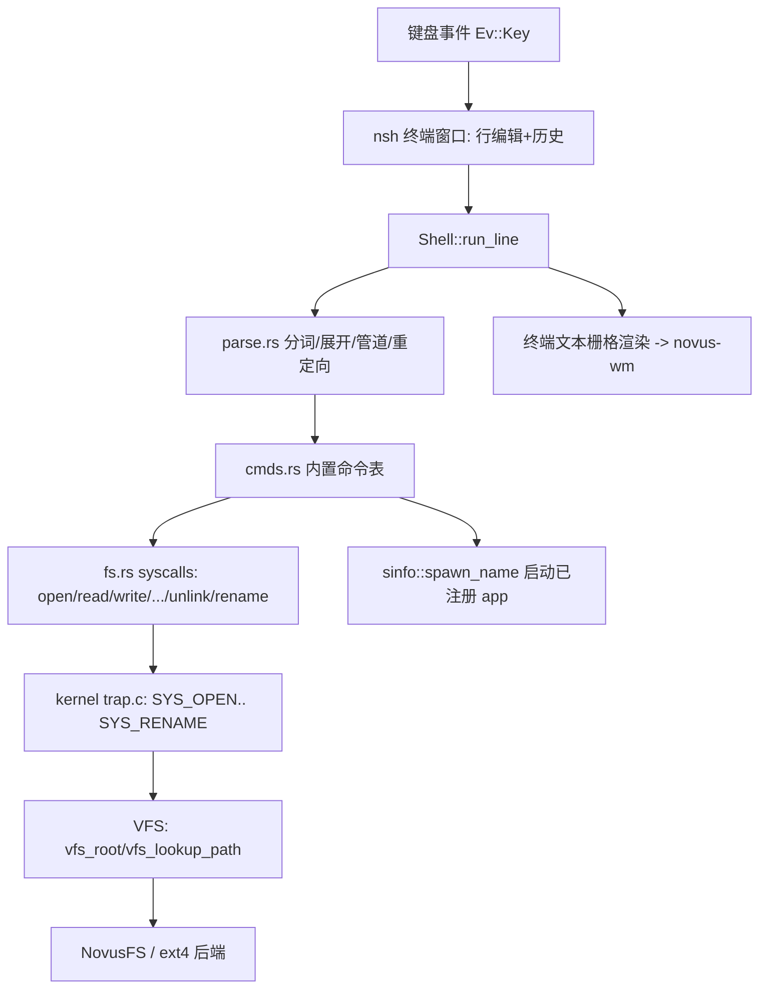

## 用户需求概述

为 Novus OS 实现一套严格对齐 Linux/POSIX 的交互式终端 shell（默认名 `nsh`），与已有的 Windows 风格 GUI 解耦。终端永远使用单根 `/` 路径、POSIX 语义；cmd 兼容别名（dir/copy/del 等）改为默认关闭的可选附加包。

## 核心功能（第一阶段基座）

- 内核新增两个文件系统 syscall：`unlink`（删除文件/空目录）与 `rename`（移动/重命名），供 `rm`/`mv` 使用；无 truncate，重定向 `>` 用「删除+重建」实现截断。
- 用户态 shell 引擎（Rust no_std、无分配器）：POSIX 路径规范化（相对路径基于 cwd、处理 `.`/`..`、`~/` 展开）、词法分析与展开（引号、`| > >> < ; && ||`、`$VAR`、`$(...)`、glob `*`/`?`）。
- 内置命令：`ls(-l/-a/-h)`、`cd`、`pwd`、`cat`、`mkdir(-p)`、`rmdir`、`rm(-r/-f)`、`cp(-r)`、`mv`、`stat`、`echo`、`env`、`export`、`unset`、`clear`、`help`、`history`、`true`、`false`、`whoami`、`which`、`touch`、`wc`、`head`/`tail`、`tree`、`alias`、`drives`（可选）。
- 终端窗口应用 `nsh`：文本栅格渲染（约 80 列 × 24 行）、键盘输入（含 Ctrl 修饰键）、彩色提示符、滚动缓冲。
- 桌面集成：开始菜单/桌面磁贴/任务栏新增「终端」入口与终端图标。
- 外部命令：找不到内置时尝试以已注册 app 名经 `sinfo::spawn_name` 启动，否则报 `command not found`。

## 边界约束

- 终端只认真实 `/` 路径，绝不识别盘符/`vol:` 友好名；GUI 注入语义与内核、终端互不污染。
- 第一阶段不支持真正并发管道（无 fork/exec），`|` 与 `$(...)` 采用顺序捕获，需在文档注明。
- cmd 别名包默认关闭，开关持久化（OOBE）留待后续阶段。

## 技术栈选择

- 内核：C（既有 `kernel/trap.c`、`fs/vfs.*`、`fs/novusfs/*`、`fs/ext4/*`），沿用现有 syscall 表与 VFS 抽象，不引入新依赖。
- 用户态：Rust（`apps/` 包），`no_std`、无全局分配器、目标 `x86_64-unknown-none`；复用 `sys.rs`/`fs.rs`/`wm.rs`/`ipc.rs`/`sinfo.rs`/`ui.rs` 既有 API 与无分配器字符串模式（固定 `[u8; N]` 缓冲，参考 `ui::Buf`）。
- GUI：沿用自研 Novus graphics（`nd_core` 文本栅格 + `nvgui` 控件 + `novus-wm` 文本协议），颜色沿用 `ui.rs` 主题令牌。

## 实现方案

### 总体策略

分两层：内核补齐文件系统能力（unlink/rename），用户态在既有无分配器运行时上新增一个 `shell` 模块与一个 `nsh` 二进制。所有行内缓冲、历史、环境变量均用固定大小数组，避免任何堆分配。

### 关键决策与权衡

1. **unlink/rename 由内核 VFS 统一提供**：`vfs_unlink_path` 把路径拆成父目录+叶子，先 `stat` 判断类型，目录需先确认为空再删；`vfs_rename_path` 拆源/目标为（目录,名）后调用后端 `rename`。
2. **NovusFS rename 拆分多事务**：`fs/novusfs/dir.c` 的 WAL 注释明确「单事务内同一数据块只记录一次」。若在同一事务里对一个目录块既 `dir_add` 又 `dir_remove` 会丢记录，因此 `novusfs_rename` 拆为：①（若目标已存在）单独事务删除目标；②事务添加新名并提交；③事务删除旧名并提交。崩溃在两步之间只会造成文件短暂双名（可恢复），不会丢失数据。
3. **ext4 暂不支持 rename**：`vfs_rename_path` 遇后端 `rename==NULL` 返回 -1，由 shell 报「文件系统不支持」。
4. **无分配器下的管道**：没有 fork/exec，第一阶段 `|` 与 `$(...)` 用「左命令完整输出进固定缓冲，再作为 stdin 喂右命令」的顺序捕获实现；在 help/文档注明并发限制，后续随进程模型增强。
5. **重定向 `>` 截断**：复用新 `unlink` + `open(O_CREAT)`，无需新增 truncate syscall。
6. **键盘修饰键**：`wm.rs` 的 `Ev::Key(u32)` 当前丢弃 `mods`；改为 `Ev::Key(u32,u8)` 并同步 `session.rs`/`setup.rs`/`fileman.rs` 三处匹配，使终端能识别 Ctrl+C/Ctrl+U 等。

### 性能与可靠性

- 文本栅格逐可见行只发一条 WM 文本（≤96 字节），24 行远低于每帧 48 文本上限；`clear()`+`invalidate()` 一次性重绘，避免逐字符重绘。
- 滚动缓冲用环形定长数组，无动态增长；行缓冲上限 96 字节，超出截断并在末尾标记。
- 内核路径解析原地拆分，零分配；`mkdir -p`、glob 用 `readdir` 枚举，O(条目数)。
- 新增 syscall 沿用既有 `user_path` 拷贝与 `session_logged_in` 校验，保持安全边界。

### 避免技术债

- 内核 syscall 号（20/21）续接既有表，`g_syscalls[]` 同步登记；app 表在 `kernel/apps.c` 末尾追加 `nsh`，不移动现有索引。
- 复用既有 `apps/src/fs.rs`、`ui.rs` 颜色令牌与 `sinfo::spawn_name`，不重复造轮子。

## 实现要点

- `apps/src/fs.rs`：新增 `pub fn unlink(path)->bool`、`pub fn rename(from,to)->bool`，调用号 20/21。
- `apps/src/shell/path.rs`：实现 `normalize(cwd, input)->[u8;256]`，处理 `.`/`..`（词法折叠，因 VFS 无 `..` 条目）、绝对/相对、`~/`→`/`。
- `apps/src/shell/parse.rs`：词法状态机产出 token 流 + 重定向/管道描述符；支持单/双引号、转义、`$VAR`、`$(...)`（递归调用 `Shell::run_to` 捕获）、glob。
- `apps/src/shell/mod.rs`：`Shell{cwd, vars[32], history[64], cmd_aliases:bool, last_status}`；`run_line(&mut self, line, &mut Sink)` 驱动解析→执行；`Sink` trait（`put(&mut self,&str)`）便于终端与捕获缓冲复用。
- `apps/src/shell/cmds.rs`：内置命令表（命令名→函数指针），cmd 别名包在 `cmd_aliases` 为真时额外注册 `dir/copy/del/type/move`。

## 架构设计



## 目录结构

```
kernel/
  trap.c            # [MODIFY] 新增 SYS_UNLINK=20/SYS_RENAME=21 及 handler，登记 g_syscalls[]
  apps.c            # [MODIFY] g_apps[] 末尾追加 {"nsh", k_app_nsh, &k_app_nsh_len}
fs/
  vfs.h            # [MODIFY] vfs_fs_t 增加 rename 字段；声明 vfs_unlink_path/vfs_rename_path
  vfs.c            # [MODIFY] 实现 vfs_unlink_path/vfs_rename_path，nv_fill 接入 nv_rename
  novusfs/
    novusfs.h      # [MODIFY] 声明 novusfs_rename
    novusfs.c      # [MODIFY] 实现 novusfs_rename（多事务，规避 WAL 单块约束）
apps/
  Cargo.toml       # [MODIFY] 新增 [[bin]] nsh = src/bin/nsh.rs
  src/
    lib.rs         # [MODIFY] 新增 pub mod shell;
    fs.rs          # [MODIFY] 新增 unlink/rename 封装
    wm.rs          # [MODIFY] Ev::Key 改为携带 mods(u8)，并同步其它匹配
    shell/
      mod.rs       # [NEW] Shell 状态机、run_line、Sink trait、cmd_aliases 开关
      path.rs      # [NEW] POSIX 路径规范化（cwd/. ./.. ~/）
      parse.rs     # [NEW] 分词、引号、| > >> < ; && ||、$VAR、$(...)、glob
      cmds.rs      # [NEW] 内置命令实现与命令表（含可选 cmd 别名包）
    bin/
      nsh.rs       # [NEW] 终端窗口：文本栅格、键盘编辑、提示符、滚动缓冲
    bin/session.rs # [MODIFY] 同步 Ev::Key(u32,u8) 匹配
    bin/setup.rs   # [MODIFY] 同步 Ev::Key(u32,u8) 匹配
    bin/fileman.rs # [MODIFY] 同步 Ev::Key(u32,u8) 匹配
graphics/
  nd_demo.c        # [MODIFY] 开始菜单/桌面磁贴/任务栏新增「终端」入口 + on_launch_terminal
  nvgui.c          # [MODIFY] ng_icon_kind_t 新增 NG_ICON_TERM，icon_glyph 增加分支
Makefile           # [MODIFY] APPS_NAMES 追加 nsh
docs/
  终端与命令解释器设计.md   # [NEW] 架构边界、命令清单、限制与路线图
```

## 关键代码结构

```rust
// apps/src/shell/mod.rs（节选）
pub trait Sink {
    fn put(&mut self, s: &str);
    fn put_byte(&mut self, b: u8);
}
pub struct Shell {
    pub cwd: [u8; 256],
    pub vars: [( [u8; 16], [u8; 64] ); 32],
    pub history: [[u8; 128]; 64],
    pub cmd_aliases: bool,
    pub last_status: i32,
}
impl Shell {
    pub fn run_line(&mut self, line: &str, out: &mut dyn Sink) -> i32;
    pub fn run_to(&mut self, line: &str, out: &mut dyn Sink); // 供 $() 捕获复用
}
```

## 设计风格

终端为全新 UI，但严格复用 Novus 现有 Fluent 主题令牌（`ui.rs` 的 `bg()/canvas()/text()/dim()/accent()`）与 `nd_core` 文本栅格，不引入新视觉体系，保证与桌面外壳一致。终端窗口本体采用深色「代码编辑器」面板：近黑背景、浅灰等宽文本、accent 色提示符与命令回显高亮，关闭圆角卡片感、强调可读性。

## 布局（单窗口，自上而下）

1. 标题栏：由 novus-wm 统一绘制，标题「终端」+ 终端图标；最小化/最大化/关闭在右侧（Windows 范式）。
2. 文本主体：80 列 × 24 行的等宽栅格（scale=2，字宽 12px、行高 16px），左上起排；自动滚动到末行；行尾超出 96 字节截断。
3. 提示符行：`<accent>user@novus</accent>:<path> $ `，路径用 dim 色，命令输入随键入实时出现在提示符后。
4. 选中/状态：Ctrl+C 中断当前行（清空输入），无 GUI 选区。

## 交互动效

- 键盘即时回显、退格/左右光标移动、上下历史回溯（实时刷新提示符区域，重绘单行）。
- 窗口聚焦时提示符 accent 色加亮；失焦变 dim，符合桌面一致性。
- 不添加额外装饰动画，维持终端的「冷静、高效」气质。