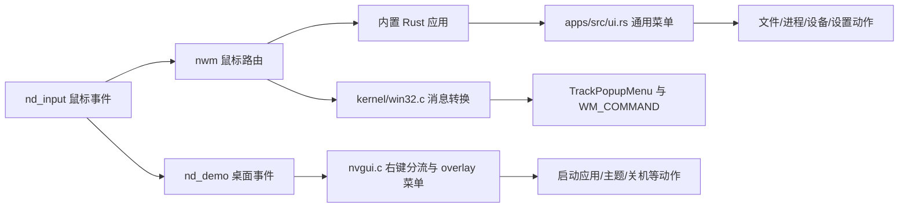

## Product Overview

为 Novus OS 补齐右键上下文菜单能力，使桌面、开始菜单、任务栏、全部内置应用以及 Win32 兼容层都能正确响应鼠标右键。右键事件必须不再被误判为左键，菜单应以符合当前主题的小型浮层展示，并把每个菜单项落到已有或明确补充的真实操作上。

## Core Features

- 通用右键菜单：统一的弹出定位、边界收拢、命中测试、禁用态、悬停高亮、Esc/外部点击关闭。
- 桌面与 Shell：桌面空白处、开始菜单项、任务栏图标、状态区图标支持右键菜单；右键不再触发左键动作或窗口拖动。
- 文件管理器：文件/目录右键支持打开或运行、属性、重命名、删除、刷新；空白和导航区右键支持新建文件夹、刷新、返回上级等，不支持的文件系统操作需禁用或给出状态说明。
- 任务管理器与设备管理器：进程树右键支持结束任务、刷新、排序或属性；设备树右键兑现文档中的“属性”入口。
- 其他内置 GUI：设置、安装程序、网络管理、会话窗口、终端均提供与其现有动作对应的右键菜单，避免只忽略右键。
- Win32 兼容层：补 `WM_RBUTTONDOWN/UP` 消息映射与 `TrackPopupMenu`，右键菜单项可产生 `WM_COMMAND`，并兼容常用对齐标志。
- 验证与文档：补自检/示例覆盖，更新与右键行为不一致的文档说明。

## Tech Stack Selection

- 沿用现有 freestanding UEFI + C 内核 + Novus-WM 架构，不新增系统级框架。
- 内置应用继续使用 Rust `no_std`、无分配器、目标 `x86_64-unknown-none`。
- 桌面 Shell 继续使用 `graphics/nvgui.c` 的控件池、`NG_WF_OVERLAY` 浮层与主题令牌。
- Win32 兼容层继续在 `kernel/win32.c` 内以固定容量表和层内状态实现菜单，不引入独立窗口。
- 构建继续使用顶层 `Makefile`；WSL 中需带 `/home/dev/.rustup` 与 `/home/dev/.cargo` 的 Rust 工具链环境。

## Implementation Approach

整体策略是“底层已通不动协议，上层补组件并分应用接入”。`nd_input.c` 已产生带 `button` 的鼠标事件，`nwm.c` 已原样转发，因此不修改输入与 WM 协议；先在 Rust 与 C GUI 两侧建立通用右键菜单能力，再逐应用接入动作，最后补 Win32 消息与 API。

关键决策：

- Rust 侧在 `ui.rs` 扩展固定容量菜单组件，而不是新建动态 UI 框架。原因是应用已统一使用 `ui` 调色板、`Buf`、`width()`、`round_fill()`、`round_frame()` 和 `text()`，且无分配器；固定数组最契合现有约束。
- 菜单只保留显示与命中逻辑，业务动作由各应用传入固定动作码处理。这样避免闭包、trait 对象和跨应用耦合，符合 DRY/SoC。
- 桌面侧在 `nvgui.c` 增加一个可复用的 overlay 上下文菜单控件，而不是为每个菜单项创建控件。原因是 `NG_POOL_SIZE` 有限，单菜单控件加固定项表可以控制资源占用。
- `nvgui.c` 必须先按 `ev->button` 分流：左键继续驱动按钮、列表、拖动；右键只用于打开/关闭菜单。否则任何上层菜单都会被现有左键逻辑抢先触发。
- Win32 侧把现有菜单栏弹层逻辑抽象为“按矩形布局的菜单弹出层”，再让菜单栏下拉和 `TrackPopupMenu` 共用绘制/命中代码，避免复制状态机。
- 文件写操作受现有 syscall 限制约束：`rename/unlink` 仅在 NovusFS 根可靠支持，非空目录不可直接删除；菜单项需按当前路径、文件类型和返回值禁用或显示明确状态。

性能与可靠性：

- 菜单项上限建议 8 项，单次绘制与命中复杂度都是 `O(m)`，`m ≤ 8`，无热路径分配。
- Rust 应用维持 WM 的 40-shape / 48-text 绘制预算；菜单绘制在基础界面之后，只有可见菜单参与额外绘制。
- 桌面菜单复用一个 overlay 控件，避免每次右键都创建/销毁控件导致控件池碎片。
- 所有破坏性动作保留现有保护：任务管理器不结束自身/系统任务；删除、重命名失败时写状态栏而不是静默失败。
- Win32 侧继续用 `read_user_str()` 读取用户字符串，校验 hwnd/menu/item 索引，非法参数返回既有错误语义。

### Architecture Design



## Implementation Notes

- 不修改 `graphics/nd_input.c` 与 `wm/novus-wm/nwm.c` 的事件协议；只消费已有的 `button` 字段。
- 在 `apps/src/wm.rs` 增加左/右/中键常量，统一替代散落的 `button == 1`，避免魔法数字。
- 所有 Rust 应用采用统一事件顺序：右键按下先交给菜单；若菜单可见则优先命中菜单项；右键按下不执行左键路径；Esc 关闭菜单。
- 菜单坐标需相对应用窗口进行边界收拢，避免超出窗口客户区；桌面菜单需限制在屏幕范围内。
- `fileman.rs` 的 `Hit::Row` 右键需先选中该行再弹菜单；`Hit::None` 与导航区分别提供不同菜单，避免把空白区当文件操作。
- `devmgr/mod.rs` 可直接复用现有 `open_props()`、`refresh()`、`menu_action()`，避免重复实现属性窗口逻辑。
- `nsh.rs` 当前完全忽略鼠标；右键菜单建议提供清屏、滚动到顶部/底部、执行帮助等无需剪贴板服务的动作，避免引入不存在的全局剪贴板协议。
- Win32 侧新增状态字段时保持现有固定容量结构布局，优先扩展 `win32_wnd_t`，不改消息 `MSG` 布局。
- `TrackPopupMenu` 建议支持 `TPM_LEFTALIGN`、`TPM_RIGHTALIGN`、`TPM_TOPALIGN`、`TPM_BOTTOMALIGN` 与 `TPM_RETURNCMD`；未支持标志忽略但不误触。
- 自检需要覆盖：右键按钮不触发左键动作、右键拖动窗口无效、菜单外点击关闭、菜单项产生正确动作。
- 构建验证至少包括顶层内核镜像构建、Rust 应用嵌入构建、桌面自检与 `user/win32compat/samples/menudemo.c` 自检。

## Directory Structure Summary

本次为现有项目改造，不新增源模块；主要在通用 UI 组件、各应用事件循环、C GUI 浮层、Win32 兼容层和文档中扩展。

```text
novus-os/
├── apps/
│   ├── src/
│   │   ├── wm.rs  # [MODIFY] 增加左/右/中鼠标按钮常量，统一事件判断语义；保留 MouseEvent 与 Ev::Mouse 结构兼容。
│   │   ├── ui.rs  # [MODIFY] 新增固定容量右键菜单组件：菜单项表、打开/关闭、命中测试、主题化绘制、禁用态与危险项样式。
│   │   ├── bin/
│   │   │   ├── fileman.rs  # [MODIFY] 接入行/空白/导航区右键菜单；实现打开、运行、属性、重命名、删除、新建文件夹、刷新及状态反馈。
│   │   │   ├── taskman.rs  # [MODIFY] 进程行右键菜单；复用结束任务、刷新、排序逻辑，并增加选中进程详情状态。
│   │   │   ├── settings.rs  # [MODIFY] 导航和内容区右键菜单；复用现有页面切换、主题与系统动作。
│   │   │   ├── setup.rs  # [MODIFY] 安装流程右键菜单；映射上一步、下一步、刷新、退出等已有按钮动作。
│   │   │   ├── netman.rs  # [MODIFY] 网络测试区右键菜单；映射 ping、TCP、NCSI、刷新等已有动作。
│   │   │   ├── session.rs  # [MODIFY] 登录/注销/设置/关机区域右键菜单；复用现有登录会话动作与焦点切换。
│   │   │   └── nsh.rs  # [MODIFY] 终端窗口右键菜单；提供清屏、滚动、帮助等非剪贴板动作，并确保不干扰键盘输入。
│   │   └── devmgr/
│   │       └── mod.rs  # [MODIFY] 设备树右键菜单；选中行、打开属性、刷新、展开/折叠，并修正右键被当左键的问题。
│   ├── graphics/
│   │   ├── nvgui.h  # [MODIFY] 增加上下文菜单控件类型、API 声明与必要状态常量；保留 NG_WF_OVERLAY 语义。
│   │   ├── nvgui.c  # [MODIFY] 实现单个 overlay 菜单控件；ng_dispatch 按按钮分流，右键只处理菜单，不触发左键点击和拖动。
│   │   └── nd_demo.c  # [MODIFY] 为桌面、磁贴、任务栏、开始菜单接入右键菜单动作；补充右键误触自检。
│   ├── kernel/
│   │   └── win32.c  # [MODIFY] 增加 WM_RBUTTONDOWN/UP、TrackPopupMenu API、矩形弹出层布局与右键命中处理。
│   ├── user/
│   │   └── win32compat/
│   │       └── samples/
│   │           └── menudemo.c  # [MODIFY] 声明并测试 TrackPopupMenu；验证右键消息不再映射为左键，菜单项产生 WM_COMMAND。
│   ├── docs/
│   │   ├── 设备管理器.md  # [MODIFY] 明确右键属性入口由上下文菜单触发。
│   │   ├── M8 内置系统应用.md  # [MODIFY] 更新内置应用右键菜单覆盖范围与文件操作限制。
│   │   ├── M9 Win32 兼容层原型.md  # [MODIFY] 更新菜单实现状态，记录 WM_RBUTTON 与 TrackPopupMenu 支持范围。
│   │   └── 终端与命令解释器设计.md  # [MODIFY] 补充终端右键动作边界，说明未引入剪贴板协议。
│   └── Makefile  # [REVIEW] 不新增源文件，原则上不改；仅在自检目标需要显式暴露新样例时做最小调整。
```

## Design Style

采用与现有 Novus Fluent 组件一致的轻量 Windows 11 风格上下文菜单：小型圆角卡片、清晰边框、主题化背景、悬停高亮、危险操作红色语义、禁用项低对比度。桌面侧使用现有 nvgui 矢量绘制和 overlay 通道，保证菜单浮在窗口之上；应用侧使用 `ui.rs` 的统一调色板，自动适配明暗主题和强调色。

## Interaction Blocks

- 锚点块：菜单在鼠标右键位置附近展开，靠近边缘时向内收拢，不遮挡指针所在项。
- 项目块：固定 6 至 8 项，单行文字左对齐，必要项显示勾选或图标占位；分隔线用于分组。
- 状态块：不可用操作灰显但仍保留位置；删除、结束任务等破坏性操作使用危险色文字或图标提示。
- 交互块：悬停即时高亮，左键选择执行，Esc 或点击外部关闭；右键再次按下只关闭或重新定位，不触发左键动作。

## Surface Adaptation

- 桌面、开始菜单、任务栏：菜单项以启动、打开、刷新、设置、关机/注销等直接动作为主。
- 文件管理器：行菜单强调打开与文件操作，空白菜单强调新建与刷新；不支持的操作明确禁用。
- 任务管理器与设备管理器：菜单贴近列表项，突出结束任务、属性、刷新，属性沿用既有模态窗口。
- 设置、网络、安装、会话、终端：菜单只暴露当前窗口已有且可验证的动作，避免空菜单或装饰性按钮。
- Win32 兼容层：弹出菜单延续现有菜单栏下拉的浅色矩形样式，但支持在鼠标位置弹出与 `WM_COMMAND` 返回。

## Agent Extensions

### SubAgent

- **code-explorer**
- Purpose: 复核右键事件从输入层到 WM、Rust 应用、桌面 GUI 与 Win32 兼容层的完整调用链，并覆盖全部应用入口。
- Expected outcome: 产出修改后的完整影响面清单，确认没有遗漏的鼠标事件循环、菜单调用点或文档不一致。

### Skill

- **lsp-code-analysis**
- Purpose: 对新增按钮常量、菜单组件 API、应用事件处理函数和 Win32 菜单 API 枚举做定义、引用与影响分析。
- Expected outcome: 确认所有调用点已适配，未产生未使用符号、重复实现或破坏既有 API 兼容性的改动。