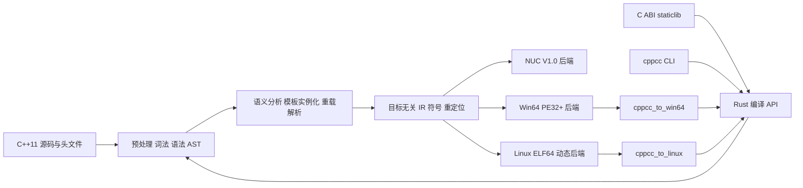

## 用户原始需求

用户要求完善 cppcc 编译器，将其做成可编译 C++11 的库，并提供 cppcc_to_win64 与 cppcc_to_linux 两个工具。

## 确认范围

- C++11 目标为全标准终态，包含 STL、异常、RTTI、完整模板元编程。
- 库形态为 Rust 公共 API 与 C ABI 静态库，供 Rust 及 C/C++ 宿主复用。
- cppcc_to_win64 输出可直接运行的 Windows 64 位 PE32+ console 可执行，支持导入现有 Win32 兼容 API。
- cppcc_to_linux 输出动态链接 glibc 的 Linux 64 位可执行，包含标准动态链接结构。
- 以分阶段支持矩阵推进；每个阶段必须有可运行产物、清晰诊断和回归验证，不用部分实现冒充完成。

## 产品概述

将 cppcc 从单翻译单元、单 NUC 输出的命令行工具，演进为分层编译库和一组目标工具。库负责 C++11 源码预处理、解析、语义分析、目标无关 IR 生成与目标镜像输出；工具分别面向 NUC、Windows 64 位和 Linux 64 位。

## 核心功能

- C++11 全标准能力按阶段落地：类、继承、虚函数、模板与变参模板、lambda、右值引用、移动语义、异常、RTTI、new/delete、浮点、多翻译单元、标准库与运行时。
- 稳定编译库：输入源码或文件集合与选项，输出诊断、IR、目标字节和符号信息。
- C ABI 静态库：提供头文件、显式内存释放接口和跨语言安全的错误返回。
- cppcc_to_win64：生成 PE32+、Win64 ABI、导入表、控制台入口和可加载镜像。
- cppcc_to_linux：生成 ELF64 动态可执行、PT_INTERP、动态段、符号与重定位、GOT/PLT。
- 保留现有 cppcc CLI 与 NUC 输出行为，作为兼容性基线和回归入口。

## 技术栈选择

- 沿用现有主机端 Rust Cargo 工程：`user/cppcc`，edition 2021，当前唯一依赖 `anyhow`。
- 不引入新的外部二进制格式依赖；沿用 `nucgen.rs` 和 `x86_64.rs` 的手写序列化风格，降低供应链与交叉构建风险。
- 新增 C ABI 静态库采用独立 Cargo crate，核心库保持纯 Rust API。
- 构建继续接入 `tools/tools.mk` 与根 `Makefile`；WSL 中 Rust 工具链位于 `/home/dev/.rustup` 与 `/home/dev/.cargo`。

## 实现策略

整体采用“库化先行、IR 解耦、语言能力分阶段、目标后端并行接入”的策略。先把 `driver` 流水线封装为稳定库 API，再把当前直接遍历 AST 的后端改为目标无关 IR 到多目标后端的模式，随后扩展 C++11 前端、语义、运行时与标准库，最后落地 PE32+ 和 ELF64 工具。

关键决策：

- 当前 `driver.rs` 已是完整流水线，但 `x86_64.rs` 私有且后端直接依赖 AST；因此新增 `api.rs`、`ir.rs` 与 `target` 模块，避免每个后端重复实现语义遍历。
- `nucgen.rs` 已有 `serialize(sections)`，说明段、符号、重定位抽象已具雏形；将其提升为通用 `Artifact` 与 `ObjectModel`，让 NUC、PE32+、ELF64 共用。
- Win64 与 SysV x86_64 ABI 差异显著：Win64 需要 RCX/RDX/R8/R9、shadow space、栈对齐、unwind 信息和 IAT；不能继续复用现有单 ABI 生成器。
- Linux glibc 动态后端需要处理 PT_INTERP、PT_DYNAMIC、dynsym/dynstr、rela.dyn/rela.plt、GOT/PLT 和 `__libc_start_main`，复杂度高于静态 syscall 后端，但符合用户确认目标。
- 全标准 C++11 是长期终态；计划按可验证阶段推进，并在 `docs/C++11 支持矩阵.md` 明确当前支持、部分支持与不支持项。

## 性能与可靠性

- 预处理与词法复杂度约为 O(源码字节数)，解析与语义分析约为 O(tokens 与 AST 节点数)，IR lowering 与后端发射约为 O(IR 指令数)。
- 避免重复 AST 遍历：语义检查一次标注，IR 一次生成，后端只消费 IR。
- 模板实例化采用签名去重和实例化缓存，防止递归模板导致指数级膨胀；设置诊断上限和深度上限。
- C ABI 不允许 panic 跨边界；所有入口捕获错误并返回状态码，分配句柄必须配套释放函数。
- 诊断统一通过现有 `diagnostic` 模块输出源码位置、错误级别和稳定错误码，避免 C ABI 返回裸字符串造成生命周期问题。

## 架构设计



## 实施注意事项

- 不修改输入层、WM 或内核 PE 加载器，除非新生成样例暴露出加载器缺陷；本次主体是用户态编译工具链。
- 保持现有 `cppcc` CLI 参数兼容，尤其 `-o`、`-I`、`-isystem`、`-D`、`-U`、`-E`、`--check`、`--dump-ast`、`-nostdinc`。
- `-std=c++11` 及未来 `-std=c++14/17` 应进入编译选项结构，不再静默忽略；当前阶段明确按 C++11 处理。
- 多翻译单元能力需要新增对象文件模型与链接入口；NUC 仍可先保持单翻译单元兼容，PE32+ 和 ELF64 必须支持多对象合并。
- PE32+ 导入表只使用现有 Win32 兼容层实际导出的 API 名，避免生成无法加载的镜像。
- ELF64 后端生成的动态符号和重定位必须能被系统 `ld-linux-x86-64.so.2` 解析；先以 `printf`、`write`、`malloc`、`free`、`exit` 等基础符号打通。
- 不改动无关 UI、终端命令、桌面应用与 GUI 框架代码，避免扩大回归面。

## 目录结构

```text
novus-os/
├── user/cppcc/
│   ├── Cargo.toml  # [MODIFY] 增加 bin 目标、库 crate 类型元数据、模块组织说明；保持 anyhow 依赖最小化。
│   ├── README.md  # [MODIFY] 更新 C++11 支持范围、库用法、工具用法与支持矩阵链接。
│   ├── src/lib.rs  # [MODIFY] 公开 api、ir、target、diagnostic 新接口，保留既有前端模块导出。
│   ├── src/api.rs  # [NEW] 稳定 Rust 编译 API：编译选项、输入集合、诊断、产物与目标选择。
│   ├── src/driver.rs  # [MODIFY] 降级为 CLI 与 API 之间的薄适配层，移除重复流水线逻辑。
│   ├── src/main.rs  # [MODIFY] 仅解析命令行并调用新 API，保留旧 cppcc 行为。
│   ├── src/bin/cppcc_to_win64.rs  # [NEW] Win64 工具入口，调用 API 生成 PE32+ 可执行。
│   ├── src/bin/cppcc_to_linux.rs  # [NEW] Linux 工具入口，调用 API 生成动态 ELF64 可执行。
│   ├── src/ir.rs  # [NEW] 目标无关 IR：函数、基本块、指令、全局、符号、重定位与目标能力描述。
│   ├── src/codegen.rs  # [NEW] AST 到 IR 的 lowering，承接现有 x86_64.rs 中目标无关部分。
│   ├── src/object.rs  # [NEW] 多翻译单元对象模型、符号解析、弱符号、公共符号与链接入口。
│   ├── src/diagnostic.rs  # [MODIFY] 增加稳定错误码、诊断分类、模板实例化栈与 C ABI 可序列化诊断。
│   ├── src/ast.rs  # [MODIFY] 扩展 C++11 AST：类、模板、异常、RTTI、lambda、初始化列表、尾置返回类型。
│   ├── src/lexer.rs  # [MODIFY] 补齐 C++11 token、原始字符串、用户定义字面量与新关键字诊断。
│   ├── src/parser.rs  # [MODIFY] 移除对 class、template、lambda、union 等语法的早期拒绝并实现完整语法。
│   ├── src/sema.rs  # [MODIFY] 完善类型系统、重载解析、访问检查、模板实例化、移动语义与异常语义。
│   ├── src/layout.rs  # [MODIFY] 补齐继承布局、虚表、空基类优化、位域与对齐计算。
│   ├── src/preprocess.rs  # [MODIFY] 支持标准库头文件搜索路径、多目标 include 映射与更完整宏语义。
│   ├── src/x86_64.rs  # [MODIFY] 抽象 SysV 与 Win64 ABI 差异，保留现有 NUC 代码生成回归能力。
│   ├── src/nucgen.rs  # [MODIFY] 改为消费通用对象模型并保留 NUC V1.0 序列化与 validate。
│   ├── src/target/mod.rs  # [NEW] 目标描述、目标枚举、后端接口与能力查询。
│   ├── src/target/nuc.rs  # [NEW] NUC V1.0 后端封装。
│   ├── src/target/win64.rs  # [NEW] PE32+ 头、节、导入表、重定位、Win64 ABI 与入口生成。
│   ├── src/target/linux.rs  # [NEW] ELF64 动态可执行、PT_INTERP、dynamic、GOT/PLT 与 SysV ABI 生成。
│   ├── stdlib/include/  # [NEW] C++11 标准库兼容头集合，例如 cstddef、type_traits、string、vector、map、exception。
│   ├── stdlib/win64/  # [NEW] Win64 目标运行时头与CRT入口实现。
│   ├── stdlib/linux/  # [NEW] glibc 动态目标头、启动入口与符号声明。
│   ├── tests/compile_api.rs  # [NEW] Rust 库 API 单元测试，覆盖输入、诊断、目标选择与产物校验。
│   ├── tests/cxx11_suite/  # [NEW] C++11 语言与标准库回归源码集合。
│   ├── tests/win64_pe.rs  # [NEW] 校验 PE32+ 头、节、导入表、入口与重定位结构。
│   ├── tests/linux_elf.rs  # [NEW] 校验 ELF64 program header、dynamic、符号与重定位结构。
│   └── examples/hello.cc  # [MODIFY] 增加 C++11 特性 smoke 与多目标示例约束。
├── user/cppcc-cabi/
│   ├── Cargo.toml  # [NEW] staticlib C ABI crate，依赖 cppcc 核心库。
│   ├── src/lib.rs  # [NEW] 导出编译、诊断释放、产物释放、版本查询等无 panic 跨越边界的 C 函数。
│   └── include/cppcc.h  # [NEW] C 与 C++ 宿主使用的稳定头文件、句柄类型、状态码与释放接口声明。
├── tools/tools.mk  # [MODIFY] 增加 cppcc-cabi、cppcc_to_win64、cppcc_to_linux 构建与复制规则。
├── Makefile  # [MODIFY] 增加目标声明、demo 与验证入口，保持旧 cppcc 目标兼容。
├── Kconfig  # [MODIFY] 增加 cppcc 多目标工具与 C ABI 库配置开关。
├── configs/novus_defconfig  # [MODIFY] 默认启用 cppcc 多目标工具与 C ABI 库。
├── docs/M7 cppcc 实现说明.md  # [MODIFY] 更新新流水线、IR、多目标后端与库化说明。
├── docs/cppcc 构建与端到端验证.md  # [MODIFY] 补充实际可执行验证步骤和三目标 smoke 流程。
├── docs/C++11 支持矩阵.md  # [NEW] 记录每个 C++11 特性的支持阶段、目标差异与诊断策略。
└── docs/C++98 测试程序移植说明.md  # [MODIFY] 区分 MinGW G++ 验收链与 cppcc 新后端链。
```

## 关键接口约定

- Rust API 采用不可变编译选项对象与显式输入集合，返回产物字节、诊断列表和目标元数据；错误不通过 panic 传播。
- C ABI 采用不透明句柄与显式释放函数；诊断和产物内存由库分配，必须由调用方通过对应释放接口归还。
- 目标后端统一消费 IR 与对象模型，不再直接依赖 AST；AST 改动不得破坏 PE32+ 与 ELF64 writer 接口。

## SubAgent

- **code-explorer**
- Purpose: 复核 cppcc 前端、语义、AST、后端、Makefile、文档与样例的完整调用链，并建立影响面和支持矩阵基线。
- Expected outcome: 产出准确的现状清单、缺口清单与所有需要改动的路径，避免遗漏多翻译单元、标准库和目标后端依赖。

## Skill

- **lsp-code-analysis**
- Purpose: 在库 API、IR、目标后端和 C ABI 改造过程中验证符号定义、引用、调用链与影响范围。
- Expected outcome: 确认新旧 API 调用点全部适配，未留下未实现符号、重复定义或未使用接口，并辅助最终回归审查。