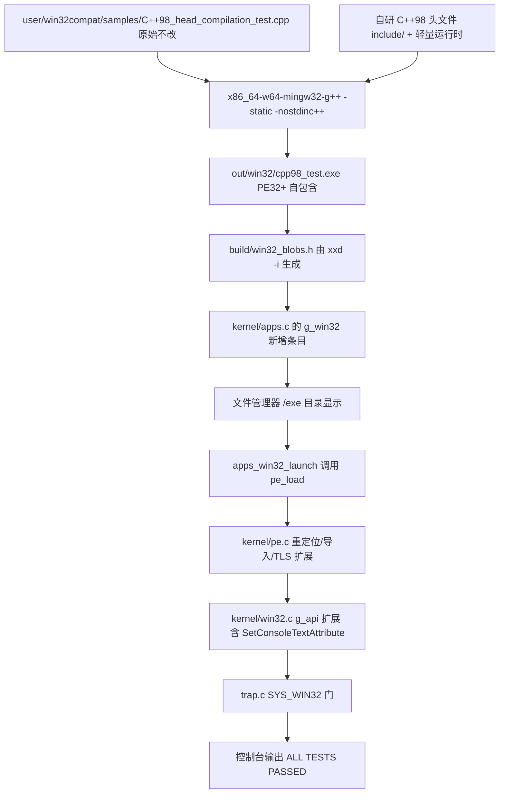

## 用户需求

让 Novus OS 能**原样编译并完整运行** `user/win32compat/samples/C++98_head_compilation_test.cpp`：保留文件全部 C++98 写法（iostream、string、vector、list、deque、map、set、queue、stack、sstream、fstream、algorithm、functional、iterator、numeric、utility、auto_ptr、limits、stdexcept 异常、typeinfo/RTTI、locale、bitset、cstdio/cstdlib/cstring/ctime/cmath/cctype/csetjmp/csignal 等），在其上输出 `>>> ALL TESTS PASSED <<<`（当前 28 个 testCase 全 PASS）；源文件本身不改写。用户补充要求：**用 Rust + C 自研全部头文件与对 Windows exe 的兼容**；启动入口为**文件管理器 /exe 目录**，与现有 8 个 Win32 样例一致（编译成 PE32+ .exe 内嵌进内核）。

## 产品概述

在现有 M9 Win32 兼容层（PE32+ 加载器 + 约 133 个内核 C API + SYS_WIN32=40 单一系统调用门）之上，补齐一个完整 C++98 程序所需的编译、标准库、运行时与 API 链路，使该测试程序作为第 9 个内嵌 exe 出现在 /exe 并可点击运行。

## 核心功能

- 主机侧 C++98 原样编译为自包含 PE32+ 镜像，并用项目自研 C++98 标准库/CRT 头文件替换系统 libstdc++。
- 内核 Win32 兼容层补齐控制台颜色 `SetConsoleTextAttribute`/`FOREGROUND_*` 与 C++/CRT 所需 API。
- PE 加载器扩展以支持静态链接 C++ 运行时的镜像（TLS、重定位与导入上限）。
- Makefile 新增 .cpp 构建、blob 内嵌、内核镜像注册表条目，使其出现在 /exe 目录。
- 端到端验证：QEMU 启动后运行该 exe，全部测试显示 PASS。

## 技术栈选择

- **主机交叉编译器**：沿用 Makefile 现有 `x86_64-w64-mingw32-` 工具链，用 `x86_64-w64-mingw32-g++` 原样编译该 .cpp（唯一能在不改源码前提下产出 PE32+ 且支持完整 C++98 的可用前端；项目自带 cppcc 不支持模板/类/异常且输出 NUC，与本任务冲突，不使用）。
- **自研标准库头文件**：新增 C++98 头文件集合，以 `-nostdinc++ -I.../include` 让 g++ 前端只使用项目自研头文件；对测试覆盖的头文件提供最小可用实现，而非移植整个 libstdc++。
- **运行时与兼容层（C）**：扩展 `kernel/win32.c`（API 表与实现）、`kernel/pe.c`（加载器）、`kernel/apps.c`（内嵌注册表）；底层 CRT 功能映射到现有内核 API。
- **Rust 工具**：沿用仓库 Rust 工具链，增加主机侧辅助工具做依赖清单/头文件与 API 一致性校验（与现有 `tools/` 主机工具、cppcc 的 Rust 构建方式一致）。
- **目标格式**：PE32+ .exe，链接在 0x400000、映射到 0x50000000 以复用现有 base relocation 路径。

## 实现方案

### 总体策略（两阶段推进，原始 .cpp 与其余 8 个样例保持不变）

1. **基线量化**：先用 MinGW g++  `-static -static-libgcc` 静态编译原样 .cpp，dump 其导入表与 PE directory，精确列出内核需补齐的 Win32 API、TLS 需求、重定位/导入数量，作为实现输入，避免盲补。
2. **替换与补齐**：用自研 C++98 头文件 + 轻量运行时替换系统 libstdc++（g++ 仅作编译器前端），内核补齐 API 与 PE 能力，最终内嵌并从 /exe 运行。

### 关键决策与权衡

- **不扩展 cppcc**：其 README 明确不支持类/模板/异常/RTTI/STL/浮点，输出 NUC 无法进入 /exe 的 PE 路径；扩展它等于重写编译器，成本高于用现成 g++ 前端。自研主要集中在"标准库头文件 + 运行时 + 内核兼容层"，契合用户诉求。
- **静态链接而非动态 DLL**：内核无 DLL 加载与 CRT 分发，静态链接使镜像自包含；代价是 exe 体积与 TLS/异常处理依赖必须由加载器承接，这正是需扩展的重点。
- **PE 加载器必须支持 TLS**：`kernel/pe.c:257` 当前对任何 `PE_DIR_TLS` 非零的镜像直接判 `PE_EFORMAT`；静态 C++ 运行时的异常状态（类似 `__cxa_eh_globals`）依赖 TLS，必须新增受控的 TLS directory 处理，并保持对无 TLS 镜像的向后兼容。
- **控制台颜色**：`SetConsoleTextAttribute` 不在 `g_api[]`；建议新增 API 条目并把 `FOREGROUND_*` 颜色状态映射到终端 ANSI SGR 着色（复用 `apps/src/bin/nsh.rs:456-474` 的着色思路），使 PASS/FAIL 文本着色可见。
- **异常/RTTI**：优先用静态 libgcc 的 unwind 运行时跑通 try/throw/typeid；自研头文件仅提供类型与容器语义。若静态 unwind 引入无法解析的导入，再以自研精简运行时兜底。

### 性能与可靠性

- 静态 C++ exe 体积可能达数百 KB 至数 MB；需评估 `out/win32_blobs.h` 生成、内核镜像大小与 QEMU 加载开销，必要时开 `-Os -ffunction-sections -Wl,--gc-sections` 控制体积。
- `kernel/pe.c` 中 `PE_MAX_IMPORTS=64`、`PE_MAX_RELOCS=4096` 为硬上限；基线阶段需核对静态 exe 是否越界，越界则按实测提升并对越界值保持拒绝。
- 导入仅支持按名导入（`pe.c:444`），基线需确认静态链接产物不引入按序号导入或 delay import。

## 实现说明

- **复用现有机制**：g_api 表解析与别名回退（`win32.c:5892-5917`）、id 到 thunk 的生成（`win32.c:5953+`）、`WIN32_BLOB_H` 的 `xxd -i -n` 生成、`kernel/apps.c` 的 `apps_win32_*` 注册与 `pe_load` 启动链路、SYS_WIN32 白名单（`kernel/trap.c:1106`）均直接复用，不新增并行机制。
- **颜色/输出**：沿用 `WriteConsoleA`/`WriteFile` 的 64 字节分片输出约束；颜色状态按句柄保存，避免污染其他样例。
- **日志**：沿用内核 `kputs` 与 PE/APPS 现有前缀输出，不打印大 blob 与敏感数据。
-  **blast radius**：新增独立 .cpp 规则与独立头文件目录，不改既有 8 个 .c 样例编译参数；保持 `TASK_ABI_WIN32` 只能访问 SYS_WIN32/SYS_EXIT 的约束不放宽；配置保持 `CONFIG_NOVUS_WIN32` 门控。
- **环境**：WSL 下构建需带 `PATH=/home/dev/.rustup/toolchains/stable-x86_64-unknown-linux-gnu/bin:...`（Rust 工具在 /home/dev/.rustup 与 /home/dev/.cargo）。

## 架构设计



## 目录结构

```
//wsl.localhost/Debian/home/dev/novus-os/novus-os/
├── user/win32compat/include/                         # [NEW] 自研 C++98 标准库/CRT 头文件根目录，供 -nostdinc++ -I 使用
│   ├── windows.h                                     # [NEW] 自研 Win32 类型与 API 声明：HANDLE/DWORD、STD_OUTPUT_HANDLE、SetConsoleTextAttribute、FOREGROUND_*、GetStdHandle/WriteFile 等，替代测试对 windows.h 的依赖
│   ├── cstddef.h cstdio.h cstdlib.h cstring.h        # [NEW] CRT 头文件：size_t/ptrdiff_t、printf 族、rand/atexit/remove、strcpy/strcmp 等，声明映射到 Win32/内核 API
│   ├── ctime.h cmath.h cctype.h climits.h cfloat.h    # [NEW] 时间与数学/字符/极值头文件：time/localtime、sqrt、isalpha、INT_MAX、DBL_MAX
│   ├── cstdarg.h csetjmp.h csignal.h                  # [NEW] 变长参数、setjmp/longjmp、signal 声明；底层跳转/信号用到内核或 libgcc 支持
│   ├── iostream.h fstream.h sstream.h string.h        # [NEW] 流与字符串：cout/endl、ofstream/ifstream、stringstream、std::string 的测试所需子集
│   ├── vector.h list.h deque.h map.h set.h            # [NEW] 顺序与关联容器：测试用到的 push_back/front/insert/count/operator[] 等最小实现
│   ├── queue.h stack.h algorithm.h functional.h       # [NEW] queue/stack、sort、less 等适配器与算法
│   ├── iterator.h numeric.h utility.h memory.h        # [NEW] back_inserter、accumulate、pair/make_pair、auto_ptr
│   ├── limits.h stdexcept.h typeinfo.h locale.h       # [NEW] numeric_limits、runtime_error/异常类型、typeid/type_info、locale::classic
│   └── bitset.h                                       # [NEW] bitset 测试所需 test()/构造
├── kernel/win32.c                                    # [MODIFY] 在 g_api[] 增补 SetConsoleTextAttribute 等新 API 的映射条目，并实现处理函数（颜色状态保存 + ANSI 着色输出），扩容 WIN32_API_COUNT 对应枚举
├── kernel/win32.h                                    # [MODIFY] WIN32_API_COUNT 与新增 API 枚举常量、FOREGROUND_* 常量定义
├── kernel/pe.c                                       # [MODIFY] 新增受控 TLS directory 解析与映射（拒绝 delay import 保持不变），按实测提升 PE_MAX_IMPORTS/PE_MAX_RELOCS 上限，保持无 TLS 镜像向后兼容
├── kernel/apps.c                                     # [MODIFY] 在 g_win32[] 增加 {"cpp98_test.exe", k_app_cpp98_test_exe, &k_app_cpp98_test_exe_len} 条目
├── Makefile                                          # [MODIFY] 新增 CXX 变量与 .cpp 规则（-static -static-libgcc -nostdinc++ -Iuser/win32compat/include，-nostdlib 相关 flag 按静态 CRT 需要调整）；将 out/win32/cpp98_test.exe 加入 WIN32_BINS 与 win32_blobs.h 生成
├── tools/cpp98_depcheck.rs                           # [NEW] Rust 主机工具：解析 exe 导入表/PE directory，校验自研头文件清单与内核 g_api 映射的一致性，输出缺失 API 报告，纳入 make 的前置检查
├── docs/C++98 测试程序移植说明.md                     # [NEW] 记录构建命令、依赖来源、API 映射、TLS/异常方案、已知限制与验证步骤
└── qtest.sh                                          # [MODIFY] 可选：增加一键构建并从 /exe 运行该测试的验证路径
```

## 关键代码结构

以下为需在自研头文件中统一的接口约定（接口级，不含实现）：

```cpp
// user/win32compat/include/windows.h —— 自研 Win32 最小声明契约
typedef void *HANDLE;
typedef unsigned int DWORD;
#define STD_OUTPUT_HANDLE ((DWORD)-11)
#define FOREGROUND_BLUE      1u
#define FOREGROUND_GREEN     2u
#define FOREGROUND_RED       4u
#define FOREGROUND_INTENSITY 8u
extern "C" HANDLE __stdcall GetStdHandle(DWORD which);
extern "C" int    __stdcall SetConsoleTextAttribute(HANDLE h, unsigned short attr);
extern "C" int    __stdcall WriteFile(HANDLE h, const void *buf, DWORD len,
                                      DWORD *written, void *overlapped);
```

kernel/win32.c 的新 API 需沿用 `win32_api_t{dll,fn,id}` 表结构并在 `kernel/win32.h` 增加对应 `WIN32_API_*` 枚举，保持 `WIN32_API_COUNT` 与表长一致（`win32.c:5899` 有边界检查）。

## Agent Extensions

### SubAgent

- **code-explorer**
- Purpose: 基线阶段深入探索 MinGW g++ 静态链接产物的导入表/PE directory，并精确定位 kernel/pe.c 中 TLS/重定位/导入处理点、kernel/win32.c 中所有待补 API 的映射与实现位置。
- Expected outcome: 产出精确的"缺失 API 清单 + PE 扩展点 + 上限实测值"，使后续修改一次到位、不破坏其余 8 个样例。

### Skill

- **lsp-code-analysis**
- Purpose: 在实现自研 C++98 头文件与内核 API 扩展时，用语义分析做符号定义/引用与影响面定位（如 WIN32_API_* 枚举、g_api 表、g_win32 注册）。
- Expected outcome: 确认所有引用点同步更新，避免枚举越界、表长不一致与遗漏调用点导致的内核构建或运行失败。