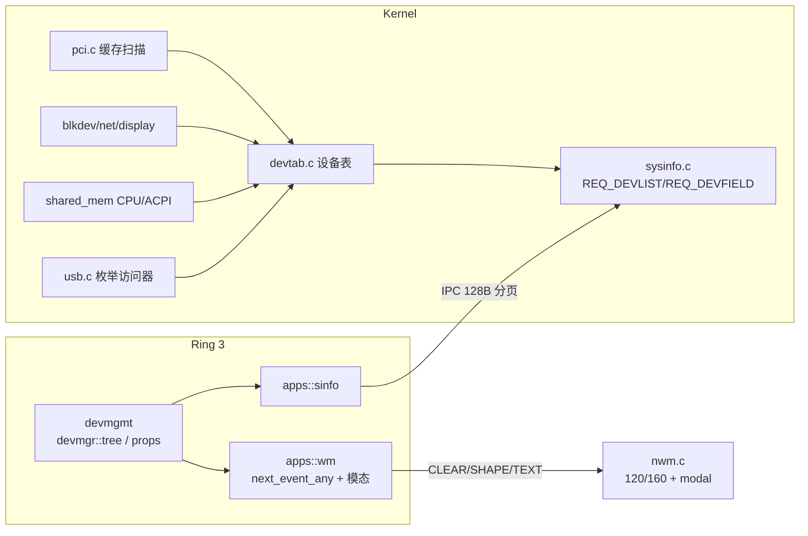

## 用户需求

在 Novus OS 中新增一个"设备管理器"应用（`devmgmt`），视觉与交互对标 Windows 11 设备管理器（参考 7 张截图），并展示真实的机器设备信息。

## 产品概述

一个双窗口的图形应用：主窗口是设备管理器控制台（菜单栏 + 工具栏 + 左侧可折叠设备树 + 状态栏）；双击/右键"属性"会打开一个独立的模态属性窗口（常规 / 驱动程序 / 详细信息 / 事件 / 资源 五个选项卡），完全复刻截图的版式：标题栏、选项卡条、设备图标 + 名称行、键值对列表、"设备状态"带滚动条文本框、驱动操作按钮 + 右侧说明文字、事件表格 + 信息框、资源表格 + 自动设置复选框 + "没有冲突。"、底部"确定 / 取消"。

## 核心功能

- 设备树：按类别分组（计算机、处理器、固件、显示适配器/监视器、磁盘驱动器、存储控制器、网络适配器、USB 控制器/根集线器/USB 设备、人体学输入设备、系统设备、未知设备），支持展开/折叠、单选、悬停高亮、键盘上下键、刷新与"显示/隐藏空类别"。
- 真实数据：PCI 设备（厂商/设备 ID、类别、BAR 基址与长度、IRQ）、块设备（名称、容量、可移动标志）、网卡（型号名、链路类型、无驱动状态）、显示输出（分辨率、接口类型）、CPU（品牌、核心数）、ACPI 固件（OEM ID、修订号）、USB 设备（端口、速率、类型）、PS/2 输入、IOAPIC 等。
- 异常状态提示：无驱动 / 未知设备行显示黄色感叹号徽标，属性页显示"该设备的驱动程序未被安装。(代码 28)"一类真实状态文字。
- 属性窗口（模态）：选项卡切换；常规页设备类型 / 制造商 / 位置 + 设备状态框；驱动程序页提供商 / 日期 / 版本 / 数字签名 + 5 个操作按钮（含禁用态）与说明文字；详细信息页属性下拉展开列表 + 值框；事件页时间 / 描述表格 + 信息框 + "查看所有事件…"；资源页内存范围 / I/O 范围 / IRQ 表格 + "使用自动设置"勾选 + "没有冲突。"。
- 只读边界：更新 / 回退 / 禁用 / 卸载等破坏性操作不做真实驱动变更，点击后在对话框内显示说明行，保持界面完整但不损坏系统。
- 入口：开始菜单磁贴、任务栏图标（含运行指示点）、桌面磁贴，以及 `nsh` 中可直接 `devmgmt` 启动。
- 主题：随系统浅色/深色与强调色联动，中英文双语标签。

## 技术栈

- 内核：C（`kernel/`），沿用 sysinfo IPC 服务（`sysinfo.h` 请求/应答 + 128 字节分页载荷）。
- 应用：Rust `no_std` 无堆、`x86_64-unknown-none` 扁平镜像（`apps/`），复用 `novus_apps::{wm,ui,sinfo,sys,ipc,lang}`。
- 窗口系统：`wm/novus-wm`（C）+ `apps/src/wm.rs` 客户端库。

## 实现方案

### 总体策略

1. 内核侧新建归一化设备表 `devtab`：启动期一次性建立（PCI 缓存扫描 + blkdev + netdev + display + CPU + ACPI + USB），避免运行期重跑 `pci_scan()`（`bar_info()` 会向 BAR 写 `0xFFFFFFFF`，会短暂关闭在役设备的地址窗口）。
2. 通过 sysinfo 新增两条分页请求暴露"设备列表"和"设备属性字段"（现有 `sysinfo_list_t` 分页范式，每条应答 ≤128B）。
3. WM 侧放宽每窗显示列表上限到 120 shapes / 160 texts，并补一个真正的模态窗口标志（`nwm_create_t.flags` 目前未定义任何位）。
4. 客户端 `wm.rs` 补多窗口事件路由（现状 `next_event()` 会丢弃其它窗口的事件）与创建期事件暂存。
5. 应用侧新增 `devmgr` 模块（主窗口 / 设备树 / 属性窗口 / 字段表），`devmgmt` 二进制仅做入口。

### 关键决策与权衡

- **设备表在启动期固化**：数值稳定、分页索引稳定、零运行期副作用；代价是热插拔（USB）不实时，仅"刷新"时重建 USB/网卡部分。
- **字段按 tab 枚举而不是一次性打包**：设备详情（实例路径、硬件 ID、资源范围）长度远超 128B，改为 `(dev, tab, index)` 逐条取字段，客户端缓存当前页；2 条/包，值 56 字节，长文本截断。
- **属性页独立窗口 + 模态标志**：用户明确选择。WM 侧只做三件事——标记 modal、保持置顶、命中测试只返回该窗口；客户端靠 `next_event_any()` 按 win 路由，其它应用零改动（`Ev::Focus` 保持单字段，仅修正为 payload 中的真实 win id）。
- **预算调整**：`NWM_MAX_SHAPES 40→120`、`NWM_MAX_TEXTS 48→160`、`NWM_MAX_WINDOWS 8→10`。每窗双份列表约 39KB（`nwm_shape_t` 20B、`nwm_text_t` 112B），内核 BSS 由约 99KB 增至约 400KB。协议仍是一条图元一条 IPC（`pump()` 每 tick 8 条），因此**必须限制每帧图元数**（主窗 ≈35 shapes/30 texts，属性窗 ≈60/70），只在交互时重绘、不做逐像素悬停动画。
- **图标**：WM 协议只能传 shape/text，无位图；沿用仓库既有做法（`fileman` 的圆角色块 + 文本字形），设备类别用不同颜色的小圆角方块 + 展开箭头用 `v`/`>` 字形。

### 性能与可靠性

- `devtab` 规模 `DEVTAB_MAX 48`：内存约 2.3KB；PCI 缓存 `PCI_MAX_DEVICES 16→32`（约 4KB）。
- 设备列表每次查询 O(48) 线性扫描，最多 16 个应答包；客户端一次性缓存（48×44B ≈ 2KB 静态）。
- 字段查询使用 `devtab.c` 内的静态字段缓冲（不复用栈大数组），sysinfo 单线程分派，无并发问题。
- 所有查询失败路径返回 `SYSINFO_RSP_ERR`，应用退化为只显示根节点并给状态栏提示，不崩溃。

## 架构设计



### 协议契约（新增）

```c
#define SYSINFO_REQ_DEVLIST  0x031Bu   /* {UINT16 index; UINT8 max; UINT8 pad;} 复用 list_req */
#define SYSINFO_RSP_DEVLIST  0x031Cu
#define SYSINFO_REQ_DEVFIELD 0x031Du   /* {UINT16 dev; UINT8 tab; UINT8 index;} */
#define SYSINFO_RSP_DEVFIELD 0x031Eu

typedef struct {           /* 40B, 3 条/包 (4 + 120) */
  UINT16 parent;          /* 0xFFFF = 根 */
  UINT16 id;
  UINT8  class;           /* DEV_CLASS_* */
  UINT8  status;          /* 0 正常, 1 警告 */
  UINT8  flags;           /* 可移动/无驱动等 */
  UINT8  pad;
  char   name[32];
} sysinfo_dev_t;

typedef struct {           /* 60B, 2 条/包 (4 + 120) */
  UINT8 key;               /* DEV_F_* 属性键 */
  UINT8 group;             /* BAR/事件序号 */
  UINT16 pad;
  char  value[56];
} sysinfo_devfield_t;
```

## 目录结构（新增 / 修改）

```
kernel/
├── devtab.h                  # [NEW] 设备类别/字段键枚举、devnode_t、devfield_t、devtab_* API
├── devtab.c                  # [NEW] 启动期建表：pci_scan 缓存 + 小型 PCI 名称表、blkdev、net_*、nd_outputs、shared_mem CPU、ACPI RSDT/XSDT OEM ID、usb 枚举、IOAPIC、PS/2；devtab_field() 按 tab 生成字段（常规/驱动/详细信息/事件/资源），静态字段缓冲，十六进制范围格式化
├── pci.h / pci.c             # [MODIFY] PCI_MAX_DEVICES 16→32，注释说明缓存扫描的调用时机约束
├── usb.h / usb.c             # [MODIFY] 新增 usb_device_count()/usb_device_info(i, *info)（port/speed/kind/hid_kind/sectors），只读，不改枚举流程
├── sysinfo.h / sysinfo.c     # [MODIFY] 新增 0x031B–0x031E 请求/应答结构与 req_devlist()/req_devfield()，handle() 加两个 case
├── kmain.c                   # [MODIFY] ide_init() 之后调用 devtab_init(mmap,size,stride)；net_init() 之后调用 devtab_add_net()
├── apps.c / apps.h           # [MODIFY] g_apps[] 加 devmgmt；APPS_MAX 修正
└── session.c                 # [MODIFY] desktop_app() 白名单加 devmgmt

wm/novus-wm/
├── nwm_proto.h               # [MODIFY] MAX_SHAPES 120 / MAX_TEXTS 160 / MAX_WINDOWS 10；新增 NWM_F_CREATE_MODAL 标志
└── nwm.c                     # [MODIFY] nwm_window_t 加 modal；req_create 记录标志并置顶；hit_test/route/req_raise/req_focus 在存在模态窗时只服务模态窗；模态窗不画最小化/最大化按钮；销毁时释放模态状态

apps/src/
├── wm.rs                     # [MODIFY] MAX_SHAPES/MAX_TEXTS 同步；create_ex(..., flags)；new Ev 路由 next_event_any() -> (win, Ev)；4 槽消息暂存（避免 create 阻塞期丢事件）；Ev::Focus 返回真实 win
├── sinfo.rs                  # [MODIFY] REQ/RSP 常量、DevRec/DevField 结构、devices()/dev_fields()
├── lib.rs                    # [MODIFY] pub mod devmgr;
├── devmgr/mod.rs             # [NEW] 应用状态机：加载设备表、展开集合、选中/滚动、窗口创建、事件循环、菜单与工具栏命中
├── devmgr/tree.rs            # [NEW] 可见行扁平化（parent/expanded/depth）、行绘制（类别色块、箭头、警示徽标、选中条）、命中测试
├── devmgr/props.rs           # [NEW] 属性窗口布局与五个选项卡绘制、字段分页缓存、按钮/下拉/表格/状态框命中
├── devmgr/fields.rs          # [NEW] 属性键→中英标签表、值格式化（容量、十六进制范围、IRQ、日期/时长）
├── bin/devmgmt.rs            # [NEW] #![no_std] #![no_main] + _start，薄入口
├── shell/cmds.rs             # [MODIFY] KNOWN_APPS 加 devmgmt
└── bin/settings.rs           # [MODIFY] 应用页列表加 devmgmt（可选）

graphics/
├── nvgui.h / nvgui.c         # [MODIFY] NG_ICON_DEVICES 枚举 + 程序化图标（芯片/集线器轮廓）
└── nd_demo.c                 # [MODIFY] on_launch_devmgmt()、开始菜单固定磁贴、任务栏图标 + 运行圆点（数组 5→6）、桌面磁贴

Makefile                      # [MODIFY] APPS_NAMES 加 devmgmt
apps/Cargo.toml               # [MODIFY] [[bin]] devmgmt
tools/langgen/strings.toml    # [MODIFY] 新增设备管理器词条，并重新生成 graphics/nd_lang_dict.c 与 apps/src/lang_dict.rs
docs/                         # [MODIFY] M8 内置系统应用.md（新应用）、Novus-WM 与 IPC 协议规范（预算与模态标志）、Novus UI 设计语言规范（40/48→120/160）；[NEW] 设备管理器.md
```

## 实施注意

- **PCI 扫描时机**：`devtab_init()` 放在 `ide_init()` 之后、`net_init()` 之前（此时存储已就绪但无 DMA 在途）；网卡在 `net_init()` 之后用 `devtab_add_net()` 追加，避免对在役 NIC 做 BAR 尺寸探测。
- **无分配**：应用侧所有缓存用固定数组/静态；属性字段缓存 8 条 × 60B；避免任何 `alloc`。
- **图元纪律**：不要给每行都画背景块；只为选中行画选中底 + 强调条；设备类别色块 1 个/行；不使用悬停重绘风暴（悬停仅改变 1~2 个图元时再重绘）。
- **标题长度**：`NWM_TITLE_MAX 24`（UTF-8 字节），属性窗口标题固定为"设备属性"，设备全名画在客户区首行，避免标题被截断成乱码。
- **兼容性**：`Ev::Focus` 保持单字段；其它应用不改事件循环；WM 预算提高只影响 BSS 与上限，不改变既有图元语义。
- **日志**：沿用 `sys::write` 风格薄日志（`[APP] devmgmt up`、`[DEVTAB] n devices`），不打印整表。
- **文档一致性**：同步 `docs/` 中过期的 40/48、28/40 数字；`scripts/wm-churn.sh` 若断言窗口数量需同步。

## 设计目标

复刻 Windows 11 设备管理器的版式与信息密度，同时落在 Novus Fluent 设计令牌上（浅/深色与强调色随系统）。全部界面由 wm 图元（圆角填充/边框/文本）绘制，图标为程序化色块字形，不使用位图。

## 主窗口（设备管理器）

- 窗口：客户区 820×540，标题"设备管理器"，圆角 10px 阴影边框，白色主体。
- 菜单栏：22px 高，文件(F) 操作(A) 查看(V) 帮助(H)，点击展开浅色浮层菜单，选中项高亮强调色。
- 工具栏：36px 高浅灰条，图标按钮组（后退/前进/向上/刷新 | 查看/帮助 | 添加/移除/属性），禁用态为浅灰线条，悬停显示圆角底色。
- 设备树：20px 行高，缩进 14px/层；展开箭头用 `v`/`>` 字形；类别/设备前 12×12 圆角色块（显示蓝、网络青、磁盘灰、USB 紫、未知黄）；异常设备行尾黄色 `!` 徽标；选中行为浅蓝选中底 + 3px 强调色竖条。
- 状态栏：底部 24px，左侧提示"选择设备后按 Enter 查看属性"，右侧设备计数；滚动超出时以 offset 平滑翻页，选中项始终可见。

## 属性窗口（模态子窗口）

- 窗口：客户区 520×600，标题"设备属性"，比主窗更高的层级，打开时主窗不接受输入。
- 选项卡条：44px 高白底，5 个选项卡（常规/驱动程序/详细信息/事件/资源），选中项下方 2px 强调色下划线，未选中为次级文字色。
- 常规页：24×24 类别图标 + 设备全名（放大字）；三行键值对（设备类型/制造商/位置），左列 110px 灰色标签、右列值；下方"设备状态"1px 边框圆角文本框，内含多行状态文字。
- 驱动程序页：四行键值对；下方 5 个 220×30 按钮竖排（第一项强调色描边），右侧对齐说明文字；禁用项文字与边框降为浅灰。
- 详细信息页：属性(P) 标签 + 下拉框（展开为白色高亮列表，键盘/滚轮可选）+ 下方值框，选中项强调色底。
- 事件页：表头（时间戳/描述）+ 3 行表格 + 选中行高亮；下方信息(I) 等宽文本块；"查看所有事件(V)…"次要按钮。
- 资源页：资源设置(R) 表格（资源类型/设置，含内存范围×2、I/O 范围、IRQ）+ 禁用下拉"设置基于(B)" + "使用自动设置"勾选框 + "更改设置(C)…"禁用按钮 + "冲突设备列表：没有冲突。"。
- 底部：右对齐"确定 / 取消"按钮，确定为主按钮（强调色），取消为描边次按钮。

## 交互与动效

树展开/折叠即时重排；选项卡切换 80ms 内完成重绘；模态窗口置顶、遮罩暗化主窗；`Esc`/取消关闭属性窗；`F5` 刷新设备表；主题切换时整体重绘并保持选中项。

## Agent Extensions

### SubAgent

- **code-explorer**
- Purpose: 在注册新应用与桌面入口时，全仓核对 `devmgmt` 的注册链路（Makefile → apps_blobs → kernel/apps.c → session/desktop/开始菜单/任务栏/nsh/settings/文档）是否有遗漏，并复核 WM 预算提高后是否有其它硬编码 40/48 的假设。
- Expected outcome: 输出一份"已改/仍缺"的核对清单，确保应用可从四个入口启动且无遗留硬编码，降低回归风险。