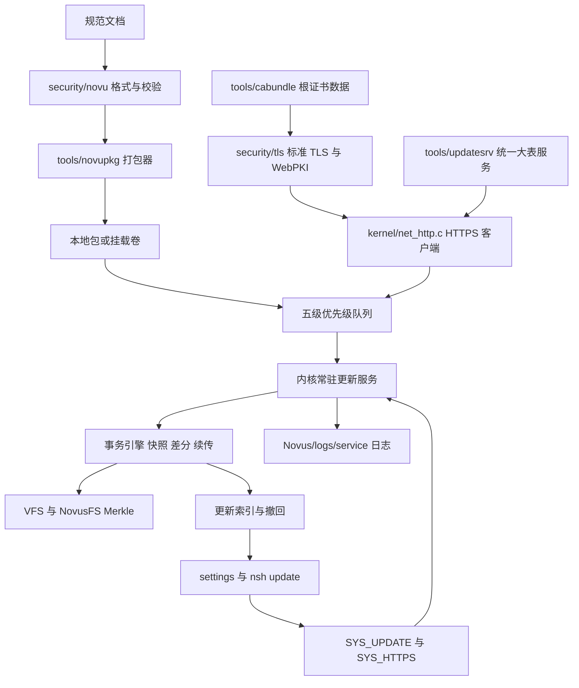

## User Requirements
按 `docs/Novus OS 自研分级增量更新体系完整规范.md` 完善 Novus OS：代码与文档都做，且本次一次做完规范要求的能力闭环，而不是只交付最小可用版本。用户明确要求远程通道可与任意公网安全更新服务通信并完成证书可信校验；同时把规范修订为与实现一致的真实状态。保留上一轮已完成的三套镜像目录树、真实挂载与启动安装能力，不破坏现有构建与冒烟结果。

## Product Overview
在现有 Novus OS 上补齐一套完整可用的分级增量更新体系：四类更新载体、五级推送通道、统一更新大表、优先级队列、后台常驻服务、原子事务与回滚、撤回与更新索引、差分与断点续传、灰度与状态上报、设置中心与终端命令全部可用。用户可在图形界面查看更新、安装、延后、撤回和配置策略，也可在终端完成同样操作；后台在无前台参与时自动完成检测、下载、校验、安装、清理与上报。规范文档同步修正编号、能力状态、格式矛盾与落地清单。

## Core Features
- 四类更新载体与五级通道的完整生命周期管理，紧急修复最高优先级且不可延后
- 统一更新大表、设备维度百分比灰度、白名单、批次与机型策略
- 更新包来源可信校验、事务化安装、前置快照、异常自动回滚
- 已完成更新的索引登记、依赖检测、分层撤回、快照保留与固化锁定
- 差分传输、下载与安装双阶段断点续传、失败梯度重试与设备自愈降级
- 后台常驻轮询、空闲与免打扰时段调度、延后次数管控、低资源节流
- 状态上报、批量撤回指令、灰度降级与问题补丁下架
- 设置中的更新中心、终端 `update` 命令、服务状态与日志可视化
- 规范文档能力状态、章节编号、头部偏移、格式边界与落地清单修订

## 视觉与交互效果
设置应用新增「更新」入口，采用 Novus Fluent 卡片分层与深浅色令牌。顶部显示通道与服务状态徽标，内容区以状态卡、更新列表、进度条、历史索引和策略设置组织，底部常驻状态栏显示上次检查、网络、证书与结果。紧急补丁用红色高亮并置顶，可撤回项显示撤回按钮，锁定项显示锁定说明。进度条、卡片悬停抬升、状态色渐变与列表刷新提供轻量微动画；窗口按桌面尺寸自适应，不是移动端放大版。


## Tech Stack Selection
完全复用现有工程，不引入新框架或第三方架构依赖：

- 内核与更新引擎：freestanding C，`Makefile:SRC/INC` 编译进 `out/NOVUS.EFI`；沿用 `fs/novusfs/`、`fs/vfs.c`、`kernel/net*.c`、`kernel/sched.c` 的静态表、无分配器、有界缓冲风格。
- 用户态：`apps/` 为 Rust `no_std`、无分配器，通过 `APPS_NAMES` 嵌入内核；新增 `apps/src/update.rs`，在 `apps/src/lib.rs` 注册模块；沿用 `sys::call` 与 `#[repr(C)]` ABI。
- 图形界面：沿用 `apps/src/ui.rs` 的 `page/card/section/row/button/ghost/nav/progress` 与 Novus-WM 显示列表，不引入 React/Vue/MUI。
- 密码学：复用 `lib/novuslib_rs.h` 的 CRC32、SHA-256、SHA-512、Ed25519 verify 与 `security/nkm/nkm.c` 签名校验闭环；标准 TLS 与 WebPKI 所需的大数、ASN.1、X.509、RSA、P-256、X25519、AES-GCM、ChaCha20-Poly1305、HKDF、PRF、CSPRNG 全部自研补齐。根证书为信任数据，不是第三方架构依赖。
- 宿主工具：C11 与 Python3 标准库，仅用于构建、打包、大表生成、证书包生成与 QEMU 参考服务端，不进入 OS 镜像。
- 构建：WSL 中 `PATH=/home/dev/.rustup/toolchains/stable-x86_64-unknown-linux-gnu/bin:/home/dev/.cargo/bin:$PATH`。

## Implementation Approach
**总体策略**：按「格式与密码学底座 → 事务与队列 → 服务与界面 → 服务端与文档」的依赖顺序一次落地全量能力。以一份冻结的 128B 头与共享头驱动宿主打包器、内核校验器、镜像内自检和文档；以内核 tick 驱动的常驻状态机实现后台守护，避免新增调度原语；以 `SYS_UPDATE`/`SYS_HTTPS` 两个新 syscall 把能力暴露给设置与终端。

**关键决策与权衡**：
1. **头部矛盾修正**：规范 7.3 的字段偏移按注释累加为 168 字节，与「128Byte 固定」冲突。保持 128B 冻结，修正为 `file_sha256` 在 0x48、`sig_offset/sig_len` 在 0x68、`patch_uuid_bin` 在 0x70、`reserved_fill[8]` 在 0x78；7.8 的固定区块排布用于推导差分表偏移，不新增字段。文档同步改为真实布局。
2. **标准 TLS 与 WebPKI 自研**：实现 TLS 1.3 与 TLS 1.2 回退，支持 `TLS_AES_128_GCM_SHA256`、`TLS_AES_256_GCM_SHA384`、`TLS_CHACHA20_POLY1305_SHA256`、TLS 1.2 ECDHE-RSA/ECDSA 的 AES-GCM 与 ChaCha20 套件；支持 X.509 链、基本约束、密钥用途、SAN 主机名、有效期、RSA-PKCS1v15/RSA-PSS 与 ECDSA P-256 验签。不支持 0-RTT、客户端证书、HTTP/2、QUIC、OCSP 硬失败；遇到不支持扩展明确拒绝而非静默跳过。能力范围写入文档。
3. **单会话流式网络**：现有 `net_tcp_open()` TX 192B / RX 2048B 不足以承载证书链。在 `kernel/net_tcp.c` 与 `kernel/net.h` 增加 16KB 有界双缓冲流式收发，保留 `net_tcp_test()` 兼容；仍为单会话、轮询、非阻塞。
4. **无新目录、无新常驻进程**：复用上一轮 77 项目录树中的现有目录存放索引、日志、缓存、配置与快照文件，不新增目录项，从而保持三套镜像别名表与 `scripts/check_rootfs.py` 的 435 项断言不变。后台服务实现为 `update_service_tick()` 状态机加持久化 journal，不新增 `kernel/apps.c` 内嵌应用。
5. **Merkle 一致性**：运行时写系统分区会使既有 Merkle 根失效；提交与回滚成功后必须调用 `novusfs_merkle_build()` 重算并写回超级块。`.novusfs` 只读静态元数据不参与写入。live 会话默认只检测与缓存，安装到系统根要求 `vfs_root_persistent()` 为真。
6. **差分与性能**：采用 4KiB 固定块 + 滚动弱校验 + SHA-256 强校验的 copy/literal 差分流，O(n) 时间、O(1) 内存、流式处理，不整文件载入；索引固定 64 条、队列固定 64 项、证书链深度上限 6、根证书约 140 张，DER 解析线性无递归。瓶颈是证书链解析、16KB 单会话吞吐与 Merkle 重算，缓解方式为静态表、批量提交、提交窗口内禁止其他写者、按 40 tick 周期调度。

**避免技术债**：复用 `tools/wpkg` 的「宿主打包 + 双端共享头」、`tools/nkmgen` 的 Ed25519 签名、`kernel/win32.c` 的定长注册表、`kernel/mountcfg.c` 的固定键解析、`apps/src/ui.rs` 控件与 `install_authorize()` 的能力授权模式。新增 `CONFIG_NOVUS_UPDATE` 默认开启，关闭时新代码不链接，便于回归对比。

## Implementation Notes
- **Grounded reuse**：`security/novu/novu_format.h` 与 `tools/novupkg` 共享；校验流水线复用 `novus_rs_sha256` 与 `novus_rs_ed25519_verify`；回滚事务使用现有 `SYS_RENAME 21` 对应的 `vfs_rename_path()`；跨挂载点 rename 与只读挂载判定沿用 `fs/vfs_mount.c`。
- **Blast radius**：保持 syscall 1..24、40、60 不变，新增 25、26；保持 `SYSINFO_DIR_*`、`user_stat_t`、`user_dirent_t`、引导文件路径、驱动设备名与上一轮 `mount/umount/drives` 行为不变；`make check-rootfs` 仍应为 435 检查 0 错误。
- **Merkle 与 WAL**：所有 stage、snapshot、commit、rollback 写入都走 NovusFS，提交或回滚末尾重算 Merkle；journal 记录 `PREPARED/STAGED/COMMITTED/ROLLED_BACK` 与完成位图，启动时重放未完成任务。
- **安全**：新增 `update_authorize()/update_owner()`，仅 settings、nsh、setup 可获授权；路径白名单限定 `/Novus`、`/ProgramData/NovusApps`、`/temp/system`、`/Novus/logs/service`、`/Users/alice/.novus`；签名与 8 步校验在任何写操作之前完成；设备 ID 上报前哈希；日志不含 URL 凭证、用户数据与明文设备标识。
- **Logging**：复用 `kputs`，统一 `[UPDATE]`、`[TLS]`、`[HTTPS]` 前缀；启动自检只打印一次汇总，失败信息含 UUID、级别、步骤与错误码，按 40 tick 采样避免刷屏。
- **Performance**：`update_service_tick()` 每 40 ticks 触发；`update list` 与 `drives` 一次 syscall 返回全表；差分块匹配避免 N+1 目录遍历；DER 与 JSON 解析使用固定栈缓冲，禁止递归与重复扫描。
- **Edge cases**：规范 7.3 偏移矛盾、`.novu` 与 `.nup` 边界、`.hotpth` 用户禁止撤回、基线固化、开发者豁免、无电池驱动时的低电量策略为配置模拟、无锁屏驱动时新增 `session_screen_locked()` 最小标志、`rtc_now()` 仅有时分需补 `rtc_date()` 与 Unix 天数换算、RTC 无效时拒绝 TLS 握手。
- **Docs truthfulness**：第 4 节能力表改为「已实现 / 部分实现 / 未实现」三态；修正重复 3.4/3.5、错序第 7 节、`.novu` 与 `.nup` 表述；新增 TLS 与 WebPKI 支持范围、已知限制、头部真实偏移与完整落地清单。

## Architecture Design
现有架构为「内核 freestanding C + 内嵌 Rust 应用 + 宿主工具链」。本次在其上增加四条链：格式校验链、HTTPS 链、事务链、服务与界面链。数据流为：设置或 nsh 发起 `SYS_UPDATE` → 内核更新服务读取配置与大表 → HTTPS 客户端经 TLS 获取索引与补丁 → 五级队列排序 → 校验流水线 → 快照与差分应用 → VFS 原子替换与 Merkle 重算 → 索引/journal/日志落盘 → 状态回传界面与服务端。



## Directory Structure
本次以新增模块为主，少量修改既有装配点；不新增根目录项、不改动三套镜像目录树定义。

```
novus-os/
├── Makefile                                   # [MODIFY] 在 SRC 增加 security/novu/*、security/tls/*、kernel/net_http.c；INC 增加 -Isecurity/novu -Isecurity/tls；加入 CONFIG_NOVUS_UPDATE 开关；保持 APPS_NAMES 与 OBJS 规则不变。
├── security/
│   ├── novu/
│   │   ├── novu_format.h                      # [NEW] 冻结的 128B 头、四魔数、类型/级别/flag、manifest 项、delta 块、快照项、索引记录、journal 与配置结构；修正 7.3 偏移矛盾；带 _Static_assert。
│   │   ├── novu_verify.c                      # [NEW] 8 步校验流水线：头完整性、魔数、版本、UUID 双向、版本区间、SHA256、Ed25519、入队；纯 C，可被宿主工具与内核共用。
│   │   ├── novu_queue.c                      # [NEW] 固定 64 项五级队列，按 .hotpth/.npth/.apth/预览/可选/Dev 串行排序，处理插队、延后、忽略与开发者模式。
│   │   ├── novu_delta.c                      # [NEW] 4KiB 滚动弱校验加 SHA256 强校验的 copy/literal 差分流；流式应用，O(n) 时间、O(1) 内存。
│   │   ├── novu_apply.c                      # [NEW] 事务引擎：临时区暂存、原文件增量快照、逐项 rename、完成位图、失败逆序回滚、Merkle 重算钩子。
│   │   ├── novu_index.c                      # [NEW] 固定 64 条更新索引注册表，记录 UUID、类型、级别、时间、状态、依赖、快照路径、锁定与过期；提供撤回 7 步流程。
│   │   ├── novu_service.c                   # [NEW] tick 驱动常驻状态机：轮询、下载预载、校验、空闲安装、残留清理、上报、梯度重试、断电续任务重放。
│   │   ├── novu_service.h                   # [NEW] 服务状态枚举、配置结构、tick 入口、空闲探测、能力授权与白名单接口声明。
│   │   └── novu_cap.c                       # [NEW] 仿 install_authorize 的 update_authorize/update_owner，限制可调用进程与路径白名单。
│   └── tls/
│       ├── tls.h                             # [NEW] TLS 会话、套件、证书链、错误码与记录层统一接口。
│       ├── bigint.c                          # [NEW] 定长大数运算，支持 RSA 模幂与 P-256 域运算，无动态分配。
│       ├── asn1.c                            # [NEW] 有界 DER 解析，线性无递归，拒绝超深嵌套与超长字段。
│       ├── x509.c                            # [NEW] X.509 解析、链构建、基本约束、密钥用途、SAN、有效期与根锚定匹配。
│       ├── rsa.c                             # [NEW] RSA-PKCS1v15 与 RSA-PSS 验签，支持 SHA256/SHA384。
│       ├── p256.c                            # [NEW] P-256 ECDSA 验签与 ECDHE 共享秘密计算。
│       ├── x25519.c                          # [NEW] X25519 ECDHE 与 TLS 1.3 密钥交换。
│       ├── aes_gcm.c                         # [NEW] AES-128/256-GCM AEAD 记录保护。
│       ├── chacha20poly1305.c                # [NEW] ChaCha20-Poly1305 AEAD 记录保护。
│       ├── hkdf.c                            # [NEW] HKDF-Extract/Expand 与 TLS 1.3 密钥调度。
│       ├── prf.c                             # [NEW] HMAC、TLS 1.2 PRF 与 Finished 校验。
│       ├── csprng.c                          # [NEW] 基于 RDTSC、RTC、网络事件与 SHA512 的 CTR DRBG，不把单一熵源当随机。
│       ├── tls12.c                          # [NEW] TLS 1.2 握手、ECDHE 套件、证书验签、PRF 与 Finished。
│       ├── tls13.c                          # [NEW] TLS 1.3 握手、密钥调度、EncryptedExtensions、证书验签与 Finished。
│       ├── tls_record.c                     # [NEW] 记录层分片、AEAD 加解密、序列号与告警处理。
│       └── ca_bundle.h                       # [NEW] 由 tools/cabundle 生成的根证书 DER 数组，约 140 张，构建不联网。
├── kernel/
│   ├── net_http.c                            # [NEW] HTTPS GET/HEAD/POST 状态机，支持 SNI、Range、chunked、Content-Length、状态码与有界响应；由 net_tick 驱动。
│   ├── net_http.h                            # [NEW] HTTPS 请求与响应 ABI、错误码、进度回调与 net_http_tick 声明。
│   ├── net.c                                 # [MODIFY] 在现有 net_tick 链中调用 net_http_tick；不改变 DHCP/DNS/NCSI 行为。
│   ├── net_tcp.c                             # [MODIFY] 增加 16KB 有界双缓冲流式收发 net_tcp_push/net_tcp_pull，保留 net_tcp_open/net_tcp_test 兼容。
│   ├── net.h                                 # [MODIFY] 声明流式 TCP 与 net_http_tick 入口，保留 NET_TCP_RX_CAP/TX_CAP 旧常量。
│   ├── trap.c                                # [MODIFY] 新增 SYS_UPDATE 25、SYS_HTTPS 26、user_update_req_t/user_update_info_t/user_https_req_t 静态断言与分派；保持旧编号不变。
│   ├── sched.c                               # [MODIFY] 在现有 40 tick 周期调用 update_service_tick；不新增 workqueue。
│   ├── kmain.c                               # [MODIFY] 在 net_init、devtab_refresh、mountcfg_apply 之后初始化 TLS、CA 包、更新服务并重放 journal。
│   ├── sysinfo.c                             # [MODIFY] 增加 SYSINFO_REQ_UPDATE 与回复，服务列表加入 updatesvc，向任务管理器暴露状态。
│   ├── sysinfo.h                             # [MODIFY] 定义 0x031F 请求与 0x0320 回复，保持既有编号不变。
│   ├── rtc.c                                 # [MODIFY] 增加 rtc_date 与 Unix 天数换算，供证书有效期、快照保留期与夜间策略使用。
│   ├── rtc.h                                 # [MODIFY] 声明 rtc_date，保留 rtc_now。
│   ├── session.c                             # [MODIFY] 增加最小 session_screen_locked 标志与开发者模式查询，供空闲与豁免策略使用。
│   └── nvus_paths.h                          # [MODIFY] 增加 updates.idx、updates.jnl、快照前缀、stage、cache、update.log、update.cfg、device.id 路径宏。
├── fs/
│   ├── novusfs/merkle.c                      # [MODIFY] 增加提交后重算 Merkle 的薄封装，复用 novusfs_merkle_build/verify。
│   ├── novusfs/novusfs.h                     # [MODIFY] 声明上述重算入口，保持既有 ABI 与常量。
│   ├── vfs_mount.c                           # [MODIFY] 暴露路径只读判定与挂载点保护辅助函数，供更新事务拒绝只读卷与跨挂载点 rename。
│   └── vfs_mount.h                           # [MODIFY] 声明新增辅助函数，保持 vfs_resolve_path 接口。
├── graphics/
│   ├── nd_input.c                            # [MODIFY] 记录最近键鼠事件 tick，供空闲判定，IRQ 关键路径只写一个计数器。
│   └── nd_input.h                            # [MODIFY] 声明 nd_input_last_event_ticks。
├── apps/src/
│   ├── lib.rs                                # [MODIFY] 注册 pub mod update；保持现有模块与 panic handler 不变。
│   ├── update.rs                             # [NEW] SYS_UPDATE/SYS_HTTPS 的 no_std 包装、#[repr(C)] ABI 镜像、列表解析、状态与错误码格式化。
│   ├── sinfo.rs                              # [MODIFY] 增加 SYSINFO_REQ_UPDATE 查询包装，复用现有 IPC 分页读取。
│   ├── shell/cmds.rs                         # [MODIFY] 新增 cmd_update 与 BUILTINS 条目，支持 check/list/install/defer/rollback/retry/config/log。
│   └── bin/settings.rs                       # [MODIFY] 新增「更新」导航页与四个子页面；修正文件头「Nothing is persisted」注释为更新策略经 SYS_UPDATE 持久化。
├── tools/
│   ├── novupkg/novupkg.c                     # [NEW] 宿主打包器，生成四类包、128B 头、UUID、SHA256、Ed25519 签名、meta/table/delta/data/snapshot/sig 固定排布。
│   ├── novutable/novutable.py                # [NEW] 统一大表筛选器，按设备 ID、批次、机型、版本、分组、百分比、白名单生成已签名 index.json。
│   ├── updatesrv/table.json                  # [NEW] 全局唯一大表样例与字段规范：uuid、type、level、版本区间、灰度、依赖、URL、哈希、签名、撤回策略。
│   ├── updatesrv/updatesrv.py                # [NEW] Python3 标准库 HTTPS 参考服务端，仅用于 QEMU 端到端测试，托管 index 与补丁并接收状态上报。
│   ├── updatesrv/test_ca.pem                 # [NEW] 测试根证书，SAN 含 10.0.2.2，供 QEMU 证书链校验。
│   ├── updatesrv/test_ca.key                 # [NEW] 测试根私钥，仅测试使用，不进入 OS 镜像。
│   ├── cabundle/roots.pem                    # [NEW] 提交到仓库的根证书数据，注明来源与许可，构建不联网。
│   ├── cabundle/gen_ca_bundle.py             # [NEW] 解析 roots.pem，去重并生成 security/tls/ca_bundle.h。
│   └── tools.mk                              # [MODIFY] 增加 novupkg、novutable、updatesrv、ca-bundle、check-update 目标；保持 iso、esp、novus-img 规则不变。
├── scripts/
│   ├── check_update.py                       # [NEW] 校验打包产物头、UUID、哈希、签名、区块排布、index 与 journal 一致性。
│   ├── update-smoke.sh                       # [NEW] 启动 updatesrv，QEMU 以 netdev user 访问 10.0.2.2:8443，验证 HTTPS、下载、断点续传、安装、回滚与撤回日志。
│   ├── build-all.sh                          # [MODIFY] 在 check_rootfs 之后调用 check_update.py。
│   └── font_smoke.sh                         # [MODIFY] 日志匹配增加 [UPDATE] 与 [TLS] 标记，保持 -net none 启动回归。
├── docs/
│   ├── Novus OS 自研分级增量更新体系完整规范.md # [MODIFY] 修正章节编号、重复 3.4/3.5、7.3 头部真实偏移、能力表三态、.novu 与 .nup 边界、TLS/WebPKI 范围与完整落地清单。
│   ├── 更新体系实现与运维手册.md              # [NEW] 架构、文件格式、ABI、大表字段、灰度算法、证书与套件范围、QEMU 测试、已知限制与运维命令。
│   ├── 根目录结构与挂载规范.md                # [MODIFY] 补充更新运行时文件落点、Merkle 重算与只读挂载约束，不新增目录项。
│   ├── 终端与命令解释器设计.md                # [MODIFY] 增加 update 命令、队列与撤回说明。
│   ├── NUP 应用安装包格式规范 V1.0.md         # [MODIFY] 明确 .nup 为应用安装包、.apth 为应用更新、.novu 为全量系统包，消除格式冲突。
│   ├── 用户会话与文件API.md                   # [MODIFY] 增加更新能力授权、开发者模式与多用户全局服务说明。
│   └── README.md                             # [MODIFY] 增加更新体系概览、make update-smoke 与 CONFIG_NOVUS_UPDATE 说明。
```

## Key Code Structures
```c
/* security/novu/novu_format.h —— 按规范 7.3 修正后的 128B 冻结布局 */
#define NOVUS_UPDATE_HDR_VER_MAJOR 1u
#define NOVUS_UPDATE_HDR_VER_MINOR 0u
#define NOVU_TYPE_FULL       0u
#define NOVU_TYPE_SYS_PATCH  1u
#define NOVU_TYPE_APP_PATCH  2u
#define NOVU_TYPE_HOT_PATCH  3u
#define UPDATE_LVL_OPTIONAL  0u
#define UPDATE_LVL_RECOMMEND 1u
#define UPDATE_LVL_PREVIEW   2u
#define UPDATE_LVL_URGENT    3u
#define UPDATE_LVL_DEV       4u

typedef struct __attribute__((packed)) {
    UINT32 magic;
    UINT16 ver_major;
    UINT16 ver_minor;
    UINT8  file_type;
    UINT8  update_level;
    UINT8  remote_support;
    UINT8  reserved_0;
    UINT32 flag_bits;
    UINT64 target_os_ver;
    UINT64 min_compat_ver;
    UINT32 entry_count;
    UINT32 delta_block_count;
    UINT32 meta_offset;
    UINT32 meta_len;
    UINT32 table_offset;
    UINT32 table_len;
    UINT32 data_offset;
    UINT32 data_len;
    UINT32 snapshot_offset;
    UINT32 snapshot_len;
    UINT8  file_sha256[32];     /* 0x48 */
    UINT32 sig_offset;          /* 0x68 */
    UINT32 sig_len;
    UINT8  patch_uuid_bin[8];   /* 0x70 */
    UINT8  reserved_fill[8];    /* 0x78 */
} novus_update_header_t;
_Static_assert(sizeof(novus_update_header_t) == 128u, "update header drift");
```

```c
/* kernel/trap.c 与 apps/src/update.rs 共享的控制 ABI */
#define SYS_UPDATE 25u
#define SYS_HTTPS  26u

typedef struct __attribute__((packed)) {
    UINT32 op;
    UINT8  uuid[8];
    char   path[128];
    char   url[192];
    UINT8  level;
    UINT8  flags;
    UINT8  reserved[2];
} user_update_req_t;
_Static_assert(sizeof(user_update_req_t) == 336u, "update req ABI drift");

typedef struct __attribute__((packed)) {
    UINT8  uuid[8];
    UINT8  type;
    UINT8  level;
    UINT8  state;
    UINT8  lock;
    UINT32 installed_at;
    UINT32 expires_at;
    UINT64 before_ver;
    UINT64 after_ver;
    char   name[48];
} user_update_info_t;
_Static_assert(sizeof(user_update_info_t) == 84u, "update info ABI drift");

typedef struct __attribute__((packed)) {
    char   host[128];
    char   path[192];
    UINT16 port;
    UINT8  method;
    UINT8  reserved;
    UINT64 range_start;
    UINT32 range_len;
    UINT32 response_cap;
} user_https_req_t;
_Static_assert(sizeof(user_https_req_t) == 340u, "https req ABI drift");
```


## Application Type
桌面操作系统内置设置应用，按桌面窗口设计，不是 Web 页面，也不是放大的移动端。沿用 `apps/src/bin/settings.rs` 的 720×560 窗口、左侧导航轨与 Novus-WM 显示列表；组件来自 `apps/src/ui.rs`，无第三方组件库。

## Design Style
采用 Novus Fluent 设计语言：深浅色跟随时间、Mica 玻璃顶栏、半透明卡片、柔和渐变强调色、清晰层级与克制的微动画。紧急更新用红色状态带，推荐更新用蓝色，预览与开发通道用紫与石墨。卡片悬停轻微抬升，进度条带流光，状态切换用 180ms 色彩过渡；所有动画尊重低资源模式。

## Shared Shell
四个页面共用顶部导航栏：窗口标题、当前通道徽标、刷新按钮、开发者模式指示；共用左侧「系统 / 个性化 / 应用 / 更新 / 关于」导航；共用底部状态栏：服务状态、上次检查、网络、证书可信状态、结果提示。底部栏跨页面复用，保证后台任务在任何页面可见。

## Page 1 更新中心概览
1. 状态卡：显示当前版本、可更新数量、紧急补丁数与后台服务状态，提供「立即检查」。
2. 通道筛选：五级通道标签与计数，紧急项置顶且红色高亮，开发通道默认折叠。
3. 更新列表：卡片显示名称、级别、类型、体积、来源与状态，支持滚动与选中。
4. 操作区：安装、延后、忽略、查看详情；紧急项隐藏延后与忽略。
5. 底部提示：显示延后剩余次数、免打扰时段与下次轮询倒计时。

## Page 2 更新详情与安装
1. 摘要块：UUID、类型、级别、目标版本区间、签名状态与压缩包体积。
2. 内容块：变更说明、修改文件数、差分块数、预计快照占用与依赖列表。
3. 进度块：下载、校验、快照、安装、提交五段进度条与当前步骤文字。
4. 安全块：证书链结果、SHA256 摘要、签名者、来源域名与只读卷提示。
5. 结果块：成功、失败、重试次数、自动回滚结果与日志入口。

## Page 3 更新历史与撤回
1. 索引表：按时间与类型展示已安装更新、状态、前后基线、是否生效或已撤回。
2. 筛选块：时间、类型、级别、版本、可撤回状态与固化锁定项过滤。
3. 撤回块：依赖检测提示、连带撤回选项、锁定原因与开发者豁免开关。
4. 快照块：快照保留期、占用、过期倒计时与自动清理状态。
5. 日志块：撤回时间、操作主体、结果、归档记录与服务端同步状态。

## Page 4 更新策略设置
1. 通道块：默认通道、预览可见性、开发者模式与白名单设备标识展示。
2. 时段块：免打扰起止时间、夜间静默、锁屏安装与前台活跃限流。
3. 延后块：稳定版延后次数 1 至 3 次、耗尽强制安装与紧急补丁豁免说明。
4. 网络块：服务端地址、证书根状态、计量网络节流、低电量策略与代理提示。
5. 维护块：缓存清理、日志归档、失败设备兼容标记重置与批量撤回指令入口。

## Responsiveness
窗口随 WM 缩放，内容区在窄宽度下由双列卡片转单列；列表保持最小行高与滚动命中区；底部状态栏在最小尺寸下折叠为单行摘要。高对比主题下状态色仍可区分，不依赖颜色单独传达语义。

## Agent Extensions
### SubAgent
- **code-explorer**
  - Purpose: 在动工前跨文件复核更新、TLS、网络、调度、syscall、VFS、镜像校验与 QEMU 冒烟的全部调用点，确认零实现清单与可复用基础。
  - Expected outcome: 产出带行号的完整受影响文件清单，确认新增 syscall 25/26、77 项目录树、435 项镜像检查、boot 与 install 冒烟均未被破坏。
### Skill
- **lsp-code-analysis**
  - Purpose: 对新增的 `novus_update_header_t`、`user_update_req_t`、`SYS_UPDATE`、`SYS_HTTPS`、`net_tcp_push`、`novus_rs_sha256` 与 Rust 镜像做定义、引用与实现关系分析。
  - Expected outcome: 产出跨 C 与 Rust 的符号依赖图，确认 ABI 静态断言、模块注册、syscall 分派表与共享头引用完整且无悬空符号。
