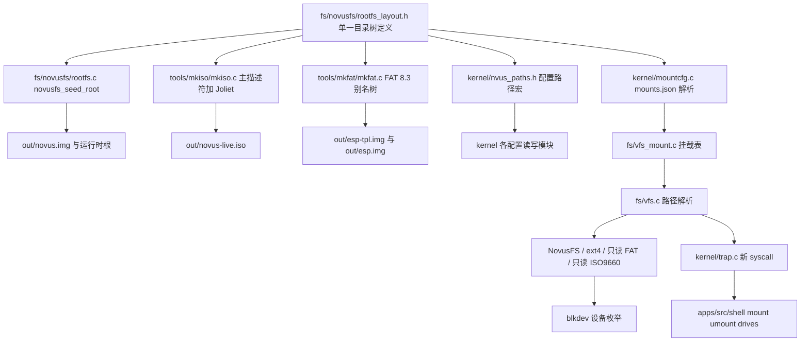

## 用户要求

把用户给出的根目录树同时落实到 ISO 安装镜像、运行时系统盘与 ESP 安装模板；现有散落在根目录的配置文件迁入新树并同步修改引用；`disk0`、`disk1`、`media/cdrom0`、`media/usb0`、`media/usb1` 不能只是空目录，必须真正能够挂载，并且终端能进入、列出、读取其中内容；U 盘与光盘介质上的常见文件系统也要能读。

## 产品概述

Novus OS 的启动介质、安装模板与系统根分区统一呈现同一套目录结构：既包含 `.novusfs` 元数据与挂载点，也包含 `Novus`、`ProgramData`、`Users` 等系统与用户目录。打开安装镜像、进入文件管理器或在终端列出根目录时，看到的结构一致；插入磁盘、U 盘或光盘后，对应挂载点下出现真实内容，而不是空占位。

## 核心功能

- 三套镜像统一目录树：系统盘为可写真实目录树；ISO 与 ESP 为静态镜像，名称按各自格式限制做确定性转写，引导必需文件位置保持不变，安装与 UEFI 启动不受影响。
- `.novusfs/fsinfo` 与 `mounts.json` 具备真实可读内容：前者描述卷信息，后者是可被系统读取的挂载表；`.novusfs/trash` 为可用目录。
- 原有字体、语言、用户账户、注册表配置迁入新树对应位置，功能不丢失，首次启动与安装后均正常读写。
- 真实挂载：`disk0`、`disk1`、`media/*` 可挂载启动期探测到的卷，支持现有系统卷与其他常见介质格式；提供 `mount`、`umount`、`drives` 命令，`ls`、`cd`、`cat`、`tree` 可跨挂载点访问。
- 文件管理器与设备管理器展示新目录、常用位置与设备名；终端主目录指向 `/Users/alice`。
- 构建校验、自检、启动与安装冒烟同步更新，文档给出目录、名称映射与挂载表规范。

## 视觉与交互效果

打开 ISO 可见完整目录层级；启动后文件管理器左侧出现「磁盘、用户、媒体、元数据」等快捷位置，根目录列表显示 `.novusfs`、`disk0`、`disk1`、`media`、`Novus`、`Program Files`、`Program Files (Windows)`、`ProgramData`、`temp`、`Users`。终端 `ls /` 得到同一结果，`drives` 以表格列出挂载点、设备、卷类型与只读状态；插入 U 盘后 `ls /media/usb0` 显示文件，`cd /media/cdrom0` 与 `cat` 可读。

## 技术栈选择

完全复用现有工程，不引入新框架或第三方依赖：

- 内核与文件系统：freestanding C（`Makefile:SRC` 编译进 `out/NOVUS.EFI`），沿用 `fs/novusfs/`、`fs/vfs.c`、`kernel/blkdev.c` 的静态表、无分配器、有界缓冲风格。
- 用户态：`apps/` 为 Rust `no_std`、无分配器，通过 `APPS_NAMES` 嵌入内核；沿用 `sys::call` 直接编号调用与 `BUILTINS` 命令表。
- 主机镜像工具：C11 + `_GNU_SOURCE`，`tools/mkfsnovus`、`tools/mkiso`、`tools/mkfat`；`mkfsnovus` 与内核共享 `NOVUSFS_HOST_SRCS`。
- 校验与冒烟：Python 脚本 + QEMU（OVMF）启动/安装；ISO 采用 ISO9660 主描述符加 Joliet 补充描述符，ESP 为 FAT 8.3。
- WSL 下 Rust 工具链位于 `/home/dev/.rustup` 与 `/home/dev/.cargo`，构建需显式设置 `PATH` 指向 `stable-x86_64-unknown-linux-gnu/bin`。

## 实现方案

**总体策略**：以一份共享声明作为唯一真源，驱动「镜像生成」与「运行时格式化」两条链路；用固定容量挂载表把现有单根 VFS 扩展为按路径切换的多挂载点，再通过三个新系统调用把能力暴露给终端。分三阶段落地：目录树与路径迁移、多挂载框架与终端、只读介质后端。

**1. 单一真源与目录树生成**
新增 `fs/novusfs/rootfs_layout.h`，以宏与条件编译数组定义约 77 个目录路径、2 个元数据文件、FAT/ISO 主描述符的 8.3 大写别名表、允许的挂载点列表，以及 `fsinfo`、`mounts.json` 的内联文本。各消费方按需定义 `NOVUS_LAYOUT_WANT_*` 后包含，避免静态数组未使用告警。
新增 `fs/novusfs/rootfs.c`（同时编入内核与宿主 `mkfsnovus`），实现 `novusfs_mkdir_p()`（先 `novusfs_dir_lookup` 再 `novusfs_mkdir`，规避 `novusfs_dir_add` 不查重）、`novusfs_seed_root()` 与 `novusfs_root_top_count()`，由 `novusfs_format()` 末尾调用。这样 `out/novus.img`、安装后的 GPT 分区、以及 live 会话实际使用的 ramdisk 根都得到同一棵树，**无需改写 live root 采用逻辑**：当前 `novusfs_set_root()` 一旦指向 liveimg 会让 `vfs_root_persistent()` 误判为已安装系统并强制登录，改动面大且风险高。代价是 `novusfs_selftest()` 的「root 只有 2 项」断言需改为按 `novusfs_root_top_count()` 校验，这是唯一受影响的既有断言。

**2. 三套镜像的名称映射**

- NovusFS：原名逐字写入，大小写敏感；`NOVUSFS_NAME_MAX 56`、`NOVUSFS_MAX_INODES 1024` 足够（约 80 个 inode），`SYS_SIZE_MB ?= 8` 不变。
- ISO：主描述符使用 8.3 大写别名（保持标准合规与 `dir_find` 自检），Joliet SVD 使用 UCS-2BE 原名（含空格、大小写、前导点）。`mkiso` 的 `node_t` 增加 `jname/jlen/jlba`，`assign_dirs` 为主树与 Joliet 树各分配目录扇区，`write_dir` 支持跨扇区目录 extent（现有单扇区假定在 13 条根记录加长名时接近上限），写四张路径表（主/Joliet × 大小端），并把 `PVD/BRVD/SVD/TERM/PATH/ROOT` 的 LBA 常量整体后移。`MAX_NODES` 提到 256、`MAX_NAME` 提到 128；引导文件 `EFI/BOOT/BOOTX64.EFI`、`SYSTEM.IMG`、`ESP.IMG` 仍在主描述符根，El Torito 目录与 isohybrid 分区表完全不动。
- FAT ESP：`mkfat` 按别名表预建目录树，`dir_pool[16]` 提到 128，`dir_get_or_create()` 改为按名返回已存在的 `dir_t`（现有实现每次都新建池项，树中有重名父目录会写坏），`make_short_name` 接受显式别名；`fsinfo`、`mounts.json` 以内联数据写入（`file_arg_t` 增加内存数据源），不新增宿主临时文件。
- ISO 与 ESP 上的 `disk0`、`media/*` 只是静态目录镜像，真实挂载语义只存在于可写的 NovusFS 根，文档中明确说明。

**3. 配置路径迁移**
新增 `kernel/nvus_paths.h` 集中定义：`/Novus/fonts/font.bin`、`/Novus/kernel/core/language.cfg`、`/ProgramData/Security/users.db`、`/Novus/wincompat/system32/registry.cfg`、`/.novusfs/fsinfo`、`/.novusfs/mounts.json`、`/Users/alice`。同步修改 `graphics/nd_font.c`（`kmain.c:274` 与 `:343` 两处调用同一函数）、`kernel/lang.c`、`kernel/session.c`、`kernel/win32.c`、`kernel/install.c:write_language()`（改为按嵌套路径查父目录再创建，写入后仍重建 Merkle）。`tools/tools.mk` 的 `--put` 目标改为 `/Novus/fonts/font.bin`，`mkfsnovus:inject_file()` 支持嵌套路径且对已存在文件直接覆盖写入。

**4. 多挂载点框架**
新增 `fs/vfs_mount.h/c`：固定 8 项挂载表（根 + 5 个挂载点 + 余量），`vfs_resolve_path()` 从 `vfs_root()` 起逐组件遍历，每解析一级就把累积路径与挂载表比对，命中则切换到该 `vfs_fs_t` 的根 inode。复杂度 O(路径深度 × 8)，无分配、无额外遍历，天然支持嵌套挂载。`vfs_resolve_parent()` 供创建/删除/改名使用，并拒绝挂载点本身被删除。
保留 `vfs_lookup_path()`、`vfs_parent_path()`、`vfs_novusfs_wrap()`、`ext4_vfs()` 作为 wrapper（后者新增 `*_init(view, fs)` 非单例版本），把 `fs/vfs.c` 与 `fs/ext4/vfs_ext4.c` 的静态单例改为可注入，避免技术债。`kernel/sched.h` 的 FD 增加 `struct vfs_fs *fs`；`kernel/trap.c` 九处 `vfs_root()` 改为解析结果，FD 读写从 FD 取 fs，避免跨挂载点用错后端。
新增空闲号 `SYS_MOUNT 22`、`SYS_UMOUNT 23`、`SYS_MOUNTS 24`，沿用 `user_path()` 的有界 UTF-8 校验；`user_mount_t` 加入 `_Static_assert`。挂载/卸载要求已登录、路径必须在 `rootfs_layout.h` 白名单内、禁止覆盖根、禁止跨挂载点 rename、只读挂载的写操作直接失败。

**5. 挂载表与自动挂载**
新增 `kernel/mountcfg.c/h`：以 `vfs_lookup_path` + `stat` + `read` 精确读取 `/.novusfs/mounts.json`（现有 `vfs_read_file` 要求长度完全相等，不能直接读变长文本），实现 4KB 有界、最多 8 条、仅识别固定键、无转义的极简 JSON 扫描器（内核无 JSON 库，也不引入通用解析器）。条目形如「路径、逻辑设备名、卷类型、读写标志」。`mountcfg_apply()` 在 `kmain.c` 的 `vfs_selftest()`/`ext4_selftest()` 之后调用，通过 `blkdev_get_at()` 按 `REMOVABLE/READONLY` 标志把设备分类为 `diskN`、`usbN`、`cdromN`（不改驱动现有名字，缩小爆炸半径），跳过 `BOOT_ONLY` 与已作为根的设备，读取前 4096 字节与 LBA16 扇区按魔数识别卷类型，再挂到静态后端槽并调用 `vfs_mount_add()`。运行时状态通过 `SYS_MOUNTS` 返回，**不回写 `.novusfs`**：现有 Merkle 在提交写后会失效，运行时写元数据会破坏启动校验。`fsinfo` 只含静态卷信息，`cat` 可读。

**6. 只读介质后端（分阶段第二步）**

- `fs/fat/`：把 `arch/x86_64/boot/stage3.c:360-398` 的 FAT16/32 读取器移植为内核版，去掉 UEFI 池分配，改为每实例静态 512 字节扇区缓存与有界目录遍历，支持 FAT12/16/32、8.3 短名、LFN 跳过、4Kn 的 `blkdev_sectors_per_block()` 换算。
- `fs/iso9660/`：解析卷描述符序列，优先选带 `%/E` 转义的 Joliet SVD 根目录记录，把 UCS-2BE 文件标识转成 ASCII，剥离 `;1`，支持多扇区目录 extent 与按 extent 顺序读文件；无 Joliet 时回退主描述符。
- 两者都实现 `vfs_fs_t` 全部操作，写类操作返回失败，`VFS_KIND_FAT`/`VFS_KIND_ISO9660` 加入枚举与 `vfs_kind_name()`。不实现 NTFS（现有只有枚举、无后端，遵循 YAGNI），不实现硬件热插拔事件（挂载发生在启动与显式 `mount -a`）。

**7. 终端、GUI 与验证**
`apps/src/fs.rs` 增加三个 syscall 包装与 `user_mount_t`；`apps/src/shell/cmds.rs` 增加 `mount`、`umount` 内建命令并重写 `cmd_drives`（一次 syscall 拿全表，替代硬编码「single root」），`help` 自动包含；`apps/src/shell/mod.rs` 的 `HOME` 与 `path.rs` 的 `~` 基准改为 `/Users/alice`，词法折叠 `..` 逻辑不变。`apps/src/bin/fileman.rs` 在磁盘页增加常用路径快捷项，不改现有 5 个虚拟目录标签；`kernel/sysinfo.c` 的 `/dev` 列表附带逻辑设备名。
校验侧：`scripts/inspect_img.py` 改为递归列树并对照期望布局；`scripts/_extract_sys.py`、`scripts/_iso_find.py` 去掉「inode2 就是 font.bin」的假设，改为按路径查找；新增 `scripts/check_rootfs.py` 对三套镜像做结构与元数据断言；`scripts/font_smoke.sh`、`qtest.sh`、`scripts/run-install-test.sh` 更新日志标记。新增规范文档并修正 `docs/` 中旧 `/system`、`/home/user` 等路径。

**关键权衡**：Joliet 双树使 ISO 增加约 200KB 目录扇区，远小于内嵌 ESP，换来「打开镜像看到原始目录名」且主描述符仍合规；FAT 8.3 无法与原名完全一致（用户已确认接受）；把目录树放在 `novusfs_format()` 而非仅镜像注入，保证 live 会话与安装后系统一致，代价是格式化自检断言需同步；不改动 live root 采用逻辑，避免会话持久化语义回归。

## 实现说明（执行要点）

- 热路径：`vfs_resolve_path()` 一次遍历完成前缀匹配；`sys_fs_read/readdir` 必须从 `t->fd[index].fs` 取后端，禁止再调 `vfs_root()`；`drives` 一次 `SYS_MOUNTS` 返回全表，避免逐项开文件。
- 日志：复用 `kputs`，统一 `[MOUNT]` 前缀；设备不存在时启动只打印一次汇总，失败信息含路径与卷类型，不含用户数据，不逐设备刷屏。
- 兼容性：保持全部既有 syscall 编号、`user_stat_t`/`user_dirent_t` ABI、`SYSINFO_DIR_*` 编号、引导文件路径与驱动设备名；新增 API 一律以 wrapper 保留旧入口；`NOVUSFS_NAME_MAX`、`VFS_PATH_MAX`、`FS_PATH_MAX` 不变。
- Merkle：所有 seed 与 `--put` 注入都在 `novusfs_merkle_build()` 之前；`kernel/install.c` 写语言后仍重建；运行时不写 `.novusfs`，避免根哈希失效。
- 易错点：NovusFS 大小写敏感，路径宏必须逐字一致；别名表与目录数组同索引，构建时用 `_Static_assert` 校验数量；`novusfs_dir_add()` 不查重，seed 必须先 lookup；`mkfat:dir_get_or_create()` 必须返回已有 `dir_t`；`mkiso:write_dir()` 需支持目录 extent 跨扇区。
- 资源：挂载表 8 项、后端槽按类型各 8 个静态实例；`ext4_fs_t` 含 64 个组描述符，静态占用约数十 KB，控制在可接受范围；FAT/ISO 后端每实例一个扇区缓存，读取受 `FS_IO_MAX 4096` 限制。
- 构建：WSL 中执行需 `PATH=/home/dev/.rustup/toolchains/stable-x86_64-unknown-linux-gnu/bin:...`；`make tools novus-img esp iso` 后依次运行 `scripts/check_rootfs.py`、`scripts/font_smoke.sh`、`scripts/run-install-test.sh`。

## 架构设计



## 目录结构

```
novus-os/
├── Makefile                                   # [MODIFY] 在 SRC 增加 fs/novusfs/rootfs.c、fs/vfs_mount.c、fs/fat/*.c、fs/iso9660/*.c、kernel/mountcfg.c；INC 增加 -Ifs/fat 与 -Ifs/iso9660；保持 OBJS 规则不变。
├── fs/
│   ├── novusfs/
│   │   ├── rootfs_layout.h                    # [NEW] 唯一真源：路径宏、条件编译的目录数组/元数据文件数组/8.3 别名数组/挂载点白名单，以及 fsinfo 与 mounts.json 内联文本；纯 C，不依赖内核头。
│   │   ├── rootfs.c                          # [NEW] novusfs_mkdir_p()、novusfs_seed_root()、novusfs_root_top_count()；兼容宿主与内核编译，先 lookup 再 mkdir，写入两个文本文件。
│   │   ├── novusfs.h                         # [MODIFY] 声明 seed/mkdir_p/top_count 接口；保持既有 ABI 与常量不变。
│   │   └── novusfs.c                         # [MODIFY] novusfs_format() 末尾调用 novusfs_seed_root()；自检 root 条目断言改为按 top_count 校验；保留 /system 测试。
│   ├── vfs.h                                 # [MODIFY] vfs_kind_t 增加 VFS_KIND_FAT 与 VFS_KIND_ISO9660；保留 VFS_KIND_NTFS 占位；不改名长度与路径上限。
│   ├── vfs.c                                 # [MODIFY] vfs_kind_name() 覆盖新类型；nv_fill 抽成 vfs_novusfs_init(view, fs)，保留 vfs_novusfs_wrap/vfs_set_root/vfs_lookup_path/vfs_parent_path wrapper。
│   ├── vfs_mount.h                           # [NEW] 挂载表类型与 vfs_mount_add/remove/at、vfs_resolve_path、vfs_resolve_parent 的接口声明。
│   ├── vfs_mount.c                           # [NEW] 固定 8 项挂载表；逐组件遍历时按累积路径切换 fs；父路径解析拒绝挂载点被删除；有界栈缓冲。
│   ├── ext4/vfs_ext4.c                       # [MODIFY] 抽出 ext4_vfs_init(view, fs) 非单例版本，ext4_vfs() 保留为兼容 wrapper；补齐 rename 缺失时的失败返回。
│   ├── fat/fat.h                             # [NEW] fat_fs_t、fat_mount/unmount、目录项解码与只读语义声明。
│   ├── fat/fat.c                             # [NEW] 移植 stage3.c 的 FAT16/32 读取器为内核版：静态扇区缓存、8.3 短名、跳过 LFN、支持 4Kn 换算；实现 lookup/read/stat/readdir。
│   ├── fat/vfs_fat.c                         # [NEW] 把 fat_fs_t 包装为 vfs_fs_t 的全部操作，写类操作返回失败。
│   ├── iso9660/iso9660.h                     # [NEW] iso9660_fs_t、iso9660_mount/unmount 与 Joliet 选择开关声明。
│   ├── iso9660/iso9660.c                     # [NEW] 扫描卷描述符，优先 Joliet SVD，UCS-2BE 转 ASCII，剥离 ;1，支持多扇区目录 extent 与按 extent 读文件。
│   └── iso9660/vfs_iso9660.c                 # [NEW] 只读 vfs_fs_t 适配器。
├── kernel/
│   ├── nvus_paths.h                          # [NEW] 集中定义字体/语言/用户库/注册表/元数据/HOME 的规范路径宏，供各模块引用。
│   ├── mountcfg.h                            # [NEW] mountcfg_apply/mount/umount/list/logical_name 接口与 user_mount_t 相关声明。
│   ├── mountcfg.c                            # [NEW] 4KB 有界极简 JSON 扫描器、设备逻辑名分类、按魔数识别卷类型、静态后端槽、启动自动挂载、跳过根设备与 BOOT_ONLY 设备。
│   ├── trap.c                                # [MODIFY] 新增 SYS_MOUNT/UMOUNT/MOUNTS 定义、user_mount_t 与静态断言、三个处理函数、g_syscalls 三行；九处 vfs_root() 改为解析结果，FD 携带 fs，只读挂载拒绝写。
│   ├── sched.h                               # [MODIFY] fd 结构增加 struct vfs_fs *fs 前向指针，memset 清零逻辑不变。
│   ├── kmain.c                               # [MODIFY] 在 vfs_selftest/ext4_selftest 之后调用 mountcfg_apply()；不改动 live root 采用与字体加载顺序。
│   ├── lang.c                                # [MODIFY] LANG_FILE 改为 /Novus/kernel/core/language.cfg，逻辑不变。
│   ├── session.c                             # [MODIFY] users.db 读写改为 /ProgramData/Security/users.db，保留首次启动缺文件分支。
│   ├── win32.c                               # [MODIFY] WIN32_REG_PATH 改为 /Novus/wincompat/system32/registry.cfg，定长二进制格式与校验不变。
│   ├── install.c                             # [MODIFY] write_language() 按新嵌套路径查父目录并创建，写入后仍重建 Merkle。
│   └── sysinfo.c                             # [MODIFY] /dev 列表附带 diskN/usbN/cdromN 逻辑名，保持 SYSINFO_DIR_* 编号不变。
├── graphics/nd_font.c                        # [MODIFY] novusfs_lookup_path 目标改为 /Novus/fonts/font.bin，日志文案同步，覆盖 kmain.c 两处调用。
├── tools/
│   ├── tools.mk                              # [MODIFY] NOVUSFS_HOST_SRCS 增加 rootfs.c；mkiso/mkfat 编译加 -Ifs/novusfs；NOVUS_IMG 的 --put 目标改为新字体路径；ISO/ESP 规则保留原有引导文件参数；新增 check-rootfs 目标。
│   ├── mkfsnovus/mkfsnovus.c                 # [MODIFY] inject_file() 支持嵌套路径与覆盖已存在文件；在 Merkle 重建前完成注入；保留校验输出。
│   ├── mkiso/mkiso.c                         # [MODIFY] MAX_NODES 256、MAX_NAME 128；node_t 增加 jname/jlen/jlba 与内联数据源；按共享布局建主树与 Joliet 树；新增 SVD、四张路径表、跨扇区目录 extent；LBA 常量后移；自检改查主根新 LBA。
│   └── mkfat/mkfat.c                         # [MODIFY] dir_pool 提到 128；dir_get_or_create 按名复用；按别名表预建目录树；支持内联 fsinfo/mounts.json 文件；保留 8.3 与 FAT16/32 选择逻辑。
├── apps/src/
│   ├── fs.rs                                 # [MODIFY] 增加 mount/umount/mounts 三个 syscall 包装、user_mount_t 与静态断言；沿用 path_arg 有界校验。
│   ├── shell/mod.rs                          # [MODIFY] HOME 改为 /Users/alice，cd 无参数回主目录。
│   ├── shell/path.rs                         # [MODIFY] ~ 基准改为 HOME 常量，保持词法 .. 折叠与 PATH_MAX 不变。
│   ├── shell/cmds.rs                         # [MODIFY] 新增 mount/umount 内建命令，重写 cmd_drives 用 SYS_MOUNTS 打印真实挂载表，BUILTINS 增加两行。
│   └── bin/fileman.rs                        # [MODIFY] 磁盘页增加 /Users/alice、/media、/.novusfs 等快捷入口；不改五个虚拟目录标签与 View 结构。
├── scripts/
│   ├── inspect_img.py                        # [MODIFY] 递归打印 NovusFS 目录树并对照期望布局输出，供 build-img.sh/build-all.sh 调用。
│   ├── _extract_sys.py                       # [MODIFY] 不再假设 inode2 是 font.bin，按 /Novus/fonts/font.bin 路径查找。
│   ├── _iso_find.py                          # [MODIFY] 去掉 (itbl, inode2_size) 分组假设，改用超块字段统计，适配新 Merkle 根。
│   ├── list_fat16.py                         # [MODIFY] 支持列嵌套 FAT 目录。
│   ├── font_smoke.sh                         # [MODIFY] 更新 [FONT] 与新增 [MOUNT] 日志匹配。
│   ├── run-install-test.sh                   # [MODIFY] 更新安装冒烟期望标记与目录断言。
│   └── check_rootfs.py                       # [NEW] 对 novus.img、novus-live.iso、esp-tpl.img、esp.img 校验目录树、别名映射、fsinfo 与 mounts.json 内容。
├── qtest.sh                                  # [MODIFY] 更新启动冒烟的日志标记与新增挂载自检断言。
├── docs/
│   ├── 根目录结构与挂载规范.md                # [NEW] 目录树、三套镜像名称映射表、mounts.json 字段、fsinfo 格式、挂载点设备映射、新 syscall ABI 与已知限制。
│   ├── INS 快捷方式文件格式规范 V1.0.md       # [MODIFY] /system/share/applications 等旧路径改为新树路径。
│   ├── NUP 应用安装包格式规范 V1.0.md        # [MODIFY] /system/bin 与 /var/db 旧路径改为新树路径。
│   ├── Novus OS Debug 级接口手册 V1.0.md     # [MODIFY] novus-settings 路径与挂载调试接口说明。
│   ├── 用户会话与文件API.md                  # [MODIFY] users.db 新路径与多挂载点访问说明。
│   ├── 终端与命令解释器设计.md               # [MODIFY] 单根假设改为多挂载点，补充 mount/umount/drives 与 HOME。
│   └── M9 Win32 兼容层原型.md                # [MODIFY] 注册表路径与 winprefix 目录说明。
```

## 关键代码结构

```c
/* fs/vfs_mount.h —— 挂载表与跨挂载点解析（接口级） */
#define VFS_MOUNT_MAX 8u

typedef struct vfs_mount {
  char        path[VFS_PATH_MAX];
  vfs_fs_t   *fs;
  blkdev_t   *dev;
  UINT8       readonly;
  UINT8       active;
} vfs_mount_t;

int    vfs_mount_add(const char *path, vfs_fs_t *fs,
                     blkdev_t *dev, int readonly);
int    vfs_mount_remove(const char *path);
UINT32 vfs_resolve_path(const char *path, vfs_fs_t **out_fs);
int    vfs_resolve_parent(char *path, vfs_fs_t **out_fs,
                          UINT32 *parent, char **leaf);
const vfs_mount_t *vfs_mount_at(int index);
```

```c
/* kernel/trap.c 与 apps/src/fs.rs 共享的挂载表 ABI */
typedef struct {
  char   path[64];
  char   dev[16];
  char   fstype[12];
  UINT8  active;
  UINT8  readonly;
  UINT8  pad[2];
} user_mount_t;
_Static_assert(sizeof(user_mount_t) == 96u, "mount ABI drift");
```

`/.novusfs/mounts.json` 采用固定键的扁平数组：`path`、`dev`、`fstype`、`options`，每行一条、无嵌套与转义、总长不超过 4KB、最多 8 条；`path` 必须是 `rootfs_layout.h` 白名单中的绝对路径，`dev` 为 `root` 或 `diskN`/`usbN`/`cdromN` 逻辑名，`fstype` 取 `auto`、`novusfs`、`ext4`、`fat`、`iso9660`，`options` 取 `rw` 或 `ro`。内核解析器逐字符扫描并拒绝未知键，shell 可直接 `cat` 查看。

## Agent Extensions

### SubAgent

- **code-explorer**
- Purpose: 在动工前跨文件复核 `vfs_root()` 调用点、硬编码根级路径、构建规则依赖与镜像校验脚本假设。
- Expected outcome: 产出带行号的完整受影响文件清单，确认无遗漏的九处 syscall 后端取值、四个配置路径、ISO/ESP 引导文件引用与「inode2 即 font.bin」类假设。