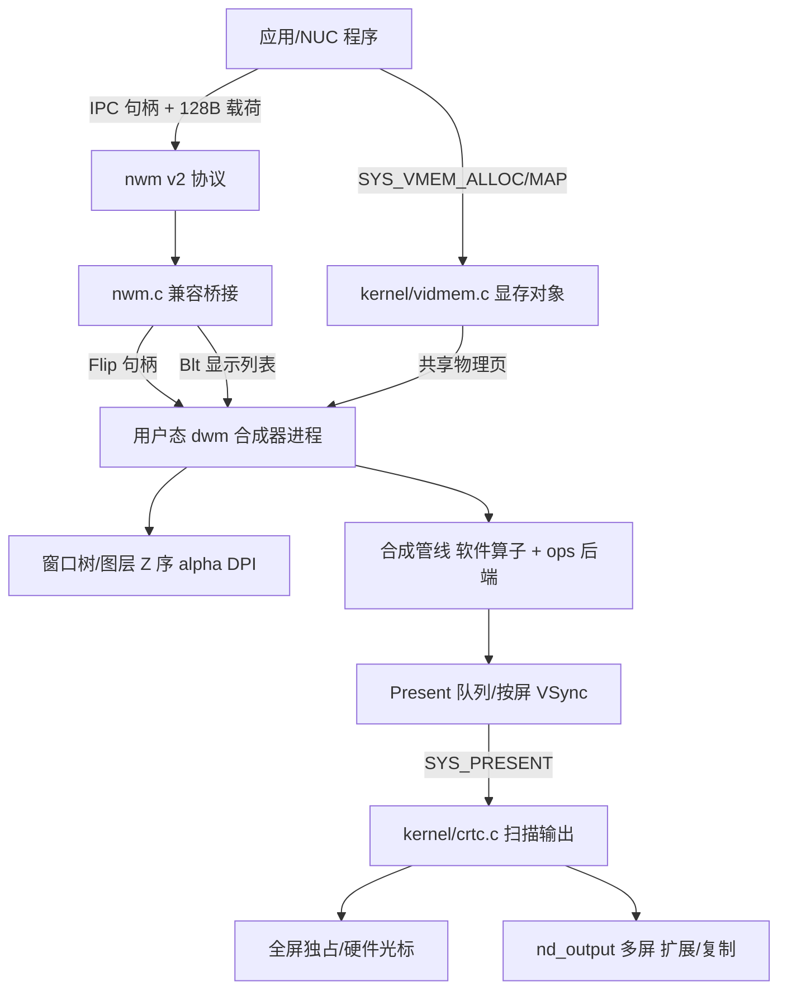

## 产品概述

在现有 Novus OS 上实现一套对标 Windows DWM/WDDM/DXGI 的自研合成器，去掉 Windows 专属 API，适配现有 NovusFS、内核显示栈与 GPU 探测框架。运行后呈现无撕裂的桌面合成、窗口动画与透明模糊效果，并支持多屏与全屏独占。

## 核心功能

- 内核显示底座：显存对象分配器、CRTC/扫描输出抽象、垂直同步信号、硬件光标接口、全屏独占控制。
- 表面重定向：Flip 模型（应用与合成器共享缓冲、零拷贝移交）与 Blt 模型（兼容老 2D 应用的拷贝路径）。
- 用户态合成器进程：窗口树（Z 序、位置、透明度、圆角、DPI）、图层生成、合成管线（纹理采样、alpha 混合、缩放、高斯模糊、色域转换）、按显示器 VSync 的 Present 调度。
- 缩略图服务：复用窗口纹理生成任务栏/切换器缩略图。
- 多显示器：扩展模式（每屏独立合成目标）与复制模式（一份画面多屏输出）。
- 全屏独占接口：应用接管指定 CRTC 扫描缓冲，合成器暂停该屏合成，退出后自动恢复。
- 兼容性：保留现有内核窗口管理器与 1.1/1.2 协议作为回退，内置应用、终端、Win32 兼容层不回归。

## 技术栈

- 内核与显示栈：C + GNU 汇编，x86_64，沿用 `kernel/`、`graphics/`、`wm/` 现有模块与 `Kconfig`/`Makefile` 构建。
- 用户态：Rust `no_std`、无分配器、目标 `x86_64-unknown-none`，通过 `apps/link.ld` 生成扁平镜像，`nuc_spawn_blob()` 映射；`apps/src/sys.rs` 的 `call()` 封装 syscall。
- IPC：现有 `kernel/ipc.c`（32 字节头 + 128 字节载荷 + 命名端口），新表面只传句柄/描述符，不传像素。
- 验证：QEMU（TCG，无 PAT、无真实 VBlank）下的串口自检与显示自检脚本。

## 实现思路

采用“增量分层 + 向后兼容”策略：先补齐内核显示底座与新 ABI，再引入用户态合成器进程，最后把窗口树/表面从内核 WM 逐步迁移过去，全程保留内核 WM 作为可切换回退路径。关键决策：

1. **软件合成先行，硬件后端留缝**：`gpu.c` 探测显示控制器但三家厂商入口均为 `ENODEV`，无 GTT/ring/显存对象。因此合成管线先实现基于 `nd_surface_t` + `gpu2d_copy_row/blit` 的软件算子（alpha 混合、缩放、模糊、色域转换），并定义与 `gpu2d.c` 一致的 `ops` 后端表，未来厂商驱动注册即可切换到硬件着色器，避免“假装能跑”导致花屏。
2. **零拷贝 Flip 通过新增显存对象 ABI**：IPC 载荷仅 128 字节，无法传像素。新增显存对象分配/映射 syscall，句柄走 IPC 传递，应用与合成器映射同一物理缓冲，Present 只移交句柄，无像素拷贝；老 2D 应用走 Blt 路径由内核/合成器侧离屏纹理拷贝。
3. **VSync 双源**：优先用现有 `nd_hal.c` 的 VGA 0x3DA 垂直回读（`present_probe()`/`present_wait_blank()`）加定时器节拍，CRTC 抽象预留真实 VBlank 中断与硬件 flip 入口；QEMU 无真实 VBlank 时退化为定时器模拟，保证功能可验证。
4. **新 syscall 号段**：`trap.c` 中 1–27 已用、40 为 `SYS_WIN32`、60 为 exit，故选用空闲的 28–39 段，避免破坏 ABI；每个新调用一行加入 `g_syscalls[]`，符合现有“一表一 ABI”约定。
5. **迁移不一次性删除**：`nwm_init()/nwm_tick()` 与 Win32 兼容层的 `nwm_owner_*` 全部保留；新增 v2 协议消息与桥接，让旧显示列表窗口经 Blt 路径喂给新合成器。

## 关键架构（修改部分）



## 目录结构

```
novus-os/
├── kernel/
│   ├── vidmem.h / vidmem.c        # [NEW] 显存对象分配器。按 handle 分配/释放/映射共享缓冲（系统内存或 stolen/aperture 后备），记录 owner pid 与引用计数，任务退出时按 pid 回收；供 Flip 零拷贝使用。
│   ├── crtc.h / crtc.c            # [NEW] CRTC/扫描输出抽象。封装 nd_output_t，提供 per-output present 队列、VSync 等待（0x3DA+定时器降级）、扫描缓冲切换(flip)、硬件光标接口、clone/extend 模式、全屏独占所有权管理。
│   ├── dwmsys.h / dwmsys.c        # [NEW] 新显示 ABI 的 syscall 实现：surface create/destroy/map、present、wait_vsync、set_exclusive、cursor；严格校验句柄/owner，避免越权访问。
│   ├── trap.c                     # [MODIFY] 新增 SYS_VMEM_ALLOC/FREE/MAP、SYS_SURFACE_PRESENT、SYS_WAIT_VSYNC、SYS_SET_EXCLUSIVE、SYS_SET_CURSOR 宏与 handler，加入 g_syscalls[]（28–39 段）。
│   ├── kmain.c                    # [MODIFY] 在 gpu_init()/gpu2d_init() 后初始化 vidmem/crtc/dwmsys；CONFIG_NOVUS_DWM 时 launch dwm 进程，未配置时保持 nwm 合成路径。
│   ├── sched.c                    # [MODIFY] tick 中调用 crtc_tick() 做 present/vsync 调度；任务退出钩子回收其显存对象与独占 CRTC。
│   ├── apps.c                     # [MODIFY] g_apps[] 增加 dwm 项，与 Makefile 的 APPS_NAMES 顺序对齐。
│   └── gpu.c / gpu.h              # [MODIFY] 向 vidmem/crtc 暴露 aperture/stolen 基址与 GOP 输出数量桥接（复用已有 getter）。
├── graphics/
│   ├── nd_hal.c                   # [MODIFY] CRTC 接管 scanout/present：独占模式下跳过 nd_present()；向 crtc 暴露输出列表与 vsync 源。
│   └── nd.h                       # [MODIFY] 补充输出枚举/模式助手声明，保持 nd_surface_t/nd_output_t ABI 不变。
├── wm/novus-wm/
│   ├── nwm_proto.h                # [MODIFY] 新增 v2 请求类型（SURFACE_CREATE/DESTROY、FLIP_PRESENT、BLT_SUBMIT、SET_EXCLUSIVE、THUMBNAIL）及定长载荷结构体，保留 v1.1/1.2 类型不变。
│   ├── nwm.c / nwm.h              # [MODIFY] 处理 v2 消息，向 vidmem/crtc 注册表面，旧显示列表窗口经 Blt 桥接喂给 dwm；保留 nwm_owner_* 供 Win32 层。
├── apps/src/
│   ├── bin/dwm.rs                 # [NEW] 用户态合成器入口：初始化表面 ABI、窗口树、事件循环、帧调度。
│   ├── dwm/abi.rs                 # [NEW] 新 syscall 的 Rust 封装与内核共享的表面/图层结构体。
│   ├── dwm/tree.rs                # [NEW] 窗口树与图层列表：Z 序、几何、alpha、圆角裁剪、DPI 缩放，产出图层描述符。
│   ├── dwm/surface.rs             # [NEW] RedirectSurface：Flip（共享句柄零拷贝）与 Blt（离屏纹理拷贝）两条路径。
│   ├── dwm/compose.rs             # [NEW] 合成管线与 ops 后端表：alpha 混合、缩放、高斯模糊、色域转换，软件实现为默认后端。
│   ├── dwm/present.rs             # [NEW] 输出队列与按屏 VSync Present 调度，支持扩展/复制模式与脏矩形。
│   ├── dwm/thumbnail.rs           # [NEW] 缩略图服务，复用窗口纹理生成缩略图图层。
│   ├── lib.rs                     # [MODIFY] 注册 dwm 模块。
│   ├── sys.rs                     # [MODIFY] 添加新 syscall 号包装函数。
│   └── wm.rs                      # [MODIFY] 增加 v2 协议消息封装，保持旧接口可用。
├── Kconfig                        # [MODIFY] 新增 CONFIG_NOVUS_DWM 与 CONFIG_NOVUS_DWM_HW（硬件后端开关），依赖 NOVUS_DISPLAY/NOVUS_WM。
├── Makefile                       # [MODIFY] APPS_NAMES 增加 dwm，纳入 blob 生成与内核镜像；确认新增 kernel C 文件进入编译源列表。
├── docs/Mini-DWM 架构与实现.md     # [NEW] 记录三张 Mermaid 图、ABI 表、后端 ops 契约、迁移与自检步骤。
└── scripts/dwm-selftest.sh / dwm-selftest.c  # [NEW] QEMU 自检：显存对象分配/映射、Flip Present、VSync、clone/extend、独占获取与恢复。
```

## 关键代码结构（接口契约）

```c
/* kernel/trap.c 新增 syscall 号段（28–39，避开 SYS_WIN32=40 / exit=60） */
#define SYS_VMEM_ALLOC      28u  /* rdi=size, rsi=flags -> handle(<0 为错误) */
#define SYS_VMEM_FREE       29u  /* rdi=handle -> 0/-1 */
#define SYS_VMEM_MAP        30u  /* rdi=handle, rsi=va_hint -> va/-1 */
#define SYS_SURFACE_PRESENT 31u  /* rdi=crtc, rsi=layer_desc 数组, rdx=count */
#define SYS_WAIT_VSYNC      32u  /* rdi=crtc -> 0/-1 */
#define SYS_SET_EXCLUSIVE   33u  /* rdi=crtc, rsi=handle(0=释放) -> 0/-1 */
#define SYS_SET_CURSOR      34u  /* rdi=handle, rsi=x, rdx=y -> 0/-1 */
```

```c
/* wm/novus-wm/nwm_proto.h：v2 图层描述符，仅含句柄与元数据，走 128B 载荷 */
typedef struct {
  UINT32 handle;      /* 显存对象句柄 */
  UINT32 win;
  INT32  x, y, w, h;  /* 屏幕坐标 */
  UINT8  alpha;
  UINT8  flags;       /* FLIP / BLT / EXCLUSIVE */
  UINT16 pad;
} nwm_layer_t;
```

## 实施要点

- 性能热点是合成 blit：复用 `gpu2d_copy_row/blit` 与脏矩形（`nd_rect_t`/`nd_cursor_take_damage`），避免每帧全屏重绘；图层遍历为 O(layers×pixels)，用脏区裁剪降低开销。
- 安全：所有新 syscall 校验 handle 归属与 CRTC 独占所有权；IPC 只传句柄，用户指针经 `user_copy()` 逐页校验；Win32 ABI 任务仍 confined 到 `SYS_WIN32`。
- 回退：`CONFIG_NOVUS_DWM=n` 时完全走原 `nwm_tick()`；dwm 进程崩溃或显存分配失败时回退内核合成，不清屏。
- 复体现有模式：离线合成用 `nd_canvas()`/`nd_present()`；复制模式沿用 `nd_mirror_rect()`；VSync 复用 `present_probe()` 的 0x3DA 探测结果。

## Agent Extensions

### SubAgent

- **code-explorer**
- Purpose: 在协议迁移阶段对 `nwm_owner_*`、`nwm_tick()`、IPC 请求分发等所有调用点做跨文件影响分析，确认桥接不遗漏 Win32 兼容层与内置应用。
- Expected outcome: 给出完整的调用点清单与迁移边界报告，据此安全地在 `nwm.c/.h`、`nwm_proto.h` 加入 v2 消息与兼容桥接。