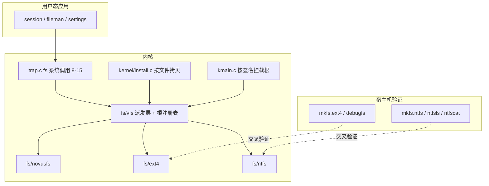

## 产品概述

为 Novus OS 增加 ext4 与 NTFS 两套完整读写驱动，使安装向导里的"系统分区文件系统"不再是置灰选项：用户选 ext4 或 NTFS 时，安装器按文件把系统镜像写入目标分区，启动时由内核识别该文件系统并挂载为根，会话、设置、文件管理器等全部内置应用照常工作。

## 核心功能

- **VFS 派发层**：新增统一文件系统接口与根文件系统注册表，`kernel/trap.c` 的文件类系统调用从"直接调 NovusFS"改为经 VFS 派发；NovusFS 作为第一个后端，行为保持不变。
- **ext4 驱动**（`fs/ext4/`）：超级块（64bit、metadata_csum）、组描述符、inode（256 字节）、extent 树（含索引节点）、块/节点位图、目录（线性 + htree 读取）、块读写；挂载时重放 journal 已提交事务；稀疏文件与大文件（>4GiB、SEEK_HOLE/SEEK_DATA）；xattr（inode 内 + 外部块）、符号链接、硬链接；crc32c 校验；`mkfs.ext4` 等价格式化。
- **NTFS 驱动**（`fs/ntfs/`）：引导扇区、MFT 记录、属性解析（$STANDARD_INFORMATION、$FILE_NAME、$DATA、$INDEX_ROOT/$INDEX_ALLOCATION、$BITMAP、$SECURITY_DESCRIPTOR、$EFS）；resident/non-resident runlist（含稀疏）；LZNT1 解压读取；重解析点（符号链接）解析；$UsnJrnl 变更日志读取与索引 B-tree 目录枚举；加密文件识别（提示"已加密"）；`mkfs.ntfs` 等价格式化。
- **安装器按文件拷贝**：新安装路径遍历 live NovusFS 镜像的目录树，逐个文件写入目标 ext4/NTFS；分步执行、显示进度、可取消；非 NovusFS 目标上 Merkle 整盘校验如实降级为逐文件哈希校验并明确告知用户。
- **启动挂载**：`kmain` 按超级块签名（NovusFS magic / ext4 `0xEF53` / NTFS `"NTFS    "`）识别系统分区文件系统，经 VFS 挂载为根；GPT 查找增加 ext4/NTFS 分区类型 GUID。
- **交叉验证**：ext4 用宿主机 e2fsprogs（`mkfs.ext4`/`debugfs`）生成镜像并校验读写；NTFS 安装 ntfs-3g 后用 `mkfs.ntfs`/`ntfsls`/`ntfscat` 校验（安装软件包需用户审批）。

## 范围边界

- 不做 ext4 实时日志写入（仅挂载时重放）、不做 NTFS 写入压缩、不做 EFS 解密（只识别并提示）、不做文件系统在线修复与 resize。
- live 介质仍从 NovusFS 镜像（`SYSTEM.IMG`）启动，不受影响；已安装系统的系统分区可选三种文件系统之一。
- 不修改 NUC、GPT、FAT、块设备与 NovusFS 的现有磁盘格式。

## 技术栈

- 内核：C（freestanding，x86_64 UEFI），复用 `kernel/blkdev.c`（64 位扇区、分区视图）、`kernel/gpt.c`、`kernel/pmm.c` 与 `fs/novusfs` 的分配器约定。
- 新增：`fs/vfs`（派发层）、`fs/ext4`、`fs/ntfs` 三个目录；`Kconfig` 增加 `CONFIG_NOVUS_VFS` / `CONFIG_NOVUS_EXT4` / `CONFIG_NOVUS_NTFS`。
- 安装器：扩展现有 `kernel/install.c` 分步状态机（`INSTALL_FS_*` 已预留）。
- 验证：宿主机 `mkfs.ext4`/`debugfs`（已有）、`ntfs-3g`（需安装）；QEMU q35 + OVMF + `scripts/run-install-test.sh`。
- 构建：`make` / `make iso`，dev 用户 + `~/.cargo`；生成物提交，普通构建不依赖 Python。

## 实现方案

### 1. VFS 派发层（前置，两个文件系统都要用）

现在 `kernel/trap.c` 的文件类系统调用（编号 8-15）与 `kernel/session.c` 直接调用 `novusfs_*`。新增 `fs/vfs.h`：

```c
typedef struct vfs_ops {
  int (*mount)(void *fs, blkdev_t *dev);
  int (*read_block)(void *fs, UINT64 blk, void *buf);
  int (*write_block)(void *fs, UINT64 blk, const void *buf);
  int (*lookup)(void *fs, UINT32 dir_ino, const char *name, UINT32 *ino);
  int (*readdir)(void *fs, UINT32 dir_ino, UINT32 index, char *name, UINT32 *ino);
  int (*read_file)(void *fs, UINT32 ino, UINT64 off, void *buf, UINT32 len, UINT32 *got);
  int (*write_file)(void *fs, UINT32 ino, UINT64 off, const void *buf, UINT32 len);
  int (*create)(void *fs, UINT32 dir_ino, const char *name, UINT32 *ino);
  int (*unlink)(void *fs, UINT32 dir_ino, const char *name);
  int (*mkdir)(void *fs, UINT32 dir_ino, const char *name, UINT32 *ino);
  int (*stat)(void *fs, UINT32 ino, UINT64 *size, UINT8 *type);
  int (*seek_hole)(void *fs, UINT32 ino, UINT64 off, UINT64 *hole);
  int (*read_xattr)(void *fs, UINT32 ino, const char *key, void *val, UINT32 *len);
  int (*write_xattr)(void *fs, UINT32 ino, const char *key, const void *val, UINT32 len);
  int (*read_link)(void *fs, UINT32 ino, char *target, UINT32 len);
} vfs_ops_t;

int  vfs_register(const char *name, const vfs_ops_t *ops, UINT32 magic_off,
                  const UINT8 *magic, UINT32 magic_len);
int  vfs_mount_root(blkdev_t *dev);      /* 按签名探测并挂载 */
void *vfs_root(void);                     /* 当前根文件系统私有数据 */
const vfs_ops_t *vfs_root_ops(void);
```

`kernel/trap.c` 的 8-15 号调用改为 `vfs_root_ops()->xxx(vfs_root(), …)`；NovusFS 提供第一个 `vfs_ops_t` 适配（内部仍调 `novusfs_*`），行为与现在逐字节一致——这一步单独提交、单独回归，确保"换了派发层但 NovusFS 路径零变化"。

### 2. ext4 驱动（`fs/ext4/`，与 NTFS 并行推进）

- **super.c**：解析 1024 字节超级块（`s_inodes_count`、`s_blocks_count_lo/hi`、`s_log_block_size`、`s_inode_size`、`s_feature_incompat` 的 64bit/metadata_csum、`s_desc_size`、`s_checksum_type`、UUID、卷名）；支持块大小 1K/2K/4K（默认 4K）。
- **group.c**：组描述符表（64bit 时 `ext4_group_desc` 为 64 字节，含块/节点位图、inode 表的高位字段）。
- **inode.c**：256 字节 inode；`i_flags`（`EXT4_EXTENTS_FL`、`EXT4_HUGE_FILE_FL`）；extent 树解析（`eh_depth==0` 线性 extent，`>0` 走 `ex_index` 索引节点，支持任意深度）；`i_block` 内的快速符号链接（目标 < 60 字节）；`i_links_count` 硬链接。
- **bitmap.c**：块位图与节点位图的分配/释放（写路径）。
- **dir.c**：线性目录遍历；`dir_index`（htree）开启时按 dx_root 的间接块读取，退化为"顺序扫全部块"以保证正确。
- **extent.c**：extent → 逻辑块到物理块的映射，含未初始化 extent 的处理；稀疏文件的空洞在读路径返回零、不落盘。
- **xattr.c**：inode 内 `ibody` xattr 与外部 xattr 块（`i_file_acl`）解析与写入；`user.*` 命名空间。
- **journal.c**：挂载时读取 journal inode（inum 8）的描述符块与提交块，对**已提交事务**做 redo（只写数据块，不处理撤销）；跳过未提交与校验失败的事务并打印一行 `[EXT4] journal: replayed N blocks`。
- **crc32c.c**：反射多项式 0x1EDC6F41 的表驱动实现；校验 inode、目录块、位图、超级块校验和（`metadata_csum` 开启时）。
- **ext4.c**：`vfs_ops_t` 适配 + `ext4_format()`（写超级块、组描述符、位图、根目录、lost+found、journal inode 预留）。
- 内存策略：沿用 NovusFS 的做法——每文件系统一个固定私有结构 + 有界栈缓冲（4 KiB 块缓冲 ×2），路径查找用固定深度循环，不做无界递归。

### 3. NTFS 驱动（`fs/ntfs/`，与 ext4 并行）

- **boot.c**：解析 OEM 名 `"NTFS    "`、`bytes_per_sector`、`sectors_per_cluster`、`mft_lcn`、`mft_record_size`、`clusters_per_index_block`、卷序列号与卷标。
- **mft.c**：MFT 记录头（`"FILE"`/`"BAD"`/`"END"`）、更新序列数组（fixup：把每个 512 字节扇区末尾的 USA 值替换回去）、属性遍历（`ATTR_STANDARD_INFORMATION`/`ATTR_FILE_NAME`/`ATTR_DATA`/`ATTR_INDEX_ROOT`/`ATTR_INDEX_ALLOCATION`/`ATTR_BITMAP`/`ATTR_OBJECT_ID`/`ATTR_EFS`）。
- **attr.c**：resident（值在记录内）与 non-resident（runlist：`(length, 位移)` 对，位移为负表示稀疏洞）两种形态；多 runlist 片段拼接；`$DATA` 无名流即文件内容，命名流（ADS）列出但默认不打开。
- **lznt1.c**：压缩属性解压（16 位标志 + LZ77 变长的分块格式），读到未压缩数据时原样返回。
- **index.c**：`$INDEX_ROOT` + `$INDEX_ALLOCATION` 的 B-tree 目录枚举（索引项按 `$FILE_NAME` 排序，含子节点 `VCN` 尾指针）；支持只读顺序遍历与按键查找。
- **usn.c**：`$UsnJrnl:$J` 记录流解析（`USN_RECORD` 头部 + 文件名偏移），供"最近变更"查询。
- **efs.c**：检测 `$EFS`（属性名 `$EFS`）存在即标记"已加密"，读尝试返回明确错误码 `NTFS_E_ENCRYPTED`，由文件管理器显示提示。
- **reparse.c**：`$REPARSE_POINT` 的符号链接标签（`SYMLINK`）解析为目标路径。
- **ntfs.c**：`vfs_ops_t` 适配 + `ntfs_format()`（引导扇区 + MFT 前 16 个元数据文件 + 根目录 + $Bitmap + $LogFile 占位）。

### 4. 安装器按文件拷贝

`kernel/install.c` 现有分步状态机新增"文件拷贝"路径（`install_begin(index, fs)` 中 `fs != INSTALL_FS_NOVUS` 时进入）：

1. `TABLE`：建 GPT + 写 ESP（与现在一致）。
2. `FORMAT`：在系统分区上 `ext4_format()` / `ntfs_format()`（一步）。
3. `COPY`：**分步遍历 live NovusFS 树**（`novusfs_dir_readdir` 递归，固定深度），每个文件按 64 KiB 分片 `vfs_root_ops()->write_file()`；进度按"已拷贝文件数 / 总文件数"与字节数双轨显示。
4. `VERIFY`：非 NovusFS 目标上，逐文件重读并比对哈希（复用现有哈希原语），在向导里明确写成"逐文件校验"而非 Merkle 整盘校验；NovusFS 目标保持现有 Merkle 流程不变。

`install.h` 新增 `INSTALL_PHASE_FORMAT` 与 `INSTALL_PHASE_COPY`（仅追加，不改既有编号）；`apps/src/install.rs` 与 `setup.rs` 同步阶段文案；向导方案页三个选项全部可选，NTFS/ext4 下显示"按文件拷贝 + 逐文件校验"的说明。

### 5. 启动挂载（`kernel/kmain.c`）

- 系统分区查找：在 `gpt_find_novusfs` 之外增加 `gpt_find_type()`（ext4 Linux data `0FC63DAF-8483-4772-8E79-3D69D8477DE4` 或 Linux filesystem `E6D9D4F0-...`，NTFS basic data `EBD0A0A2-B9E5-4433-87C0-68B6B72699C7`）。
- `vfs_mount_root(part_dev)` 按签名探测：读第 0 块，匹配 NovusFS magic / ext4 `0xEF53`（偏移 0x438）/ NTFS OEM 名（偏移 3）→ 调对应后端 `mount` → `vfs` 记录根。
- Merkle 自检：仅当根为 NovusFS 时执行（现状）；ext4/NTFS 时打印 `[BOOT] system partition is ext4/ntfs: integrity check skipped`，如实降级，不假装通过。
- 会话、文件管理器、设置的文件读写经 VFS，无需改动应用层。

## 实现要点

- **提交与回归节奏**：VFS 派换层单独一步并回归（NovusFS 路径零行为变化）；ext4 与 NTFS 各自"读路径 → 宿主编图验证 → 写路径 → 再验证"；最后才是安装器与启动链路。
- **性能**：块读写走 `blkdev_read/write`（每次 ≤128 KiB 与 USB/SATA 传输块对齐）；目录枚举一次读入整个目录块；extent/runlist 查找为 O(深度)，避免每次线性扫盘；`crc32c` 用 256 项表。
- **内存**：每文件系统一个静态私有结构（≤3 个 4 KiB 缓冲 + 有界路径缓冲），不引入堆分配；MFT 记录与 extent 节点用固定 4 KiB 栈缓冲逐级解析。
- **日志**：`[VFS]` / `[EXT4]` / `[NTFS]` / `[INST]` 前缀；挂载失败打印签名与特征位，便于定位"特性不支持"与"镜像损坏"的差别。
- **安全**：所有来自磁盘的长度/偏移先校验再使用（inode 大小 vs 卷大小、runlist 长度 vs 分区大小、MFT 记录号 vs 记录总数），越界一律返回错误而不是信任。
- **Kconfig**：`CONFIG_NOVUS_VFS` 默认 y；`CONFIG_NOVUS_EXT4` / `CONFIG_NOVUS_NTFS` 默认 y（可在小内存配置关闭）；关闭时安装向导对应选项隐藏。

## 架构设计



## 目录结构

```
novus-os/
├── fs/
│   ├── vfs.h / vfs.c                 # [NEW] 统一接口、签名探测、根注册表
│   ├── novusfs/
│   │   └── vfs.c                     # [NEW] NovusFS 的 vfs_ops_t 适配（行为不变）
│   ├── ext4/
│   │   ├── ext4.h                    # [NEW] 私有结构与常量
│   │   ├── super.c group.c inode.c extent.c bitmap.c dir.c xattr.c
│   │   ├── journal.c crc32c.c        # [NEW] journal 重放与校验和
│   │   └── format.c vfs.c            # [NEW] mkfs 与 vfs 适配
│   └── ntfs/
│       ├── ntfs.h                    # [NEW] 私有结构与常量
│       ├── boot.c mft.c attr.c index.c usn.c efs.c reparse.c lznt1.c
│       └── format.c vfs.c            # [NEW] mkfs 与 vfs 适配
├── kernel/
│   ├── trap.c                        # [MODIFY] fs 系统调用改经 VFS 派发
│   ├── install.c / install.h         # [MODIFY] FORMAT/COPY 阶段、fs 分支、逐文件校验
│   ├── kmain.c                       # [MODIFY] 按签名挂载 ext4/NTFS 根、Merkle 降级
│   ├── gpt.c/.h                      # [MODIFY] 增加按分区类型 GUID 查找
│   └── session.c                     # [MODIFY] 经 VFS 读写 /users.db
├── apps/src/
│   ├── install.rs                    # [MODIFY] 新阶段与文案
│   └── bin/setup.rs                  # [MODIFY] 文件系统三选一全部可选 + 说明
├── Makefile / Kconfig / configs/novus_defconfig   # [MODIFY] 新源文件与开关
├── scripts/
│   └── verify-fs.sh                  # [NEW] 宿主编图 + QEMU 往返验证脚本
├── docs/
│   ├── ext4 与 NTFS 驱动.md          # [NEW] 结构、特性矩阵、验证方法、限制
│   ├── 图形安装向导设计与实现.md     # [MODIFY] 文件拷贝路径与校验降级说明
│   └── 中文支持与 Win11 桌面.md      # [MODIFY] 文件管理器多文件系统说明
├── README.md / changes.md            # [MODIFY] M12 里程碑
└── tools/fontgen/ + graphics/nd_font_cjk.c       # [MODIFY] 新文案字模
```

## 关键代码结构

```c
/* fs/vfs.h —— 三个文件系统共用的最小接口。
 * 每个后端只实现自己支持的部分，不支持的置 NULL，VFS 返回 -ENOSYS。 */
typedef struct vfs_ops vfs_ops_t;   /* 见实现方案第 1 节 */

/* 签名探测：mount 时读第一块，按 (偏移, 字节) 匹配。 */
typedef struct {
  const char *name;        /* "novusfs" / "ext4" / "ntfs" */
  UINT32      magic_off;
  UINT8       magic[8];
  UINT32      magic_len;
  const vfs_ops_t *ops;
} vfs_backend_t;
```

```c
/* fs/ext4/ext4.h —— 私有结构（接口级） */
typedef struct {
  blkdev_t   *dev;
  UINT32      block_size;      /* 1024 << s_log_block_size */
  UINT32      inodes_per_group;
  UINT32      inode_size;
  UINT64      blocks_count;
  UINT32      first_data_block;
  UINT32      desc_size;       /* 64bit 特征时为 64 */
  UINT8       has_64bit;
  UINT8       has_metadata_csum;
  UINT8       has_journal;
  UINT32      journal_inum;
  UINT8       buf[4096];       /* 有界块缓冲 */
} ext4_fs_t;
```

```c
/* fs/ntfs/ntfs.h —— 私有结构（接口级） */
typedef struct {
  blkdev_t   *dev;
  UINT32      sector_size;
  UINT32      cluster_size;
  UINT64      mft_lcn;
  UINT32      mft_record_size;
  UINT32      index_block_size;
  UINT32      mft_record_count;
  UINT8       rec[4096];       /* 单条 MFT 记录缓冲（含 fixup） */
} ntfs_fs_t;
```

## Agent Extensions

### SubAgent

- **code-explorer**
- Purpose: 动手前彻底梳理 `kernel/trap.c` 的 fs 系统调用（8-15）全部调用点、`fs/novusfs` 对外 API 的使用面、`kernel/kmain.c` 的系统分区挂载链，以及 `kernel/install.c` 的现有阶段机，确保 VFS 派换不遗漏任何直接调用。
- Expected outcome: 一份带文件与行号的调用点清单，作为 VFS 适配与回归验证的对照表。

### Skill

- **lsp-code-analysis**
- Purpose: 在 VFS 派换、ext4/NTFS 两个驱动接入后做语义级核对：检查 `vfs_ops_t` 实现与声明的字段一致性、`install.h` 新增阶段号在 C 与 Rust 两侧的同步、`kmain.c` 挂载链的类型与错误路径。
- Expected outcome: 接口实现一致性核对结果，编译前发现字段缺失或偏移不一致。