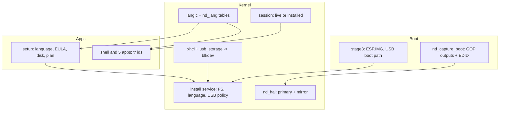

## 产品概述

在 M10 桌面上交付阶段 1：live 环境免登录、安装后首次设置账户；壳层与全部内置应用支持中英文即时切换；安装器新增语言选择、用户协议与文件系统选择，并补齐 USB 存储识别；显示侧实现固件 GOP 多输出、EDID 首选分辨率与多显示器镜像。

## 核心功能

- **会话分流**：live 介质启动时自动进入名为 live 的会话，不显示账号密码；只有安装到持久 NovusFS 后才要求首次创建账户与登录；安装模式只启动安装器。
- **全系统双语**：壳层、窗口管理器、登录、安装器、文件管理器、任务管理器、设置、网络管理均从统一字符串表取文案；安装器首屏与设置页可切换，切换即时生效；已安装系统把语言写入系统盘，首次启动继承。
- **安装器流程**：语言（双语标签）→ 用户协议（GPLv2 要点、免责声明、数据清除提示，必须勾选）→ 磁盘 → 方案 → 确认 → 进度 → 完成/失败。
- **文件系统选择**：NovusFS 可选并实际安装；NTFS/ext4 显示为规划中且不可选，注明需要后续驱动里程碑，接口预留文件系统参数。
- **磁盘识别**：新增 xHCI + SCSI BOT 的 USB 存储驱动，USB 磁盘出现在安装器列表；显示总线类型、容量、分区表状态与不可选原因；正在启动的 USB 介质标记为不可写目标；所有等待有超时，驱动失败不影响启动。
- **显示适配**：引导阶段枚举全部 GOP 输出，读取 EDID 首选分辨率并选择最接近的模式；主输出渲染，其余输出镜像同一桌面；界面显示输出数量、分辨率与数字/模拟类型。连接器精确区分 eDP/DP/HDMI/VGA 留给原生驱动里程碑。

## 范围边界

- 本轮不实现 NTFS/ext4 的格式化与读写，不实现原生 DP/eDP/HDMI 驱动、扩展桌面、IDE/RAID/MMC 驱动与 USB 热插拔。
- 多显示器本轮只做镜像；不同分辨率按左上角裁剪，文档说明。
- AP 核相关功能不在本阶段范围。

## 技术栈

- 内核与图形：C（freestanding，x86_64 UEFI），沿用 NovusDisplay、nvgui、Novus-WM、IPC。
- 内置应用：Rust `no_std`（x86_64-unknown-none），扁平 NUC 镜像内嵌内核。
- 存储：`kernel/blkdev`、`kernel/gpt`、`fs/novusfs`；新增 xHCI/BOT 驱动注册为 `blkdev_t`。
- 构建：mingw 交叉 gcc + `make`；Rust 以 dev 用户与 `~/.cargo` 构建；字符串与主题生成物提交仓库，普通构建不依赖 Python。
- 验证：QEMU q35 + OVMF；安装脚本、USB 目标、桌面截图与串口日志。

## 实现方案

### 1. 多语言单一来源

新增 `tools/langgen/strings.toml`，每条包含语义 id 与 zh/en 两列；`langgen.py` 一次生成：

- `graphics/nd_lang.h/.c`：`lang_id_t` 枚举、两张字符串表、`nd_tr()`、`nd_lang_set/get/version()`。
- `apps/src/lang.rs`：同序 `Id` 枚举、ZH/EN 表、`tr()`、`set/get/version()`、`poll(sys_port)`。
- `langgen.py --check` 校验生成物是否过期；`check_sources.py` 扫描 C/Rust 源文件，发现字符串表之外的 CJK 字面量即失败，防止迁移漏项。
- `tools/fontgen/fontgen.py` 增加 `strings.toml` 扫描，避免文案迁出源码后缺字。

运行时：

- 新增 `kernel/lang.c/.h`：`lang_init()` 在根文件系统挂载后读取 `/config/language`（仅持久根），`lang_save()` 写回；live 只存内存。
- `sysinfo` 新增 `REQ_LANG 0x030F`，请求 `{set,value}`，回复 `{lang,version}`；`nd_lang_set()` 递增版本。
- 壳层在空闲 tick 同时比较主题与语言版本，变化时重建控件树；Rust 应用在 `ui::poll()` 中按约一秒轮询语言版本，变化时重绘并更新窗口标题。
- 英文布局：新增 `ui::fit(text,max_px)` 与按像素宽度计算的列位置，替换任务管理器/文件管理器的固定列；1024×768 与 1280×800 下验收。

### 2. 会话分流

- `session.h` 增加 `session_enter_live()`、`session_live()`、`session_display_name()`。
- `session_init()`：`novusfs_root_persistent()==0` 时直接进入 live 会话（`g_logged_in=1`，不读 users.db）；持久根保持“首次建账户/登录”逻辑。
- `kmain`：安装模式启动 `setup`；否则 live 不启动登录窗口，持久根启动 `session`。语言初始化必须在 `nd_demo_init()` 之前。
- 壳层页脚显示 `Live 会话 / Live session`；电源操作在 live 下允许。

### 3. 安装器

- 页面改为：语言、协议、磁盘、方案、确认、进度、完成/失败，侧栏 7 步；语言页同时承担欢迎内容，标题用双语常量，选择后其余文案立即切换。
- 协议页：分页/滚动的 EULA 文本（每条不超过 90 字节，避免 WM 单段 96 字节上限），必须勾选同意才能继续；内容为 GPLv2 要点、无保修声明、整盘数据清除提示。
- 方案页：文件系统选择，NovusFS 可用；NTFS/ext4 置灰并显示“需要后续驱动里程碑”，不允许选中。
- `install_begin` 扩展文件系统参数（0 NovusFS，1 NTFS，2 ext4）；非 0 返回 `INSTALL_ERR_FS`，为后续实现留出 ABI。
- 语言交接：`INSTALL_OP_LANG` 记录选择；安装校验阶段挂载新系统分区后写入 `/config/language`，再卸载，保证首次启动语言一致。
- 磁盘页显示总线（AHCI/NVMe/USB）、容量、分区表状态、不可选原因与刷新按钮。

### 4. USB 存储

- `kernel/pci.c` 支持 64 位 BAR 对：读取高 32 位、合成物理地址，仍要求低于 4 GiB。
- 新增 `kernel/xhci.c/.h`：PCI 发现（class 0x0C/0x03/0x30）、BAR0 映射、控制器复位与运行、命令环/事件环/ERST、端口复位与速度识别、Enable Slot、Address Device、控制传输读取设备/配置描述符、SET_CONFIGURATION。
- 新增 `kernel/usb_storage.c/.h`：BOT 的 CBW/CSW、INQUIRY、READ CAPACITY、READ10/WRITE10、Bulk-Only Reset 与 Clear Feature Halt；单次传输上限 64 KiB，块层 128 KiB 写请求内部拆分。
- 所有等待使用有界轮询与超时；失败只打印 `[USB]` 日志并继续启动，不阻塞调度器。
- `blkdev_t` 增加 `bus` 字段（AHCI/NVMe/USB/RAM），`install_disk_t` 透出；新增 `BLKDEV_FLAG_BOOT_MEDIUM`。
- 引导阶段从 `LoadedImage->DeviceHandle` 的设备路径解析 USB 端口与 PCI 地址，写入共享内存保留尾部；xHCI 匹配后给启动盘打 `BOOT_MEDIUM`。解析失败时保守处理：所有 USB 磁盘不可作为安装目标。
- 安装规则：可移除磁盘允许作为目标，但必须可写、非启动介质、容量达标、裸盘或 Novus 自身两分区布局；其他分区表仍拒绝。

### 5. 显示多输出

- `uefi.h` 补 `EFI_EDID_ACTIVE_PROTOCOL`、设备路径节点、GOP QueryMode/SetMode 函数类型。
- `nd_capture_boot` 改为 `LocateHandleBuffer(GOP)` 枚举最多 4 个输出；对每个输出读取 EDID 第一详细时序得到首选分辨率与数字/模拟类型，在 `QueryMode` 中选择最接近且不超过 4 GiB、32bpp RGB/BGR 的模式并 `SetMode`；失败保留当前模式。
- 新增 `nd_output_t` 与 `nd_outputs()`：记录每个输出的分辨率、pitch、格式、首选分辨率、数字/模拟、主输出标记。
- 镜像：`nd_copy_rect` 在源/目标 surface 间做像素格式转换；当绘制目标是屏幕时，`nd_blit` 与光标绘制后把脏矩形复制到其余输出。不同分辨率按左上角裁剪并记录一次日志。
- 无 EDID 或单输出时行为与现在一致；新增 EDID 解析与像素转换的无硬件自检，加入 `nd_selftest`。
- 设置页“系统”新增显示输出卡片，数据来自 `SYSINFO_REQ_DISPLAY`。

## 架构设计



## 目录结构

```
tools/langgen/strings.toml        # [NEW] 中英文案唯一来源（含 EULA 行）
tools/langgen/langgen.py          # [NEW] 生成 C/Rust 字符串表，支持 --check
tools/langgen/check_sources.py    # [NEW] 检查源码中残留 CJK 字面量
graphics/nd_lang.h/.c             # [NEW 生成] lang_id_t、两张表、nd_tr、语言状态
kernel/lang.c/.h                  # [NEW] 读取/保存 /config/language，供启动与 sysinfo 使用
graphics/nd_hal.c                 # [MODIFY] GOP 多输出、EDID、SetMode、镜像、EDID 自检
graphics/nd_core.c                # [MODIFY] nd_blit 后镜像脏矩形；nd_copy_rect 辅助
graphics/nd.h                     # [MODIFY] nd_output_t、nd_outputs、nd_mirror_rect
graphics/nd_demo.c                # [MODIFY] 全量文案迁移、live 用户、语言版本重建
graphics/nd_ime.c                 # [MODIFY] 候选窗文案迁移
arch/x86_64/include/uefi.h        # [MODIFY] EDID 协议、设备路径节点、GOP 函数类型
arch/x86_64/boot/stage3.c         # [MODIFY] 解析 USB 启动路径并发布共享内存
kernel/shared_mem.h               # [MODIFY] 追加 boot_usb_* 字段与偏移断言
kernel/session.c/.h               # [MODIFY] live 会话、显示名与启动分流
kernel/sysinfo.c/.h               # [MODIFY] REQ_LANG、REQ_DISPLAY 与回复
kernel/install.c/.h               # [MODIFY] 文件系统参数、语言写入、USB 规则、总线字段
kernel/blkdev.h/.c                # [MODIFY] bus 字段、BOOT_MEDIUM 标志
kernel/pci.c/.h                   # [MODIFY] 64 位 BAR 对支持
kernel/xhci.c/.h                  # [NEW] xHCI 控制器、端口、传输与枚举
kernel/usb_storage.c/.h           # [NEW] BOT 磁盘，注册 blkdev_t
kernel/kmain.c                    # [MODIFY] lang_init、xhci_init、会话启动顺序
apps/src/lang.rs                  # [NEW 生成] Id、ZH/EN 表、set/get/poll
apps/src/ui.rs                    # [MODIFY] 语言轮询、fit 与列宽工具
apps/src/sinfo.rs                 # [MODIFY] lang/display 请求
apps/src/install.rs               # [MODIFY] fs 参数与语言操作
apps/src/bin/setup.rs             # [MODIFY] 七页流程、EULA、语言、文件系统选择
apps/src/bin/session.rs           # [MODIFY] 双语登录/建账户
apps/src/bin/fileman.rs           # [MODIFY] 双语、动态列宽
apps/src/bin/taskman.rs           # [MODIFY] 双语、动态列宽
apps/src/bin/settings.rs          # [MODIFY] 语言项、显示输出卡片、双语
apps/src/bin/netman.rs            # [MODIFY] 双语
Makefile                          # [MODIFY] 新源文件、lang 目标、lang-check
Kconfig / configs/novus_defconfig # [MODIFY] CONFIG_NOVUS_USB
scripts/run-install-test.sh       # [MODIFY] 新流程按键、USB 目标模式
docs/多语言与显示输出支持.md      # [NEW] 语言表、切换、持久化、输出检测与镜像
docs/图形安装向导设计与实现.md     # [MODIFY] 七页流程、EULA、FS 选项、USB 规则
docs/中文支持与 Win11 桌面.md      # [MODIFY] 双语说明
docs/M8 内置系统应用.md            # [MODIFY] 语言轮询与动态列宽
README.md / changes.md            # [MODIFY] M11 阶段 1
```

## 关键代码结构

```c
/* graphics/nd_lang.h（生成） */
typedef enum { LANG_SHELL_START, /* ... */ LANG_COUNT } lang_id_t;
const char *nd_tr(lang_id_t id);
void nd_lang_set(UINT32 lang);   /* 0 zh, 1 en */
UINT32 nd_lang_get(void);
UINT32 nd_lang_version(void);
```

```c
/* kernel/install.h —— 只追加的安装 ABI */
#define INSTALL_ERR_FS 7u
#define INSTALL_FS_NOVUS 0u
#define INSTALL_FS_NTFS  1u
#define INSTALL_FS_EXT4  2u
#define INSTALL_OP_LANG  7u
int install_begin(UINT8 index, UINT8 fs);   /* 非 0 返回 -1，err=INSTALL_ERR_FS */
void install_set_language(UINT8 lang);      /* 校验阶段写入新系统盘 */
```

```c
/* graphics/nd.h —— 多输出描述与镜像 */
#define ND_MAX_OUTPUTS 4u
typedef struct {
  UINT8  available, digital, primary;
  UINT16 width, height, pref_w, pref_h;
  UINT32 pitch, bgr;
  UINT64 fb_phys, fb_size;
} nd_output_t;
const nd_output_t *nd_outputs(UINT32 *count);
void nd_mirror_rect(nd_rect_t r);  /* 主输出已绘制后复制到其余输出 */
```

## 实现要点

- **xHCI 风险控制**：所有寄存器等待、端口复位、命令/传输完成都设上限；初始化失败只降级为“无 USB 磁盘”，不能 panic 或卡住 tick。
- **启动盘识别保守策略**：设备路径解析不确定时，所有 USB 磁盘标记为启动介质，宁可拒绝目标也不能写掉运行中的介质。
- **镜像性能**：只复制脏矩形；每帧最多 4 个输出；像素格式只支持 32bpp RGB/BGR，其他输出跳过并记录。
- **语言切换一致性**：C 侧壳层重建静态控件树；Rust 应用重绘并更新窗口标题；安装器在开始安装前锁定语言并交给内核写入新盘。
- **英文排版**：所有固定列改为按 `ui::width()` 计算；长文案用 `ui::fit()` 截断；1024×768 下无越界。
- **字体**：迁移完成后重跑 `fontgen`；`langgen --check` 与 `check_sources.py` 纳入验收，避免缺字或漏译。
- **兼容性**：`SYS_SETUP` 只追加 op 与参数；共享内存只在保留尾部追加并更新断言；单输出、无 USB、无 EDID 的机器保持现有行为。

## 设计风格

沿用 Novus Fluent：Mica 渐变画布、表面/卡片三层次、1 px 描边、单一强调色；新旧页面使用同一套令牌，不引入新的视觉语言。

## 安装向导（900×600）

- 左侧 240 px 品牌与 7 步导航：语言、协议、磁盘、方案、确认、进度、完成；当前步强调色圆点，完成步显示对勾。
- 语言页：顶部双语标题“选择语言 / Select language”，两个 140×36 分段按钮（中文、English），下方三条安装前提示；选择后整页即时切换。
- 协议页：内容卡片内 8–10 行等宽文本，右侧细滚动条；下方勾选框“我已阅读并同意 / I accept”，未勾选时主按钮为禁用灰。
- 磁盘页：每块磁盘一行，左侧总线徽标（AHCI/NVMe/USB）、名称、容量，右侧状态；不可选行整体降为次要文字色并附原因。
- 方案页：文件系统三选一卡片，NovusFS 选中；NTFS/ext4 卡片降低对比度并标注“规划中 / Planned”，点击只更新说明，不改变选择。
- 确认页保留红色警告卡与勾选；进度页保留四阶段清单与进度条；完成/失败页按钮与现有风格一致。

## 设置新增

- 个性化页增加“语言 / Language”卡片，中英分段按钮，切换后立即重建壳层并持久化。
- 系统页增加“显示输出”卡片：每行显示输出序号、分辨率、数字/模拟、主输出标记；无多输出时显示“单输出”。

## 字体与颜色

- 中文 16 px 点阵，英文 5×7 点阵（1x 正文、2x 标题）；英文使用同一套字号，不额外放大。
- 颜色继续取语义令牌：accent #0067C0 / #4CC2FF，surface #FFFFFF / #202020，card #FBFBFD / #272727，stroke #E1E5EA / #3A3A3A，danger #C42B1C / #FF99A4。
- 英文文案比中文长，按钮宽度按文本测量，不使用固定字符数；列表列位置动态计算。

## Agent Extensions

### SubAgent

- **code-explorer**
- Purpose: 迁移前完整梳理 C 壳层、IME、6 个 Rust 应用与安装器的中文字面量、窗口标题、固定列布局，以及 session/blkdev/display 的调用点。
- Expected outcome: 带文件与行号的清单，作为字符串表拆分和迁移顺序的依据。

### Skill

- **lsp-code-analysis**
- Purpose: 在扩展 `install_disk_t`、`sysinfo` 请求、`blkdev_t`、`nd_display_t` 后做语义级引用核对，确认 C/Rust 两侧结构同步且无遗漏调用点。
- Expected outcome: 协议字段与结构体的引用清单，编译前发现类型或偏移不一致。