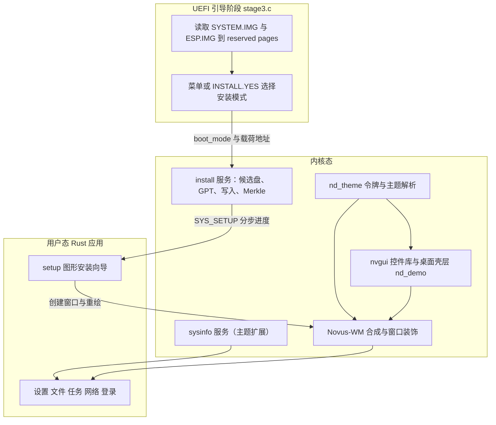

## 产品概述

Novus OS 桌面体验与系统安装流程的整体升级。以现有 Windows 11 Fluent 视觉为基础深化为统一的 Novus Fluent 设计语言，提供浅色、深色与跟随时间自动切换；桌面壳层与全部内置应用按同一套颜色、间距、圆角、字号和图标规则重做。同时新增进入系统图形环境后运行的图形安装向导，把原本的文本安装菜单变成可看、可读、可回退的分步安装流程。

## 核心功能

- 统一设计语言：语义化颜色令牌（画布、表面、卡片、描边、主次文字、强调色、成功/警告/危险）、间距与圆角规范、组件规格、图标绘制规则，壳层与应用共同遵守。
- 主题体系：浅色与深色两套完整配色，支持浅色、深色、跟随时间三种模式，切换即时生效；设置页提供模式、强调色、壁纸选择，安装向导同样跟随主题。
- 桌面壳层重做：Mica 渐变桌面与水印、右侧桌面磁贴；居中悬浮任务栏含开始、搜索、固定与运行中应用指示、系统托盘、日期时钟；开始菜单含搜索框、已固定网格、推荐列表、用户与电源页脚；快捷设置浮层含主题模式、强调色、壁纸、网络状态与电源操作。
- 内置应用统一重做：设置（左导航加卡片内容）、文件管理器（侧栏加面包屑加列表）、任务管理器（概览加进程表）、网络管理（状态卡片加设备列表）、登录/首次建账户窗口，全部支持深色模式与统一交互反馈。
- 图形安装向导：从引导菜单选择安装或检测到安装标记后，进入图形环境自动打开；包含欢迎、磁盘选择、安装方案、确认、进度、完成/失败六个步骤。
- 磁盘与风险控制：列出全部候选磁盘及容量、分区表状态、不可选原因；整盘擦除前给出明确警告与二次确认；写入开始前可取消，开始后如实提示不可撤销；无可用磁盘、载荷缺失、写入失败、校验失败都有独立说明页。
- 安装执行与反馈：分区表创建、引导分区与系统分区写入、文件系统校验树重建分阶段执行，进度条与阶段清单实时更新，完成后可直接重启或关机。

## 范围边界

- 安装程序只处理本机可写的整块磁盘；从 USB 启动介质安装到 USB 目标盘不在本次范围内，保留主机侧脚本方式并在文档中说明。
- 不改变现有可执行格式、文件系统磁盘结构与分区表格式，只新增读取、写入与校验接口。

## 技术栈

- 内核与图形：C（freestanding，x86_64 UEFI），沿用 NovusDisplay（nd）、nvgui 控件库、Novus-WM 与 IPC。
- 内置应用：Rust `no_std`（x86_64-unknown-none），沿用扁平二进制内嵌内核的打包方式。
- 存储：沿用 `kernel/gpt.c`、`kernel/blkdev.c`、`fs/novusfs`（含 WAL 与 Merkle 树）。
- 构建：顶层 `Makefile` + `Kconfig`，mingw 交叉 gcc；Rust 工具链在 `/home/dev/.cargo`，构建需以 dev 用户执行。
- 文档：`docs/` 下 Markdown 规范，生成物（字模、主题头文件）提交仓库，普通构建不依赖 Python。

## 实现方案

### 1. 设计令牌单一来源，消除 C/Rust 双份调色板

当前 `graphics/nvgui.c:theme_init()` 与 `apps/src/ui.rs` 各维护一份颜色常量，文档也明确要求"手工保持一致"，这是已存在的技术债。改为：

- 新增 `tools/themegen/theme.toml` 作为唯一令牌源，描述浅色/深色两套语义色、圆角、间距、字号与行高。
- 新增 `tools/themegen/themegen.py`，生成三个文件并提交：`graphics/nd_theme.h`（令牌结构与常量）、`graphics/nd_theme.c`（两张色表与解析函数）、`apps/src/theme.rs`（Rust `Palette` 与两套常量）。
- `make theme` 手动重新生成；构建只使用生成物，不引入 Python 依赖，符合现有 `fontgen`/`imegen` 的约定。
- `nvgui.c:theme_init()` 改为从 `nd_tokens()` 填充 `ng_theme_t`，窗口管理器、壳层、应用都从同一组语义色取值。

关键收益：深色模式不是"再加一套常量"，而是同一份令牌的第二种解析结果，后续新增颜色只改一处。

### 2. 语义角色 + 运行时主题解析

- `nd_theme.h` 定义 `nd_theme_mode_t`（浅色/深色/自动）、`nd_role_t`（画布/表面/卡片/弱背景/描边/正文/次要文字/强调/反白/成功/警告/危险）与 `nd_tokens_t`。
- `nd_theme_set_mode()` 更新模式并递增 `nd_theme_version()`；`nd_theme_resolve()` 在自动模式下用 `kernel/rtc.c:rtc_now()` 的小时数解析（19:00 至 07:00 为深色），由壳层分钟级时钟刷新顺带检查。
- `nvgui` 增加角色色标签与面板：`ng_role_label()` 在绘制时解析角色，避免控件缓存旧颜色；壳层重建时无需逐控件改色。
- 主题切换：`ng_theme_apply()` 就地替换 `ng_theme_t` 并触发全屏重绘，窗口管理器标题栏在绘制时读取当前主题，自动跟随；壳层通过重建静态控件树刷新角色色，演示窗口关闭属于可接受行为并在文档说明。
- `kernel/sysinfo.h` 的 `SYSINFO_REQ_THEME` 只做**尾部追加**：`mode`、`resolved`、`version` 三个 `UINT32`，保留 `accent`、`wallpaper` 原顺序。`apps/src/sinfo.rs` 增加对应结构与 `set_mode()`。
- Rust 应用启动时读取主题，之后约每秒比对一次 `version`，变化则切换 `Palette` 并重绘；sysinfo 不可用时回退浅色。

### 3. 壳层与应用改造

- 桌面壳层仍由内核态 nvgui 绘制（`graphics/nd_demo.c`），重写为：桌面磁贴区、悬浮任务栏、开始菜单、快捷设置浮层。运行中应用指示通过 `apps_count()` 与 `sched_find_name()` 判断，不新增 IPC。
- 新增少量通用控件：角色色标签、开关、分段选择器、图标块（用矩形/线/圆拼 24x24 字形）、徽标、分隔线、卡片面板。控件池仍为固定容量，不引入分配器。
- 应用侧 `apps/src/ui.rs` 升级为组件库：页面骨架、导航栏、卡片、区块标题、列表行、主/次/危险按钮、开关、进度、空态、页脚。所有应用按同一套组件重写布局，保留原有功能与数据来源。
- Novus-WM 协议做最小扩展：新增 `NWM_OP_ROUND_FILL` 与 `NWM_OP_ROUND_FRAME`（半径放在 `h` 字段），使客户端能画圆角卡片、胶囊按钮与页签。同步 `wm/novus-wm/nwm_proto.h`、`nwm.c:paint_shape()`、`apps/src/wm.rs` 与协议文档；不做图片、透明通道与图标资源。
- 客户端在 `apps/src/wm.rs` 内统计每帧 shape/text 数量，超限时通过 `sys::write` 打印警告，避免被 WM 静默截断。

### 4. 图形安装器：引导阶段只暂存，内核执行，用户态驱动

安装链路拆成三段，避免在启动阶段写复杂 UI，也避免内核 tick 被长时间占用：

1. **UEFI 引导阶段**（`arch/x86_64/boot/stage3.c`）

- 复用 `esp_read_reserved()` 把 `ESP.IMG` 暂存到 reserved pages，新增全局 `g_esp_base/g_esp_size`，在 `stage3_finish()` 写入共享内存尾部。
- `kernel/shared_mem.h` 在 0x2F0 起的保留尾部新增 `esp_img_base`（0x2F0）、`esp_img_size`（0x2F8）、`install_flags`（0x300），并同步偏移断言；不移动任何既有字段。
- 菜单第 3 项改为"图形安装"，选择后设置 `boot_mode = SHM_BOOT_MODE_INSTALL` 并继续进入内核；`INSTALL.YES` 同样进入图形安装。文本安装 `install_run()` 保留在 `CONFIG_NOVUS_INSTALLER_TEXT=y` 下作为无图形环境回退。

2. **内核安装服务**（`kernel/install.c/.h`）

- 候选盘枚举：复用 `blkdev_count/get_at`、`gpt_read`、`gpt_find_esp`、`gpt_find_novusfs`，按整盘、可写、非分区、非只读、容量下限、无外来系统（ESP 或 NovusFS）判定，并给出不可选原因码。内核阶段只枚举 AHCI/NVMe，USB 介质天然不出现。
- 写入流程：`gpt_write()` 建表 → 按 1 MiB 对齐写 ESP 与系统分区 → `blkdev_partition_init()` 建立目标分区视图 → `novusfs_mount()` → 增量 Merkle 重建 → `novusfs_super_flush()`。
- 分步状态机：`install_step()` 每次做约 128 KiB 拷贝或 32 个 Merkle 块，单步控制在 2 ms 量级；进度以千分比与阶段码返回，用户态循环调用并重绘，UI 始终可响应。
- 授权与生命周期：内核启动 `setup` 后记录 `g_setup_pid`，`SYS_SETUP` 只接受该 pid；单实例安装；安装进行中 `sched_kill` 拒绝结束该进程；进程异常退出时安装状态标记失败，避免"半途而废仍显示进行中"。
- `kernel/blkdev.c/.h` 增加 `blkdev_release()`，释放安装用的分区视图槽位，防止反复重试耗尽 16 个设备槽。

3. **用户态安装向导**（`apps/src/bin/setup.rs` + `apps/src/install.rs`）

- 六页流程：欢迎、磁盘选择、安装方案、确认、进度、完成/失败；左右分栏，左侧步骤导航，右侧内容卡片，底部主次按钮。
- 磁盘选择页同时展示可选盘与不可选盘及原因；确认页展示将创建的两个分区、容量与"整盘数据将被清除"警告，并提供勾选确认。
- 进度页展示阶段清单（建表、引导分区、系统分区、校验树）与百分比；写入开始前允许取消，开始后按钮改为"安装进行中"。
- 完成页提供"立即重启""关机"；失败页展示错误码、可读原因与"重试/返回"，并提示目标盘可能已不可启动。

### 5. 应用注册与启动解耦（前置改造）

`kernel/apps.c` 目前用固定索引 4 表示 session，`apps_launch(4)`、`nd_demo.c` 的 0 至 3、`settings.rs` 的应用数组都依赖顺序。新增 `setup` 会打乱全部索引，因此：

- 新增 `apps_find()` 已存在，补充 `apps_launch_name(const char *name)` 与 `apps_index(name)`。
- `apps_launch()` 的登录闸门改为按名字判断：`session` 永久放行；`setup` 在安装模式或已登录时放行；其余应用要求已登录。
- `kmain.c` 改为按名字启动 `session`；安装模式下改为启动 `setup` 并跳过登录窗。
- `nd_demo.c` 与 `settings.rs` 全部改为按名字启动；`sysinfo` 新增按名字 spawn 的请求（0x030E，16 字节名字），保留按索引的旧请求以兼容。
- `Makefile` 的 `APPS_NAMES` 增加 `setup`，`build/apps_blobs.h` 自动包含新 blob。

### 6. 兼容、回退与安全

- 系统调用只追加：`SYS_SETUP = 19`，不改动 1 至 18 与 60；`g_syscalls[]` 增加 `"setup"` 条目。
- 共享内存只在保留尾部追加并更新静态断言，总大小仍为 8 KiB。
- 不修改 NUC、FAT、GPT、NovusFS 的磁盘格式；Merkle 只把一次性重建重构为可迭代，`novusfs_merkle_build()` 保持原签名与原行为，现有自检不受影响。
- 安装是破坏性操作：候选盘判定沿用并加强引导阶段规则，拒绝运行介质与外来系统盘；所有失败都在写表之前完成判定。
- 文档明确：从 USB 启动并安装到另一块 USB 盘不在本次范围；主机侧 `scripts/install.sh` 仍是该场景的方式。

## 实现要点

- **构建与验证环境**：所有 make 命令通过 `sudo -u dev -H bash -lc 'source ~/.cargo/env && cd /home/dev/novus-os/novus-os && make'` 执行；root 下 cargo 不可见。`xxd` 用于生成应用 blob，缺失会导致 `build/apps_blobs.h` 失败，验证前先确认。
- **字模**：所有新增中文文案位于 `graphics/`、`wm/`、`apps/src/` 与 `kernel/`，改完运行 `python3 tools/fontgen/fontgen.py` 再提交 `graphics/nd_font_cjk.c`，否则显示空心方框。
- **主题与绘制预算**：客户端每帧最多 40 个 shape、48 段文本、每段 96 字节，窗口最多 8 个。新版页面按"每屏不超过 36 shape、32 段文本"设计，卡片与分隔线复用矩形而非叠加多层。
- **深色对比度**：强调色不直接作为小字号正文；深色下强调色使用亮蓝并搭配深色反白文字；描边与卡片层次至少保持一档明度差。
- **安装性能**：整体复杂度 O(镜像大小)，内存为两个 4 KiB 块缓冲加迭代表；拷贝与哈希均按块推进，避免一次性大分配。进度回调不写日志，只在阶段切换时输出 `[INST]` 行，防止串口刷屏拖慢安装。
- **失败一致性**：GPT 写入成功即视为"已提交"，后续任何失败都不回滚分区表，失败页必须提示磁盘可能不可启动；`blkdev_release()` 与 `novusfs_unmount()` 在所有退出路径执行。
- **爆炸半径控制**：不改 WAL、inode、目录项语义；不改引导阶段现有文本安装的成功路径；新增协议 op 使用新编号，旧客户端行为不变；壳层重建只影响演示窗口的开关状态。

## 架构设计



## 目录结构

```
novus-os/
├── tools/themegen/
│   ├── theme.toml                         # [NEW] 设计令牌唯一来源：浅/深语义色、圆角、间距、字号
│   └── themegen.py                        # [NEW] 生成 C 头/源与 Rust 令牌；支持 --check 比对是否过期
├── graphics/
│   ├── nd_theme.h                         # [NEW 生成] nd_theme_mode_t、nd_role_t、nd_tokens_t、间距与圆角常量
│   ├── nd_theme.c                         # [NEW 生成] 浅/深两张色表、nd_tokens()、nd_theme_set_mode()、nd_theme_resolve()
│   ├── nvgui.h                            # [MODIFY] 角色色标签/面板、开关、分段选择器、图标块、徽标、分隔线 API
│   ├── nvgui.c                            # [MODIFY] theme_init 改为读取 nd_tokens；新增控件绘制；主题切换全屏重绘
│   └── nd_demo.c                          # [MODIFY] 重写桌面壳层：磁贴、任务栏、开始菜单、快捷设置、时钟与主题联动
├── wm/novus-wm/
│   ├── nwm_proto.h                        # [MODIFY] 新增圆角填充/圆角描边 op，沿用现有显示列表上限
│   └── nwm.c                              # [MODIFY] paint_shape 支持圆角；标题栏与焦点态从当前主题取色
├── kernel/
│   ├── install.h                          # [NEW] 安装服务接口、阶段码、错误码、磁盘记录结构
│   ├── install.c                          # [NEW] 候选盘判定、GPT、载荷写入、分区视图、增量 Merkle、分步状态机、授权
│   ├── shared_mem.h                       # [MODIFY] 0x2F0 起新增 esp_img_base/esp_img_size/install_flags 与偏移断言
│   ├── apps.h                             # [MODIFY] 增加按名字查找与启动接口
│   ├── apps.c                             # [MODIFY] apps_launch_name、按名字的 session/setup 闸门
│   ├── kmain.c                            # [MODIFY] install_init；安装模式启动 setup，普通模式按名字启动 session
│   ├── sysinfo.h                          # [MODIFY] 主题回复尾部追加 mode/resolved/version；新增按名字 spawn 请求
│   ├── sysinfo.c                          # [MODIFY] 主题读写委托 nd_theme；名字 spawn；磁盘列表可选透出
│   ├── trap.c                             # [MODIFY] 新增 SYS_SETUP=19 与调用者授权校验
│   └── blkdev.h / blkdev.c                # [MODIFY] 新增 blkdev_release()，释放安装分区视图槽位
├── fs/novusfs/
│   ├── novusfs.h                          # [MODIFY] 声明增量 Merkle 迭代器与 begin/step/finish/abort
│   └── merkle.c                           # [MODIFY] 将一次性重建重构为迭代器；novusfs_merkle_build 保持原签名
├── arch/x86_64/boot/
│   └── stage3.c                           # [MODIFY] 暂存 ESP.IMG、发布载荷地址与 boot_mode、菜单文案与文本回退开关
├── apps/src/
│   ├── theme.rs                           # [NEW 生成] Palette 结构与浅/深两套常量
│   ├── ui.rs                              # [MODIFY] 组件库：页面骨架、导航、卡片、列表行、按钮、开关、进度、空态
│   ├── wm.rs                              # [MODIFY] 圆角 op 封装；每帧 shape/text 预算统计与超限告警
│   ├── sinfo.rs                           # [MODIFY] 主题 mode/resolved/version；按名字 spawn
│   ├── install.rs                         # [NEW] SYS_SETUP 客户端：列盘、开始、单步、取消、进度结构
│   ├── lib.rs                             # [MODIFY] 导出 theme 与 install 模块
│   └── bin/
│       ├── setup.rs                       # [NEW] 六页安装向导：欢迎、磁盘、方案、确认、进度、完成/失败
│       ├── settings.rs                    # [MODIFY] 左导航加卡片布局；主题模式、强调色、壁纸；安装入口
│       ├── fileman.rs                     # [MODIFY] 侧栏加面包屑加列表，统一空态与选中态
│       ├── taskman.rs                     # [MODIFY] 概览卡片加进程表，统一按钮与状态色
│       ├── netman.rs                      # [MODIFY] 状态卡片加设备列表，统一错误提示
│       └── session.rs                     # [MODIFY] 登录/建账户界面按新组件重做，支持深色
├── scripts/
│   └── run-install-test.sh                # [NEW] 生成空白 AHCI 磁盘并启动 QEMU，用于安装端到端验证
├── docs/
│   ├── Novus UI 设计语言规范 V1.0.md      # [NEW] 令牌、组件、壳层与应用线框、图标与动效、绘制预算
│   ├── 图形安装向导设计与实现.md          # [NEW] 流程图、磁盘判定矩阵、错误码与文案、性能与安全边界
│   ├── 中文支持与 Win11 桌面.md           # [MODIFY] 更新为新设计语言与主题说明
│   ├── M8 内置系统应用.md                 # [MODIFY] 更新应用列表与 setup 的启动方式
│   ├── Novus-WM 与 IPC 协议规范 V1.0.md   # [MODIFY] 补充圆角 op 与版本兼容说明
│   └── …                                  # README.md、changes.md 同步里程碑与变更记录
├── Makefile                               # [MODIFY] theme 生成目标；APPS_NAMES 增加 setup
└── tools/fontgen/charset.txt              # [MODIFY] 新增界面语料；重新生成 graphics/nd_font_cjk.c
```

## 关键代码结构

```c
/* graphics/nd_theme.h（生成）——壳层、WM 与安装器共用的语义色 */
typedef enum { ND_THEME_LIGHT = 0, ND_THEME_DARK = 1, ND_THEME_AUTO = 2 } nd_theme_mode_t;

typedef struct {
  UINT32 canvas_top, canvas_bottom, surface, card, subtle, stroke;
  UINT32 text, dim, accent, on_accent, success, warn, danger;
} nd_tokens_t;

const nd_tokens_t *nd_tokens(void);        /* 已按 auto 解析的当前令牌 */
nd_theme_mode_t nd_theme_mode(void);
void nd_theme_set_mode(nd_theme_mode_t mode);
UINT32 nd_theme_version(void);             /* 每次变化递增，供客户端轮询 */
void nd_theme_resolve(void);               /* auto 模式按 RTC 小时解析 */
```

```c
/* kernel/install.h 与 kernel/trap.c —— SYS_SETUP(19) 的请求/回复契约 */
#define SETUP_OP_LIST  0u   /* index → setup_disk_t */
#define SETUP_OP_BEGIN 1u   /* index → status，写表前完成全部校验 */
#define SETUP_OP_STEP  2u   /* → setup_progress_t，单步有界工作 */
#define SETUP_OP_ABORT 3u   /* 写表前可取消 */

typedef struct { UINT8 op; UINT8 index; UINT8 pad[2]; } setup_req_t;

typedef struct {
  UINT8  phase;     /* 0 空闲 1 建表 2 引导分区 3 系统分区 4 校验树 5 完成 6 失败 */
  UINT8  err;       /* 0 正常，非 0 见文档错误码表 */
  UINT16 permille;
  UINT32 done_kb;
  UINT32 total_kb;
} setup_progress_t;

typedef struct {
  char   name[16];
  UINT64 sectors;
  UINT32 flags;
  UINT8  eligible;  /* 0/1 */
  UINT8  reason;    /* 分区/只读/可移除/太小/已有系统 */
} setup_disk_t;
```

```c
/* fs/novusfs/novusfs.h —— 可分步执行的完整性树构建，供安装进度驱动 */
typedef struct novusfs_merkle_iter novusfs_merkle_iter_t;

int  novusfs_merkle_begin(novusfs_fs_t *fs, novusfs_merkle_iter_t *it);
int  novusfs_merkle_step(novusfs_merkle_iter_t *it, UINT32 max_blocks);
int  novusfs_merkle_finish(novusfs_merkle_iter_t *it, UINT8 out_root[32]);
void novusfs_merkle_abort(novusfs_merkle_iter_t *it);
/* novusfs_merkle_build() 内部改为 begin/step/finish，行为与根值不变 */
```

## 设计风格

Novus Fluent：在现有 Windows 11 Fluent 语言上补齐系统性。核心是"三层次 + 一条强调色"：Mica 渐变画布、白色或石墨色表面、更亮一档的卡片；1px 低对比描边建立边界，阴影只由窗口管理器施加，强调色只用于可操作元素与当前选中态。整体克制、留白充足、层级清晰，避免多彩卡片与过度装饰。

浅色为"云母"：桌面 #EEF2F8 到 #E3EAF3，表面 #FFFFFF，卡片 #FBFBFD；深色为"石墨"：桌面 #1A1E24 到 #11151A，表面 #202020，卡片 #272727。深色不使用纯黑，避免点阵文字发虚。

## 布局与组件

- 8px 网格：4/8/12/16/24/32；控件高 32、主按钮高 36、列表行 28、标题栏 32。
- 圆角：控件 6、卡片与浮层 10、胶囊 18（半高）；仅通过新增圆角 op 绘制，边框与填充同半径。
- 组件：主按钮（强调色填充 + 反白文字）、次按钮（表面 + 描边）、危险按钮（仅确认页使用红色描边）、开关、分段选择器、列表行（悬停弱背景、选中左侧 3px 强调条）、卡片（标题 + 说明 + 内容）、状态徽标、空态（图标块 + 一行说明）、步骤导航（序号圆点 + 连接线）。
- 图标语言：24x24 内用 3 至 5 个矩形/线/圆拼出单色字形，强调色只用于一处细节；不使用位图资源，保证深浅色自动适配。

## 页面规划（5 个界面）

1. 桌面壳层

- 桌面：Mica 渐变 + 右下角低对比水印；右侧竖排四个磁贴（文件、任务、设置、安装），悬停浮起 1px。
- 任务栏：底部居中 560x48 悬浮胶囊；左起开始徽标、搜索；中部固定应用图标，运行中应用下方 3px 强调条；右侧网络、音量、日期时钟。
- 开始菜单：480x560 浮层卡片；顶部搜索框（支持拼音），"已固定" 3x2 图标网格，"推荐" 四行最近项，页脚用户与电源菜单。
- 快捷设置：320x260 浮层；主题三段选择（浅色/深色/自动）、强调色 2x4 色板、壁纸三选、网络状态行、音量滑杆、电源按钮。

2. 设置

- 左导航 200px：系统、个性化、应用、账户、关于，选中项左侧强调条 + 弱背景。
- 顶部标题区：页面名 + 一句话说明；内容区为纵向卡片流，卡片间距 12。
- 个性化页：主题分段选择、强调色色板、壁纸卡片带预览条。
- 系统页：设备信息、内存与任务统计条、安装入口行（仅在可安装时出现）。

3. 文件管理器

- 顶部工具栏：后退、前进、面包屑路径、搜索框、视图切换。
- 左侧导航 160px：内置目录与设备；右侧表格：名称、类型、大小，表头固定。
- 行交互：悬停弱背景、单击选中、双击进入；空目录显示空态图标与提示。
- 底部状态栏：条目数与当前路径，字号更小、颜色更弱。

4. 任务管理器与网络

- 任务管理器：顶部三张概览卡（任务数、空闲内存、窗口数），下方进程表含 PID、名称、状态、CPU、内存；行内操作按钮在悬停时出现。
- 网络：顶部状态卡（链路、速率、IPv4），中部设备列表，底部连通性测试与结果条；失败用警告色文字而非弹窗。

5. 图形安装向导

- 窗口 900x600；左侧 240px 品牌区与步骤导航（欢迎、磁盘、方案、确认、进度、完成），当前步强调色圆点，已完成步显示对勾。
- 右侧内容卡片：标题、说明、内容区、底部按钮条（次按钮在左、主按钮在右）。
- 磁盘页：左侧磁盘列表（名称、容量、状态徽标），右侧详情与"将清空整盘"警告；不可选磁盘灰显并附原因。
- 确认页：分区方案摘要三行 + 危险提示卡 + 勾选确认；主按钮文案为"开始安装"。
- 进度页：阶段清单四项（建表、引导分区、系统分区、校验树）+ 进度条 + 已写入容量；取消按钮在开始写入后变为禁用态说明。
- 完成页：大号结果标题、重启与关机两个按钮；失败页展示错误码、原因与重试/返回。

## 动效与交互

- 悬停 80ms 过渡到弱背景；按下内缩 1px；焦点环 2px 强调色内嵌，圆角跟随控件。
- 窗口创建 160ms 淡入（沿用现有窗口特效），开始菜单与快捷设置 120ms 淡入；不使用位移与缩放，保持点阵渲染稳定。
- 任务栏运行指示、步骤导航对勾、进度条均以离散帧更新，避免每帧重绘整窗。
- 键盘：Tab 在可聚焦控件间移动，Enter 触发主按钮，Esc 关闭浮层或在安装向导中返回上一步。

## 响应式与约束

- 最低分辨率 1024x768；安装向导在 1024x768 下居中显示，内容区最小 620px，低于该宽度改为单列堆叠。
- 客户端绘制预算：每帧不超过 36 个形状与 32 段文本；卡片用单层填充 + 单层描边，避免用多条线模拟阴影。
- 深色模式下卡片与表面至少相差一档明度，正文与背景对比度不低于 4.5:1；强调色只用于按钮、选中条与焦点环。

## Agent Extensions

### SubAgent

- **code-explorer**
- Purpose: 在动手前做一次 very thorough 的影响面梳理：列出 `ng_theme_t`、`theme_init`、`apps_launch` 索引、`SYSINFO_REQ_THEME`、`NWM_OP_*` 的全部调用点与依赖，确认改造不会漏改。
- Expected outcome: 一份带文件路径与行号的调用点清单，直接用于任务 1 的规范编写与后续改造核对。

### Skill

- **lsp-code-analysis**
- Purpose: 在主题引擎与协议字段改造后做语义级校验：查找 `ng_theme_t` 字段引用、`sysinfo_theme_rsp_t` 使用点、`nwm_shape_t` 构造点，确认没有遗漏或类型不匹配。
- Expected outcome: 引用与实现清单核对结果，保证 C 与 Rust 两侧协议结构同步且无悬空调用。