> 英文版本：[docs/en/ARCHITECTURE.md](docs/en/ARCHITECTURE.md)

# Novus OS 架构文档（ARCHITECTURE）

> 版本：v1.0（基于 2026-11-27 工作树）
> 配套文档：[ROADMAP.md](ROADMAP.md)（状态与规划）、[README.md](README.md)（冻结规范）、[SECURITY.md](SECURITY.md)（安全边界）、[CONTRIBUTING.md](CONTRIBUTING.md)（开发约定）
>
> 本文描述**当前源码的真实架构**：分层、依赖方向、数据流、ABI 边界与关键常量。图中出现的数字均可在源码中查到；规范与代码冲突时以 `CONTRIBUTING.md:7` 的优先级为准。
> 图表使用 Mermaid，可在支持 Mermaid 的 Markdown 阅读器中直接渲染。

---

## 目录

- [1. 设计原则与总体分层](#1-设计原则与总体分层)
- [2. 启动架构](#2-启动架构)
- [3. 内核架构](#3-内核架构)
- [4. 文件系统与存储架构](#4-文件系统与存储架构)
- [5. 图形、窗口与合成架构](#5-图形窗口与合成架构)
- [6. 网络与安全架构](#6-网络与安全架构)
- [7. 用户态架构](#7-用户态架构)
- [8. 构建与镜像架构](#8-构建与镜像架构)
- [9. 端到端数据流](#9-端到端数据流)
- [10. 架构约束速查表](#10-架构约束速查表)

---

## 1. 设计原则与总体分层

### 1.1 硬约束

1. **全部自研**：不引入外部开源内核/库；Unifont 字形数据是已记录例外。
2. **单向依赖**：层与层之间只允许自上而下调用；禁止反向调用与循环依赖。
3. **冻结 ABI**：NUC / NKM / NUP / INS / IPC / Debug 接口的字段与版本冻结，变更须升版本并走评审。
4. **一根 VFS**：系统调用只看到一个 `/`；挂载表在路径前缀切换后端，不形成多棵独立根树；目录中没有 `..` 条目。
5. **用户/内核隔离**：NUC 靠 ring 3 页表隔离（不签名），NKM 是 Ring0 模块（必须 Ed25519 签名）。
6. **故障降级**：用户态异常只终止该进程；多数内核自检失败降级为 WARN 而不是 panic。

### 1.2 总体分层图

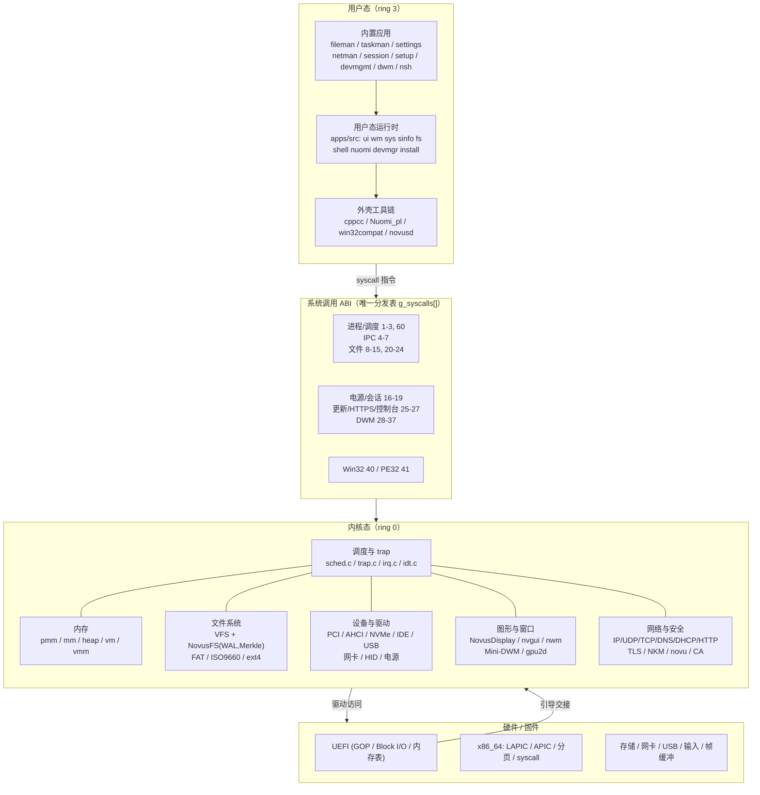

### 1.3 目录到层的映射

| 层 | 目录 | 说明 |
|---|---|---|
| 引导 | `arch/x86_64/boot/` | `efi_main`、`stage3`、启动菜单、Merkle 校验、负载暂存 |
| 内核 | `kernel/` | 调度、syscall、内存、驱动、网络、Win32/PE、安装、会话 |
| 文件系统 | `fs/` | VFS、NovusFS、FAT、ISO9660、ext4、挂载配置、rootfs 布局 |
| 安全 | `security/` | NKM 签名、TLS 1.2/1.3、novu 更新与 CA bundle |
| 图形 | `graphics/` | NovusDisplay、nvgui、桌面壳层、字体/IME/主题/壁纸 |
| 窗口 | `wm/novus-wm/` | 内核态合成器 + 协议服务端，`nwm_proto.h` 是协议真源 |
| 用户态 | `apps/` | Rust `no_std` 扁平 NUC 镜像，内嵌进内核 |
| 语言/工具 | `user/`、`tools/` | Nuomi、cppcc、novusd、win32compat；主机端镜像与生成器 |
| 验证 | `scripts/`、`tools/ci.mk` | 自检、QEMU 冒烟、基线比对、本地 CI 入口 |

> 注意：根目录没有 `system/`、`drivers/`、`user/shell/`、`user/micropython/`；驱动在 `kernel/`，shell 在 `apps/src/shell/`。

---

## 2. 启动架构

### 2.1 两阶段 A/B 核启动

A 核（BSP）负责固件交接与完整性自检，完成后休眠；B 核（AP）加载主内核并接管全部运行。`CONFIG_NOVUS_A_CORE_DISABLE=y` 可跳过 A 核自检；SIPI 失败降级单核，不 panic。

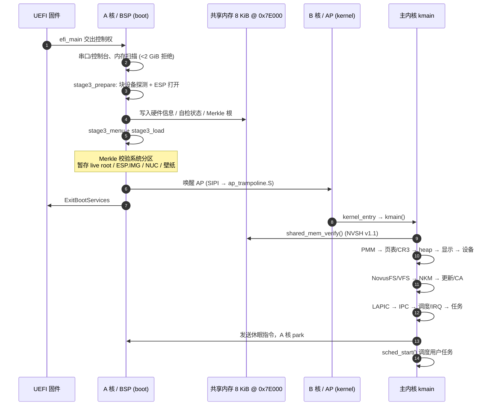

### 2.2 共享内存交接区

引导阶段与内核阶段通过固定 8 KiB 共享区传递信息；布局冻结，新字段只能追加到 `0x2F0` reserved 尾部。

| 内容 | 作用 |
|---|---|
| 硬件信息 / 内存映射 | 内核据此初始化 PMM 与页表 |
| 自检状态码 / Merkle 根哈希 | 内核只消费引导阶段的校验结论，不重复读盘 |
| `live_root_base/size` | 引导阶段暂存的 NovusFS 镜像，内核转成 memimg 块设备 |
| `esp_img_base/size/install_flags` | 图形安装器载荷与启动模式 |
| `wpkg_img_base/size` | 壁纸包 |
| NUC demo 镜像地址/大小 | `APPS/DEMO.NUC` 固定槽 |
| 4 KiB 日志环 | `klog_init()` 继承，splash 第一阶段即可显示固件日志 |

### 2.3 `kmain` 初始化顺序（硬约束）

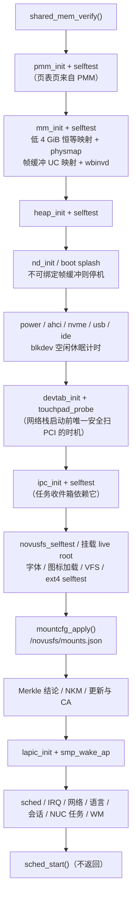

**顺序不可换的三条理由**（源码注释明确）：

1. `pmm_init` 必须先于 `mm_init`：页表页来自 PMM。
2. NovusFS 自检与 live root 挂载必须在 AP 唤醒之前：避免第二核心同时访问块层与 WAL。
3. `devtab_init` 必须在存储驱动之后、网络栈之前：BAR 探测会写 `0xFFFFFFFF`，不能再干扰传输。

---

## 3. 内核架构

### 3.1 内核子系统依赖图

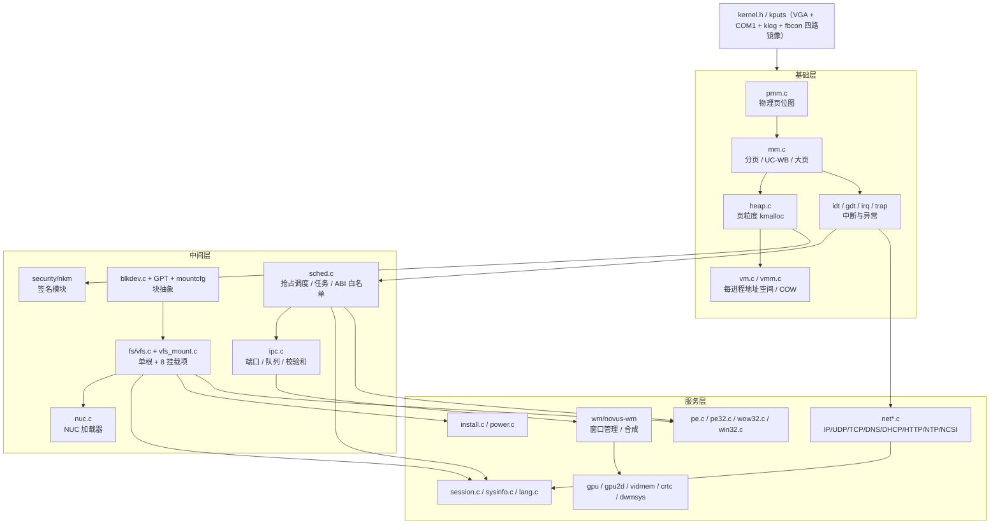

### 3.2 内存架构

| 区域 | 机制 | 关键常量 / 位置 |
|---|---|---|
| 物理页 | `pmm.c` 固定 256 KiB 位图，约覆盖 8 GiB | `kernel/pmm.c` |
| 内核堆 | `kmalloc` 按 4 KiB 向上取整，最多 256 MiB / 256 条记录 | `kernel/heap.c` |
| 堆窗口 | `0xFFFF810000000000` 起 256 MiB，所有 CR3 共享、supervisor-only | `CONTRIBUTING.md:293` |
| 进程空间 | 每任务独立 CR3；COW；只有 TEXT 可执行，其余 NX | `kernel/vm.c`、`nuc.c` |
| 内核栈 | 每任务 64 KiB ring-0 栈 | `kernel/sched.h` |
| NUC 栈 | 栈顶固定 `0xA0000000`，返回跳板 `0x90000000`，栈由头请求并 clamp 到 64 KiB–4 MiB | `CONTRIBUTING.md:295` |
| 共享区 | 8 KiB @ `0x7E000`，NVSH v1.1 | `kernel/shared_mem.h` |

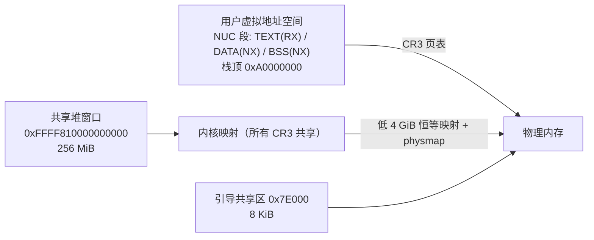

### 3.3 调度与任务

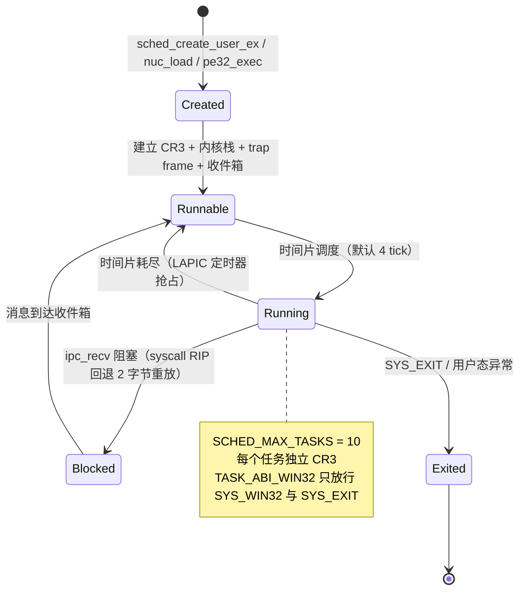

### 3.4 系统调用 ABI

统一入口：`syscall` 指令 → `kernel/trap.c` → `g_syscalls[]` → 具体 `sys_*`。`rax` 号、`rdi/rsi/rdx/r10` 传参（第 4 参用 `r10`），负返回值表示错误。内核不直接解引用用户指针，按任务 CR3 逐页复制。

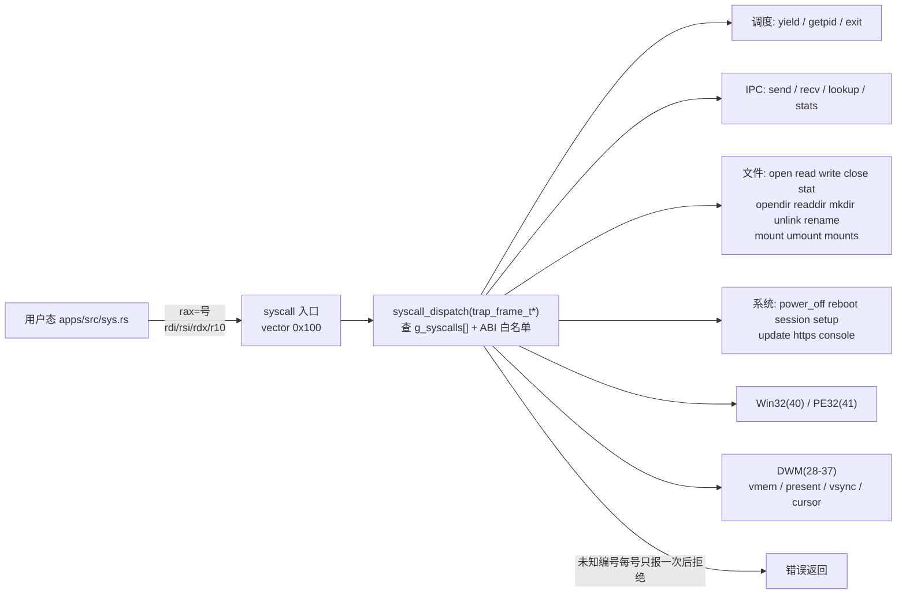

**编号表**（`kernel/trap.c:48-76`、`kernel/dwmsys.h`、`kernel/win32.h`）：

| 范围 | 调用 |
|---|---|
| 1–7 | `yield` `write` `getpid` `ipc_send` `ipc_recv` `ipc_lookup` `ipc_stats` |
| 8–15 | `open` `read` `fs_write` `close` `stat` `opendir` `readdir` `mkdir` |
| 16–19 | `power_off` `reboot` `session` `setup` |
| 20–24 | `unlink` `rename` `mount` `umount` `mounts` |
| 25–27 | `update` `https` `console` |
| 28–37 | `vmem_alloc/free/map/grant`、`surface_present`、`wait_vsync`、`set_exclusive`、`set_cursor`、`dwm_query`、`set_mode` |
| 40 / 41 | `win32` / `pe32_exec` |
| 60 | `exit` |

> `write`(2) 是串口日志，不是文件写；文件写是 `fs_write`(10)。编号稀疏且冻结，只追加不复用。

---

## 4. 文件系统与存储架构

### 4.1 VFS 分层与挂载

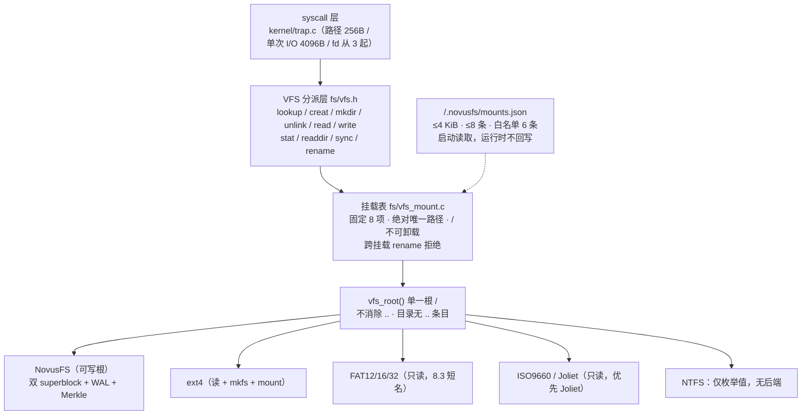

**挂载白名单**（`rootfs_layout.h:138-144`）：`/`、`/disk0/1`、`/media/cdrom0/usb0/usb1`。运行时 `mount`/`umount` 不回写 `mounts.json`，否则下次启动 Merkle 校验失败。

### 4.2 NovusFS 磁盘布局与事务链

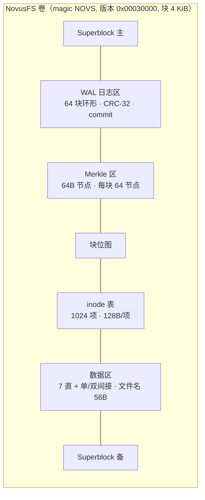

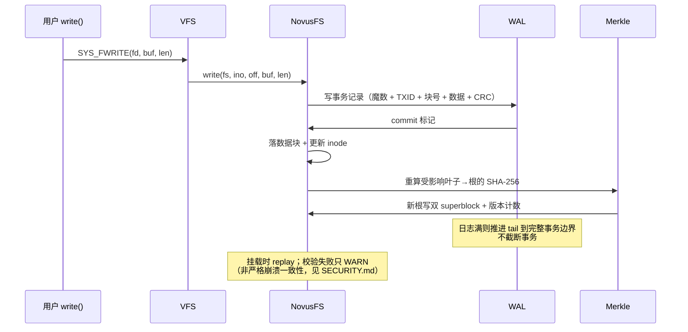

**Merkle 覆盖范围**：bitmap + inode + data；**不覆盖** WAL 区与 Merkle 区自身。

### 4.3 块设备栈

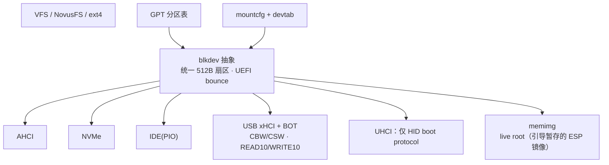

---

## 5. 图形、窗口与合成架构

### 5.1 图形栈分层

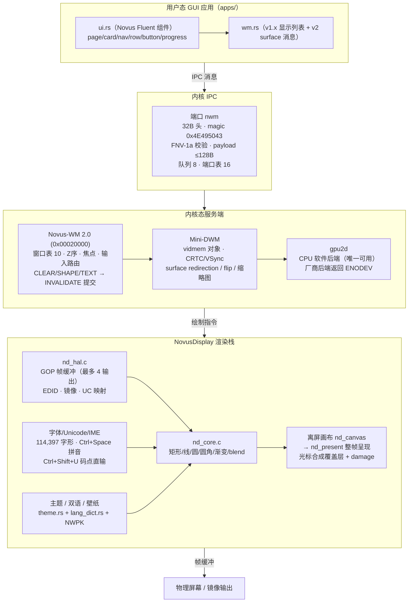

### 5.2 GUI 一帧的协议时序

每帧必须以 `CLEAR` 开始，随后若干 `SHAPE`/`TEXT`，最后 `INVALIDATE` 一次性提交；缺少 `INVALIDATE` 会出现半帧闪烁。

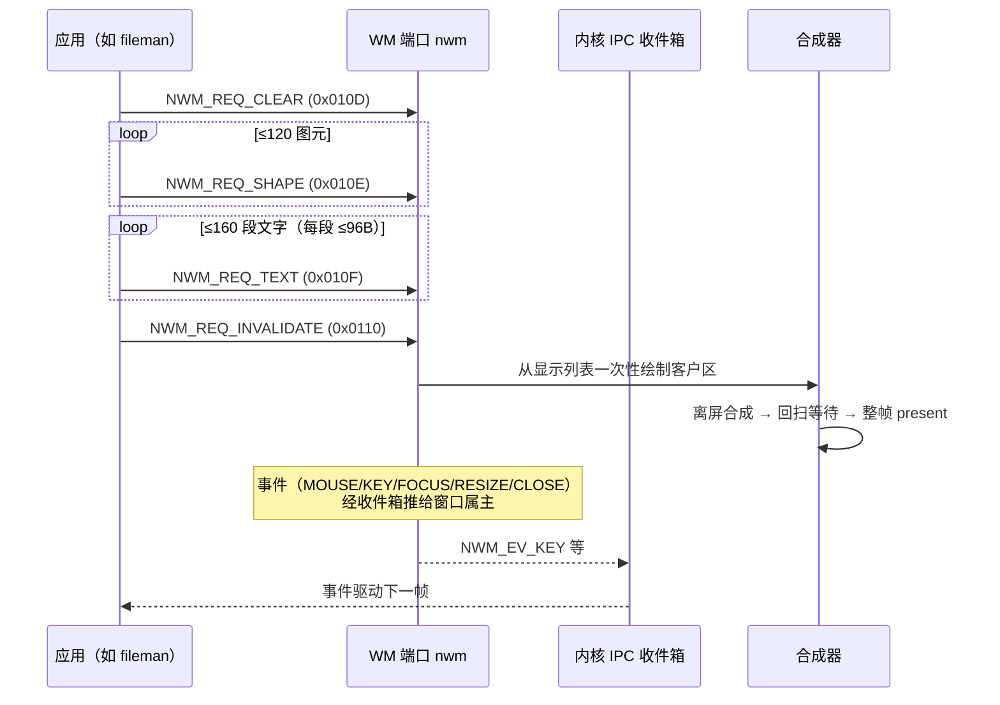

### 5.3 Mini-DWM v2 表面重定向

v2 是**追加**消息，不改 v1.x 语义：老客户端继续用显示列表，v2 客户端用 `SYS_VMEM_ALLOC` 分配显存对象，只把句柄与几何交给 WM，像素不跨 IPC 边界。

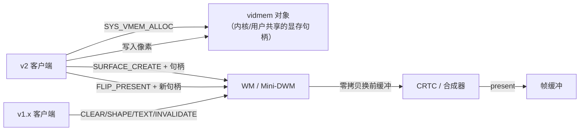

---

## 6. 网络与安全架构

### 6.1 网络协议栈

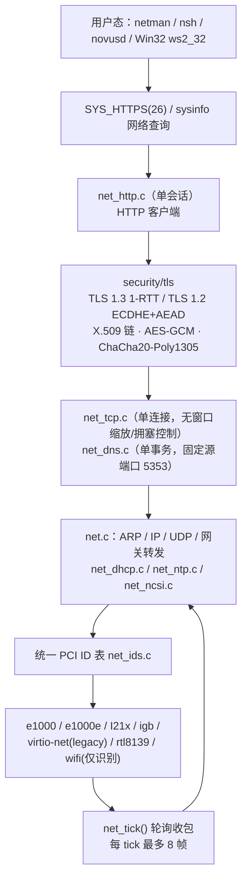

### 6.2 安全边界

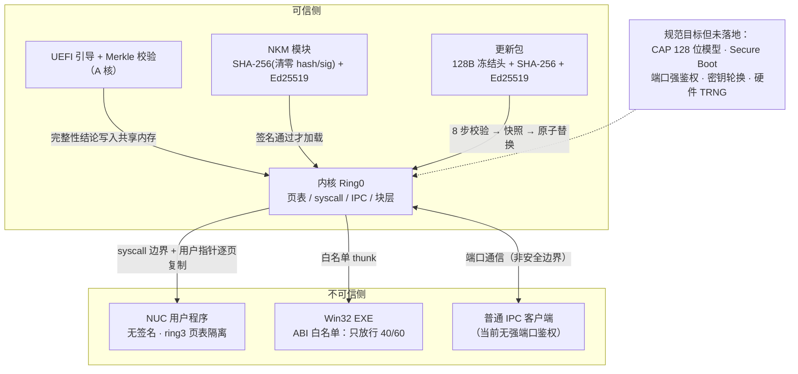

> 安全口径真源是 [SECURITY.md](SECURITY.md)。不要把 CAP、Secure Boot、完整 WebPKI 当作已实现能力。

### 6.3 更新体系

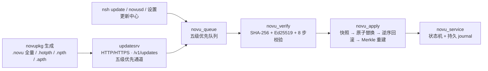

---

## 7. 用户态架构

### 7.1 内置应用与运行时

`apps/` 是 Rust `no_std`、无分配器、无第三方依赖环境：固定数组/栈缓冲，`panic` 只打印 COM1 并 `exit(3)`；扁平镜像链接到 `0x400000`，`objcopy -O binary` → `xxd -i` → 内核符号 `k_app_<name>`。

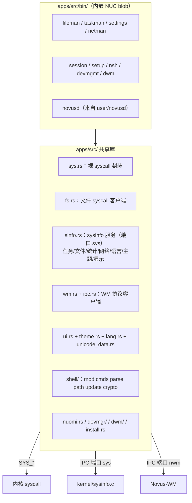

**内置应用注册链**（新增应用需改 4 处）：

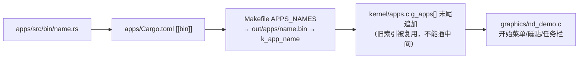

### 7.2 `nsh` 终端

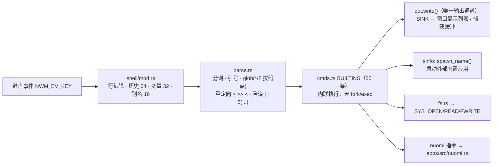

**35 条内建命令**：`ls cd pwd cat echo mkdir rmdir rm cp mv stat env export unset clear help history true false whoami which touch wc head tail tree alias drives mount umount nuomi update novusd run install`。
`dir`/`copy`/`del` 兼容别名默认关闭。管道是顺序捕获（≤8 段，捕获缓冲 4 KiB），不是并发进程；参数上限 40，单参数 256 B。

### 7.3 多语言执行路径

```mermaid
flowchart TB
    subgraph HOST["主机端工具链"]
        CPP["cppcc（Rust C++ 子集编译器）<br/>预处理→词法→语法→语义→AST→codegen"]
        CPP --> N1["NUC V1.0（x86_64 原生机器码）"]
        CPP --> N2["Win64 PE32+"]
        CPP --> N3["Linux ELF64"]
        NUOMI_C["Nuomi_pl C 参考实现<br/>带 GC · nuomi nuc 生成 NUC"]
    end

    subgraph DEVICE["设备端"]
        FIXED["boot-stage 固定读取<br/>APPS/DEMO.NUC → 共享内存 → nuc_load()"]
        EXEC["通用 ./app.nuc exec（尚未实现）"]
        NSH_NUOMI["nsh 内置 nuomi.rs<br/>no_std 无堆 bump arena 256 KiB"]
    end

    N1 --> FIXED
    N1 -.-> EXEC
    NUOMI_C -.-> N1
    NSH_NUOMI -->|"nuomi script.nuomi"| SH["shell 行编辑"]
```

---

## 8. 构建与镜像架构

### 8.1 构建流水线

```mermaid
flowchart TB
    CFG["configs/novus_defconfig<br/>（Kconfig 仅声明占位，无 menuconfig）"]
    SRC["C 源（kernel/fs/security/graphics/wm）<br/>Rust 内核静态库（x86_64-pc-windows-msvc）<br/>Rust 应用（x86_64-unknown-none）"]
    GEN["生成器（产物已提交）<br/>themegen / langgen / fontgen / imegen<br/>wpgen / cabundle / nkmgen"]
    CFG --> MK["顶层 Makefile<br/>SRC / ASM_SRC / INC 显式列举"]
    SRC --> MK
    GEN --> MK
    MK --> EFI["out/NOVUS.EFI<br/>PE32+ subsystem 10 · 入口 efi_main"]
    MK --> APPS["out/apps/&lt;name&gt;.bin<br/>→ build/apps_blobs.h"]
    MK --> TOOLS["主机工具<br/>mkfat mkiso mkfsnovus mkdisk nkmgen novupkg wpkg"]

    EFI --> IMG["out/novus.img（8 MiB NovusFS）"]
    APPS --> IMG
    TOOLS --> IMG
    IMG --> ESP["out/esp.img（31.5 MiB FAT）<br/>out/esp-tpl.img（16 MiB 安装模板）"]
    ESP --> ISO["out/novus-live.iso<br/>ISO9660 + Joliet + El Torito + isohybrid"]
    IMG --> DISK["out/novus-disk.img（64 MiB）<br/>GPT + ESP + NovusFS"]
    ISO --> CHECK["make check-rootfs<br/>主/Joliet 树 + 8.3 名 + 字体 + 元数据"]
    DISK --> CHECK
```

> El Torito 扇区计数只有 16 位（单位 512 B），启动项必须 < 32 MiB，故 live ESP 取 31.5 MiB。

### 8.2 验证矩阵

```mermaid
flowchart LR
    subgraph HOST["主机侧"]
        T1["display / irq / sched / dwm / memory selftest"]
        T2["novupkg selftest · nkmgen selftest<br/>updatesrv selftest · cppcc cargo test"]
        T3["check_rootfs.py · inspect_img.py<br/>themegen/langgen --check"]
    end
    subgraph QEMU["QEMU / OVMF"]
        Q1["qemu-smoke.sh + VNC 基线比对<br/>（固定 127.0.0.1:5901）"]
        Q2["ci_smoke.py（300s 无头启动）"]
        Q3["run-install-test.sh（EN=1 / FLOW=desktop）"]
        Q4["wm-churn.sh（20 轮应用生命周期）"]
        Q5["qtest.sh（IDE/AHCI/NVMe/USB）"]
    end
    HOST --> CI["make pipeline<br/>check → check-lint → build → smoke"]
    QEMU --> CI
    CI --> OUT["out/ci/report.*"]
```

---

## 9. 端到端数据流

### 9.1 终端按键到屏幕像素

```mermaid
sequenceDiagram
    participant HW as 键盘/鼠标
    participant IRQ as IRQ / nd_input
    participant W as Novus-WM
    participant SH as nsh 收件箱
    participant SHL as shell 引擎
    participant K as 内核 syscall
    participant C as 合成器

    HW->>IRQ: 按键扫描码（含 Ctrl/Alt）
    IRQ->>W: 输入事件（IME 先处理组合/候选）
    W->>SH: NWM_EV_KEY（Unicode 码点）
    SH->>SHL: 行编辑 → parse → cmds
    SHL->>K: 内建命令直接调 syscall
    K-->>SHL: 结果写入 out.write()
    SHL->>W: CLEAR / SHAPE / TEXT… / INVALIDATE
    W->>C: 从显示列表绘制客户区
    C->>C: 离屏合成 → 回扫等待 → 整帧 present
    C-->>HW: 屏幕像素更新
```

### 9.2 文件打开到磁盘 I/O

```mermaid
sequenceDiagram
    participant A as 应用 fs.rs
    participant T as kernel/trap.c
    participant V as VFS + 挂载表
    participant N as NovusFS
    participant B as blkdev
    participant D as AHCI/NVMe/USB

    A->>T: SYS_OPEN(path, flags)（用户指针逐页复制）
    T->>V: 按最长前缀选挂载项（≤256B）
    V->>N: lookup 逐组件解析（无 .. 穿越）
    N->>B: 读 superblock/inode/数据块
    B->>D: 512B 扇区 I/O（UEFI bounce 兼容）
    D-->>B: 数据
    B-->>N: 块
    N-->>V: inode
    V-->>T: fd（从 3 起）
    T-->>A: fd
    Note over A,D: 后续 read/fs_write 单次上限 4096B<br/>写路径经 WAL + Merkle 更新
```

---

## 10. 架构约束速查表

| 约束 | 值 | 真源 |
|---|---|---|
| 任务数 / 内核栈 / 时间片 | 10 / 64 KiB / 4 tick | `kernel/sched.h` |
| 路径 / 单次 I/O / fd 起点 | 256 B / 4096 B / 3 | `kernel/trap.c:78-80` |
| 挂载项 / 挂载白名单 | 8 / 6 条 | `fs/vfs_mount.h:17`、`rootfs_layout.h:138-144` |
| NovusFS 块 / inode / 文件名 | 4 KiB / 1024×128 B / 56 B | `fs/novusfs/novusfs.h` |
| WAL / Merkle | 64 块 / 64 B 节点、64 节点每块 | `fs/novusfs/novusfs.h` |
| IPC 头 / 载荷 / 队列 / 端口 | 32 B / ≤128 B / 8 / 16 | `kernel/ipc.h` |
| WM 版本 / 窗口 / 图元 / 文字 | `0x00020000` / 10 / 120 / 160 | `wm/novus-wm/nwm_proto.h:26-42` |
| GOP 输出 / 字符字形 | 4 / 114,397 | `graphics/nd_hal.c`、`nd_font_uni.c` |
| 应用 blob / 栈 | <128 KiB / 64 KiB–4 MiB | `CONTRIBUTING.md:360,369` |
| nsh 历史 / 变量 / 别名 / 管道 | 64 / 32 / 16 / ≤8 段 | `apps/src/shell/mod.rs` |
| Nuomi 源码 / arena / 递归 | 6 KiB / 256 KiB / 约 500 层 | `apps/src/nuomi.rs` |
| live ESP 上限 | <32 MiB（取 31.5 MiB） | `tools/tools.mk` |

### 已知边界（架构层面）

```mermaid
flowchart LR
    subgraph LIM["当前实现边界（详见 ROADMAP.md §4）"]
        L1["SMP：A/B 双核，多 AP 未实现"]
        L2["网络：单 TCP 会话、DNS 单事务、收包轮询"]
        L3["图形：CPU 2D、无 vblank 中断、多输出仅镜像"]
        L4["存储：IDE PIO、NVMe 队列深 4、USB BOT 非 UASP"]
        L5["安全：CAP/Secure Boot/端口鉴权/密钥轮换未落地"]
        L6["执行：通用 ./app.nuc 未实现，仅固定 APPS/DEMO.NUC"]
        L7["Win32：原型，无磁盘 DLL / 32 位 PE32 / 真实沙箱"]
    end
```

> 架构图描述"是什么"，不描述"计划是什么"。能力缺口与演进顺序见 [ROADMAP.md](ROADMAP.md)。
