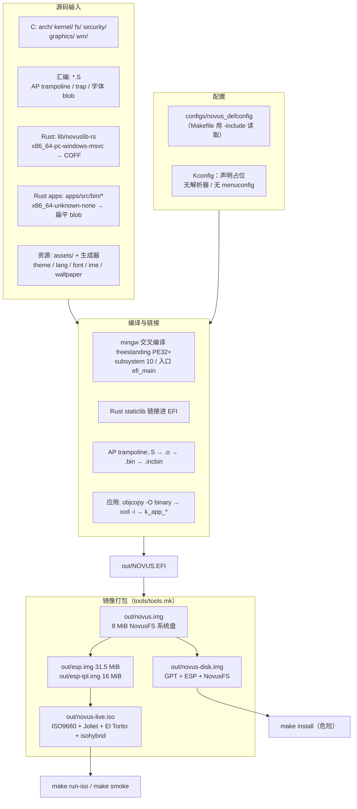
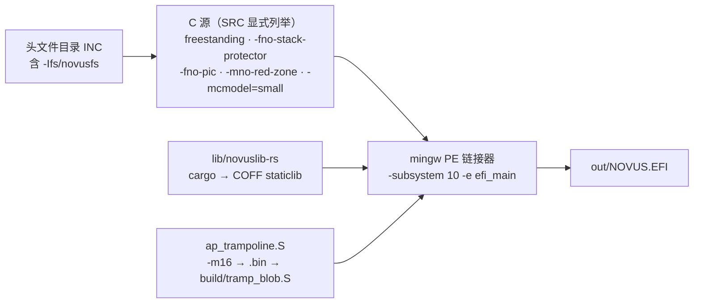
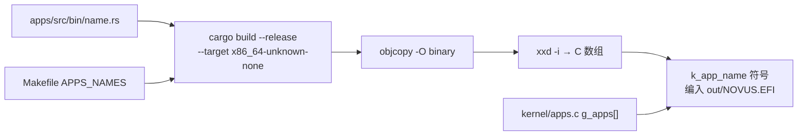
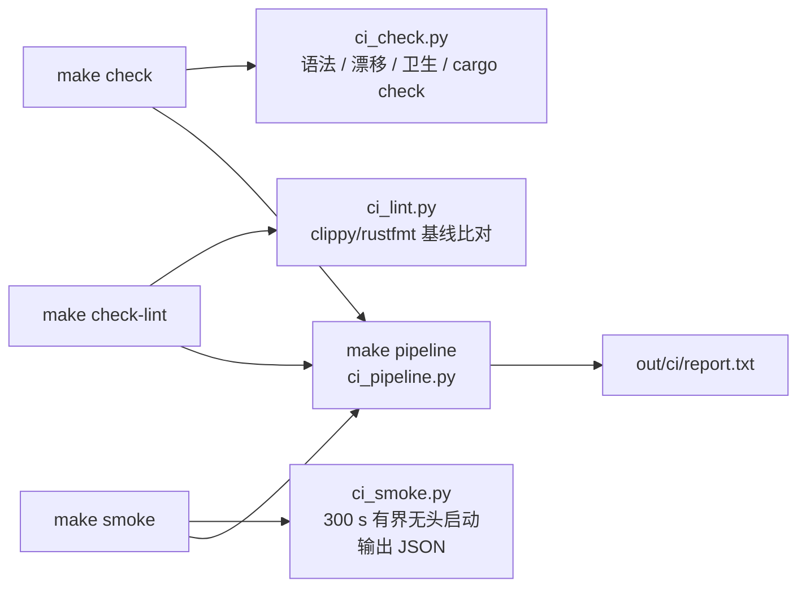

# Novus OS 构建指南（BUILD）

> 版本：v1.0（基于 2026-11-27 工作树）
> 配套：[CONTRIBUTING.md](CONTRIBUTING.md)（贡献流程）、[CODESTYLE.md](CODESTYLE.md)（代码规范）、[COMPATIBILITY.md](COMPATIBILITY.md)（冻结格式）、[ARCHITECTURE.md](ARCHITECTURE.md)（镜像结构）
>
> 本文描述从源码到可启动镜像的完整构建链：工具链、配置、目标、产物、生成物、运行与验证。命令与变量均来自顶层 `Makefile`、`tools/tools.mk` 和 `tools/ci.mk`。

---

## 目录

- [1. 快速开始](#1-快速开始)
- [2. 构建链总览](#2-构建链总览)
- [3. 环境准备](#3-环境准备)
- [4. 配置系统](#4-配置系统)
- [5. 构建目标速查](#5-构建目标速查)
- [6. 构建流程详解](#6-构建流程详解)
- [7. 产物清单与体积约束](#7-产物清单与体积约束)
- [8. 生成物与资源](#8-生成物与资源)
- [9. 运行与安装](#9-运行与安装)
- [10. 验证与本地 CI](#10-验证与本地-ci)
- [11. 可覆盖变量](#11-可覆盖变量)
- [12. 增量构建与清理](#12-增量构建与清理)
- [13. 故障排查](#13-故障排查)

---

## 1. 快速开始

```sh
# ① 一次性安装依赖（Ubuntu/Debian）
sudo apt install -y build-essential gcc-mingw-w64-x86-64 g++-mingw-w64-x86-64 \
  binutils-mingw-w64-x86-64 mingw-w64 qemu-system-x86 ovmf python3 xxd
rustup target add x86_64-pc-windows-msvc
rustup target add x86_64-unknown-none

# ② 构建内核与内置应用
make

# ③ 构建 live ISO 并校验目录树
make iso
make check-rootfs

# ④ 启动 QEMU（headless，串口输出到终端）
make run
```

成功标志：`out/NOVUS.EFI` 存在；`make check-rootfs` 全绿；串口出现 `[ND] demo desktop painted` 与 `[HALT] entering the scheduler`。

---

## 2. 构建链总览



**关键点**：顶层 `Makefile` 只负责编译与链接；`iso`、`run-iso`、`disk-img`、`install`、`novus-img` 等镜像目标定义在 `tools/tools.mk`，在文件底部 `include`，这样 `all` 仍是默认目标。

---

## 3. 环境准备

### 3.1 必需工具

| 工具 | 用途 | 缺失时的表现 |
|---|---|---|
| `x86_64-w64-mingw32-gcc`、`objcopy` | 内核交叉编译与 PE32+ 链接 | `Makefile:56-62` 立即 `error`，提示安装或设 `CROSS` |
| Rust + `rustup` | 内核静态库与内置应用 | 需要静态库时报安装指引 |
| `x86_64-pc-windows-msvc` target | 内核 Rust 静态库（COFF，mingw 链接器可直接消费） | 链接失败 |
| `x86_64-unknown-none` target | 内置应用扁平 NUC blob | 应用构建失败 |
| `make`、`gcc`（主机）、Python 3、`xxd` | 主机工具、生成器、blob 转换 | 相应目标失败 |
| QEMU、OVMF、`qemu-img` | `run` / `run-iso` / 冒烟测试 | 无法启动 |

> 为什么内核 Rust 用 `msvc` target：`x86_64-unknown-none` 产出 ELF 对象，无法链接进 PE 镜像；`x86_64-pc-windows-msvc` 产出 COFF，mingw 链接器可直接消费。见 `Makefile:296-306`。

### 3.2 安装命令

```sh
sudo apt update
sudo apt install -y build-essential gcc-mingw-w64-x86-64 g++-mingw-w64-x86-64 \
  binutils-mingw-w64-x86-64 mingw-w64 xorriso mtools grub-pc-bin \
  qemu-system-x86 ovmf bison flex libelf-dev python3 xxd

rustup target add x86_64-pc-windows-msvc
rustup target add x86_64-unknown-none
```

`xorriso`、`mtools`、`grub` 在 devcontainer 清单里，但当前镜像由自研 `mkfat`/`mkiso` 生成，普通 `make` 并不依赖它们。

按需安装：

| 场景 | 依赖 |
|---|---|
| `wm-churn.sh` | `socat` |
| 更新服务 / E2E / 证书 | `openssl` |
| 壁纸重采样（`wpgen`） | Python `Pillow` |
| 字体 / IME 生成器 | GNU Unifont hex、ibus 拼音表（不随仓库分发） |
| Windows QEMU 验收 | PowerShell 7；必要时 `subst` 挂载 ASCII 盘符 |

### 3.3 WSL 环境

```sh
source "$HOME/.cargo/env"
# 若仍找不到 cargo，显式加工具链目录：
# export PATH="$HOME/.rustup/toolchains/stable-x86_64-unknown-linux-gnu/bin:$HOME/.cargo/bin:$PATH"
```

交叉工具链前缀不同时用 `make CROSS=<prefix>` 覆盖。

---

## 4. 配置系统

### 4.1 配置源

- `configs/novus_defconfig` 是**唯一真正生效**的配置源，通过 `Makefile:70` 的 `-include` 读取。
- 顶层 `Kconfig` 只是声明式占位：没有解析器，也没有 `make menuconfig`；新配置项必须手工同步到 defconfig。
- `y`/`n` 只转成 C 宏 `1`/`0`（`Makefile:245-247`），源码列表本身固定；功能门控要写 `#if CONFIG_NOVUS_*`。
- `depends on` 不会自动校验，需要人工保证：`IRQ → SCHED`、`GUI → DISPLAY`、`WM → GUI + IPC`、`WIN32 → SCHED`。
- `CONFIG_USER_MOCHI` 与 `CONFIG_USER_CPPCC` 都可能占用 `APPS/DEMO.NUC` 槽位；当前工作树没有 `user/mochi` 子模块，相关 target 只在源码存在时定义。
- `CONFIG_NOVUS_NTP=y` 默认开启：DHCP 后用 DNS 解析 `ntp.aliyun.com`（失败回退 `203.107.6.88`），经 UDP/123 每小时校准时钟。

### 4.2 E2E 标志的一致性（重要）

`E2E=1` 会编入测试根证书和 HTTPS 探针。Makefile 用 stamp 记录完整 flag 串（`Makefile:281-294`），换标志会触发全量重编，避免对象混用。

```sh
# 错误：同一批对象混用两种标志
make            # E2E=0
make E2E=1 smoke

# 正确：整条链路同一标志
make clean
make E2E=1
make E2E=1 smoke
# 验证完再切回生产构建
make clean
make
```

生产构建绝不能混入测试锚：`security/novu/cabundle_e2e.c` 只在 `E2E=1` 时编入（`Makefile:225-229`）。

### 4.3 新增配置项的检查清单

```text
[ ] Kconfig 中声明（含 depends on 说明）
[ ] configs/novus_defconfig 中给出默认值
[ ] 源码使用 #if CONFIG_NOVUS_XXX（不是裸开关变量）
[ ] 依赖顺序已人工核对
[ ] docs / README 已同步
```

---

## 5. 构建目标速查

### 5.1 核心构建

| 目标 | 产物 / 行为 |
|---|---|
| `make` / `make all` | `out/NOVUS.EFI`（默认目标，先打印 banner） |
| `make banner` | 只打印配置摘要 |
| `make clean` | 删除 `build/`、`out/`、`esp/` |

### 5.2 镜像与运行

| 目标 | 产物 / 行为 |
|---|---|
| `make novus-img` | `out/novus.img`（8 MiB NovusFS 系统盘） |
| `make esp` | `out/esp.img`（31.5 MiB live）与 `out/esp-tpl.img`（16 MiB 安装模板） |
| `make iso` | `out/novus-live.iso`；若已是最新则只打印路径 |
| `make iso-force` | 无条件删除并重建 ISO |
| `make run` | 构建并启动 QEMU（`MEM=4G`）；`CONFIG_USER_CPPCC=y` 时先跑 `cppcc-demo` 并暂存 `APPS/DEMO.NUC` |
| `make run-iso` | 从 ISO 启动，可附加第二块磁盘 |
| `make disk-img` | `out/novus-disk.img`（默认 64 MiB，GPT + ESP + NovusFS） |
| `make install DEVICE=/dev/sdX` | 用 `dd` 覆盖目标设备，**危险操作** |
| `make iso-testapp` | `out/novus-testapp.iso`，发布 `/testapp` |
| `make run-testapp` | 启动 testapp ISO |
| `make test-testapp` | 校验 ISO 包含全部 testapp 文件 |
| `make check-rootfs` | 校验 ISO/ESP/系统盘目录树、字体与元数据 |

### 5.3 主机工具与语言工具链

| 目标 | 产物 |
|---|---|
| `make tools` | `mkfat`、`mkiso`、`mkfsnovus`、`mkdisk`、`wpkg`、`novupkg`（含 cppcc） |
| `make cppcc` | C++ 子集 → NUC 编译器 |
| `make cppcc-tools` | `cppcc_to_win64`、`cppcc_to_linux`、C ABI 静态库 |
| `make cppcc-demo` | `out/cppcc/hello.nuc` |
| `make cppcc-cabi` | C ABI 库产物 |
| `make cppcc-to-win64` / `cppcc-to-linux` | 多目标后端 |
| `make wpkg-img` | 壁纸包 |
| `make nkm-test-module` | `security/nkm/nkm_test_module.h`、`out/test.nkm` |
| `make theme` | 重新生成主题令牌 |
| `make mochi-tools` / `make nuc-apps` | 仅当 `user/mochi` 存在时定义 |

### 5.4 验证

| 目标 | 行为 |
|---|---|
| `make check` | 语法、生成物漂移、仓库卫生、两个 Rust crate `cargo check` |
| `make check-lint` | clippy/rustfmt 与 `tools/ci/lint-baseline.json` 对比，仅新增问题失败 |
| `make check-lint-update` | 显式刷新 lint 基线（不要随手用） |
| `make smoke` | 构建 live ISO 后跑 300 s 有界无头启动 |
| `make pipeline` / `make ci` | check → check-lint → build → smoke，写 `out/ci/report.*` |

---

## 6. 构建流程详解

### 6.1 内核镜像链接



- 所有 C 文件必须显式加入 `Makefile` 的 `SRC`；汇编加入 `ASM_SRC`；新目录加入 `INC`。**没有源码自动发现**。
- 对象名由路径分隔符换下划线生成（`Makefile:274-279`），新增同名文件会导致冲突。
- AP trampoline 是 16 位裸二进制，必须 < 4 KiB、无重定位；最后 24 字节是 CR3、AP 栈指针和 `ap_main` 三个 64 位槽。
- EFI 是 PE32+，subsystem 10，入口 `efi_main`。

### 6.2 内置应用 blob



- 链接地址固定 `0x400000`；`nuc_spawn_blob()` 按该地址映射，代码里的绝对引用无需重定位。
- 单 blob **< 128 KiB**；栈范围 64 KiB–4 MiB；`apps.stamp` 只跟踪 `apps/src/**`、`apps/Cargo.toml`、`apps/link.ld`、`apps/.cargo/config.toml`。
- `g_apps[]` 只能在**末尾**追加：索引被旧版 sysinfo `/apps` 与客户端复用；新代码优先 `apps_launch_name()`。
- Win32 样例走独立路径：`x86_64-w64-mingw32-gcc` 生成 `out/win32/hello.exe` → `xxd -i` → `build/win32_blobs.h`，与 `g_apps[]` 无关。

### 6.3 镜像打包顺序

1. `mkfsnovus` 用内核 `fs/novusfs/*.c` 原文编译（只补桩 `kputs`/`kmalloc`/`blkdev`），生成 `out/novus.img` 并建立 Merkle。
2. `mkfat` 生成 `out/esp-tpl.img`（安装模板）与 `out/esp.img`（live），FAT 只支持 8.3 短名。
3. `mkiso` 生成 ISO9660 + Joliet 双树、El Torito no-emulation EFI 引导与 isohybrid 分区表。
4. `mkdisk` 用 `kernel/gpt.c` 原文生成 GPT + ESP + NovusFS 整盘镜像。
5. `check_rootfs.py` 对三套镜像做约 435 项断言。

壁纸 JPEG **不进 EFI 镜像**：`wpkg` 把 `assets/backgrounds-screen/`（重采样到 2560 px）打成 `WALLPAPERS.PKG`，引导阶段从 ESP 读入保留页。这样 live ESP 才能留在 32 MiB 上限内；介质缺该包时桌面回退纯色渐变。

---

## 7. 产物清单与体积约束

| 产物 | 说明 | 约束 |
|---|---|---|
| `out/NOVUS.EFI` | UEFI PE32+ 内核，含 AP trampoline 与 Rust 静态库 | — |
| `out/apps/<name>.bin` | 内置应用扁平镜像 | **< 128 KiB**，链接地址 `0x400000` |
| `out/novus.img` | 8 MiB NovusFS 系统镜像，含 `/Novus/fonts/font.bin` | `SYS_SIZE_MB=8` |
| `out/esp-tpl.img` | 16 MiB 安装模板 FAT ESP | `ESP_TPL_SIZE_MB=16` |
| `out/esp.img` | 31.5 MiB live FAT ESP | **必须 < 32 MiB**（El Torito 16 位扇区计数） |
| `out/novus-live.iso` | ISO9660 + Joliet + El Torito + isohybrid | — |
| `out/novus-disk.img` | 默认 64 MiB，GPT + ESP + NovusFS | `DISK_SIZE_MB=64` |
| `out/cppcc/hello.nuc` | M7 smoke 程序 | 暂存为 `APPS/DEMO.NUC` |
| `out/qemu-smoke*` | 截图、串口日志、结果 JSON | — |
| `out/ci/report.*` | 本地 CI 报告 | — |

El Torito 的 sector count 只有 16 位、单位 512 字节，因此启动项必须严格小于 32 MiB；`mkfat` 的 size 参数支持小数 MiB，live ESP 取 31.5 MiB 是安全余量。

构建产物位于 `build/`、`out/`、`esp/` 与各处 `target/`，**不得提交**。

---

## 8. 生成物与资源

生成物大多已提交仓库，普通构建不需要重新生成；修改源文件后必须重新生成并提交结果。

| 源 | 命令 | 产物 |
|---|---|---|
| `tools/themegen/theme.toml` | `make theme` / `python3 tools/themegen/themegen.py` | `graphics/nd_theme.[ch]`、`apps/src/theme.rs` |
| `tools/langgen/strings*.toml` | `python3 tools/langgen/langgen.py` | `graphics/nd_lang_dict.c`、`apps/src/lang_dict.rs` |
| Unifont hex | `python3 tools/fontgen/fontgen.py --bmp unifont.hex --upper unifont_upper.hex` | `graphics/nd_font_data.bin`（3.5 MB）、`nd_font_uni.c`、`apps/src/unicode_data.rs` |
| `tools/imegen/pinyin.txt` | `python3 tools/imegen/imegen.py --gen` | `graphics/nd_ime_dict.c` |
| `assets/` 壁纸 | `python3 tools/wpgen/wpgen.py`、`make wpkg-img` | `assets/backgrounds-screen/`、`out/wallpapers.pkg` |
| 更新根证书 | `python3 tools/cabundle/cabundle.py --pem tools/cabundle/roots.pem --out security/novu/cabundle.c` | `security/novu/cabundle.c` |
| NKM 测试种子 | `make nkm-test-module` | `security/nkm/nkm_test_module.h`、`out/test.nkm` |
| 图标 SVG | `tools/icons/mkico.py` | `assets/icons/*.ico`（已提交） |
| boot logo | `tools/splash/mkbootlogo.py` | ARGB blob（引导期无图片解码器） |

要求：

- 生成文件头部标注"改 TOML 后重新生成，不要直接编辑"。
- 新增中文文案通常需要重生成字体数据，否则只能显示回退字形。
- `themegen`、`langgen`、`fontgen` 支持 `--check`，可本地检查产物是否过期。
- E2E 证书由 `tools/updatesrv/gen_e2e_certs.sh` 生成，只影响 `cabundle_e2e.c`，不污染生产 `cabundle.c`。
- 生产 CA 变更须先 `tools/cabundle/import_roots.py --dry-run` 审查。
- 不提交私钥、证书私钥、`NKM_SEED` 轮换产生的私有材料。

---

## 9. 运行与安装

### 9.1 `make run`

默认 `MEM=4G`，QEMU 2 核；网卡默认 `e1000`（用户态网络 + DHCP/DNS/NAT）。`scripts/run.sh` 支持：

| 变量 | 作用 |
|---|---|
| `NOVUS_NIC` | 网卡模型：`e1000`（默认）、`e1000e`、`virtio-net-pci`、`rtl8139`；`igb` 在 QEMU 下不置 LU，如实显示未连接 |
| `DISPLAY` | 非空时用 gtk，否则 headless |
| `QEMU_BIN` / `OVMF_CODE` / `OVMF_VARS` | 指定路径（冒烟脚本也支持 `--qemu/--code/--vars`） |

串口关键标记：`[BOOT] UEFI boot started` → `[SHM] shared memory verified` → `[BOOT] mounts applied` → `[M3] integrity: PASS` → `[ND] demo desktop painted` → `[HALT] entering the scheduler`。

### 9.2 `make install`（危险）

```sh
make install DEVICE=/dev/sdX
```

- 依赖 `disk-img`，用 `dd` 覆盖目标设备**全部数据**。
- 脚本要求显式 `DEVICE` 和手工输入 `yes`。
- 测试安装优先用 `scripts/run-install-test.sh`，默认只写 `/tmp/novus-install-target.img`；`EN=1` 走英文路径，`FLOW=desktop` 走桌面路径。

### 9.3 Windows / WSL 注意事项

- 部分 QEMU 发行版不识别中文路径：用 `subst` 挂载 ASCII 盘符，从该盘符启动脚本，并给固件/镜像/可写临时目录使用 ASCII 路径。
- `tools/icons/mkico.py` 硬编码 Windows ImageMagick 路径。
- `scripts/ci_check.py:105-106` 拒绝 `.sh` 的 CRLF 行尾。
- 多个脚本含 `/home/dev/...` 或固定 OVMF 路径，见 [CONTRIBUTING.md §4.3](CONTRIBUTING.md)。

---

## 10. 验证与本地 CI

### 10.1 标准回归

```sh
# 主机自检
bash scripts/display-selftest.sh
bash scripts/irq-selftest.sh
bash scripts/dwm-selftest.sh
python3 -m unittest discover -s scripts -p qemu_smoke_test.py
python3 -m unittest discover -s scripts -p novusimg_test.py
cargo test --manifest-path user/cppcc/Cargo.toml

# 镜像与洁净构建
make clean
make iso
python3 scripts/inspect_img.py out/novus.img
python3 scripts/check_rootfs.py out

# QEMU 启动与交互
make disk-img
bash scripts/qemu-smoke.sh
bash scripts/qemu-smoke.sh --no-root --output out/qemu-smoke-no-root
scripts/wm-churn.sh 4G 20          # 需要 socat
```

工具自检：

```sh
make tools
build/tools/novupkg selftest
(cd tools/nkmgen && cargo run --quiet -- selftest)
python3 tools/updatesrv/selftest.py
python3 tools/themegen/themegen.py --check
python3 tools/langgen/langgen.py --check
```

### 10.2 本地 CI 入口



- 仓库**没有托管 CI**；未执行的检查必须在 PR 中明确说明。
- QEMU 冒烟使用临时固件变量和 `-snapshot`，不修改源镜像、不保存测试账户。
- VNC 只监听 `127.0.0.1:5901`，端口占用会直接失败。
- 截图基线在 `scripts/baselines/qemu/{disk,no-root}`；缺失或不匹配即失败。普通回归**不得**带 `--update-baseline`，只有 UI 有意变更时才更新并逐张人工核验。
- 按改动类型的最小必跑矩阵见 [CONTRIBUTING.md §4.1](CONTRIBUTING.md)。

### 10.3 安全相关构建验证

```sh
make
make check-rootfs
make nkm-test-module
build/tools/novupkg selftest
(cd tools/nkmgen && cargo run --quiet -- selftest)
python3 tools/updatesrv/selftest.py
```

更新/TLS 改动还需 `bash tools/updatesrv/e2e-run.sh`，然后用不带 `E2E=1` 的 `make` 确认生产构建没有混入测试锚。详见 [SECURITY.md §7](SECURITY.md)。

---

## 11. 可覆盖变量

| 变量 | 默认 | 用途 |
|---|---|---|
| `CROSS` | `x86_64-w64-mingw32-` | 交叉工具链前缀 |
| `MEM` | `4G` | `make run` / `run-iso` 客体内存 |
| `E2E` | `0` | 是否编入 HTTPS E2E 测试锚与探针 |
| `HOSTCC` | `gcc` | 主机工具编译器 |
| `HOSTCFLAGS` | `-O2 -std=c11 -Wall -Wextra -D_GNU_SOURCE` | 主机工具编译参数 |
| `PYTHON` | `python3` | CI 脚本解释器 |
| `SYS_SIZE_MB` | `8` | NovusFS 系统镜像 |
| `ESP_TPL_SIZE_MB` | `16` | 安装模板 ESP |
| `ESP_SIZE_MB` | `31.5` | live ESP（支持小数 MiB） |
| `DISK_SIZE_MB` | `64` | 完整磁盘镜像 |
| `NKM_SEED` | 固定种子 | 测试密钥种子；随意更换会导致与内核内嵌公钥不匹配 |
| `DEVICE` | 无 | `make install` 目标，必须显式提供 |
| `NOVUS_NIC` | `e1000` | QEMU 网卡模型 |
| `DISPLAY` | 空 | 非空时 `run.sh`/`run-iso.sh` 用 gtk |
| `SMOKE_TIMEOUT` / `SMOKE_SETTLE` | `300` / `15` | `make smoke` 超时与稳定等待（超时硬上限 300） |
| `SMOKE_IMAGE` | `out/novus-live.iso` | `make smoke` 输入镜像 |

---

## 12. 增量构建与清理

- `make` 是增量的；对象文件放在 `build/`，C/Rust/汇编各自有 stamp。
- `apps.stamp` 只跟踪 `apps/src/**` 等四个路径；改其它文件不会触发应用重编。
- `E2E` 切换由 flag stamp 强制全量重编（`Makefile:281-294`），不要混用对象。
- `make clean` 删除 `build/`、`out/`、`esp/`，但**不删除** `target/`；必要时手动清理各 crate 的 `target/`。
- 发版或大重构建议 `make clean && make iso` 全量洁净重建。

```text
不要提交：build/、out/、esp/、target/、*.o、OVMF VARS 副本、临时日志
```

---

## 13. 故障排查

| 症状 | 原因 | 处理 |
|---|---|---|
| `$(CC) not found in PATH` | 未装 mingw 交叉工具链或前缀不同 | 安装 `gcc-mingw-w64-x86-64` 或 `make CROSS=<prefix>` |
| Rust 静态库缺失 | 未装 `x86_64-pc-windows-msvc` target | `rustup target add x86_64-pc-windows-msvc` |
| `undefined symbol k_app_*` | 应用未在 `apps/Cargo.toml`、`APPS_NAMES`、`g_apps[]` 登记齐 | 按 [CONTRIBUTING.md §10.2](CONTRIBUTING.md) 核对四处 |
| 应用 blob 超 128 KiB | 引入分配器或大缓冲 | 回到固定数组；检查 `apps.stamp` 是否触发重建 |
| ISO 构建报大小超限 | live ESP 超过 El Torito 32 MiB 上限 | 检查 `ESP_SIZE_MB`、壁纸包与暂存负载体积 |
| `check-rootfs` 目录数不符 | `rootfs_layout.h`(78) 与 `fsinfo`/`check_rootfs.py`(77) 漂移 | 以 `rootfs_layout.h` 为真源同步（ROADMAP P0-04） |
| 生成器 `--check` 报 stale | 改了 TOML 没重生成，或手改生成文件 | 重生成并提交，不要手改生成文件 |
| QEMU 无串口输出 | `CONFIG_NOVUS_DEBUG_SERIAL=n` 或串口被重定向 | 检查 defconfig 与 `scripts/run.sh` |
| 启动停在 splash | 帧缓冲绑定/映射失败 | 看最后一条 `nd_boot_stage` 与 `[ND]` 日志 |
| 冒烟基线不匹配 | UI 有意变更未更新，或截图含动态内容 | 普通回归不要 `--update-baseline`；有意变更后人工核验 |
| `qtest.sh` 看似通过但磁盘没挂 | 脚本 `|| true` 吞失败 | 人工 grep `/tmp/b_*.log` 的 `[MOUNT]` |
| E2E 构建污染生产镜像 | 混用了 `E2E=0/1` 对象 | `make clean` 后整条链路统一标志；最后用 `E2E=0` 重建确认 |
| Windows 路径失败 | 中文路径或 CRLF | 用 `subst` ASCII 盘符；确保 `.sh` 是 LF |

更完整的症状表见 [CONTRIBUTING.md §11](CONTRIBUTING.md)。
