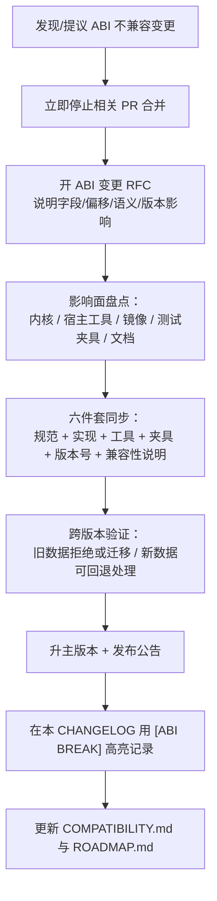

# Novus OS 变更日志（CHANGELOG）与发布说明

> 文档版本：v1.0（整理于 2026-11-27）
> 当前基线：**V1.6-FinalSpec（冻结正式版）**，对应当前主分支
> 配套：[ROADMAP.md](ROADMAP.md)、[COMPATIBILITY.md](COMPATIBILITY.md)、[SECURITY.md](SECURITY.md)、[changes.md](changes.md)
>
> 本文件采用 Keep a Changelog 风格，但针对操作系统项目增加了一条核心规则：**ABI break 必须高亮标记，并视为 OS 级重大事件**。仓库没有 git tag 或正式发布日期记录，因此历史按开发里程碑（M0～M12）与 `changes.md` 顺序组织；里程碑编号不等同于发布版本号。

---

## ABI 变更标记图例（必读）

| 标记 | 含义 | 严重度 | 必须做什么 |
|---|---|---|---|
| **[ABI BREAK]** | 冻结格式的字段、偏移、编码、版本或语义发生不兼容变更 | **最高 —— OS 大事件** | ABI RFC、升主版本、六件套同步、迁移路径、公告 |
| **[ABI-ADDITIVE]** | 只追加字段/消息号/系统调用号，旧数据仍可读 | 中 | 更新规范、工具、测试夹具、版本号（次版本） |
| **[ABI-FIX]** | 修正实现与冻结规范不一致，但不改变既定字段与语义 | 中 | 明确声明"未改变字段偏移与 ABI 主版本" |
| **[DOC-ERRATA]** | 仅修正文档文字，布局与语义不变 | 低 | 标注以哪份文件为准 |
| **[ABI-PENDING]** | 已知跨端契约冲突，尚未解决 | 高（阻塞发布） | 必须在发布前关闭，不得掩盖 |

```text
> [!CAUTION]
> **ABI BREAK 是操作系统级重大事件。**
> 它不是"一次普通的提交"：内核、宿主工具、镜像、测试夹具、规范文档、
> 版本号、兼容性说明必须同步变更；旧镜像/旧应用/旧模块可能全部失效。
> 任何 ABI BREAK 都必须先走 RFC 并得到评审，禁止在普通 PR 中夹带。
```

---

## 目录

- [1. 版本策略](#1-版本策略)
- [2. Unreleased（未发布）](#2-unreleased未发布)
- [3. Release Notes：V1.6-FinalSpec（当前）](#3-release-notesv16-finalspec当前)
- [4. 变更历史](#4-变更历史)
- [5. ABI 变更事件总表](#5-abi-变更事件总表)
- [6. ABI BREAK 应急流程](#6-abi-break-应急流程)
- [7. 如何写 ABI break 条目](#7-如何写-abi-break-条目)
- [8. 维护规则](#8-维护规则)

---

## 1. 版本策略

- **规范版本**：`V1.6-FinalSpec` 是当前冻结正式版；NUC/NKM/NUP/INS 等格式各有独立 `V1.0` 冻结版本。
- **主版本**：字段偏移、长度、编码、版本号或语义变化 ⇒ 升主版本，必须走 ABI RFC。
- **次版本**：只追加字段/消息/调用号，旧版本仍可解析 ⇒ 升次版本。
- **文档勘误**：不改变字段偏移与 ABI 主版本的文字修正 ⇒ 不升版本，但必须声明。
- **里程碑 M0～M12**：开发阶段编号，不等于发布版本号；一个规范版本可覆盖多个里程碑。

**冻结清单**（任何变更先查 [COMPATIBILITY.md §2](COMPATIBILITY.md)）：NUC、NKM、NUP、INS、内核 IPC、Novus-WM IPC、Debug 接口、更新补丁体系、rootfs 布局、共享内存、系统调用编号。

---

## 2. Unreleased（未发布）

> 以下为当前工作树中**尚未收口**的问题；含一个 **[ABI-PENDING]** 发布阻塞项。

### Added

- 新增统一工程文档：`ROADMAP.md`、`ARCHITECTURE.md`、`COMPATIBILITY.md`、`CODESTYLE.md`、`CODE_OF_CONDUCT.md`、`BUILD.md`、`CHANGELOG.md（本文件）`。
- 新增 `templates/`：GUI 应用、nsh 命令、Nuomi 脚本三条扩展路径的骨架模板。
- 新增 `apps/src/nuomi.rs`：Nuomi 语言的 `no_std` 无堆内置解释器，注册为 nsh 的 `nuomi` 命令。
- 新增 `kernel/klog.c/h`：跨引导阶段与内核阶段的日志环，启动 splash 直接显示固件日志。
- 新增多张 QEMU 网卡驱动与统一 PCI ID 表（`net_ids.c`、`net_virtio.c`、`net_rtl8139.c`）。

### Changed

- 应用 blob 上限由 64 KiB 提升到 128 KiB，内建应用栈提升到 `NUC_STACK_MAX` 4 MiB（nsh 内置解释器所需）。
- 图形呈现改为离屏合成 + 整帧 present；帧缓冲统一 UC 映射，修复真机花屏。
- 壁纸从照片 JPEG 改为程序化竖向渐变（解码器存在工具链相关 UB）。
- 内置应用改为 Rust `no_std` 扁平 NUC 镜像；会话管理器先启动，登录后再启动桌面应用。

### Fixed

- 修复 `kernel/shared_mem.h` 中 `wpkg_img_base/size` 静态断言存在但字段缺失导致的链接失败。
- 修复窗口重绘半帧闪烁：CLEAR/SHAPE/TEXT 不再逐条重绘，改由帧尾 `INVALIDATE` 一次性提交。
- 修复 e1000e MAC 读取顺序、igb 描述符结构与 SRRCTL 偏移、rtl8139 CAPR 写入值、DHCP 超时重发循环。

### [ABI-PENDING] 发布阻塞项

> [!CAUTION]
> **[ABI-PENDING] 更新包头部长度跨端不一致：内核冻结 128 B，`tools/novupkg` 使用 144 B。**
> 这是当前最严重的未关闭契约冲突：字段偏移虽兼容，但头长与 `meta_offset` 不一致，
> 可能导致更新包被内核拒绝。修复方案见 ROADMAP P0-02；**在此项关闭前不得发布正式版本**。

- **[ABI-PENDING]** 更新包契约：见上方告警。
- **[ABI-PENDING]** rootfs 目录数：`rootfs_layout.h` 为 78，`fsinfo` 与 `check_rootfs.py` 为 77（ROADMAP P0-04）。
- **[ABI-PENDING]** WM 协议版本：代码 `0x00020000`，文档标题与注释仍写 1.0（ROADMAP P0-01）。
- **[ABI-PENDING]** NUC 栈上限：内核 64 KiB–4 MiB，`cppcc README` 写 64–256 KiB。
- **[ABI-PENDING]** 硬编码开发公钥仍在 `apps/src/shell/update.rs`、`novu_verify.h`（ROADMAP P0-03）。

---

## 3. Release Notes：V1.6-FinalSpec（当前）

> 这是当前冻结正式版的发布说明。精确保留"已实现"与"规范目标"的区分；安全口径以 [SECURITY.md §5](SECURITY.md) 为准。

### 3.1 本版本亮点

- **启动**：UEFI 两阶段 A/B 核启动、启动 splash 与跨阶段日志、Merkle 自检。
- **内核**：PMM/MM/堆/每进程页表、抢占调度、syscall ABI、NUC 加载器、IPC。
- **文件系统**：NovusFS（WAL + Merkle + 双超级块）、VFS 单根、FAT/ISO9660/ext4 只读后端。
- **图形**：NovusDisplay、nvgui、Win11 风格桌面、全 Unicode 字形、中文拼音 IME、Fluent 主题、中英双语。
- **应用**：9 个内置应用（fileman/taskman/settings/netman/session/setup/nsh/devmgmt/dwm）、novusd、Nuomi。
- **工具链**：cppcc 三目标（NUC/PE32+/ELF64）、主机镜像工具、本地 CI 入口。
- **兼容层**：Win32 PE32+ 原型（141 条 API）、图形安装向导、分级增量更新体系。

### 3.2 ABI 状态总表

| 格式 / 协议 | 当前版本 | 本版本 ABI 状态 |
|---|---|---|
| NUC 可执行格式 | V1.0 / ABI `0x0100` | 稳定；头长 48 B 为文档勘误 **[DOC-ERRATA]** |
| NKM 内核模块 | V1.0 / ABI major 1 | 稳定；哈希规则统一 **[ABI-FIX]**（见 §4 M3） |
| NUP / INS | V1.0 | 冻结，无变更 |
| 内核 IPC | magic `0x4E495043` | 稳定 |
| Novus-WM IPC | `0x00020000`（2.0） | 追加 v1.1/v1.2/v1.3/v2 消息 **[ABI-ADDITIVE]** |
| Debug 接口 | 文件名 V1.0 / 内容 V1.1 | 接口基线冻结；实现差异已登记 |
| 更新补丁体系 | V1.0 | 头长契约冲突未关闭 **[ABI-PENDING]** |
| rootfs 布局 | `rootfs_layout.h` 真源 | 目录数不一致 **[ABI-PENDING]** |
| 共享内存 | NVSH v1.1，8 KiB | 冻结字段未动；追加日志环 carve-out **[ABI-ADDITIVE]** |
| 系统调用 | 稀疏编号冻结 | 只追加新编号 **[ABI-ADDITIVE]** |

### 3.3 已知限制（升级前必读）

- 不是 Secure Boot；CAP、端口强鉴权、硬件 TRNG、运行时密钥轮换均未落地。
- TCP 单连接、DNS 单事务、收包轮询；无线仅识别，802.11/WPA2 未实现。
- 硬件 2D / Mini-DWM 硬件后端缺失；无 vblank 中断；多输出仅镜像。
- NTFS 无后端；ext4 只读 + mkfs；无 `seek`/`truncate`/owner-rwx 权限。
- 通用 `./app.nuc` exec 未实现，当前只有 boot-stage 固定 `APPS/DEMO.NUC`。
- Win32 兼容层是原型：无磁盘 DLL、32 位 PE32、多线程与 SEH。
- M0–M11 历史镜像不保证安全修复回溯；不提供商业支持或合同 SLA。

### 3.4 升级注意事项

1. 升级前核对 [COMPATIBILITY.md](COMPATIBILITY.md) 的冻结清单与当前契约冲突。
2. 冻结格式主版本未变 ⇒ 旧镜像、旧 NUC 应用、旧 NKM 模块应可继续加载。
3. 更新包头长冲突关闭前，不要用 `novupkg` 产物做真实更新验证。
4. 任何 `E2E` 构建与生产构建不得混用对象；切换标志前 `make clean`。
5. 升级后执行 `make check-rootfs` 与 QEMU 冒烟，并确认无新增 `[WARN]`。

---

## 4. 变更历史

### M0 — 最小 UEFI 引导

- 新增 UEFI 入口、A 核 BSP 基础启动、VGA 文本输出。
- 冻结：UEFI PE32+ 镜像、共享内存交接区基础布局。

### M1 — 内存管理、分页、SMP

- 新增 PMM、分页、内核堆、AP 跳板与 B 核唤醒。
- **[ABI-ADDITIVE]** 共享内存块冻结为 8 KiB @ `0x7E000`，NVSH v1.1，带静态断言。
- **[DOC-ERRATA]** 完整 menuconfig 推迟到后续里程碑；Kconfig 仅声明占位。

### M2 — NovusFS 最小版本 + WAL

- 新增 NovusFS（双超级块、块位图、inode 表、WAL 64 块 CRC-32）。
- 新增 VFS 分派层、标准根目录树、`.novusfs/fsinfo` 与 `mounts.json`。
- **[ABI-PENDING]** 目录数真源 78 与校验工具 77 的漂移尚未消除。
- 冻结：NovusFS 版本 `0x00030000`、4 KiB 块、56 B 文件名。

### M3 — Merkle、NKM、ISO Live、安装器

> [!CAUTION]
> **[ABI-FIX] NKM 哈希冲突修正 —— 签名验证语义的重要修正。**
> NKM 模块校验改为：SHA-256 **排除头部 32 B hash 字段 + 64 B sig 字段**，
> 校验前把两者置 0，计算剩余全部字节摘要，再用 Ed25519 验证。
> 未同步此规则的模块与旧签名工具产出的工件会验证失败。
> 规范声明这是"统一哈希规则"修正，字段偏移与 ABI 主版本未变。

- 新增 Merkle 树校验（64 B SHA-256 节点、每块 64 节点、根写双 superblock）。
- 新增 NKM 加载器与 Ed25519 签名校验、`nkmgen` 工具。
- 新增 ISO 9660 + El Torito + isohybrid live 介质与文本安装器。
- **[ABI-ADDITIVE]** 共享内存追加 `wpkg_img_base/size`（0x308/0x310），`reserved` 相应缩短 16 B，块仍 8 KiB。

### M4 — 调度器、进程、系统调用

- 新增抢占式调度、每任务 CR3 与 64 KiB 内核栈、LAPIC 时间片、syscall 门。
- 新增 NUC 加载器：ring 3 映射、段权限、重定位、异常隔离。
- **[ABI-ADDITIVE]** 系统调用追加文件/目录编号 8–15；编号 2 `write` 保持串口日志语义不变。

### M5 — NovusDisplay 与控件库

- 新增帧缓冲 HAL、2D 软件渲染器、nvgui 控件库、桌面壳层、启动 Logo。
- **[DOC-ERRATA]** 硬件 2D 引擎与 OpenGL/Vulkan/DX 仍属规划，源码零命中。

### M6 — Novus-WM 与 IPC

- 新增内核 IPC（端口、有界队列、校验和、阻塞接收）与 Novus-WM。
- **[ABI-ADDITIVE]** Novus-WM IPC V1.0 冻结：32 B 头、magic `0x4E495043`、载荷 ≤128 B、队列 8、端口 16。

### M7 — cppcc 编译器

- 新增 cppcc C++ 子集编译器、NUC/PE32+/ELF64 三后端、C ABI 库。
- **[DOC-ERRATA]** NUC 头长按偏移表与既有实现统一为 48 B（`reserved` 16 B），明确标注"未改变字段偏移与 ABI 主版本"。
- **[ABI-PENDING]** cppcc 文档记载 NUC 栈 64–256 KiB，与内核 clamp 64 KiB–4 MiB 不一致。
- **[ABI-PENDING]** 通用 `./app.nuc` exec 未实现，仅 boot-stage 固定 `APPS/DEMO.NUC`。

### M8 — 内置系统应用

- 新增 fileman、taskman、settings、netman、session、nsh 等 Rust `no_std` 应用。
- **[ABI-ADDITIVE]** Novus-WM 协议 v1.1：新增 `CLEAR`(0x010D)/`SHAPE`(0x010E)/`TEXT`(0x010F)/`INVALIDATE`(0x0110) 显示列表消息；帧必须用 `INVALIDATE` 提交。
- **[ABI-ADDITIVE]** 系统调用追加 16–19（电源/会话/setup）与 20–24（unlink/rename/mount/umount/mounts）。

### M9 — Win32 兼容层原型 + Win11 中文桌面

- 新增 PE32+ 加载器（映射 `0x50000000`、DIR64 重定位、按名 IAT）、Win32 API 门与模拟注册表。
- **[ABI-ADDITIVE]** 新增 `SYS_WIN32(40)`、`SYS_PE32_EXEC(41)`；`task_t` 增加 ABI 标记，Win32 任务只放行 40/60。
- **[ABI-ADDITIVE]** Win32-ABI 白名单从首批 15 个 API 扩展到 141 条（含 GUI、GDI、文件、控件、资源、ws2_32 原型）。
- **[ABI BREAK]** 输入事件编码变更：`ND_KEY_*` 移到 `0x110000` 之上（`ND_KEY_BASE`），字符键直接携带 Unicode 码点，控制键不再与 `U+0100..U+010A` 冲突；Rust 侧改为 `wm::KEY_*` 常量。
  - 影响：所有按旧键码范围解析输入的客户端必须更新。
  - 处理：已同步 C/Rust 两侧常量与输入法服务；旧客户端需重新编译。

### M10 — UI 统一与图形安装向导

- 新增 Novus Fluent 主题令牌（浅色/深色/跟随时间），圆角显示列表图元 op 6/7，六页图形安装向导。
- **[ABI-ADDITIVE]** Novus-WM v1.2：新增圆角填充/描边图元；sysinfo 主题回复尾部追加 `mode/resolved/version`。
- **[ABI-ADDITIVE]** 共享内存追加 `esp_img_base/size` 与 `install_flags`；新增 `SYS_SETUP(19)`。

### M11 — 多语言、会话与 I/O

- 新增中英双语与持久化、live 免登录、七页安装向导；xHCI 大容量存储与 4 路 GOP 镜像输出。
- **[ABI-ADDITIVE]** 新增 `SYSINFO_REQ_LANG(0x030F)`、`SYSINFO_REQ_DISPLAY(0x0318)/RSP(0x0319)`；系统调用追加 25–27（update/https/console）。
- **[ABI-PENDING]** 多输出仅镜像，非独立桌面；原生 DP/eDP/HDMI 精确区分属后续里程碑。

### M12 — 设备管理器与 Mini-DWM

- 新增 devmgmt、模态属性窗、`devtab`；Mini-DWM 表面重定向与软件合成器。
- **[ABI-ADDITIVE]** Novus-WM v1.3：模态窗口标志 `NWM_F_CREATE_MODAL`；窗口上限提升到 10，显示列表提升到 120 图元/160 文字。
- **[ABI-ADDITIVE]** Novus-WM v2.0 (`0x00020000`)：新增 `SURFACE_CREATE/DESTROY`、`FLIP_PRESENT`、`BLT_SUBMIT`、`SET_EXCLUSIVE`、`THUMBNAIL` 消息；像素不跨 IPC 边界。
- **[ABI-ADDITIVE]** 系统调用追加 28–37：vmem/present/vsync/exclusive/cursor/query/mode。
- **[ABI-PENDING]** 规范文档仍写协议 1.0 与 8 窗口，与代码 2.0/10 窗不一致。

### 当前工作树（M12 之后）

- 启动 splash 日志面板、QEMU 四网卡打通、NCSI 联网检测、完整 UTF-8/Unicode、开发者模板、nsh 集成 Nuomi。
- **[ABI-ADDITIVE]** 共享内存尾部 carve-out 增加 4 KiB 日志环；冻结字段一个没动。
- **[ABI-ADDITIVE]** 更新体系新增 `SYS_UPDATE(25)`、`SYS_HTTPS(26)` 与五级通道（契约头长冲突见 §2）。

---

## 5. ABI 变更事件总表

| 事件 | 阶段 | 标记 | 影响面 | 当前状态 |
|---|---|---|---|---|
| 共享内存 8 KiB 布局冻结 | M1 | [ABI-ADDITIVE] | 引导 ↔ 内核 | 已同步，静态断言 |
| NovusFS v3 磁盘布局 | M2 | 冻结 | 所有系统镜像 | 稳定；目录数待同步 |
| NKM 哈希规则统一 | M3 | **[ABI-FIX]** | 所有 NKM 模块与签名工具 | 已同步规范与工具 |
| 共享内存追加壁纸字段 | M3 | [ABI-ADDITIVE] | 引导 ↔ 内核 | 已同步 |
| 系统调用追加 8–15 | M4 | [ABI-ADDITIVE] | 用户态头文件 | 已同步 |
| NUC 头长文档勘误 | M7 | [DOC-ERRATA] | 编译器/加载器 | 已声明非 ABI 变更 |
| WM v1.1 显示列表 | M8 | [ABI-ADDITIVE] | 所有 GUI 客户端 | 已同步 |
| 系统调用追加 16–24 | M8 | [ABI-ADDITIVE] | 用户态 | 已同步 |
| **输入事件键码迁移** | **M9** | **[ABI BREAK]** | **所有输入客户端、IME、终端** | **已同步 C/Rust；旧客户端需重编** |
| Win32 ABI 标记与 API 扩展 | M9 | [ABI-ADDITIVE] | Win32 任务 | 已同步白名单 |
| WM v1.2 圆角图元 | M10 | [ABI-ADDITIVE] | GUI 客户端 | 已同步 |
| 共享内存追加安装字段 | M10 | [ABI-ADDITIVE] | 引导 ↔ 安装器 | 已同步 |
| 多语言 / 显示 sysinfo | M11 | [ABI-ADDITIVE] | 设置与安装器 | 已同步 |
| 系统调用追加 25–27 | M11 | [ABI-ADDITIVE] | 更新/HTTPS 客户端 | 已同步 |
| WM v1.3 模态窗 | M12 | [ABI-ADDITIVE] | 设备管理器 | 已同步 |
| WM v2.0 surface 重定向 | M12 | [ABI-ADDITIVE] | DWM 与 v2 客户端 | 已同步；文档待勘误 |
| 系统调用追加 28–37 | M12 | [ABI-ADDITIVE] | Mini-DWM | 已同步 |
| 日志环 carve-out | 当前 | [ABI-ADDITIVE] | 引导 ↔ splash | 冻结字段未动 |
| 更新包头长 128 vs 144 | 当前 | **[ABI-PENDING]** | 更新包跨端契约 | **未关闭，阻塞发布** |

---

## 6. ABI BREAK 应急流程

> [!CAUTION]
> 一旦确认发生 ABI BREAK，立即按下列流程执行。**禁止**用"能用就行"或"下个版本再修"跳过。



**六件套**（缺一不可）：规范文档、内核实现、宿主工具、测试夹具、版本号、兼容性说明。

**公告必须包含**：

- 变更了哪个冻结格式、哪个字段/语义、从什么变成什么。
- 哪些旧工件会失效（旧 NUC 应用、旧 NKM 模块、旧更新包、旧镜像）。
- 迁移路径与工具命令。
- 新旧版本号与兼容窗口。
- 如果发现于已发布版本，按 [SECURITY.md](SECURITY.md) 判断是否申请 CVE。

---

## 7. 如何写 ABI break 条目

复制下面的模板，放在对应版本的显眼位置，并用引用块高亮：

```markdown
> [!CAUTION]
> **[ABI BREAK] `<格式名>` `<字段/协议>` — 一句话说明不兼容点。**
>
> - **变更内容**：从 X 变为 Y（含偏移、长度、编码、版本）。
> - **影响工件**：哪些旧镜像/应用/模块/包会失效。
> - **必须动作**：升版本、同步六件套、迁移命令。
> - **兼容窗口**：是否提供同时支持新旧格式的过渡期。
> - **依据**：RFC 链接 / 规范版本 / 测试夹具。
```

**反例（不允许）**：

```text
- 调整了头文件布局
- 顺手改了协议版本号
- 修了一下签名计算（旧模块应该还能用吧）
```

这类写法掩盖了 OS 级重大事件，会让下游工具链、镜像与测试夹具静默失效。

---

## 8. 维护规则

1. 每次合并 PR 时，先在 `Unreleased` 对应分类添加条目；含 ABI 变更的必须带标记。
2. 发布时把 `Unreleased` 内容移入新版本章节，并更新 `Release Notes` 与 ABI 状态总表。
3. `[ABI-PENDING]` 项必须附带 ROADMAP 任务号；关闭时改为对应标记并说明验证方式。
4. `changes.md` 保留开发过程的细节（主题 → 路径级要点 → 验证结果）；本文件只保留对用户/下游重要的结论。
5. 文档与代码冲突时提交勘误，并标注以哪份文件为准；不要静默改写历史条目。
