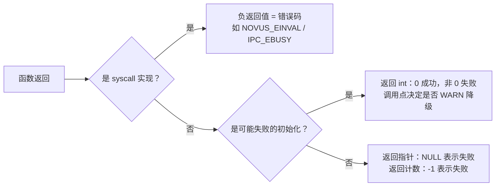
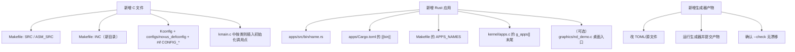
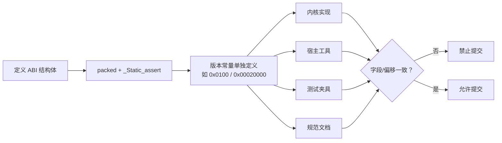

# Novus OS 代码规范（CODESTYLE）

> 版本：v1.0（基于 2026-11-27 工作树）
> 配套：[CONTRIBUTING.md](CONTRIBUTING.md)（开发流程）、[ARCHITECTURE.md](ARCHITECTURE.md)（分层与依赖）、[COMPATIBILITY.md](COMPATIBILITY.md)（冻结 ABI）、[SECURITY.md](SECURITY.md)（安全硬规则）
>
> 本规范从**当前源码的真实风格**归纳而来，不是从零发明的审美偏好。仓库没有统一的 `clang-format`、`rustfmt.toml` 或 `.editorconfig`，因此**第一规则是跟随所在文件的既有风格**；本文给出可统一执行的下限与禁止项。

---

## 目录

- [1. 总则与优先级](#1-总则与优先级)
- [2. C 代码规范](#2-c-代码规范)
- [3. Rust 代码规范](#3-rust-代码规范)
- [4. 汇编与启动代码规范](#4-汇编与启动代码规范)
- [5. 文件与目录组织](#5-文件与目录组织)
- [6. 跨语言命名总表](#6-跨语言命名总表)
- [7. ABI 与冻结格式代码规范](#7-abi-与冻结格式代码规范)
- [8. 日志与错误信息规范](#8-日志与错误信息规范)
- [9. 注释与文档规范](#9-注释与文档规范)
- [10. 子系统专用规则](#10-子系统专用规则)
- [11. 反模式对照](#11-反模式对照)
- [12. 提交前检查清单](#12-提交前检查清单)
- [13. 参考](#13-参考)

---

## 1. 总则与优先级


### 1.1 五条硬规则

1. **跟随局部风格**：不为个人偏好做大规模无关注释/格式化改动；一个 PR 只做一件事。
2. **不引入警告**：C 与主机工具代码不新增 `-Wall -Wextra` 警告；自检脚本按 `-Werror` 要求。
3. **不引入外部依赖**：Rust 应用 `no_std` 无第三方 crate；确有必要先在 Issue 论证自研替代与许可证边界（Unifont 是已记录例外）。
4. **不破坏冻结边界**：NUC/NKM/NUP/INS/IPC/Debug/更新格式的字段、偏移、版本号不得私改。
5. **注释解释"为什么"，不解释"做了什么"**：代码本身应能说明做什么；注释用于记录冻结决策、硬件怪癖与降级理由。

### 1.2 事实源优先级

源码与构建结果 > 冻结格式规范 > `changes.md`/`CONTRIBUTING.md` > `README.md` 早期规划 > 过程资料。

---

## 2. C 代码规范

### 2.1 缩进、括号与行宽

仓库 C 代码（如 `kernel/kmain.c`、`kernel/trap.c`、`kernel/ipc.h`）采用 **K&R 风格 + 2 空格缩进**：

```c
/* 正确：2 空格缩进，左括号同行，控制语句即使单行也用大括号 */
static void syscall_dispatch(trap_frame_t *f) {
  UINT32 i;
  task_t *t = sched_current();

  if (t == 0) {
    return;
  }
  for (i = 0; i < count; i++) {
    do_work(i);
  }
}
```

- 缩进：**2 个空格**，不用 Tab。
- 左大括号与 `if`/`for`/`while`/函数签名**同行**；`else` 与闭合括号同行。
- 即使循环体只有一行，也写大括号（现有代码的防御性约定）。
- 指针声明：`type *name`（星号靠变量名），如 `task_t *t`、`const char *s`。
- 行宽：以 80 列为目标，超过就换行；参数换行时对齐到第一个参数或缩进 2 格。
- 不要在旧文件里整体重排格式。

### 2.2 命名约定

| 对象 | 规则 | 实例（来自源码） |
|---|---|---|
| 函数 | 小写 + 下划线 | `syscall_dispatch`、`novusfs_mount`、`ipc_recv` |
| 局部变量 | 小写 + 下划线，短名仅用于循环 | `i`、`t`、`fb_phys`、`map_size` |
| 全局变量 | `g_` 前缀 | `g_syscalls[]`、`g_unknown_calls`、`g_timeline_start` |
| 宏 / 常量 | 全大写 + 下划线，数值常量加 `u`/`ull` 后缀 | `IPC_MAGIC`、`IPC_PAYLOAD_MAX 128u`、`IPC_PORT_BASE 0x1000ull` |
| 类型 | `snake_case_t` 或 UEFI 风格全大写 | `vfs_fs_t`、`trap_frame_t`、`task_t`；`UINT64`、`UINT32`、`UINTN`、`EFI_STATUS` |
| 结构体字段 | 小写 + 下划线 | `sender`、`payload_len`、`fb_phys` |
| 文件 | 小写 + 下划线，模块前缀利于归类 | `net_e1000.c`、`nd_font_uni.c`、`vfs_mount.c` |
| 头文件守卫 | `<FILE>_H`，全大写 | `#ifndef NOVUS_IPC_H` / `#define NOVUS_IPC_H` |

**前缀族**（按子系统归类，新增文件沿用）：

`nd_*` 图形、`nwm_*` 窗口协议、`nuc_*` 加载器、`nkm_*` 模块、`novusfs_*`/`vfs_*` 文件系统、`net_*` 网络、`sys_*` 系统调用实现、`cmd_*` shell 命令（Rust 侧同）、`blkdev_*` 块层、`devtab_*` 设备表。

### 2.3 头文件与包含

```c
/**
 * Novus OS - 简明模块说明（M6, README part 10.2-10.3）。
 *
 * 说明本模块的职责边界、为什么这样设计、以及调用者必须知道的约束。
 */

#ifndef NOVUS_IPC_H
#define NOVUS_IPC_H

#include "uefi.h"
#include "kernel.h"

/* 类型与常量定义 ... */

#endif
```

- 每个 `.c` 必须有对应的 `.h`（仅内部使用的私有函数可只在 `.c` 内 `static`）。
- 头文件自包含：包含自身依赖，不依赖调用方先包含别的头。
- include 顺序：本模块头 → 内核通用头 → 子模块头；不按字母排序，按依赖层次。
- 头文件只放声明、类型、宏与 `static inline` 小函数；不要放变量定义。
- 暴露给 NKM 的内核符号必须加入 `nksym_table`（取地址同时防止链接器丢弃）。
- 新 `.c` 必须显式加入顶层 `Makefile` 的 `SRC`，汇编加 `ASM_SRC`，新目录加 `INC`。**没有自动发现**。

### 2.4 类型与数值

- 内核使用 UEFI 定宽类型：`UINT8/UINT16/UINT32/UINT64/UINTN/INT64/BOOLEAN`；不要用裸 `int`/`long` 表示磁盘字段或 ABI 字段。
- ABI 结构体必须 `__attribute__((packed))`，并配 `_Static_assert` 固定总长度与关键字段偏移（范例：`security/nkm/nkm.c:49-66`、`fs/vfs_mount.h:39`）。
- 所有长度/数量常量用 `u` 后缀；涉及 64 位地址用 `ull`。
- 布尔用 `BOOLEAN`/`UINT8`，不要混用 `bool`（除 Rust 侧）。

### 2.5 错误处理与返回值



- 错误码统一负数，例如 IPC：`IPC_EBADF (-1)` … `IPC_ETIMEDOUT (-8)`；把常量写成 `(-1)` 形式避免宏展开优先级问题。
- 初始化失败多数**降级为 WARN 并继续启动**（NovusFS/VFS/ext4/Merkle 均如此）；不要在驱动探测失败时 panic。
- 硬件不支持时如实返回 `ENODEV` 或打印"unsupported"，**不要假装成功**（GPU 2D 厂商入口、virtio 1.0-only、igb 在 QEMU 下不置 LU 都是范例）。
- 资源句柄：`0` 或 `NULL` 表示无效；fd 从 3 开始。
- 用户指针不得直接解引用，按任务 CR3 逐页复制（`kernel/trap.c`）。

### 2.6 内存与并发硬约束

- ISR 中**禁止**：`sti`、睡眠、调度、分配内存、调用协议栈、打印日志；只清自己的中断源，EOI 由框架统一处理。
- `kmalloc()` 是页粒度分配器（4 KiB 向上取整，最多 256 MiB / 256 条记录），**不要当小对象 slab 用**。
- 块设备对象必须是静态存储且注册后长期有效；对外统一 512 B 扇区。
- 共享数据用自旋锁并设上限；锁超时降级而不是无限等待。
- 帧缓冲统一经 `mm_map_phys(..., MM_MAP_UC)` 映射；需要时 `wbinvd` 冲刷 WB 别名。
- 设备 MMIO/DMA 缓冲走显式 PMM，不经 `kmalloc`。

### 2.7 日志

统一走 `kputs()`（同时镜像到 VGA、COM1、日志环、可选 framebuffer 控制台），不要直接调 `vga_puts`/`serial_puts`。完整前缀表见 [§8](#8-日志与错误信息规范)。

---

## 3. Rust 代码规范

### 3.1 硬性运行环境

`apps/` 是 `no_std`、无分配器、无第三方依赖的扁平 NUC 镜像：

```rust
//! Novus OS - user-space runtime for the M8 system applications.
//!
//! `no_std`, no allocator, no dependencies - the whole runtime is these
//! modules, so the flat binary stays small enough to embed in the kernel.

#![no_std]

pub mod ipc;
pub mod fs;
pub mod sinfo;
pub mod sys;
```

- **禁止** `Vec`、`String`、`Box`、`format!`、`std::*`；用固定数组/切片，缓冲开在栈或静态区。
- 单应用 blob **< 128 KiB**；栈范围 64 KiB–4 MiB；链接地址固定 `0x400000`。
- profile：`panic=abort, opt-level=s, lto=true, strip=true`（2021 edition）。
- 每个二进制导出自己的 `#[no_mangle] extern "C" _start`；没有 runtime 帮你初始化栈或环境。
- `panic` handler 只向 COM1 打印 `[APP] panic` 并 `exit(3)`，没有回溯；调试靠分段落点 `sys::write(b"...\n")`。
- 不在公开日志中输出内核地址、栈回溯、密钥材料或可复现攻击 payload。

### 3.2 缩进、命名与模块

- 缩进：**4 个空格**，不用 Tab；遵循 rustfmt 默认布局（尽量跑 `cargo fmt`）。
- 模块/函数/变量：`snake_case`；类型/枚举/`trait`：`UpperCamelCase`；常量：`UPPER_SNAKE_CASE`（如 `BUILTINS`、`MAX_ARGS`、`NWM_MAX_WINDOWS` 的 Rust 镜像）。
- 模块顶层用 `//!` 文档注释说明职责、边界与限制；公共项用 `///`。
- 分区注释沿用现有风格：`/* ---- output helpers ---------------------------------------------------- */`。
- `pub mod` 在 `lib.rs` 集中声明；内部实现放子模块，不把所有代码堆在 `main.rs`。
- 条件编译用 `#[cfg(target_os = "none")]` 区分裸机与宿主测试（避免重复 lang item）。

### 3.3 输出与命令约定（`nsh`）

```rust
fn put_dec(out: &mut dyn Sink, mut v: u64) {
    if v == 0 {
        putc(out, b'0');
        return;
    }
    let mut tmp = [0u8; 20];
    let mut n = 0;
    // ...
}
```

- 内建命令统一签名：`fn cmd_xxx(shell: &mut Shell, cmd: &Cmd, stdin: &[u8], out: &mut dyn Sink) -> i32`。
- **输出只能走 `out.write()`**；禁止 `println!`，否则管道与 `$(...)` 捕获不到。
- `stdin` 是完整输入缓冲（≤4 KiB），不是流；`MAX_ARGS=40`，单参数 `WORD_MAX=256`。
- 返回值即 `$?`：`0` 成功、`127` 未找到、其它自定义。
- 改环境用 `shell.set_var()`；启动应用用 `sinfo::spawn_name()`，没有 fork/exec。
- 新增命令：函数写在 `cmds.rs` 的其它 `cmd_*` 之后、`BUILTINS` 之前，再在表中注册一行。
- 命名：应用/命令名只能字母、数字、下划线，**不能含 `-`**（否则 `k_app_<name>` 不是合法 C 标识符）。

### 3.4 `unsafe` 与裸指针

- 只在 syscall 封装、IPC 线格式解析、帧缓冲访问等不可避免处使用 `unsafe`，并写注释说明**为什么安全**。
- 不通过 `unsafe` 绕过 128 KiB blob、4 KiB IPC 载荷、256 B 路径等上限。
- 生成文件（`theme.rs`、`lang_dict.rs`、`unicode_data.rs`）头部标注"改 TOML 后重新生成，不要直接编辑"，不要手改。

---

## 4. 汇编与启动代码规范

- 文件用 `.S`，加入 `Makefile` 的 `ASM_SRC`。
- 注释说明寄存器用途、栈布局与 ABI 约定；裸机代码尤其要写清"为什么这样做"。
- AP trampoline 是特例：16 位裸二进制 **< 4 KiB**、无重定位，最后 24 字节依次是 CR3、AP 栈指针、`ap_main` 三个 64 位槽。
- `syscall; ret` 的指令布局属于 ABI（`ipc_recv` 依赖 RIP 回退 2 字节重放），不得随意改动。
- `.data` 而非 `.bss` 存放需要在 `kernel_entry` 清 `.bss` 后仍保留的状态（如启动 splash 状态）。
- 字体 blob 用 `.incbin` 嵌入（3.5 MB 数据不交给 C 编译器处理）。

---

## 5. 文件与目录组织

### 5.1 新增文件的登记点



- `g_apps[]` **只能在末尾追加**：数组索引被旧版 sysinfo `/apps` 与客户端复用；新代码优先 `apps_launch_name()`。
- Win32 镜像有独立的 `g_win32[]`，**绝不挪动 `g_apps[]` 索引**。
- 生成物大多已提交仓库；修改源文件后必须重新生成并提交（见 [CONTRIBUTING.md §8](CONTRIBUTING.md)）。
- 不提交 `build/`、`out/`、`esp/`、`target/`、`*.o`、OVMF VARS 副本、临时日志或机器特定绝对路径。

### 5.2 目录职责（不可混放）

| 目录 | 只放什么 |
|---|---|
| `arch/x86_64/` | UEFI 入口、boot stage3、内核入口、AP 跳板、汇编桩 |
| `kernel/` | 调度、syscall、内存、中断、设备驱动、网络、Win32/PE、安装、会话 |
| `fs/` | VFS、NovusFS、FAT、ISO9660、ext4、挂载与 rootfs 布局 |
| `security/` | NKM 签名、TLS、novu 更新、CA bundle |
| `graphics/` | NovusDisplay、nvgui、桌面壳层、字体/主题/IME/壁纸 |
| `wm/novus-wm/` | 内核态合成器与协议；`nwm_proto.h` 是协议真源 |
| `apps/` | Rust `no_std` 应用与运行时 |
| `user/` | Nuomi 参考实现、cppcc、win32compat、novusd、ssl 证书 |
| `tools/` | 主机端镜像/打包/签名/生成器 |
| `scripts/` | 自检、QEMU 测试、镜像检查、本地 CI 入口 |

> 根目录没有 `system/`、`drivers/`、`user/shell/`、`user/micropython/`；不要按旧 README 建这些目录。

---

## 6. 跨语言命名总表

| 类别 | C | Rust | 备注 |
|---|---|---|---|
| 函数 | `snake_case()` | `snake_case()` | 一致 |
| 局部变量 | `snake_case` | `snake_case` | 一致 |
| 全局 | `g_name` | `NAME` 或静态区 | Rust 侧偏好常量/静态 |
| 常量 | `UPPER_SNAKE` + `u` 后缀 | `UPPER_SNAKE` | 数值后缀只在 C |
| 类型 | `foo_t` / `UINT64` | `Foo` | C 用定宽 UEFI 类型 |
| 宏 | `UPPER_SNAKE` | `const` 优先 | 少用 `macro_rules!` |
| 模块/文件 | `net_e1000.c` | `net_e1000.rs` | 小写下划线 |
| 日志前缀 | `[BOOT]` 等 | 同 C | 用户态 `[APP]` |
| 端口名 | `"nwm"`、`"sys"` | 同左 | 静态字符串，不拼装 |

**前缀族速查**：`nd_`(图形)、`nwm_`(WM)、`nuc_`(加载器)、`nkm_`(模块)、`novusfs_`/`vfs_`(FS)、`net_`(网络)、`sys_`(syscall)、`blkdev_`(块层)、`devtab_`(设备表)、`cmd_`(shell 命令)。

---

## 7. ABI 与冻结格式代码规范



- 冻结字段变更必须走 ABI 变更 RFC 并升主版本；同时更新**六件套**：规范文档、内核实现、宿主工具、测试夹具、版本号、兼容性说明。
- 文本勘误要明确标注"未改变字段偏移和 ABI 主版本"（如 NUC 头长统一为 48 B 的勘误）。
- 内核 IPC 头 32 B、magic `0x4E495043`、载荷 ≤128 B；WM `NWM_PROTO_VERSION 0x00020000`；NUC ABI `0x0100`；NKM 头 208 B。改动前先读 [COMPATIBILITY.md](COMPATIBILITY.md) §2。
- 路径 ≤256 B、单次 I/O ≤4096 B、fd 从 3 起——所有用户态缓冲按此上限开，不要假设可无限增长。
- 未知系统调用每号只报一次后拒绝；不要静默忽略错误输入。

---

## 8. 日志与错误信息规范

| 前缀 | 来源 | 典型内容 |
|---|---|---|
| `[BOOT]` | `kernel/kmain.c` | 初始化阶段信标 |
| `[SHM]` / `[M3]` / `[MRKL]` | 共享内存 / Merkle | 交接校验与完整性结论 |
| `[ND]` / `[CRTC]` | NovusDisplay | 帧缓冲、合成、回扫、自检 |
| `[NOVS]` / `[WAL]` | NovusFS | 超级块、事务与校验告警 |
| `[BLK]` / `[USB]` / `[NET]` / `[DNS]` / `[NCSI]` | 驱动与网络 | 枚举、链路、DHCP/DNS/联网检测 |
| `[SMP]` / `[PMM]` / `[HEAP]` | 调度/物理内存/内核堆 | AP 唤醒、页分配告警、重复释放 |
| `[APP]` | `apps/` | panic 与分段落点 |
| `[WARN]` | 任意 | 降级路径；PR 中必须说明出现过哪些 |

规则：

1. 内核统一 `kputs()`，用户态统一 `out.write()`/`sys::write()`。
2. 消息以模块前缀开头；新增前缀在 `docs/Novus OS Debug 级接口手册 V1.0.md` 登记。
3. 不支持的硬件要如实说 `unsupported`/`ENODEV`，不要打印成功日志。
4. WARN 表示"可继续但功能受限"，不是测试通过；PR 描述里列出实际出现的 WARN。
5. 不输出内核地址、栈回溯、密钥材料或可复现攻击 payload。

---

## 9. 注释与文档规范

### 9.1 什么时候写注释

**必须写**：冻结决策、硬件怪癖、顺序依赖、降级理由、看似奇怪但必要的代码、公共 API 的前置条件。

**不要写**：逐行翻译代码；"增加了一个变量"这类无信息注释；大段被注释掉的死代码。

### 9.2 注释形式

- C 文件头用 `/** ... */` 块，说明模块职责、设计理由与关键约束（范例：`kernel/ipc.h:1-25`、`kernel/kmain.c:1-13`）。
- C 内部分区用 `/* ---- name ---- */`。
- Rust 模块用 `//!`，公共项用 `///`，内部分区沿用 `/* ---- name ---- */`。
- 注释用英文或中文均可，但**同一文件内保持一致**。
- 注释与代码同步更新；代码改了注释没改视为缺陷。

### 9.3 文档更新义务

- `changes.md` 惯例：**主题标题 → 精确到路径的要点 → 验证结果**，并如实列出未运行项。
- 修改配置/构建/API 时同步 `README.md`、`docs/` 与 `CONTRIBUTING.md`。
- 文档与代码冲突时提交勘误，声明以哪份文件为准；不要修改代码去迁就旧文档。

---

## 10. 子系统专用规则

### 10.1 内核与驱动

- 初始化顺序是硬约束（PMM → MM → heap → 显示 → 存储 → devtab → IPC → FS → NKM → SMP → 调度）；新增初始化调用点按硬件类别插入 `kmain()`。
- PCI BAR 探测在存储驱动之后、网络栈之前；扫描会写 `0xFFFFFFFF`，不能再干扰传输。
- NovusFS 自检与 live root 挂载在 AP 唤醒之前，避免第二核同时访问块层与 WAL。
- 中断注册 `irq_register(line, flags, isr, device, name)`；每 GSI 最多 4 handler，共享线路触发属性一致。
- 设备管理器只读 `devtab_refresh()` 生成的树，应用不自行扫硬件。

### 10.2 文件系统

- VFS 单根、无 `..` 穿越消除、目录实现不新增 `..` 条目。
- 挂载表固定 8 项；挂载路径绝对且唯一；跨挂载 `rename` 拒绝。
- `/.novusfs/mounts.json` ≤4 KiB / ≤8 条 / 白名单路径；运行时 `mount`/`umount` **不回写**。
- NovusFS 格式冻结：不移动已有块；WAL 64 块、Merkle 64 B 节点每块 64 节点。
- FAT/ISO9660 只读：写/删/改名直接失败；FAT 仅 8.3 短名。

### 10.3 GUI 与窗口

- 像素格式 `0xAARRGGBB`；离屏合成 → 整帧呈现；只画 `nd_canvas()`，不直接画显存。
- 一帧以 `CLEAR` 开始、`SHAPE`/`TEXT` 填充、**以 `INVALIDATE` 结束**；`IPC_EBUSY` 必须重试。
- 每窗 ≤120 图元 / ≤160 文字，单段文字 ≤96 B，标题 ≤24 B，系统 ≤10 窗。
- 文本宽度用 `nd_text_width()` / `ui::width()`，禁止"字节数 × 6"估算；中文走码点边界。
- 颜色只用语义令牌 `ui::bg()`、`card_bg()`、`row_sel()`、`text()`、`dim()`、`accent()`、`line()`。
- 客户端只在事件或主题变化时绘制；空闲 `sys::yield_now()`（任务不会被抢占）。
- 输入事件先过 IME 再投递给焦点窗口；`Ctrl+Space` 切中英，`Ctrl+Shift+U` 码点直输需校验代理区与上限。

### 10.4 安全相关

- 修改安全代码遵守 [SECURITY.md §6](SECURITY.md) 九条硬规则（不绕过签名校验、显式长度检查、不在 ISR 打印、不扩大挂载白名单等）。
- 新权限检查不要把 CAP 规范当实现；当前 `cap_check` 未落地。
- 密钥/种子/私钥不入库；E2E 测试根与生产 CA 物理隔离。
- 安全修复优先加"错误输入被拒绝"的回归用例，而不是只测正常路径。

---

## 11. 反模式对照

| 不要 | 要这样做 | 原因 |
|---|---|---|
| 在 `apps/` 用 `Vec`/`String`/`format!` | 固定数组 + `out.write()` | 无分配器，blob <128 KiB |
| 用 `println!` 输出命令结果 | `out.write(s.as_bytes())` | 管道和 `$(...)` 捕获不到 |
| `kputs()` 之外直接调 `serial_puts()` | 统一 `kputs()` | 四路镜像与加锁 |
| 在 ISR 里打印日志或分配内存 | 只清中断源，记录状态后由 tick 处理 | 会死锁或破坏调度 |
| 把帧缓冲当 WB 内存直接写 | `mm_map_phys(..., MM_MAP_UC)` + `wbinvd` | 真机花屏/卡顿 |
| 直接解引用用户指针 | 按任务 CR3 逐页复制 | 用户地址可能无效 |
| 用裸 `int` 表示磁盘/ABI 字段 | `UINT32`/`INT64` 等定宽类型 | 跨工具链布局一致 |
| 冻结结构体不加 `_Static_assert` | 加断言固定长度与偏移 | 防止漂移 |
| 引用旧文档中的 `system/`、`drivers/` | 按真实源码地图 | 那些目录不存在 |
| 应用名含 `-` | 只用字母/数字/下划线 | `k_app_<name>` 必须合法 |
| 在 `g_apps[]` 中间插入应用 | 末尾追加 | 索引被旧客户端复用 |
| 手改 `theme.rs`/`lang_dict.rs` | 改 TOML 后重生成 | 会被下次生成覆盖 |
| 回归时带 `--update-baseline` | 只有 UI 有意变更才更新并人工核验 | 基线是门禁 |
| 硬件不支持时返回成功 | 如实 `ENODEV` + 日志说明 | "假装能跑"会静默花屏 |
| 大规模重格式化旧文件 | 只改必要行 | PR 可审查、可回滚 |

---

## 12. 提交前检查清单

```text
[ ] 跟随了所在文件的既有风格（缩进/括号/命名/注释）
[ ] C 代码未引入新的 -Wall -Wextra 警告
[ ] Rust 应用仍是 no_std、无分配器、无第三方依赖，blob < 128 KiB
[ ] 新增文件已登记到 Makefile / Cargo.toml / g_apps[] 等所有必需位置
[ ] 未触碰冻结格式；若触碰，已完成六件套同步与 RFC
[ ] ABI 结构体有 packed 与 _Static_assert（如适用）
[ ] ISR 无睡眠/分配/调度/打印；用户指针已逐页复制
[ ] 日志使用统一前缀；不支持的硬件如实拒绝；WARN 已在 PR 中说明
[ ] 颜色/文本宽度/显示列表按 GUI 规则；一帧以 INVALIDATE 结束
[ ] 生成物已由源文件重新生成，--check 无漂移
[ ] README / docs / changes.md 已按真实实现更新
[ ] 无 build/out/esp/target/*.o、私钥、机器绝对路径或临时改动
[ ] PR 描述列出实际执行的命令与未执行项
```

---

## 13. 参考

[CONTRIBUTING.md](CONTRIBUTING.md)、[SECURITY.md](SECURITY.md)、[COMPATIBILITY.md](COMPATIBILITY.md)、[ARCHITECTURE.md](ARCHITECTURE.md)、[templates/README.md](templates/README.md)、`docs/Novus OS Debug 级接口手册 V1.0.md`、`docs/终端与命令解释器设计.md`、`docs/Novus-WM 与 IPC 协议规范 V1.0.md`。
