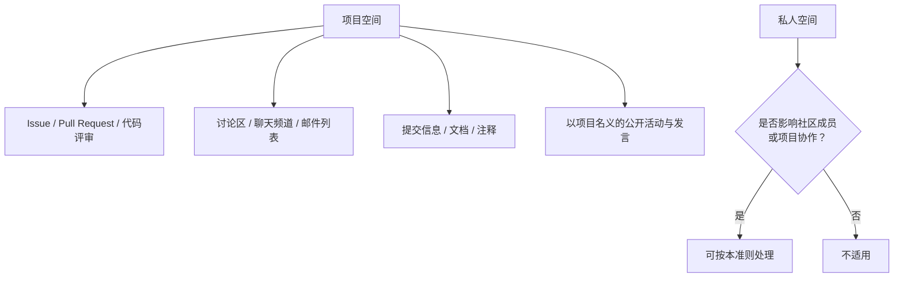
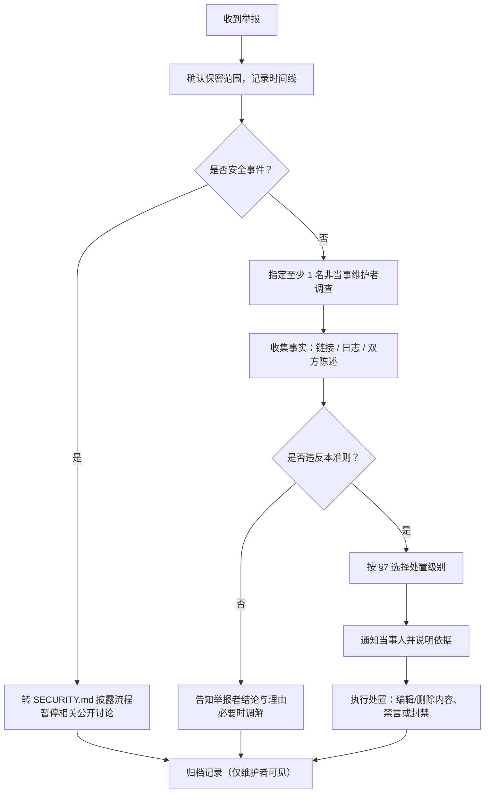
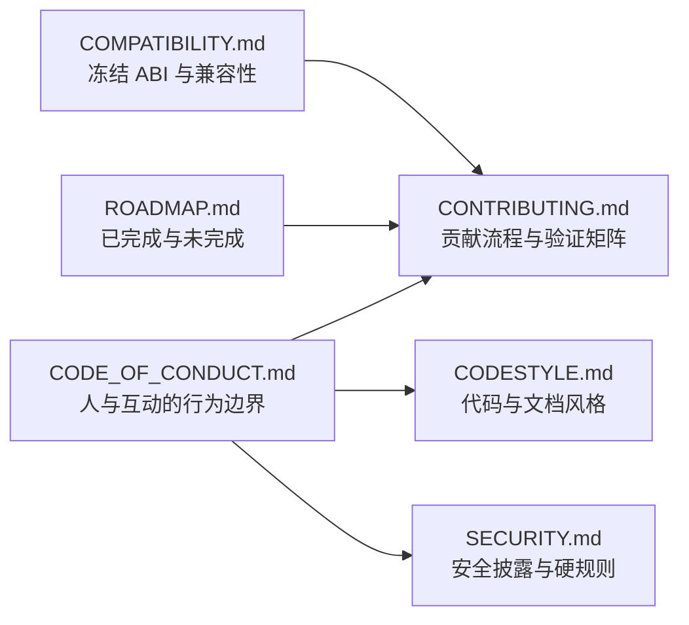

> 英文版本：[docs/en/CODE_OF_CONDUCT.md](docs/en/CODE_OF_CONDUCT.md)

# Novus OS 行为准则（CODE OF CONDUCT）

> 版本：v1.0（2026-11-27）
> 适用：所有项目空间（Issue、Pull Request、代码评审、讨论区、提交信息、文档、以及以项目名义进行的公开交流）
> 配套：[CONTRIBUTING.md](CONTRIBUTING.md)（贡献流程）、[CODESTYLE.md](CODESTYLE.md)（代码规范）、[SECURITY.md](SECURITY.md)（安全口径）、[LICENSE](LICENSE)（GPLv2）

---

## 目录

- [1. 我们的承诺](#1-我们的承诺)
- [2. 适用范围](#2-适用范围)
- [3. 我们的标准](#3-我们的标准)
- [4. 技术协作中的行为准则](#4-技术协作中的行为准则)
- [5. 举报渠道](#5-举报渠道)
- [6. 处理流程](#6-处理流程)
- [7. 处置分级](#7-处置分级)
- [8. 执行者的责任](#8-执行者的责任)
- [9. 与其他规则的关系](#9-与其他规则的关系)
- [10. 署名与许可](#10-署名与许可)

---

## 1. 我们的承诺

我们承诺：无论年龄、体型、可见或不可见的残疾、族裔、性别认同与表达、经验水平、教育程度、社会与经济地位、国籍、外貌、种族、宗教信仰或性取向如何，参与 Novus OS 社区的所有人都拥有不受骚扰的体验。

我们承诺以有助于建立开放、友善、多元、包容和健康社区的方式行事与互动。我们欢迎不同观点，但坚持"对事不对人"：可以强烈反对一个设计决策，不能贬低提出它的人。

Novus OS 是一个从零自研、全部底层代码自研的操作系统项目。我们特别珍惜**愿意把设计理由写清楚、愿意承认未知、愿意如实记录降级与未完成项**的贡献文化。任何以"项目目标宏大"为理由压制合理质疑、或以"规范已冻结"为借口拒绝讨论兼容性的行为，都不符合本准则。

---

## 2. 适用范围

本准则适用于所有项目空间，以及个人在公共场合代表项目或项目社区时的行为。代表项目包括但不限于：使用官方邮箱、通过官方社交媒体账号发言、在会议或线上活动中作为指定代表出席。

不适用于与项目无关的私人交流；但如果私人行为对社区成员造成持续伤害或影响项目协作，仍可按本准则处理。

---

## 3. 我们的标准

### 3.1 期望的行为

- 使用友善、包容的语言，避免带性别、种族、地域、学历或经验色彩的判断。
- 尊重不同观点与经验："我不理解这个设计的理由"优于"这个设计显然不对"。
- 优雅地接受建设性反馈，说"谢谢指出，我改"不需要任何附加条件。
- 以社区整体利益为重：一个 PR 只做一件事、文档与代码同步、如实列出未执行的检查。
- 对新手保持耐心：解释"为什么"，而不是只丢一句"去看规范"。
- 对他人的工作给出**具体、可操作**的评审意见：指出路径、行号与改进方向，而不是"这不行"。

### 3.2 不可接受的行为

- 使用性化的语言或图像，以及任何形式的性关注或暗示。
- 人身攻击、侮辱或贬损性评论；政治立场攻击。
- 公开或私下的骚扰、跟踪、威胁。
- 未经明确许可公开他人的真实姓名、住址、邮箱、即时通讯账号等个人信息（doxxing）。
- 在评审、Issue 或提交信息中夹带针对个人的贬称、标签或"你这种人"式表达。
- 以经验、学历、所属机构或母语为由贬低他人贡献。
- 持续无视他人的合理请求（例如停止某种交流方式、停止在无关 Issue 中灌水）。
- 故意提交有害内容：恶意破坏、后门、窃取凭据、泄露私钥或未公开漏洞。
- 把"自研"约束当作攻击他人的工具（例如嘲讽使用外部工具的贡献者），或反过来嘲讽项目坚持自研。

> 安全相关的问题请按 [SECURITY.md](SECURITY.md) 的披露流程处理，**不要**在公开 Issue 中贴出可复现的攻击 payload、私钥、种子或内核地址。

---

## 4. 技术协作中的行为准则

本项目有一些特有的协作场景，明确如下：

| 场景 | 期望做法 | 不合规做法 |
|---|---|---|
| ABI / 冻结格式变更 | 开 Issue 讨论，给兼容性说明，走 RFC 并升版本 | 私自改字段偏移后用"能跑就行"回绝评审 |
| 文档与代码冲突 | 提交勘误并说明以哪份文件为准 | 嘲笑旧文档、或反过来要求代码迁就过时规划 |
| 真机 vs QEMU 差异 | 如实说明验证环境与未执行项 | 用"QEMU 过了"否定他人真机现象，或反之否认模拟器证据 |
| 未完成功能 | 明确标注"未实现/部分实现" | 把规范目标写成已实现能力，用宏大叙事掩盖缺口 |
| 硬件兼容性报告 | 给出型号、固件、驱动日志 | 笼统说"某网卡就是不能用"且不提供日志 |
| 代码评审 | 针对代码提出具体修改建议 | 大段重写他人代码而不解释动机；用身份而非技术论据压人 |
| 自研边界讨论 | 在 Issue 中论证许可证与替代方案 | 把"不依赖外部开源项目"当作人身攻击或信仰测试 |
| 新人提问 | 给出最短阅读路径与可运行命令 | "读 README"、"这是基础"等居高临下回复 |

** disagreement 的处理顺序**：先确认事实（源码/构建日志）→ 再确认目标（冻结规范/安全口径）→ 最后讨论方案。事实层面无法达成一致时，把双方证据贴出来请第三方复核，而不是反复重复立场。

---

## 5. 举报渠道

如果你遇到或目睹不可接受的行为，请通过以下方式联系项目维护者：

1. **首选**：在相关 Issue / PR 中明确请求维护者介入；若涉及当事人，改在其他公开渠道或私信维护者。
2. **私密报告**：通过项目托管平台提供的私信或私密报告功能联系维护者（联系方式应在仓库说明中公布；若尚未公布，请在 Issue 中请求补充，不要在公开渠道披露敏感个人信息）。
3. **安全事件**：涉及漏洞、凭据泄露、私钥或恶意代码时，按 [SECURITY.md](SECURITY.md) 的披露路径处理，不要走普通 Issue。

报告中请尽量包含：发生了什么、时间线、涉及的空间（Issue/PR/聊天）、相关链接或截图、你希望的结果。举报会被**保密处理**，不会向被举报人透露举报者身份，除非举报者明确同意。

> 不要通过公开羞辱、"人肉"或报复性提交来解决问题，这本身属于不可接受行为。

---

## 6. 处理流程

流程原则：

- 调查由**非当事方**进行；涉事维护者必须回避。
- 给被举报人陈述机会，但不得以"双方各打五十大板"替代事实判断。
- 处置与反馈在合理时间内完成；复杂情况先采取临时措施（例如暂停讨论）再继续调查。
- 全程最小必要地处理个人信息，记录仅维护者可见。

---

## 7. 处置分级

| 级别 | 适用情形 | 处置 |
|---|---|---|
| **1. 私下纠正** | 一次无意的冒犯性用语、轻微跑题或经验判断失当 | 私下说明影响，请求更正；不公开点名 |
| **2. 公开澄清** | 在公开空间造成误解或需要更正的事实性错误 | 由维护者发布澄清，要求当事人更正或撤回不当表述 |
| **3. 警告** | 重复的不当行为、骚扰苗头、持续无视合理请求 | 正式书面警告，明确若再发生将升级；可临时限制参与某些空间 |
| **4. 临时封禁** | 严重骚扰、威胁、针对个人的攻击、恶意刷屏 | 固定期限禁止参与项目空间；解封需满足明确条件 |
| **5. 永久封禁** | 持续或极严重的骚扰、暴力威胁、泄露个人信息、恶意破坏或安全攻击 | 永久禁止参与；必要时通知托管平台或相关机构 |

升级判断考虑：行为严重程度、重复性、是否针对弱势方、是否影响他人继续参与、当事人是否愿意改正。处置可以组合（例如公开澄清 + 临时限制）。

---

## 8. 执行者的责任

- 维护者负责澄清和执行本准则，并对处置结果负责；必须公平、一致、及时。
- 维护者有权删除、编辑或拒绝不符合本准则的 Issue、PR、评论、提交信息与其他贡献。
- 涉事维护者必须回避调查；若所有维护者均涉事，应请社区中受信任的非维护者参与裁决。
- 维护者不得利用职权获取个人利益、打压不同技术意见或掩盖自身违规。
- 处置记录最小必要保存，仅用于后续一致性判断与申诉复核。

**申诉**：被处置者可在收到通知后通过同一私密渠道提出申诉，说明事实与理由。申诉由非当事维护者复核，结论在合理时间内反馈。重复无实质新证据的申诉可不再受理，并告知理由。

---

## 9. 与其他规则的关系

- 本准则管"人如何互动"；技术争议按 [CONTRIBUTING.md](CONTRIBUTING.md) 与 [COMPATIBILITY.md](COMPATIBILITY.md) 的事实优先顺序解决。
- 技术上的"不同意"本身不违规；用身份、情绪施压或持续骚扰来推进技术主张则违规。
- 安全披露按 [SECURITY.md](SECURITY.md)；在其中同样禁止泄露个人信息与可复现攻击 payload。
- 代码提交规范见 [CODESTYLE.md](CODESTYLE.md)；格式争议不构成行为违规，但拒绝评审、恶意重写或人身化表达属于违规。

---

## 10. 署名与许可

本准则参考 [Contributor Covenant](https://www.contributor-covenant.org/) 的框架，结合 Novus OS 的协作实际改写，特别是增加了"技术协作中的行为准则"一节。

本项目采用 GPLv2，详见 [LICENSE](LICENSE) 与 [COPYING](COPYING)。本准则文本可按相同精神自由复制与改写，用于其他自研项目时请替换项目特定条款。

> 若本准则与适用法律冲突，以适用法律为准；维护者应在不违反法律的前提下，尽量保持本准则的执行一致性。
