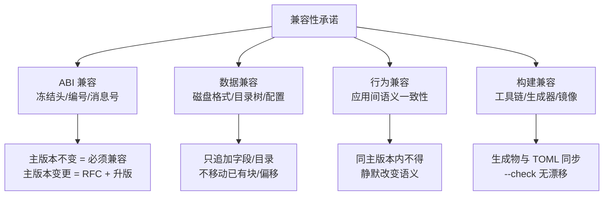
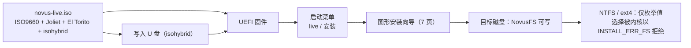
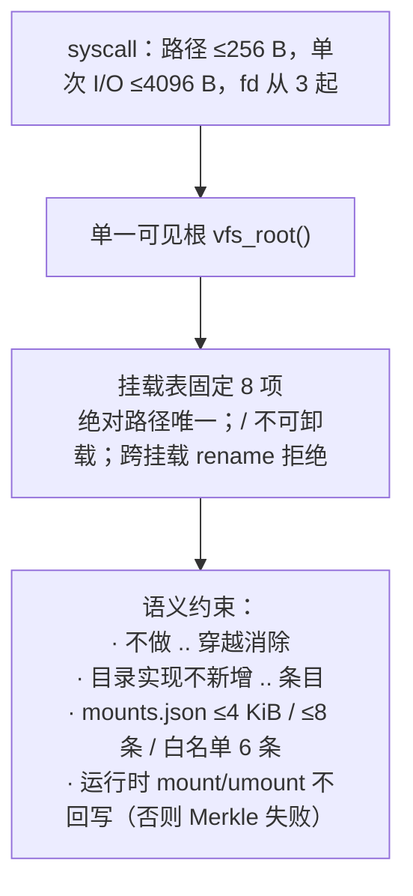
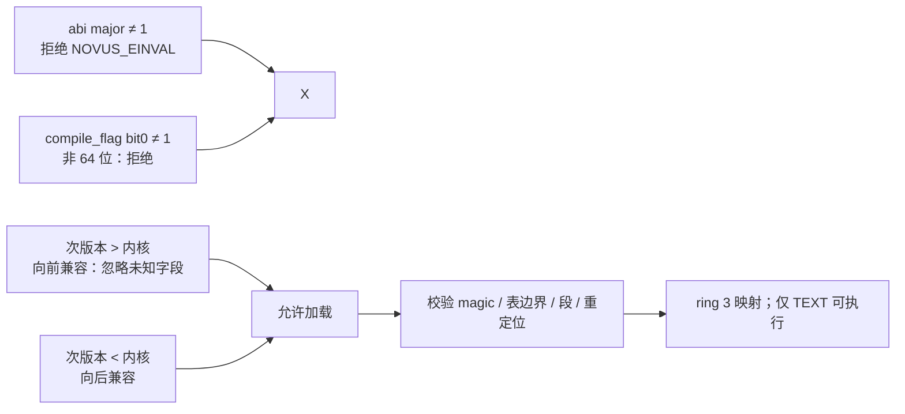
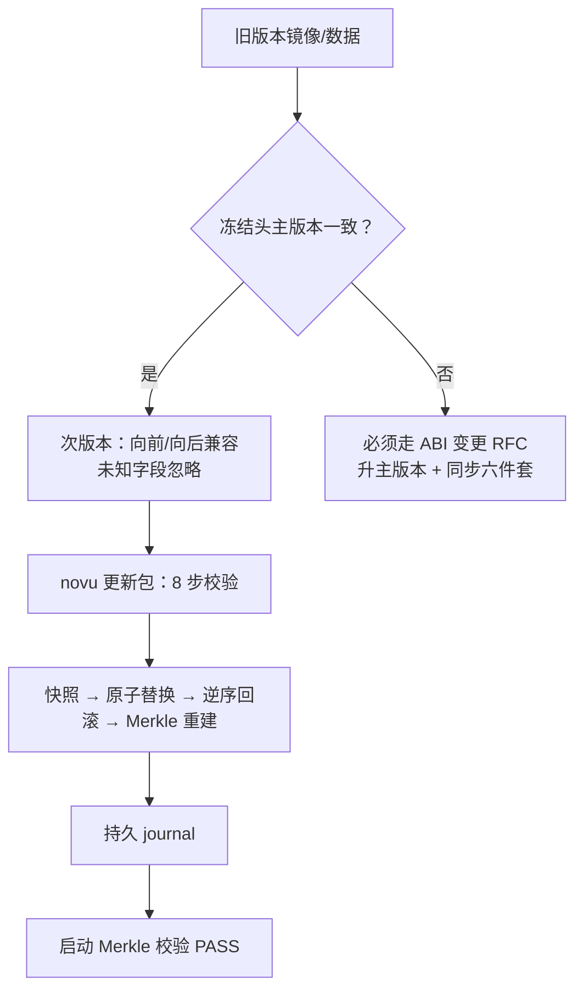
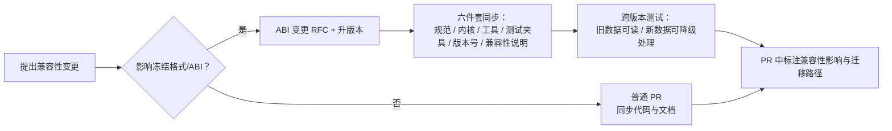

# Novus OS 兼容性矩阵（COMPATIBILITY）

> 版本：v1.0（基于 2026-11-27 工作树）
> 配套：[README.md](README.md)（冻结规范）、[ARCHITECTURE.md](ARCHITECTURE.md)（实现结构）、[ROADMAP.md](ROADMAP.md)（缺口与计划）、[SECURITY.md](SECURITY.md)（安全口径）、[CONTRIBUTING.md](CONTRIBUTING.md)（开发约定）
>
> 本文汇总**硬件、介质、文件系统、二进制格式、API、语言、工具链与跨版本**八个维度的兼容性事实。每个结论都标注依据；"未实现"与"部分实现"如实列出，不把规范目标当作当前能力。

---

## 目录

- [1. 兼容性承诺与等级定义](#1-兼容性承诺与等级定义)
- [2. 冻结格式与版本基线](#2-冻结格式与版本基线)
- [3. 硬件兼容性](#3-硬件兼容性)
- [4. 介质与镜像兼容性](#4-介质与镜像兼容性)
- [5. 文件系统兼容性](#5-文件系统兼容性)
- [6. 二进制与 ABI 兼容性](#6-二进制与-abi-兼容性)
- [7. 软件生态兼容性](#7-软件生态兼容性)
- [8. 工具链与构建环境兼容性](#8-工具链与构建环境兼容性)
- [9. 跨版本升级与数据兼容性](#9-跨版本升级与数据兼容性)
- [10. 安全兼容性边界](#10-安全兼容性边界)
- [11. 已知不兼容清单](#11-已知不兼容清单)
- [12. 兼容性验证矩阵](#12-兼容性验证矩阵)
- [13. 兼容性变更流程](#13-兼容性变更流程)
- [14. 参考与术语](#14-参考与术语)

---

## 1. 兼容性承诺与等级定义

### 1.1 总原则

**官方承诺边界**（[SECURITY.md](SECURITY.md) §1）：

- M0–M11 历史镜像**不保证向后移植安全修复**。
- 物理硬件部署**不承诺生产环境安全**，无商业支持/SLA。
- 格式冻结指"字段与语义冻结"，不等于"功能完整"。

### 1.2 兼容性等级

| 等级 | 含义 | 判定方式 |
|---|---|---|
| **保证兼容** | 冻结格式，同主版本内读写双向兼容 | 有静态断言 + 规范 + 跨版本测试夹具 |
| **有条件兼容** | 主体可用，但有明确前提或降级路径 | 需满足指定硬件/配置/分辨率/后端 |
| **部分兼容** | 只实现子集，其余明确拒绝或补齐 | 文档列出不支持项及诊断信息 |
| **不兼容** | 无实现、明确拒绝，或无源可用 | `ENODEV` / `NOVUS_EINVAL` / 日志如实说明 |
| **待核验** | 文档之间或文档与代码矛盾 | 见 [ROADMAP.md §0.3](ROADMAP.md) 漂移清单 |

### 1.3 事实优先级

与 [CONTRIBUTING.md](CONTRIBUTING.md) 一致：源码与构建结果 > 冻结格式规范 > `changes.md`/`CONTRIBUTING.md` > `README.md` 早期规划 > `.trae/specs/`、`.codebuddy/plans/`。

---

## 2. 冻结格式与版本基线

| 格式/协议 | 冻结版本 | 关键参数 | 变更规则 |
|---|---|---|---|
| Novus OS 规范 | V1.6-FinalSpec | 19 部分；Debug 手册内容版本 V1.1 | 文本勘误不改字段偏移与 ABI 主版本 |
| NUC 可执行格式 | V1.0 / ABI `0x0100` | 48 B 头、magic `NUC!`、major=1 | 字段/语义变更走 ABI RFC |
| NKM 内核模块 | V1.0 / ABI major 1 | 208 B (`0xD0`) 头、Ed25519 + SHA-256 | 同步静态断言、`nkmgen`、规范、文档 |
| NUP 安装包 | V1.0 / 状态冻结 | 64 B 头、magic `NUP!`、version=1 | 扩展必须升 Version |
| INS 快捷方式 | V1.0 / 状态冻结 | INI 风格 UTF-8 文本、`Version=1` | 扩展必须升 Version |
| 内核 IPC | magic `0x4E495043` | 32 B 头、载荷 ≤128 B、队列 8、端口表 16 | 消息号/布局不得私改 |
| Novus-WM IPC | 代码 `0x00020000`（2.0） | v1.1 显示列表、v1.2 圆角、v1.3 模态、v2 surface | 新能力只追加消息号 |
| Debug 接口 | 文件名 V1.0 / 内容 V1.1 | 接口基线冻结 | 参数级与错误码级冻结 |
| 更新补丁体系 | V1.0 | 128 B 头、四魔数、三类补丁 + `.novu`、五级通道 | 永久冻结；头长冲突见 §2.1 |
| rootfs 布局 | 无独立版本号 | `rootfs_layout.h` 为唯一真源，78 目录 | 改布局同步三套镜像与校验 |
| 共享内存 | NVSH v1.1 | 8 KiB @ `0x7E000` | 新字段只能追加到 `0x2F0` reserved 尾部 |
| 系统调用 | 稀疏编号冻结 | 1–7、8–15、16–27、28–37、40/41、60 | 只追加，不复用不重排 |

### 2.1 当前存在的契约冲突（必须先解决）

| 冲突 | 两侧口径 | 影响 | 处理 |
|---|---|---|---|
| 更新包头长 | 内核冻结 128 B（`security/novu/novu_format.h`）；`tools/novupkg` 用 `HDR=144` | 跨端契约不一致，更新包可能被拒 | 以内核冻结头为准，修 `novupkg`（ROADMAP P0-02） |
| rootfs 目录数 | `rootfs_layout.h:109` 为 78；`fsinfo` 与 `check_rootfs.py:28` 为 77 | 镜像校验与真实布局不匹配 | 以 `rootfs_layout.h` 为真源同步（P0-04） |
| WM 协议版本 | 代码 `0x00020000`；规范文档与文件头注释写 1.0 | 客户端可能按旧版本实现 | 以代码为准，文档勘误（P0-01） |
| 最低内存 | README/defconfig 2 GiB；CONTRIBUTING 早期写 4 GiB | 用户预期不一致 | 2 GiB 是引导拒绝线，4 GiB 是工作线 |
| NUC 栈上限 | 内核 clamp 64 KiB–4 MiB；`cppcc README` 写 64–256 KiB | 程序栈预期不一致 | 以内核为准 |
| Win32 API 数量 | `changes.md` 早期写 15 个；`M9 原型.md` 记录 141 条 | 兼容面判断错误 | 以 M9 文档为准（141 条） |

---

## 3. 硬件兼容性

### 3.1 平台与最低要求

| 项 | 要求 / 状态 | 依据 |
|---|---|---|
| 架构 | x86_64（UEFI PE32+ 内核，入口 `efi_main`） | `Makefile`、`README.md` |
| 固件 | UEFI；El Torito no-emulation 引导；不依赖 CSM/Legacy BIOS | `tools/mkiso` |
| 内存 | 最低 2 GiB，低于直接拒绝启动 | `arch/x86_64/boot/main.c`、`novus_defconfig:13` |
| LowMem 模式 | 2–6 GiB：缩减图形缓存、限制进程、更早 OOM | README §3.2 |
| Full 模式 | ≥6 GiB：全部功能启用 | README §3.2 |
| 物理内存上限 | PMM 固定 256 KiB 位图，约覆盖 8 GiB | `kernel/pmm.c` |
| Secure Boot | **未实现**签名固件链；不是 Secure Boot | [SECURITY.md](SECURITY.md) §4 |
| 多 AP | 只走 A/B 两核；多 AP 枚举未实现；SIPI 失败降级单核 | `kernel/smp.c:34-36,184-192` |

### 3.2 显示与 GPU

| 项 | 状态 | 说明 |
|---|---|---|
| GOP 线性帧缓冲 | 保证兼容 | `ExitBootServices` 前抓取；主屏 + 最多 4 路镜像输出 |
| EDID | 有条件兼容 | 读 `EFI_EDID_ACTIVE_PROTOCOL` 首选时序；区分数字/模拟链路，不区分 DP/eDP/HDMI |
| VGA 兜底 | 保证兼容 | 无帧缓冲时回退字符控制台；帧缓冲 >4 GiB 时 splash 跳过 |
| 缓存属性 | 已修复 | 主屏与镜像一律 UC 映射 + `wbinvd`，消除真机 WB/UC 别名花屏 |
| 垂直同步 | 部分兼容 | VGA `0x3DA` 回扫探测 + 800 spins 有界等待；**无硬件 flip / vblank 中断**，撕裂未根治 |
| 2D 加速 | 不兼容 | `intel_init()/amd_init()/nvidia_init()` 全部返回 `ENODEV`；仅 CPU 软件后端 |
| Mini-DWM 硬件后端 | 不兼容 | `CONFIG_NOVUS_DWM_HW=n`，无厂商驱动 |
| OpenGL/Vulkan/DX | 不兼容 | README §11.3 为规划，源码零命中 |
| 多显示器 | 部分兼容 | 其余输出镜像同一画面，**非独立桌面** |
| JPEG 壁纸 | 部分兼容 | 内核侧解码有工具链相关 UB，当前回退程序化渐变 |

### 3.3 存储控制器与磁盘

| 控制器 | 状态 | 已实现 | 未实现 / 限制 |
|---|---|---|---|
| UEFI Block I/O | 保证兼容 | 统一 `blkdev_t`，上层按 512 B 扇区寻址 | 4Kn 设备走整块 bounce buffer |
| AHCI | 有条件兼容 | 基本读写、空闲停转 | NCQ、多 command slot、IRQ 完成；`power_state` 主动置空 |
| NVMe | 有条件兼容 | 基本读写、4 级队列 | PRP list、更深队列；部分 queue depth/page size/command set 被拒 |
| IDE/ATA | 有条件兼容 | PIO 读写 | DMA 未实现；QEMU 上 `CHECK POWER MODE` 不置 DRQ → UNKNOWN |
| USB xHCI | 有条件兼容 | xHCI 1.1 命令/事件环、BOT（CBW/CSW）、READ10/WRITE10 | UASP、集线器、USB 3 流、热插拔事件；`power_state` 未实现 |
| UHCI | 部分兼容 | HID boot protocol | 高速设备 + EHCI-only 控制器不支持 |
| ATAPI 光驱 | 不兼容 | — | 未实现 |
| GPT | 保证兼容 | 分区表读写与安装器写入 | — |
| HDD 休眠 | 部分兼容 | 空闲超时停转、关机/重启 flush + stop | 关机/重启路径未端到端 VNC 验证；无用户阈值入口 |

### 3.4 网卡矩阵（QEMU 10.0.13 实测）

| 网卡模型 | 状态 | 说明 |
|---|---|---|
| `e1000` / `e1000e` | 保证兼容 | Intel 82540EM / 82574L；DHCP/DNS/NCSI 全通 |
| `virtio-net-pci` | 保证兼容 | legacy virtio；DHCP/DNS/NCSI 全通；virtio 1.0-only (`0x1041`) 无 legacy BAR，跳过 |
| `rtl8139` | 保证兼容 | CAPR 必须写"读指针−16"；DHCP/DNS/NCSI 全通 |
| `igb`（真机 82576/82580/I350） | 有条件兼容 | 真机可用；QEMU 模型不置 `STATUS.LU`，收包被 QEMU 丢弃，如实显示"未连接" |
| `vmxnet3` / `ne2k_pci` / `pcnet` | 不兼容 | 未实现 |
| Intel I225/I226（igc） | 不兼容 | 未实现 |
| Realtek RTL8168/8125（r8169） | 不兼容 | 未实现 |
| 无线（AX200/AX210/AX211、MT7921/2 等） | 部分兼容 | 仅枚举与命名 `wlanN`；无固件加载、802.11 关联、WPA2 |

**网络协议兼容性**：ARP/IP/UDP/网关转发可用；TCP 是**单连接**客户端，无窗口缩放/选项/拥塞控制，1 s 重传 3 次；DNS 单事务 A 查询，固定源端口 5353；收包靠 `net_tick()` 轮询，每 tick 最多 8 帧；无监听端、无并发连接。

### 3.5 USB、输入与其他外设

| 设备类 | 状态 | 说明 |
|---|---|---|
| USB 大容量存储 | 有条件兼容 | xHCI + BOT；非 UASP |
| USB HID | 保证兼容 | 键盘/鼠标报告解析、键盘 LED |
| 触摸板 | 有条件兼容 | I²C HID 路径已探测；非 PS/2 aux |
| PS/2 键鼠 | 保证兼容 | IRQ 输入 |
| 串口 COM1 | 保证兼容 | 主要调试输出；`serial.c` 非线程安全，AP 只从 `smp.c` 写 |
| 音频、摄像头、蓝牙、WWAN | 不兼容 | 无驱动 |

---

## 4. 介质与镜像兼容性

| 介质/格式 | 状态 | 约束 |
|---|---|---|
| `out/NOVUS.EFI` | 保证兼容 | PE32+ subsystem 10，入口 `efi_main`；含 AP trampoline 与 Rust 静态库 |
| ESP（FAT16/FAT32） | 保证兼容 | 自研 `mkfat`；**仅 8.3 短名**，512 B 扇区、1 扇区/簇、双 FAT |
| ISO 9660 | 保证兼容 | 自研 `mkiso`；无 Rock Ridge |
| Joliet | 保证兼容 | 优先于普通 ISO9660 树；长名只在 Joliet 保留；非 ASCII 以 `?` 呈现 |
| El Torito | 保证兼容 | no-emulation EFI 启动；16 位扇区计数 ⇒ 启动项 **< 32 MiB** |
| isohybrid | 保证兼容 | 同一镜像写 U 盘后固件可识别启动 |
| live ESP 大小 | 固定 | 31.5 MiB（安全余量）；安装模板 ESP 16 MiB |
| 系统盘 `novus-disk.img` | 默认 64 MiB | GPT + ESP + NovusFS |
| QEMU 网卡模型 | 见 §3.4 | 默认 `e1000`，可用 `NOVUS_NIC` 覆盖 |
| OVMF | 必需 | 冒烟测试需 OVMF_CODE/VARS；使用临时 VARS 与 `-snapshot`，不改源镜像 |
| Windows 主机路径 | 有条件兼容 | 部分发行版 QEMU 不识别中文路径，需 `subst` ASCII 盘符；生成器 `mkico.py` 硬编码 Windows ImageMagick 路径 |
| `make install DEVICE=...` | 危险操作 | 显式 `DEVICE` + 手工输入 `yes`；`dd` 覆盖整盘；测试请用 `run-install-test.sh` |

### 4.1 安装介质兼容目标

安装器其他限制：不支持 USB 集线器、UAS、热插拔与 USB 3 流；已有非 Novus 分区表的磁盘一律拒绝；安装后磁盘 ESP 中没有 `ESP.IMG`；安装模式不启动登录与会话。

---

## 5. 文件系统兼容性

### 5.1 VFS 后端矩阵

| 后端 | 状态 | 读 | 写 | 限制 |
|---|---|---|---|---|
| NovusFS | 保证兼容（可写根） | 支持 | 支持 | 双 superblock、64 块 WAL、Merkle；格式冻结，不移动已有块 |
| FAT12/16/32 | 部分兼容（只读） | 支持 | 拒绝 | 仅 8.3 短名；仅 512 B 扇区卷；`FAT_MAX_NODES=128` |
| ISO9660 / Joliet | 部分兼容（只读） | 支持 | 拒绝 | 优先 Joliet；非 ASCII 以 `?` 呈现 |
| ext4 | 部分兼容 | 支持 | 读路径 + `mkfs` + 挂载 | htree 写未实现；journal replay、稀疏文件、xattr、元数据校验为后续里程碑 |
| NTFS | 不兼容 | — | — | `VFS_KIND_NTFS` 仅枚举值，无后端 |

### 5.2 VFS 语义兼容

**文件 API 未兼容项**：不支持 `seek`、`truncate`、`unlink`（部分路径）与 owner/rwx 权限；`rename` 仅在 NovusFS 根支持，ext4 返回 -1；登录门禁不能替代文件权限隔离。

### 5.3 NovusFS 数据兼容

| 字段 | 冻结值 |
|---|---|
| magic / 版本 | `NOVS` / `0x00030000` |
| 块大小 | 4 KiB |
| inode | 1024 项，128 B/项，文件名 56 B |
| 寻址 | 7 直 + 单/双间接 |
| WAL | 64 块环形，逐记录 CRC-32，commit 标记，挂载 replay |
| Merkle | 64 B SHA-256 节点，每块 64 节点；覆盖 bitmap+inode+data，**不含 WAL 与自身** |
| 根哈希 | 双 superblock + 版本计数；事务失败回滚旧副本 |
| fsck 优先级 | 超级块 → WAL → inode 隔离 |

> 数据兼容边界：WAL 校验失败只 WARN；WAL replay 不是 superblock 刷新的严格门控，**不构成完整崩溃一致性或防回滚机制**（[SECURITY.md](SECURITY.md) §4）。

---

## 6. 二进制与 ABI 兼容性

### 6.1 系统调用 ABI

| 范围 | 调用 | 兼容规则 |
|---|---|---|
| 1–7 | `yield` `write` `getpid` `ipc_send` `ipc_recv` `ipc_lookup` `ipc_stats` | `write`(2) 是串口日志，不是文件写 |
| 8–15 | `open` `read` `fs_write` `close` `stat` `opendir` `readdir` `mkdir` | 文件 API |
| 16–19 | `power_off` `reboot` `session` `setup` | — |
| 20–24 | `unlink` `rename` `mount` `umount` `mounts` | 挂载相关 |
| 25–27 | `update` `https` `console` | 更新与 HTTPS |
| 28–37 | DWM vmem / present / vsync / exclusive / cursor / query / mode | 受 `CONFIG_NOVUS_DWM` 门控 |
| 40 / 41 | `win32` / `pe32_exec` | Win32 与 PE32 执行 |
| 60 | `exit` | — |

约定：`rax` 调用号，`rdi/rsi/rdx/r10` 传参（第 4 参必须 `r10`），负返回值表示错误；用户指针按任务 CR3 逐页复制；未知编号每号只报一次后拒绝；`ipc_recv` 依赖 `syscall; ret` 的 RIP 回退 2 字节重放。

### 6.2 NUC 可执行格式

| 项 | 兼容值 |
|---|---|
| 头长 / magic | 48 B (`0x30`) / `NUC!` |
| ABI | `0x0100`（major 1, minor 0） |
| 段 | 最多 16；仅 TEXT 可执行，其余 NX |
| 重定位 | 只支持 `R_X86_64_32`、`R_X86_64_PC32`；类型 3 预留，V1.0 报 `NOVUS_EINVAL` |
| 栈 | 头中请求，内核 clamp 到 64 KiB–4 MiB；固定栈顶 `0xA0000000` |
| 签名 | 无签名；靠页表隔离（与 NKM 不同） |
| 执行路径 | boot-stage 固定读取 `APPS/DEMO.NUC`；**通用 `./app.nuc` exec 尚未实现** |
| 当前实现缺口 | 段 flags 未严格落实 W^X；非 TEXT 段仍可写 |

### 6.3 NKM 内核模块

| 项 | 值 |
|---|---|
| 格式 | `NKM!`、ABI major 1、208 B 头 |
| 摘要 | SHA-256，覆盖整文件但 `[0x50,0xB0)` 置零 |
| 签名 | Ed25519 签 32 B 原始摘要 |
| 上限 | 1–16 segment、deps ≤8、符号 ≤64、重定位 ≤256、模块 ≤16、根公钥 ≤4 |
| 重定位 | 只支持 64 位绝对重定位；PC32 拒绝 |
| 加载顺序 | 边界检查 → digest → signature → dependencies → map → relocate → init |
| 密钥兼容 | 仅开发公钥，无 `key_id`、无运行时轮换/吊销；轮换需换内核 |
| 调试开关 | `NKM_FLAG_ALLOW_UNSIGNED` 仅本次会话，无完整管理员鉴权，不得持久化 |

### 6.4 IPC / WM 协议

| 项 | 值 |
|---|---|
| 内核 IPC | 32 B 头、magic `0x4E495043`、FNV-1a checksum、载荷 ≤128 B、队列 8、静态端口 16、收件箱端口 = pid |
| WM 协议 | `NWM_PROTO_VERSION 0x00020000`（2.0）；端口 `"nwm"`；`NWM_PID_SHELL=0` 本地内联分发 |
| v1.x 兼容 | `CREATE/DESTROY/MOVE/RESIZE/...`、`CLEAR/SHAPE/TEXT/INVALIDATE` |
| v2 兼容（追加） | `SURFACE_CREATE/DESTROY`、`FLIP_PRESENT`、`BLT_SUBMIT`、`SET_EXCLUSIVE`、`THUMBNAIL`；老客户端不受影响 |
| 窗口上限 | 10 窗、120 图元/160 文字、单段文字 ≤96 B、标题 ≤24 B |
| 帧协议 | 以 `CLEAR` 开始、`SHAPE`/`TEXT` 填充、以 `INVALIDATE` 提交；`IPC_EBUSY` 必须重试 |

---

## 7. 软件生态兼容性

### 7.1 cppcc C++ 支持矩阵

| 目标 | 输出 | 入口 | 阶段 |
|---|---|---|---|
| NUC V1.0 | `*.nuc` | `cppcc` | 已有基线，继续兼容 |
| Windows x64 | PE32+ console | `cppcc_to_win64` | 阶段 1 完成，**未实机验证** |
| Linux x64 | ELF64 动态（glibc） | `cppcc_to_linux` | 阶段 1 完成，本机已跑 hello/smoke |

| 阶段 | 已实现 | 未实现 |
|---|---|---|
| 阶段 0 基线 | 单 TU 预处理、对象宏、`#include`、`#pragma once`、条件编译；函数/全局变量/POD struct/enum/typedef/`static_assert`；指针、一维定长数组、引用、`auto`；表达式、控制流、范围 for、聚合初始化、`sizeof`、`nullptr`；内建 `novus_write/yield/exit/puts/putchar/exit/abort`；SysV x86_64 codegen；最多 6 参数 | — |
| 阶段 1 多目标 | Rust API、C ABI 静态库、目标无关对象模型、PE32+ 与 ELF64 后端、旧 CLI 兼容 | — |
| 阶段 2 C++11 核心（进行中） | `-std=c++11` 校验、`using` 别名、`enum class`、`static_assert`、范围 for 修正、const 指针修正 | 多 TU 链接、尾置返回、`constexpr` 语义约束、类成员/构造析构/访问控制、继承与虚表、模板与变参模板、完整重载解析、移动语义 |
| 阶段 3 运行时（规划） | — | 异常、RTTI、`new/delete`、浮点、标准库兼容头与最小运行时、Win64 CRT 与 glibc PLT 完整支持 |

**诊断原则**：未实现特性必须给 `CompileError`，语法接受不等于语义支持；每个目标支持同一矩阵的子集。

**C++98 STL/异常移植**：静态 libstdc++ 导入 122 个 API，内核兼容层只实现约 20 个，`msvcrt.dll` 的 85 个全部缺失；异常用宏模拟单一上下文，不支持嵌套传播与 `catch` 类型匹配；`fstream` 用进程内暂存表，不跨进程/掉电持久；`signal`/`atexit` 为占位。

### 7.2 Nuomi 语言

| 维度 | 宿主 C 参考实现（`user/Nuomi_pl/`） | 设备端内置（`apps/src/nuomi.rs`） |
|---|---|---|
| 运行时 | 带 GC；`nuomi -c` 走 NUC 工具链 | `no_std`、无堆、无 libm、无 GC 的 bump arena |
| JSON/HTTP/进程/窗口原语 | 有（HTTP/进程部分仅 Windows） | **无** |
| 输入 | 支持 | 无 `input`，`key` 恒为 `nil` |
| 数学 | 完整 | `sqrt` 自算，`pow` 仅整数指数 |
| 高级特性 | 宏/模块/异常未实现 | 同左 |
| 转义 | `\r`/`\0`/`\xHH` 未实现 | 同左 |
| 类型 | 无字典类型、`{}` → `nil` | 同左 |
| 参数 | 不支持可变/缺省参数 | 同左 |

**设备端资源上限**：源码 6 KiB、arena 256 KiB（环境区 128 KiB 可回收）、求值深度 `MAX_DEPTH=1500`（约 500 层函数调用）、单次实参 24、绑定 24、向量/列表字面量 64、格式化缓冲 1024 B。循环里反复 `cons` 会耗尽 arena。

### 7.3 Win32 兼容层

**已兼容**（[M9 原型文档](<docs/M9 Win32 兼容层原型.md>) 记录 141 条 API）：

- PE32+（x86-64）映射至 `0x50000000`，DIR64 重定位，按名导入并填 IAT thunk。
- 控制台输出、tick、`Sleep`、错误码、命令行、模块基址；注册表读写。
- 堆与 `VirtualAlloc`；`user32` 窗口、消息循环、投递、定时器、坐标、光标、焦点。
- `gdi32` 绘制与形状、TEB/TLS、屏幕与字体度量、文字排版（含 `DT_WORDBREAK`）。
- 文件读写、目录枚举、`LoadLibrary`/`GetProcAddress`。
- 控件（`STATIC`/`BUTTON`/`EDIT`、`WM_COMMAND`、`GetDlgItem`）、`MessageBoxA`、菜单条与下拉菜单。
- PE 资源读取、`GetVersion` 系列、`ws2_32` 握手/地址转换/错误码。
- 每进程独立 `vm_space` 与 Win32 ABI 标记，`%fs` 指向 TEB；文件管理器 `/exe` 虚拟目录可运行。

**不兼容**：

- 磁盘上任意路径 `.exe`（镜像来自内核内嵌表 `build/win32_blobs.h`）。
- 32 位 PE32（`0x014C`）执行：能识别并拒绝，兼容执行器未建。
- 16 位 `.COM`（实模式）、NE/LE 可执行文件。
- 序号导入、延迟导入、从磁盘映射真实 DLL、PE TLS 目录、多线程、SEH。
- `DialogBox`/`DLGTEMPLATE`、`TrackPopupMenu`、`LoadMenuA`（不从资源模板建）、菜单项 `&` 快捷键、子控件自身窗口过程、`SendMessage` 同步语义。
- `ws2_32` 传输部分（握手与地址转换之外，如实返回 `WSAENETDOWN`）；`crypt32`、`comctl32`、`ole32`、`shell32`。
- 安全边界：不是完整沙箱；无完整进程隔离、DLL 安全加载、异常处理、线程与文件权限模型。

### 7.4 其他语言/运行时

| 项 | 状态 |
|---|---|
| MicroPython | 仅路线图，无源码与构建目标 |
| Mochi | 规范存在，`user/mochi` 子模块缺失；相关 make target 仅在源码存在时定义 |
| cmd 兼容别名 | `dir`/`copy`/`del` 默认关闭，不要依赖其写新脚本 |

---

## 8. 工具链与构建环境兼容性

| 工具 | 要求 | 备注 |
|---|---|---|
| 交叉工具链 | `x86_64-w64-mingw32-gcc`、`objcopy` | `make CROSS=<prefix>` 可覆盖 |
| Rust | `rustup` + `x86_64-pc-windows-msvc`（内核静态库 COFF）+ `x86_64-unknown-none`（应用扁平 blob） | WSL 需显式加 PATH |
| C/主机工具 | `gcc`、Python 3、`xxd` | `HOSTCC`/`HOSTCFLAGS` 可覆盖 |
| QEMU / OVMF | `qemu-system-x86_64`、`qemu-img`、OVMF_CODE/VARS | 冒烟 2 核 / 3–4 GiB；VNC `127.0.0.1:5901` |
| 可选依赖 | `socat`（wm-churn）、`openssl`（更新/E2E）、Pillow（壁纸）、PowerShell 7（Windows 中断测试） | — |
| 字体/IME 源 | GNU Unifont hex、ibus 拼音表 | 不随仓库分发，需自行准备 |
| 生成物 | 已提交仓库 | 改 TOML 后重生成；`--check` 检漂移 |

### 8.1 本地 CI 与测试兼容

| 入口 | 作用 |
|---|---|
| `make check` | Python/shell 语法、生成物漂移、仓库卫生、两个 Rust crate `cargo check` |
| `make check-lint` | clippy/rustfmt 与 `tools/ci/lint-baseline.json` 对比，只新增失败 |
| `make smoke` / `make pipeline` | 无头启动 / check→lint→build→smoke，产物 `out/ci/report.*` |
| 托管 CI | **无**；未执行的检查必须在 PR 中说明 |

### 8.2 测试脚本的机器相关性

以下脚本含 `/home/dev/...` 或固定 OVMF 路径，换机必须调整：

`qtest.sh`、`scripts/build-all.sh`、`scripts/build-img.sh`、`scripts/rebuild-kernel.sh`、`tools/updatesrv/e2e-run.sh`、`scripts/run.sh`、`scripts/run-iso.sh`、`scripts/font_smoke.sh`、`scripts/wm-churn.sh`、`scripts/run-install-test.sh`。

其他已知限制：截图基线需人工逐张核验且普通回归禁用 `--update-baseline`；`check_rootfs.py:28` 硬编码目录数；`wm-churn.sh` 用写死坐标点击；`qtest.sh` 与 `rebuild-kernel.sh` 用 `|| true` 吞失败；headless 下 `mouse_move` 不驱动客户机光标、`sendkey` 不可靠。

---

## 9. 跨版本升级与数据兼容性

| 场景 | 兼容性 |
|---|---|
| NUC 次版本升级/降级 | 保证兼容（未知字段忽略） |
| NUC 主版本变更 | 不兼容，必须 RFC + 升版 |
| NovusFS 磁盘格式 | 冻结；不移动已有块，只追加 |
| 更新三类补丁 | `.hotpth`/`.npth`/`.apth` 与 `.novu` 全量包永久冻结 |
| 更新失败 | 3 次重试状态机已落地；兼容拉黑、灰度、定时调度未实现 |
| 密钥轮换 | NKM 仅开发公钥、无运行时轮换；更新开发公钥硬编码，出货前必须替换 |
| 降级到旧版本 | 未承诺；M0–M11 历史镜像不保证安全修复回溯 |
| 运行时 `mount`/`umount` | 不回写 `mounts.json`，重启后失效（刻意保护 Merkle） |
| 设置项持久化 | 当前不持久化（只读 FS 约束） |

---

## 10. 安全兼容性边界

| 能力 | 当前状态 | 兼容含义 |
|---|---|---|
| NUC ring3 页表隔离、用户指针校验 | 已实现 | 可依赖 |
| NKM SHA-256 + Ed25519 | 已实现 | 仅开发公钥，无轮换 |
| 更新包 SHA-256 + Ed25519 | 已实现 | 开发公钥硬编码 |
| TLS 链校验与主机名检查 | 部分实现 | 非完整 WebPKI |
| NovusFS Merkle + WAL CRC | 已实现 | 非完整防回滚/崩溃一致性 |
| 挂载白名单、只读卷保护 | 已实现 | 可依赖 |
| Win32 ABI 白名单 | 已实现 | 兼容层仍是原型 |
| CAP 最小权限模型 | **规范目标，未落地** | 不要依赖它做授权 |
| IPC 端口强鉴权 | 未实现 | WM 不是安全边界 |
| Secure Boot / 签名固件链 | 未实现 | 不抵御固件层攻击 |
| 运行时公钥导入/轮换、证书吊销 | 未实现 | — |
| 安全随机数 / 硬件 TRNG | 未实现 | CSPRNG 有确定性回退 |
| 灰度推送、定时调度、失败自愈 | 部分定义 | 不应视为已实现 |

**TLS/WebPKI 边界**：无 CRL/OCSP 吊销、名称约束、路径长度、keyUsage 全面校验；不支持客户端证书、HTTP/2、QUIC、0-RTT；P-384/P-521 根不可用；160 根中按支持口径仅 66 张；`SYS_HTTPS` 主机名解析为最小实现。不能表述为"可与任意公网安全更新服务通信"。

---

## 11. 已知不兼容清单

| 类别 | 不兼容项 |
|---|---|
| 硬件 | 多 AP SMP；硬件 2D / Mini-DWM 硬件后端；OpenGL/Vulkan/DX；硬件 flip 与 vblank 中断；独立多显示器桌面 |
| 网卡 | vmxnet3、ne2k_pci、pcnet、igc(I225/I226)、r8168/8125、virtio 1.0-only；无线真正上线 |
| 存储 | AHCI NCQ/IRQ 完成、NVMe PRP/深队列、IDE DMA、USB UASP/集线器/USB3 流、ATAPI、各设备 `power_state` |
| 文件系统 | NTFS 后端；FAT/ISO 写入；htree 写；journal replay、稀疏文件、xattr、元数据校验；`seek`/`truncate`/权限位；跨后端 `rename` |
| 执行 | 通用 `./app.nuc`；32 位 PE32；16 位 COM/NE/LE；磁盘 DLL；序号/延迟导入；PE TLS；多线程/SEH |
| 语言 | C++ 类/模板/异常/RTTI/new/浮点/STL/多 TU；Nuomi 宏/模块/异常与设备端 JSON/HTTP/进程/窗口原语；MicroPython；Mochi |
| 安全 | CAP、Secure Boot、端口强鉴权、密钥轮换、硬件 TRNG、完整 WebPKI、Win32 沙箱 |
| 更新 | 智能时段调度、灰度放量、兼容拉黑、服务端上报 |
| 工程 | 托管 CI；`make menuconfig`；生成字体/IME 的源文件分发 |

---

## 12. 兼容性验证矩阵

| 改动类型 | 最小验证 | 追加验证 |
|---|---|---|
| 任意改动 | `make`、`make check-rootfs` | PR 列出实际命令 |
| 内核启动/调度/IRQ | + `bash scripts/irq-selftest.sh` | QEMU 冒烟、`irq-qemu-test.ps1` |
| FS/目录树/镜像 | + `python3 scripts/inspect_img.py out/novus.img` | `make disk-img`、`font_smoke.sh` |
| GUI/主题/字体/IME | 完整 QEMU 冒烟 | `wm-churn.sh 4G 20`、生成器 `--check`、截图人工核验 |
| 存储驱动 | `make iso` | `bash qtest.sh` 人工看 `[MOUNT]` |
| 安装器 | `make iso` | `run-install-test.sh 256`、`EN=1`、`FLOW=desktop` |
| 网卡/网络 | `make` | `NOVUS_NIC=<model>` 逐个跑 DHCP/DNS/NCSI |
| 更新/TLS/CA | 常规构建 | `updatesrv/selftest.py`、`novupkg selftest`、E2E |
| NKM/NUC/ABI | 常规构建 | `nkmgen selftest`、`make nkm-test-module`、格式测试 |
| cppcc | `cargo test --manifest-path user/cppcc/Cargo.toml` | `make cppcc-demo` + `make run` 看串口标记 |
| Nuomi | 宿主参考测试 + `nsh` 实测 | `test-linux.sh`、`tests/nuc/run-tests.py` |
| 跨版本数据 | 旧镜像启动 + Merkle 校验 | 更新包应用 + 回滚 + journal 恢复 |

**关键兼容断言**：

1. 冻结格式字段偏移有 `_Static_assert`（NKM 在 `security/nkm/nkm.c:49-66`，挂载结构在 `fs/vfs_mount.h:39`）。
2. 生成物 `--check` 无漂移（主题/语言/字体）。
3. 截图基线缺失或不匹配即失败；普通回归不得 `--update-baseline`。
4. ABI 变更必须同时更新规范、内核、宿主工具、测试夹具、版本号与兼容性说明。

---

## 13. 兼容性变更流程

**硬规则**（来自 [SECURITY.md](SECURITY.md) §6 与 [CONTRIBUTING.md](CONTRIBUTING.md) §6）：

1. 不绕过、不降级、不条件化 NKM 与更新包签名校验；调试开关不进默认构建。
2. 系统调用显式检查长度、边界与用户指针；新增调用同步 `g_syscalls[]`、用户头与规范。
3. 不扩大挂载白名单，不回写 `mounts.json`，不把只读后端改成可写。
4. 不把 Win32 API 白名单当作通用进程隔离机制。
5. 冻结格式变更必须升版本并同步工具链、静态断言、测试夹具与文档。
6. 文本勘误要明确标注"未改变字段偏移和 ABI 主版本"。

---

## 14. 参考与术语

| 术语 | 含义 |
|---|---|
| ABI 兼容 | 二进制接口（系统调用号、格式字段、协议消息）在版本间保持可解释 |
| 向前兼容 | 新版本数据能被当前内核读取（忽略未知字段） |
| 向后兼容 | 旧版本数据能被新内核读取 |
| 冻结格式 | 字段偏移、语义与版本固定；变更需 RFC 并升主版本 |
| 降级 | 功能不可用时以 WARN 继续运行，而不是 panic |
| 白名单 | 只允许列举的路径/API/端口，其余默认拒绝 |
| 部分兼容 | 子集可用，其余明确拒绝并给出诊断 |

主要依据文件：[README.md](README.md)、[SECURITY.md](SECURITY.md)、[CONTRIBUTING.md](CONTRIBUTING.md)、[changes.md](changes.md)、[ROADMAP.md](ROADMAP.md)、[ARCHITECTURE.md](ARCHITECTURE.md)、`docs/NUC 可执行二进制格式规范 V1.0.md`、`docs/NKM 内核模块二进制格式规范 V1.0.md`、`docs/Novus-WM 与 IPC 协议规范 V1.0.md`、`docs/C++11 支持矩阵.md`、`docs/M9 Win32 兼容层原型.md`、`docs/根目录结构与挂载规范.md`、`docs/存储驱动与HDD休眠-2026-11-18.md`。
