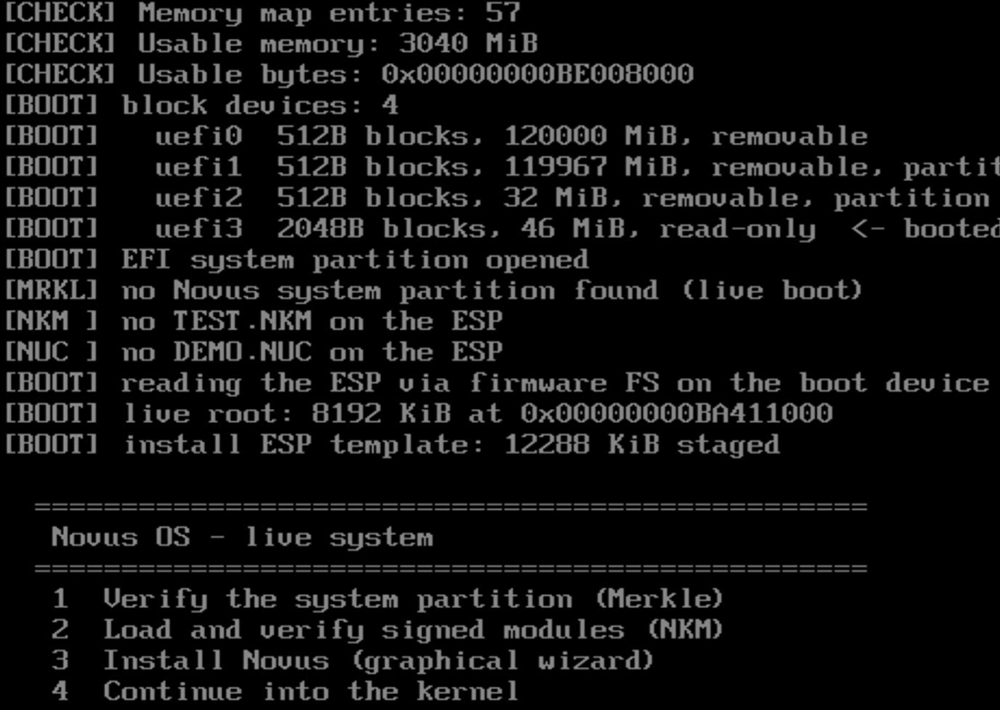
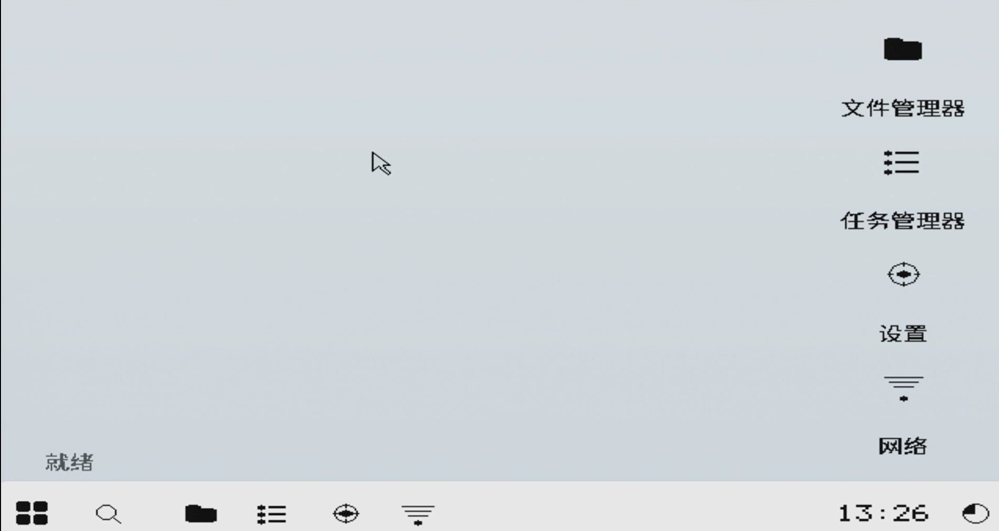
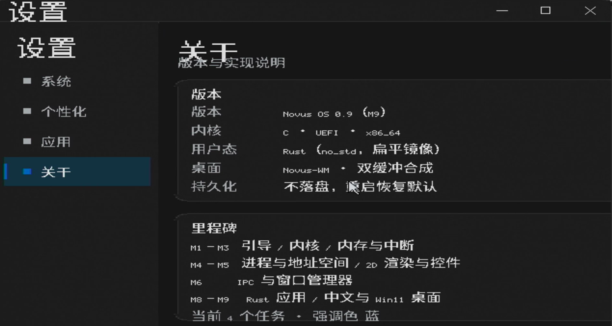
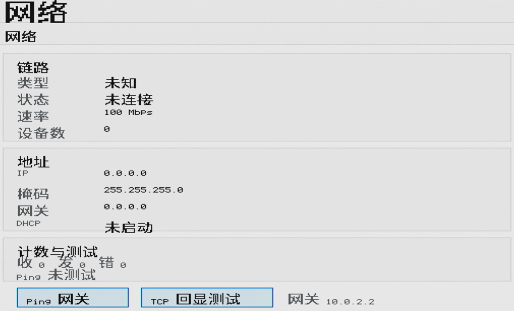
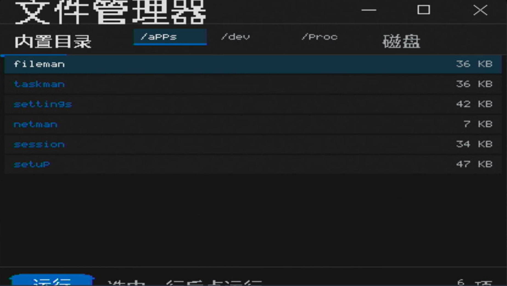
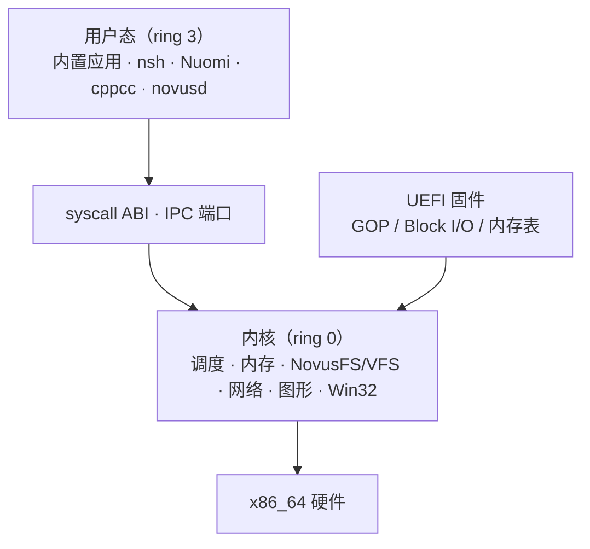

# Novus OS

**一个从零自研的 x86_64 UEFI 桌面操作系统。**

内核、文件系统、图形栈、窗口管理器、可执行格式、模块签名、更新体系——全部自研，不依赖外部开源项目。GPLv2 开源。

<div align="center">

| [中文](README.md) | [English](docs/en/README.md) |
| :---: | :---: |
| **当前版本** | 点击切换 |

[全部英文文档索引](docs/en/INDEX.md)

</div>

> 当前基线：**V1.6-FinalSpec（冻结正式版）** · 开发阶段：M0–M12 已铺开，部分能力仍在演进
> 最低 2 GiB 内存（推荐 4–8 GiB） · QEMU/OVMF 可运行 · 详细状态见 [ROADMAP.md](ROADMAP.md)

---

## 为什么关注 Novus OS

| 亮点 | 说明 |
|---|---|
| **完全自研的内核态到用户态** | C 内核 + Rust `no_std` 内置应用；抢占调度、每进程独立页表、系统调用 ABI 冻结 |
| **自己的文件系统** | NovusFS：预写日志（WAL）、Merkle 完整性校验、双超级块、fsck 修复优先级 |
| **自己的图形栈** | NovusDisplay：UEFI GOP 多输出、离屏合成、全 Unicode 字形、中文拼音输入法、Fluent 主题 |
| **自己的窗口协议** | Novus-WM 2.0：窗口管理、IPC 消息、Mini-DWM 表面重定向与零拷贝 flip |
| **自己的可执行格式** | NUC：直接映射 x86_64 原生机器码到 ring 3，无虚拟机、无字节码解释器 |
| **签名与更新体系** | NKM 内核模块 Ed25519 签名 + novu 分级增量更新（全量/热修/NPA/应用补丁） |
| **兼容层原型** | Win32 PE32+ 加载器 + 141 条 API + 模拟注册表，可运行自包含 Windows 样例 |
| **开发者友好** | 三条扩展模板（GUI 应用 / shell 命令 / Nuomi 脚本），改 2–4 处即可接入 |

---

## 运行截图

| 引导 | 桌面 |
|---|---|
|  |  |

| 设置 | 网络管理器 |
|---|---|
|  |  |

| 文件管理器 |
|---|
|  |

---

## 快速开始

```sh
# 依赖（Ubuntu/Debian）
sudo apt install -y build-essential gcc-mingw-w64-x86-64 g++-mingw-w64-x86-64 \
  binutils-mingw-w64-x86-64 mingw-w64 qemu-system-x86 ovmf python3 xxd
rustup target add x86_64-pc-windows-msvc
rustup target add x86_64-unknown-none

# 构建并启动
make
make run
```

看到 `[ND] demo desktop painted` 和 `[HALT] entering the scheduler` 就算启动成功。
完整环境、目标列表与故障排查见 [BUILD.md](BUILD.md)。

---

## 文档地图（按目的阅读）

| 我想… | 去这里 |
|---|---|
| 了解系统怎么分层、数据怎么流 | [ARCHITECTURE.md](ARCHITECTURE.md) |
| 知道哪些功能已完成、哪些还没做 | [ROADMAP.md](ROADMAP.md) |
| 查某个术语/缩写/模块名是什么意思 | [GLOSSARY.md](GLOSSARY.md) |
| 查已实现的 ABI（系统调用、NUC、NKM、IPC） | [ABI.md](ABI.md) |
| 查硬件/格式/语言兼容性矩阵 | [COMPATIBILITY.md](COMPATIBILITY.md) |
| 编写闭源/专有设备驱动 | [DRIVER-LICENSE.md](DRIVER-LICENSE.md) |
| 查版本变更与 **ABI BREAK 高亮** | [CHANGELOG.md](CHANGELOG.md) |
| 学会构建、打包、运行与验证 | [BUILD.md](BUILD.md) |
| 开始贡献代码 | [CONTRIBUTING.md](CONTRIBUTING.md) |
| 查代码风格（C/Rust） | [CODESTYLE.md](CODESTYLE.md) |
| 了解社区行为准则 | [CODE_OF_CONDUCT.md](CODE_OF_CONDUCT.md) |
| 报告安全问题 / 查安全边界 | [SECURITY.md](SECURITY.md) |
| 查冻结格式规范（NUC/NKM/NUP/INS/IPC/更新） | [docs/](docs/) |

> **给新人**：建议顺序为 [GLOSSARY.md](GLOSSARY.md) → [ARCHITECTURE.md](ARCHITECTURE.md) → [BUILD.md](BUILD.md) → [CONTRIBUTING.md](CONTRIBUTING.md)。

---

## 当前状态一览

| 里程碑 | 主题 | 状态 |
|---|---|---|
| M0–M6 | 引导、内存、文件系统、Merkle、调度、图形、IPC/WM | 已完成 |
| M7 | cppcc C++ 子集编译器 | 已完成基础，C++11 核心补全进行中 |
| M8 | 内置系统应用（文件/任务/设置/网络/会话/终端） | 已完成 |
| M9 | Win32 兼容层原型 + Win11 中文桌面 | 原型完成，能力边界见文档 |
| M10 | Fluent 主题 + 图形安装向导 | 已实现 |
| M11 | 多语言、会话分流、USB/显示 I/O | 阶段 1 完成 |
| M12 | 设备管理器 + Mini-DWM | 已实现 |

**重要边界**（详见 [ROADMAP.md §4](ROADMAP.md) 与 [SECURITY.md §5](SECURITY.md)）：

- 不是 Secure Boot；CAP 最小权限、端口强鉴权、硬件 TRNG 仍是规范目标。
- 单 TCP 会话、DNS 单事务、无线仅识别；无硬件 2D、无 vblank 中断。
- 通用 `./app.nuc` exec 尚未实现，当前只有 boot-stage 固定 demo。

---

## 架构一瞥



完整分层、启动顺序、数据流与镜像结构见 [ARCHITECTURE.md](ARCHITECTURE.md)。

---

## 设计原则

1. **全部自研**：不引入外部开源内核/库（Unifont 字形数据是已记录例外）。
2. **单向依赖**：模块解耦，禁止循环依赖；驱动与协议分层清晰。
3. **ABI 冻结**：NUC/NKM/NUP/INS/IPC 等格式字段与版本冻结，同主版本向下兼容。
4. **故障降级**：用户程序 bug 不拖垮内核；轻微错误 WARN 继续运行，不轻易 panic。
5. **诚实记录**：未完成项、已知限制、文档与代码冲突都要写明，不把规范目标说成已实现。

---

## 目录结构速览

```text
arch/x86_64/   UEFI 入口、引导阶段、AP 跳板、汇编桩
kernel/        调度、syscall、内存、驱动、网络、Win32/PE、安装
fs/            VFS、NovusFS、FAT、ISO9660、ext4
security/      NKM 签名、TLS、更新校验、CA bundle
graphics/      NovusDisplay、控件库、桌面、字体、主题、IME
wm/novus-wm/   窗口管理器与协议服务端
apps/          Rust no_std 内置应用、nsh、Nuomi
user/          Nuomi_pl、cppcc、win32compat、novusd
tools/         主机端镜像/打包/签名/生成器
scripts/       自检、QEMU 测试、镜像检查、本地 CI
docs/          设计与冻结格式规范
```

根目录没有 `system/`、`drivers/`、`user/shell/`——那是早期规划，真实布局以 [CONTRIBUTING.md §1.2](CONTRIBUTING.md) 为准。

---

## 参与贡献

- 先读 [CONTRIBUTING.md](CONTRIBUTING.md)：环境、验证矩阵、PR 规范。
- 新人可从 [templates/](templates/) 的三条扩展路径入手，不必先读内核。
- 代码风格见 [CODESTYLE.md](CODESTYLE.md)；社区规范见 [CODE_OF_CONDUCT.md](CODE_OF_CONDUCT.md)。
- 安全问题**不要**公开贴细节，按 [SECURITY.md](SECURITY.md) 私下报告。

---

## 许可

GPLv2。提交者保留版权，所有修改源码按项目条款开源。详见 [LICENSE](LICENSE) 与 [COPYING](COPYING)。

第三方可以**闭源方式**分发设备驱动：项目依据 GPLv2 第 10 节授予额外权限，条件与边界见 [DRIVER-LICENSE.md](DRIVER-LICENSE.md)（驱动仍须签名并只使用冻结 ABI）。
