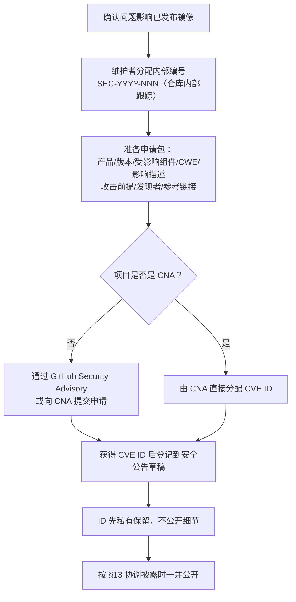

> 英文版本：[docs/en/SECURITY.md](docs/en/SECURITY.md)

# Novus OS 安全政策

本文档说明 Novus OS 的安全边界、已知限制、漏洞报告方式和贡献者必须遵守的安全规则。它与 [CONTRIBUTING.md](CONTRIBUTING.md) 配套使用；涉及实现细节时，以当前源码和冻结格式规范为准。

## 目录

- [1. 支持范围](#1-支持范围)
- [2. 如何报告漏洞](#2-如何报告漏洞)
- [3. 安全模型与信任边界](#3-安全模型与信任边界)
- [4. 密码学、密钥与更新](#4-密码学密钥与更新)
- [5. 当前能力与规范目标的区分](#5-当前能力与规范目标的区分)
- [6. 贡献者安全要求](#6-贡献者安全要求)
- [7. 安全相关验证](#7-安全相关验证)
- [8. 开源许可](#8-开源许可)
- [9. PGP 公钥与加密通信](#9-pgp-公钥与加密通信)
- [10. 漏洞分级](#10-漏洞分级)
- [11. 安全响应 SLA](#11-安全响应-sla)
- [12. CVE 申请流程](#12-cve-申请流程)
- [13. 公开披露策略](#13-公开披露策略)
- [14. 严禁公开 0day 利用方式](#14-严禁公开-0day-利用方式)
- [15. 附则](#15-附则)

---

## 1. 支持范围

| 对象 | 状态 |
|---|---|
| 当前主分支 / V1.6-FinalSpec | 当前开发基线，安全问题按优先级修复 |
| M0～M11 历史里程碑镜像 | 仅作历史参考，不保证向后移植安全修复 |
| 自定义分支、外部镜像、私有签名密钥 | 不在支持范围内 |
| 物理硬件部署 | 项目目前以 QEMU/UEFI 验证为主，不承诺生产环境安全 |

本项目是实验性操作系统，不提供商业支持或漏洞赏金，也不提供**合同性质的** SLA。但项目设有**安全响应目标**（见 [§11](#11-安全响应-sla)）：对已按规范私下报告并满足复现要求的问题，维护者按漏洞等级给出首次响应、确认与修复的目标时限。该目标是内部执行基线，不是对用户的法律承诺。

---

## 2. 如何报告漏洞

**请不要在公开 Issue、PR、`changes.md` 或讨论区中直接贴出漏洞细节、可利用 PoC、私钥或种子。**

如果仓库托管平台提供了私有漏洞报告 / Security Advisory 功能，请使用它提交报告。若当前没有私有渠道，请先提交一个不含技术细节的 Issue，标题类似“Request for private security contact”，等维护者给出私下联系方式后再提供完整信息。

报告中请尽量包含：

- 受影响的提交、镜像版本和构建命令
- 涉及子系统：`kernel/`、`security/nkm`、`security/novu`、`security/tls`、`fs/`、IPC/WM、更新服务等
- 攻击前提：是否需要 Ring 0、本地用户、特定镜像、QEMU 配置或网络位置
- 实际影响：提权、越界读写、签名绕过、信息泄露、拒绝服务等
- 可复现步骤、串口日志或截图；如涉及 PoC，请通过私有渠道发送
- 建议修复方案或相关代码位置

维护者会先确认问题、评估影响并协调修复；在修复或缓解措施发布前，请避免公开细节。修复发布后，可在 PR 或 `changes.md` 中致谢，但不要泄露私下提供的攻击材料。

报告的后续处理规则见：[§9 PGP 公钥](#9-pgp-公钥与加密通信)、[§10 漏洞分级](#10-漏洞分级)、[§11 安全响应 SLA](#11-安全响应-sla)、[§12 CVE 申请流程](#12-cve-申请流程)、[§13 公开披露策略](#13-公开披露策略)、[§14 严禁公开 0day 利用方式](#14-严禁公开-0day-利用方式)。

---

## 3. 安全模型与信任边界

### 3.1 启动与完整性

信任链起点是当前 UEFI 固件与 `out/NOVUS.EFI`：

1. UEFI 入口初始化串口/控制台和块设备，并检查最低 2 GiB 内存。
2. A 核在早期自检阶段校验系统文件完整性；篡改会阻止启动。
3. NovusFS 使用双超级块、CRC-32 和 Merkle 树检测数据/元数据篡改。
4. WAL 记录带 CRC，恢复时只重放带 commit 标记的事务，然后重算 Merkle root 并与超级块比较。

当前实现**不是 Secure Boot**：没有签名固件链、没有 UEFI 安全启动集成，也无法抵御固件层或已经取得 Ring 0 的攻击者。

Merkle 的覆盖范围不包括 WAL 区和 Merkle 区本身；超级块依靠双副本和 CRC，而不是 Merkle 叶。WAL 重放结果目前也不是超级块刷新的严格门控，贡献者不要把这描述成完整的崩溃一致性或防回滚机制。

### 3.2 Ring 0 / Ring 3 隔离

- 内置应用是 Rust `no_std` 扁平 NUC 镜像，在 ring 3、独立 CR3 和独立页表中运行。
- NUC 不要求签名；隔离依赖页表和系统调用边界，而不是镜像签名。
- 系统调用只有一张编号表 `kernel/trap.c:g_syscalls[]`，编号稀疏且冻结。
- 用户指针不能直接解引用：`user_read_byte()` / `user_copy()` 会检查地址范围、按任务 CR3 翻译并校验用户访问权限。
- 路径最长 256 字节，单次 I/O 最长 4096 字节；未知系统调用返回错误并记录，不会静默成功。
- NUC 入口、segment、重定位和权限位都有边界检查；仅 `TEXT` 可执行，其余 segment 为 NX。
- 用户栈被限制在 64 KiB～4 MiB；栈越界必须失败，不能回退到内核地址。

### 3.3 IPC、窗口与 GUI

IPC/WM 是功能协议，**目前不应视为强安全边界**：

- IPC 消息头有 magic、长度、校验和，端口表、队列和载荷都有固定上限。
- 端口 `"nwm"` 使用版本化协议，显示列表每条消息都有长度/数量限制。
- 当前没有基于 CAP 的端口授权；普通用户态可以调用 IPC 系统调用。
- 客户端不应向内核传递内核地址、未初始化长度或超出协议的显示项。
- 修改 IPC/WM 时必须保持消息布局、magic、版本号和长度检查一致；详见 [Novus-WM 与 IPC 协议规范](<docs/Novus-WM 与 IPC 协议规范 V1.0.md>)。

### 3.4 文件系统与挂载

- VFS 只有一个 syscall 可见根；挂载表在路径前缀切换后端。
- `fs/novusfs/rootfs_layout.h` 是根目录树的唯一真源。
- 挂载路径必须命中白名单，挂载表固定 8 项；`/` 不允许卸载，跨挂载 `rename` 被拒绝。
- FAT 和 ISO9660 后端只读；写、删除、重命名必须失败。
- `/.novusfs/mounts.json` 运行时不回写，否则会破坏启动时的 Merkle 校验。
- VFS 不做 `..` 穿越消除；目录实现不应通过特殊条目扩大可访问范围。

### 3.5 Win32 兼容层

Win32 兼容层是原型，不是完整沙箱：

- PE32+ 固定映射到 `0x50000000`，按 DIR64 重定位，按名称填充 IAT。
- `TASK_ABI_WIN32` 任务只允许 `SYS_WIN32(40)` 和 `SYS_EXIT(60)`；其它系统调用直接拒绝。
- `win32_syscall` 会二次校验任务 ABI 类型。
- 注册表只是持久化到普通文件的模拟实现。
- 尚未实现完整进程隔离、DLL 安全加载、异常处理、TLS、线程和文件权限模型。

---

## 4. 密码学、密钥与更新

### 4.1 NKM 内核模块

NKM 是 Ring 0 模块，必须签名：

- SHA-256 覆盖整文件，但计算前先把 `[0x50,0xB0)` 的摘要/签名区置零。
- Ed25519 签的是 32 字节摘要，不是整文件。
- 签名使用编译期固化在内核中的可信公钥。
- 校验顺序为：边界检查 → digest → signature → dependencies → map → relocate → init。
- 偏移、长度和 ABI major 由 `_Static_assert` 与头部检查固定。
- NUC 用户程序不签名；NKM 签名不能用于替代 Ring 3 隔离。

禁止行为：

- 默认启用 `NKM_FLAG_ALLOW_UNSIGNED`
- 在发布镜像中编译测试公钥或测试模块
- 只改签名工具或只改内核加载器而不更新规范和静态断言
- 用固定开发种子生成“生产”签名密钥
- 通过降低校验顺序、跳过依赖检查或放宽段权限来“修复”加载失败

> 当前实现仅有一把开发公钥，且没有运行时导入/轮换公钥的接口。`NKM_FLAG_ALLOW_UNSIGNED` 的“仅管理员本次会话有效”仍是规范目标；当前代码没有完整的管理员鉴权，不能把它当作已落实的安全控制。

> 闭源驱动适用 [DRIVER-LICENSE.md](DRIVER-LICENSE.md) 的许可例外，但**不免除**本节任何安全要求：签名、边界检查、加载顺序与 ABI 版本校验对所有 NKM 一视同仁。闭源不等于免检，也不得绕过校验。

### 4.2 更新包与 TLS

- 更新包在用户态经过魔数、版本、UUID 双向绑定、区间、SHA-256 和 Ed25519 校验。
- 开发签名根公钥固化在 `security/novu/novu_verify.c`；打包器的 `--key` 是开发/测试种子，不是生产密钥管理方案。
- TLS 链验证支持有效期、`is_ca`、签名算法子集、根有效期和主机名检查；X.509 只解析必要字段。
- 生产根集合来自 `tools/cabundle/roots.pem`，生成 `security/novu/cabundle.c`；根集合为空时 fail-closed。
- E2E 测试锚只生成 `security/novu/cabundle_e2e.c`，并且仅在 `E2E=1` 时编入内核。生产构建绝不能包含测试锚。
- 当前 TLS 实现不是完整 WebPKI：没有 CRL/OCSP 吊销、名称约束、路径长度、keyUsage 全面校验，也不支持客户端证书、HTTP/2、QUIC 或 0-RTT。
- 随机数由调用方注入种子的 hash-DRBG 提供，未播种时有确定性回退；内核种子来自调度 tick 等材料。不要宣称硬件熵或高熵 TRNG。

### 4.3 测试密钥与私钥规则

- `tools/updatesrv/` 下已有的 `*.key` 资产只用于 QEMU E2E 测试，**不是生产密钥**，绝不能用于生产签名或编入 OS 镜像。
- `.gitignore` 禁止新增 `private/*.pem|key|crt`、`tools/updatesrv/*.key`、`security/tls/*.key`、`user/ssl/*.key` 等私钥文件；历史遗留的测试私钥不应被复制到新位置或扩大用途。
- `NKM_SEED`、`novupkg --key` 和 `nkmgen keygen` 使用的固定种子只适用于自测和开发。
- 不要在文档、日志、串口输出、截图或 PR 描述中打印私钥、种子或完整证书私钥内容。
- 生产 CA 集合变更必须用 `tools/cabundle/import_roots.py --dry-run` 审查，再由离线生成脚本产出；测试 CA 不得写入生产 `cabundle.c`。
- 如果疑似生产私钥泄露，应立即停止使用该密钥、轮换签名根和已签发模块/更新包，并重新生成受影响的镜像。

---

## 5. 当前能力与规范目标的区分

| 项目 | 当前状态 |
|---|---|
| NUC Ring 3 页表隔离、用户指针校验 | 已实现 |
| NKM SHA-256 + Ed25519 签名校验 | 已实现；仅开发公钥，无运行时轮换 |
| 更新包 SHA-256 + Ed25519 校验 | 已实现 |
| TLS 链校验与主机名检查 | 部分实现，非完整 WebPKI |
| NovusFS Merkle + WAL CRC | 已实现；非完整防回滚/崩溃一致性方案 |
| 挂载路径白名单、只读卷保护 | 已实现 |
| Win32 ABI 白名单 | 已实现，但兼容层仍是原型 |
| CAP 最小权限模型 | **规范目标，当前未落地**；不要依赖它做授权 |
| IPC 端口鉴权 | 未实现强鉴权 |
| Secure Boot / 签名固件链 | 未实现 |
| 运行时公钥导入/轮换、证书吊销 | 未实现 |
| 安全随机数 / 硬件 TRNG | 未实现 |
| 灰度推送、定时调度、失败自愈 | 规范中部分定义，不应视为已实现能力 |

README 和部分规范中保留了早期目标描述；若与本节或当前源码冲突，应提交文档勘误，而不是据此放宽实现检查。

---

## 6. 贡献者安全要求

修改涉及安全的代码时，必须遵守以下硬规则：

1. 不绕过、不降级、不条件化 NKM 或更新包签名校验；调试开关不能进入默认构建。
2. 系统调用必须显式检查长度、边界和用户指针；新增调用要同步 `g_syscalls[]`、用户头文件和规范。
3. 不在中断上下文睡眠、分配内存、打印日志或调用协议栈。
4. 不扩大挂载白名单，不回写 `mounts.json`，不把只读后端改成可写。
5. 不把 Win32 兼容层的 API 白名单当作通用进程隔离机制。
6. 不提交私钥、种子、测试 root 到生产 CA 集合，或机器特定的绝对路径。
7. 冻结格式（NUC/NKM/NUP/INS/IPC）发生变化时必须升版本、同步工具链、静态断言、测试夹具和文档。
8. 修复安全问题时优先添加回归测试；测试应验证“错误输入被拒绝”，而不是只验证正常路径。
9. 不在公开日志中输出内核地址、栈回溯、密钥材料或可复现的攻击 payload。
10. 新依赖必须先评估许可证和供应链风险；项目当前坚持自研、不引入外部开源项目。

---

## 7. 安全相关验证

与安全改动至少执行：

```sh
make
make check-rootfs
make nkm-test-module
build/tools/novupkg selftest
(cd tools/nkmgen && cargo run --quiet -- selftest)
python3 tools/updatesrv/selftest.py

bash scripts/display-selftest.sh
python3 -m unittest discover -s scripts -p qemu_smoke_test.py
make disk-img
bash scripts/qemu-smoke.sh
bash scripts/qemu-smoke.sh --no-root --output out/qemu-smoke-no-root
```

更新/TLS 改动还需运行：

```sh
bash tools/updatesrv/e2e-run.sh
make
```

最后一条 `make` 用于确认生产构建（`E2E=0`）没有混入 E2E 测试锚。所有相关 `make` 调用必须一致带 `E2E=1` 或都不带，避免对象文件混用。

详细测试矩阵见 [CONTRIBUTING.md](CONTRIBUTING.md)；NKM 与更新格式细节见 [NKM 格式规范](<docs/NKM 内核模块二进制格式规范 V1.0.md>) 和 [分级增量更新体系规范](<docs/Novus OS 自研分级增量更新体系完整规范.md>)。

## 8. 开源许可

Novus OS 使用 GPLv2。安全修复同样必须遵循 GPLv2 分发；提交者保留版权，所有修改源码按项目条款开源。详见 [LICENSE](LICENSE) 与 [COPYING](COPYING)。

---

## 9. PGP 公钥与加密通信

> 本节是操作系统项目的安全基础设施要求：**必须提供可验证的安全联系公钥**，否则外部研究者无法安全地提交漏洞细节。

### 9.1 当前状态（必须如实标注）

**仓库当前尚未发布正式的安全邮箱与 PGP 公钥。** 在此状态改变之前：

- 不要向任何自称"安全团队"的私人地址发送含 PoC、利用代码或敏感日志的邮件。
- 先通过项目托管平台的私有漏洞报告功能，或提交一个**不含技术细节**的 Issue（标题如 `Request for private security contact`）确认联系方式。
- 不要自行生成一把"项目密钥"并对外宣称它是官方密钥；未经维护者明确发布与签名的密钥一律视为不可信。

### 9.2 公钥发布位置（强制清单）

一旦建立安全联系，必须在以下位置**同时**发布公钥，并保持一致：

| 位置 | 内容 | 说明 |
|---|---|---|
| 本节 `9.3` | ASCII-armored 公钥全文 | 研究者可直接导入 |
| `security/pgp/` | `<keyid>.asc` 公钥文件 | 只提交公钥，**绝不提交私钥或吊销证书私钥** |
| 项目发布页 / 文档站（如有） | 指纹与下载链接 | 提供独立于仓库的第二信任源 |
| 发布签名说明 | 哪些产物由该密钥签名 | 与 NKM / 更新签名密钥明确区分 |

### 9.3 公钥信息表（待发布时填写）

| 字段 | 值 |
|---|---|
| 用途 | 加密安全报告 / 验证发布工件签名 |
| 联系邮箱 | 待发布（建议使用 `security@` 专用地址，不用个人邮箱） |
| 算法 | 优先 Ed25519（`22`），或 RSA 4096 |
| 指纹 | 待发布（完整 40 位十六进制，禁止只发布短 ID） |
| 创建日期 / 过期日期 | 待发布（建议设置过期并提前轮换） |
| 备用验证渠道 | 待发布（至少两个独立渠道，防止单点篡改） |

**公钥正文占位符**：

```text
-----BEGIN PGP PUBLIC KEY BLOCK-----

（待维护者生成并发布；在未填写前不要向任何自称官方的密钥加密发送材料）

-----END PGP PUBLIC KEY BLOCK-----
```

### 9.4 使用规则

- 报告者应先用独立渠道核对指纹，再加密发送；不要仅凭仓库里的一段文本就信任密钥。
- 维护者向报告者回复时，也应使用报告者提供的公钥加密敏感内容。
- 用于**安全报告加密**的 PGP 密钥，与用于 **NKM 模块签名 / 更新包签名 / TLS CA** 的密钥是三组不同的密钥，不得混用（见 [§4](#4-密码学密钥与更新)）。
- 轮换密钥时，旧公钥保留在本节的历史表项中并标注"已退役 + 退役日期"，不要直接删除。
- 私钥、口令、种子不得提交仓库；`.gitignore` 已覆盖 `private/`、`tools/updatesrv/*.key`、`security/tls/*.key`、`user/ssl/*.key`。

---

## 10. 漏洞分级

分级用于决定响应优先级与 SLA，参考 CVSS 的思想但按本项目实际攻击面调整。**攻击者能力**与**前置条件**必须写进报告，否则无法定级。

| 等级 | 定义 | 本项目的典型情形 | 响应优先级 |
|---|---|---|---|
| **Critical（严重）** | 无需用户交互即可从任意用户态获得 Ring 0，或绕过签名信任链 | syscall 用户指针校验绕过导致任意内核读写；NKM/更新签名校验绕过；Merkle 校验可被静默绕过并落盘；PE32 加载器越界映射 | 最高 |
| **High（高危）** | 需要本地用户或特定配置，但可实现提权、跨进程越界或持久化后门 | NUC 段权限错误导致写可执行页；IPC/WM 伪造他人身份或越窗绘制；VFS 路径穿越写出白名单；Win32 ABI 白名单绕过 | 高 |
| **Medium（中危）** | 信息泄露、有限拒绝服务、需要较强前置条件 | 内核日志泄露地址/密钥材料；IPC 队列耗尽导致目标窗口无响应；特定网卡驱动在畸形包下挂起；更新状态机可被卡死 | 中 |
| **Low（低危）** | 影响有限、需本地物理/调试访问，或仅为理论问题 | 启动 splash 显示多余固件日志；错误码不一致；文档与安全实现不符但不产生可利用路径 | 低 |

### 10.1 定级修正因素

- **攻击前提**：需要 Ring 0、物理访问、特定 QEMU 网卡、已安装系统分区或联网 —— 每增加一条，优先级可下调一档。
- **影响范围**：影响所有镜像 > 仅 live 镜像 > 仅特定硬件 > 仅调试构建。
- **可利用性**：有可复现步骤 > 只有理论路径；有在野利用证据则直接按最高级处理并跳过常规披露等待。
- **升级规则**：多个中危问题组合可形成高危时，按组合后的最高影响定级。
- **安全边界说明**：CAP、Secure Boot、IPC 端口鉴权、硬件 TRNG 当前**未落地**（见 [§5](#5-当前能力与规范目标的区分)），围绕这些"规范目标"的报告按**当前实现**定级，不按规范文本定级。

### 10.2 不受理/降级情形

- 依赖攻击者已经取得 Ring 0 的"攻击"（本项目不承诺抵御已控内核的攻击者）。
- 仅影响 M0–M11 历史镜像且当前主分支已不存在的问题（可作历史参考，不进入 SLA）。
- 仅影响自定义分支、外部签名密钥或私有镜像的问题。
- 单纯的构建失败、文档错别字、风格问题（走普通 Issue，不走安全渠道）。

---

## 11. 安全响应 SLA

> 这是**项目内部响应目标**，不是商业合同承诺；项目不提供漏洞赏金。计时从维护者收到**符合 [§2](#2-如何报告漏洞) 要求的完整报告**开始。

| 等级 | 首次响应 | 确认/定级 | 修复或缓解方案 | 发布与披露 |
|---|---|---|---|---|
| **Critical** | 24 小时内 | 72 小时内 | 7 天内提供补丁或临时缓解 | 修复合入后尽快发布，协调披露不超过 30 天 |
| **High** | 48 小时内 | 7 天内 | 30 天内 | 协调披露不超过 60 天 |
| **Medium** | 5 个工作日内 | 14 天内 | 90 天内或排入下一里程碑 | 随常规发版披露，不超过 90 天 |
| **Low** | 10 个工作日内 | 30 天内 | 不设硬性期限，排入 backlog | 随常规发版说明 |

### 11.1 计时规则

- 报告缺少复现步骤、版本信息或子系统定位时，计时暂停并先向报告者索取信息。
- 维护者在合理时间内无法复现时，可暂停 SLA 并要求补充日志/镜像；补充后重新计时。
- 需要升级密钥、重建镜像或跨多个冻结格式同步时，可在协调披露期内适当延长，但必须向报告者说明原因与新时间点。
- 存在**在野利用**证据时，SLA 失效：立即进入应急流程，优先发布缓解措施，可突破常规披露等待期。
- 维护者人手不足时应如实告知延误，不得通过静默不回复"规避" SLA。

### 11.2 临时缓解

在补丁完成前，可采取：禁用相关配置开关（如 `CONFIG_NOVUS_WIN32`）、拒绝加载某类模块、收紧挂载白名单、临时关闭网络功能。任何缓解措施都必须写入 `changes.md` 并说明影响，不得作为永久方案。

---

## 12. CVE 申请流程

### 12.1 何时申请

- 满足以下任一条件时必须申请 CVE：影响**已发布镜像**的安全边界（Ring 3 逃逸、签名绕过、完整性校验绕过）、可被远程触发、或需要用户安装/更新第三方组件。
- 仅在开发分支中、未进入任何发布镜像的问题，可不申请 CVE，但必须在修复记录中说明原因。
- 同一个根因只申请一个 CVE；多个独立根因分别申请。

### 12.2 申请步骤



### 12.3 编号与记录规则

- 仓库内部使用 `SEC-YYYY-NNN` 作为跟踪号，与 CVE ID 一一对应，记录在**非公开**的安全台账中。
- CVE ID 在协调披露前保持私有；不得提前写入公开 Issue、提交信息、`changes.md` 或 Release Notes。
- 申请材料中**不包含**可复现利用代码、PoC 脚本、payload 或密钥材料；只提供足以说明影响的技术描述。
- CVE 描述由维护者统一撰写，避免包含可被直接复现的细节；发现者可在披露后获得致谢（需本人同意）。
- 若申请被拒或暂未分配 ID，仍按 [§11](#11-安全响应-sla) 修复与披露，不因 ID 缺失而推迟修复。

### 12.4 与 GHSA / 发布说明的关系

- 使用托管平台私有漏洞报告时，可同时创建 GitHub Security Advisory（GHSA）草稿，并关联 CVE ID。
- 公开公告应包含：CVE ID、受影响版本、修复版本、影响概述、缓解措施、致谢；**不包含**利用细节。
- `changes.md` 只写"修复安全问题（CVE-XXXX-YYYY），详见安全公告"，不写漏洞成因与触发路径。

---

## 13. 公开披露策略

### 13.1 默认：协调披露

1. 报告者通过私有渠道提交，维护者确认并定级。
2. 双方约定披露时间，按 [§11](#11-安全响应-sla) 的等级上限执行。
3. 修复进入主分支、相关镜像重新构建并验证后，才发布公开公告。
4. 公开公告包含：CVE/GHSA ID、受影响与修复版本、影响概述、缓解措施、致谢与时间线。
5. 公开后允许讨论修复思路，但不得公开私下提供的利用代码、PoC 或逐步攻击教程。

### 13.2 提前披露的例外

以下情形可以（且应当）突破常规等待期：

- 漏洞已被公开利用或在野利用；
- 漏洞细节已被第三方公开，继续保密无实际收益；
- 修复需要用户采取紧急行动（如轮换密钥、停止使用某镜像）；
- 报告者明确要求立即公开且维护者确认不会造成更大伤害。

提前披露由维护者决定并记录理由；决定前尽量通知报告者。

### 13.3 公开内容边界

**允许公开**：漏洞类别（如"用户指针校验缺失"）、受影响组件与版本、CWE 编号、修复提交哈希、缓解配置、致谢。

**禁止公开**：逐步复现过程、利用代码、PoC、payload、具体偏移/地址组合、密钥材料、私钥/种子、可定位到个人的信息。

**公开前检查清单**：

```text
[ ] 修复已合入主分支且镜像已重建
[ ] 所有相关 make 调用 E2E 标志一致，生产构建未混入测试锚
[ ] 公告不含有可直接复现的细节
[ ] CVE / GHSA ID 已正确关联（或已记录为何没有）
[ ] 已通知报告者并确认致谢方式
[ ] changes.md 只写结论与链接，不写成因与触发路径
```

### 13.4 时间线记录

维护者应在私有台账中保留：收到报告、首次响应、定级、复现、修复、发版、公开各节点时间。该记录仅用于一致性判断与事后复盘，不对外公开个人信息。

---

## 14. 严禁公开 0day 利用方式

> 这是本项目的**红线**。0day 指尚未发布修复的漏洞；其利用方式（利用代码、PoC、逐步触发步骤、可直接使用的 payload）一律禁止公开。

### 14.1 禁止行为

- 在公开 Issue、PR、讨论区、`changes.md`、文档、提交信息或 Release Notes 中发布未修复漏洞的利用代码、PoC、脚本或逐步复现教程。
- 在公开渠道贴出可定位到具体偏移、地址、系统调用序列组合的"技术提示"，即使不给出完整代码。
- 以"学术研究表明"、"仅用于测试"或"已经修了所以可以发"为理由公开未走完 [§13](#13-公开披露策略) 流程的细节。
- 向公众出售、转让或展示未修复漏洞的利用方式；以此索取漏洞赏金或利益交换（项目不提供赏金）。
- 利用 0day 对他人系统、CI 环境、其他贡献者或托管平台进行未授权测试。
- 报复性公开：因处置不满而公开漏洞细节或个人信息。

### 14.2 正确做法

- 只通过 [§2](#2-如何报告漏洞) 的私有渠道提交完整技术材料，包括 PoC；必要时使用 [§9](#9-pgp-公钥与加密通信) 的公钥加密。
- 公开 Issue 中最多写"发现一个安全问题，请求私有联系方式"，不写子系统以外的任何细节。
- 等待修复发布并完成协调披露后，再在允许范围内讨论；讨论内容以修复思路为主。
- 发现已有 0day 被公开利用时，立即私下通知维护者并说明在野证据，不转发电文或利用工具。

### 14.3 违规处理

- 违反本节属于 [CODE_OF_CONDUCT.md](CODE_OF_CONDUCT.md) 中的严重不当行为，可按警告、临时封禁直至永久封禁处理。
- 维护者有权立即删除相关内容、锁定讨论、回滚包含利用代码的提交；删除不等于事件结束，仍需按流程修复漏洞。
- 若行为涉及违法（未授权访问、恶意代码传播等），项目将保留记录并视情况通知托管平台或相关机构。
- 善意的安全研究与恶意攻击的区分在于：是否遵循私有披露流程、是否限制测试范围、是否避免造成实际损害。项目欢迎前者，绝不庇护后者。

---

## 15. 附则

本节及新增章节由维护者维护；若与具体冻结格式规范冲突，以冻结规范与当前源码为准，并应提交文档勘误。安全相关的所有时间目标都应在事后复盘中核对，连续无法达到时应公开说明原因或调整目标，而不是静默放宽。
