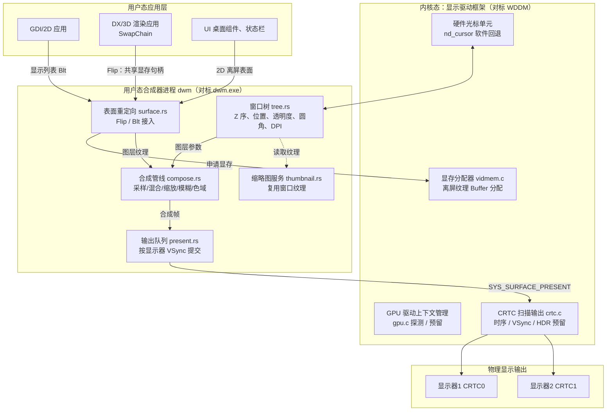
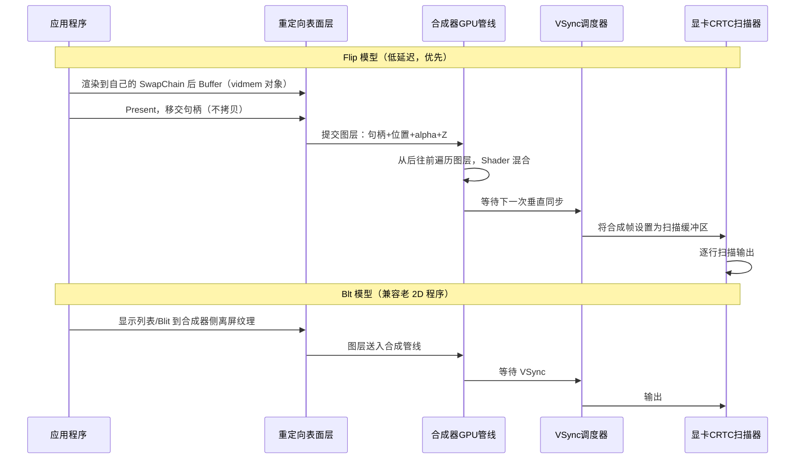
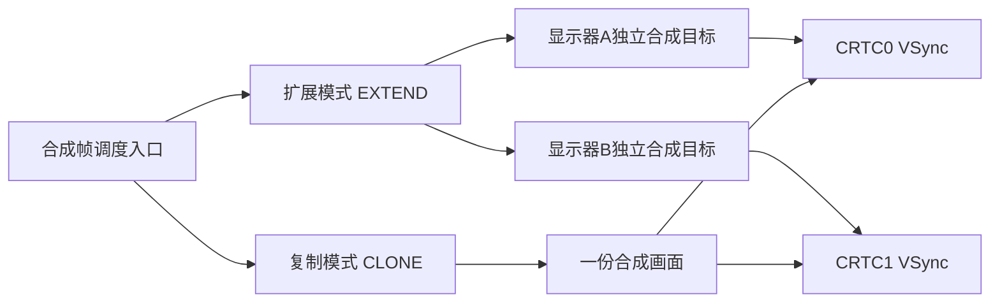

# Mini-DWM 架构与实现

Novus OS 的自研合成器，架构对齐 Windows DWM/WDDM/DXGI，但去掉 Windows 专属 API，
适配 NovusFS、内核显示驱动与 GPU 探测栈。本文记录三张架构图、ABI、后端契约、
迁移策略与自检步骤。实现代码是唯一事实来源；本文随代码更新。

---

## 1. 总架构图



对照实现：

* 用户态合成器是内嵌应用 `dwm`（`apps/src/bin/dwm.rs`），由 `kmain` 在显示栈就绪后以系统服务启动，监听命名端口 `dwm`。
* 内核侧新增 `kernel/vidmem.c`（显存对象）、`kernel/crtc.c`（扫描输出/VSync/独占/光标）、`kernel/dwmsys.c`（syscall ABI）。
* 合成引擎是 `apps/src/dwm/` 六个模块，全程 `no_std`、无分配器。
* 现有内核 WM（Novus-WM）保持运行作为回退；合成器失败不会黑屏。

## 2. 单帧合成管线时序



代码实现：`dwm.rs` 主循环从端口收 `MSG_LAYER_PUT` 更新树 → `compose_frame()` 混合到
前端 vidmem 对象 → `PresentQueue::present()` 先 `wait_vsync` 再 `surface_present`
提交图层句柄。内核 `crtc_present()` 在 `nd_crtc_blit()` 里做逐行拷贝，字节序按
framebuffer 的 BGR 标志转换。

## 3. 多显示器拓扑



`SYS_SET_MODE` 在 CLONE/EXTEND 间切换。`crtc_present()` 在 CLONE 下把帧 blit 到
所有未独占的启用输出；EXTEND 下只写目标输出。合成器为 EXTEND 的每个输出维护
独立 `PresentQueue`。输出枚举走 `SYS_DWM_QUERY`（`nd_outputs()` 去重后的列表）。

## 4. 显示 syscall ABI（28–37）

| 号 | 名称 | 参数 (rdi/rsi/rdx/r10) | 返回 |
|----|------|------------------------|------|
| 28 | vmem_alloc | size, flags | handle（0=失败）|
| 29 | vmem_free | handle | 0/-1 |
| 30 | vmem_map | handle, va, prot | 0/-1 |
| 31 | vmem_grant | handle, pid | 0/-1 |
| 32 | surface_present | crtc, layer 数组 VA, 个数 | 0/-1 |
| 33 | wait_vsync | crtc | 1 同步 / 0 无源 / -1 |
| 34 | set_exclusive | crtc, handle(0=释放) | 0/-1 |
| 35 | set_cursor | crtc, x, y, visible | 0/-1 |
| 36 | dwm_query | 缓冲 VA, 容量 | 写入字节数/-1 |
| 37 | set_mode | mode(0 CLONE/1 EXTEND) | 0/-1 |

安全约束：所有 handle 经 `vidmem_can_access()` 校验归属/授权；用户缓冲走
`user_copy(cr3, …)`；独占租约按 pid 归属；Win32 ABI 任务被 dispatcher 限制在
`SYS_WIN32`/`SYS_EXIT`，碰不到这些调用。

## 5. nwm v2 协议（0x0111–0x0116，兼容 v1.1/1.2）

| 类型 | 名称 | 载荷 |
|------|------|------|
| 0x0111 | SURFACE_CREATE | `nwm_surface_t`：窗口+显存句柄+几何 |
| 0x0112 | SURFACE_DESTROY | `nwm_win_t` |
| 0x0113 | FLIP_PRESENT | `nwm_flip_t`：新前端句柄 |
| 0x0114 | BLT_SUBMIT | `nwm_blt_t`：兼容显示列表转合成层 |
| 0x0115 | SET_EXCLUSIVE | `nwm_exclusive_t`：CRTC 独占租约 |
| 0x0116 | THUMBNAIL | `nwm_thumb_t`：缩略图目标 |

旧应用继续发 CLEAR/SHAPE/TEXT/INVALIDATE，内核 WM 用 v1 显示列表本地合成；
v2 应用用 `SYS_VMEM_ALLOC` 建对象、经 `Win::surface_create()/flip()` 注册；
桥接在 `nwm.c` 的 `handle_request()` 与窗口结构的 `surface_*` 字段。

## 6. 合成后端 ops 契约

`apps/src/dwm/compose.rs` 暴露纯函数算子：`blend_pixel`、`sample_bilinear`、
`blit_scaled`、`box_blur`、`color_adjust`，以及 `Ops{ name }` 后端标记。默认
`SOFT_OPS` 在规范 ARGB 上逐像素运算。厂商 GPU 后端（CONFIG_NOVUS_DWM_HW）应在
`gpu2d.c` 的 `ops` 表注册硬件 blit/shader，替换算子实现而不改图层遍历。当前三家
厂商入口仍返回 `ENODEV`（缺 GTT/ring/显存对象），所以默认且唯一可用的是软件后端。

## 7. 生命周期与回退

* 显存对象按 pid 引用计数：分配者持一个 owner 引用，每个映射进程持一个引用；
  `vidmem_owner_exit()`（任务退出钩子）只释放该 pid 的引用，最后一个引用消失才
  归还 PMM。共享页用 PTE 软件位 `PTE_SHARED` 标记，`vm_space_free()` 清 PTE 但
  不释放物理页，避免进程退出抽走合成器仍在用的缓冲。
* CRTC 独占租约与光标引用同样在 `crtc_owner_exit()` 释放。
* `CONFIG_NOVUS_DWM=n` 时全部新代码不编译进启动路径，桌面完全由内核 WM 绘制。

## 8. 构建与自检

构建（WSL 需把 Rust 工具链加入 PATH）：

```bash
export PATH=/home/dev/.rustup/toolchains/stable-x86_64-unknown-linux-gnu/bin:/home/dev/.cargo/bin:$PATH
export RUSTUP_HOME=/home/dev/.rustup CARGO_HOME=/home/dev/.cargo
make out/NOVUS.EFI
make run
```

内核启动时串口应出现：

```
[VIDMEM] allocator ready
[VIDMEM] selftest PASS
[CRTC] outputs=1 mode=clone
[CRTC] selftest PASS
[BOOT] vidmem and crtc ready
[BOOT] dwm compositor port ready
...
[DWM] compositor starting
[DWM] primary w=... h=...
```

自动化自检脚本 `scripts/dwm-selftest.sh` 做两件事：编译 `scripts/dwm-selftest.c`
在宿主侧验证合成算子（alpha 混合、缩放采样、圆角裁剪），以及在启用 QEMU 时
抓串口日志核对上述标记行。用法：

```bash
bash scripts/dwm-selftest.sh        # 宿主侧算子自检
QEMU=1 bash scripts/dwm-selftest.sh # 附带 QEMU 启动日志核对
```
