# Novus OS Architecture

> Version: v1.0 (2026-11-27, based on current worktree)
> Companion: [README.md](README.md), [ROADMAP.md](ROADMAP.md), [COMPATIBILITY.md](COMPATIBILITY.md)
> 中文版本：[../ARCHITECTURE.md](../ARCHITECTURE.md) · [Index](INDEX.md)
>
> Describes the **real architecture**: layering, dependency direction, data flows, ABI boundaries and key constants. Mermaid diagrams render in Mermaid-capable Markdown viewers.

---

## Contents

1. [Design principles and layering](#1-design-principles-and-layering)
2. [Boot architecture](#2-boot-architecture)
3. [Kernel architecture](#3-kernel-architecture)
4. [Filesystem and storage](#4-filesystem-and-storage)
5. [Graphics, windows and compositing](#5-graphics-windows-and-compositing)
6. [Network and security](#6-network-and-security)
7. [User space](#7-user-space)
8. [Build and images](#8-build-and-images)
9. [End-to-end data flows](#9-end-to-end-data-flows)
10. [Constraint quick reference](#10-constraint-quick-reference)

---

## 1. Design principles and layering

### Hard constraints

1. **Self-developed only**: no external open-source kernels/libs (Unifont glyph data is a documented exception).
2. **Unidirectional dependencies**: top-down calls only; no cycles.
3. **Frozen ABI**: NUC/NKM/NUP/INS/IPC/Debug fields and versions frozen; change requires RFC + version bump.
4. **Single-root VFS**: one syscall-visible `/`; mounts switch backends by prefix; no `..` entries.
5. **Isolation**: NUC uses ring-3 page tables (unsigned); NKM is Ring 0 and must be Ed25519-signed.
6. **Degradation**: user exceptions kill only the process; most kernel self-test failures are WARN, not panic.

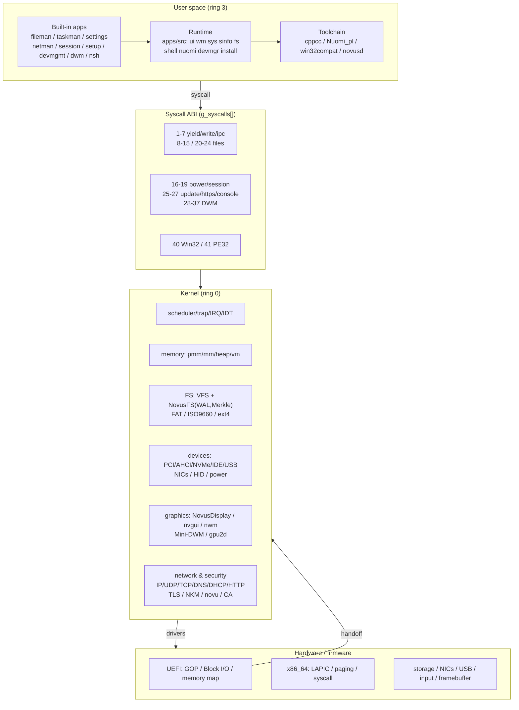

Directory-to-layer map: `arch/x86_64/` boot; `kernel/` core; `fs/` filesystems; `security/` signing/TLS/update; `graphics/` display; `wm/novus-wm/` compositor; `apps/` Rust apps; `user/` language/tools; `tools/` host tools; `scripts/` validation.

> No `system/`, `drivers/`, `user/shell/`, `user/micropython/` — those were early plans.

---

## 2. Boot architecture

### A/B two-phase boot

A core (BSP) does firmware handoff and integrity self-check then sleeps; B core (AP) loads the main kernel. `CONFIG_NOVUS_A_CORE_DISABLE` skips A-core checks; SIPI failure degrades to single-core.

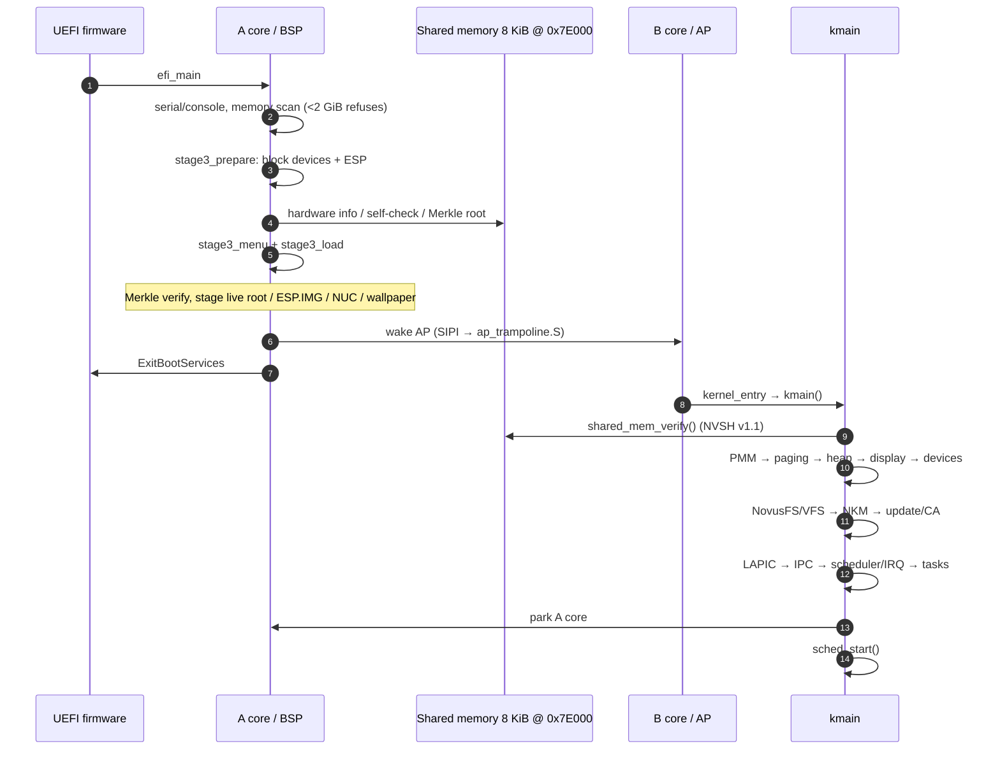

### Shared memory handoff

8 KiB @ `0x7E000`, layout frozen; new fields only appended to `0x2F0` reserved tail. Contains: hardware info / memory map, self-check status, Merkle root, `live_root_base/size`, `esp_img_base/size/install_flags`, `wpkg_img_base/size`, NUC demo image, 4 KiB log ring.

### kmain init order (hard constraint)

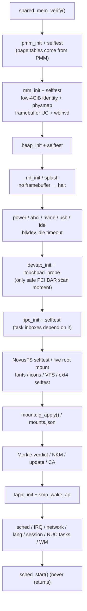

Why order is fixed: `pmm_init` before `mm_init` (page-table pages); NovusFS self-test and live-root mount before AP wake (no second core touching block layer/WAL); `devtab_init` after storage drivers and before network (BAR probing writes `0xFFFFFFFF`).

---

## 3. Kernel architecture

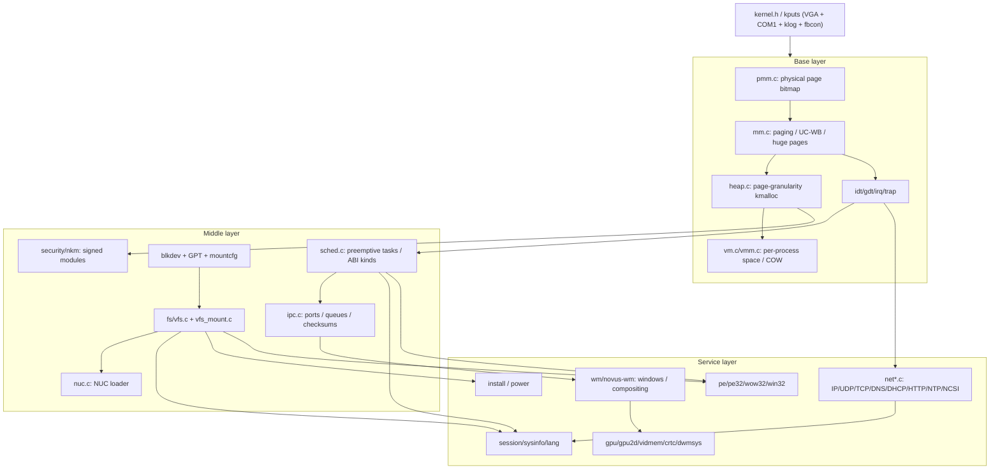

### Memory

| Region | Mechanism | Key constants |
|---|---|---|
| Physical pages | `pmm.c` 256 KiB bitmap, ~8 GiB | `kernel/pmm.c` |
| Kernel heap | `kmalloc` 4 KiB rounding, ≤256 MiB / 256 records | `kernel/heap.c` |
| Heap window | `0xFFFF810000000000`, 256 MiB, shared CR3s, supervisor-only | CONTRIBUTING §5.4 |
| Process space | Per-task CR3; COW; only TEXT executable | `kernel/vm.c`, `nuc.c` |
| Kernel stack | 64 KiB ring-0 per task | `kernel/sched.h` |
| NUC stack | top `0xA0000000`, trampoline `0x90000000`, header-clamped 64 KiB–4 MiB | CONTRIBUTING §5.4 |
| Shared area | 8 KiB @ `0x7E000`, NVSH v1.1 | `kernel/shared_mem.h` |

### Task state machine

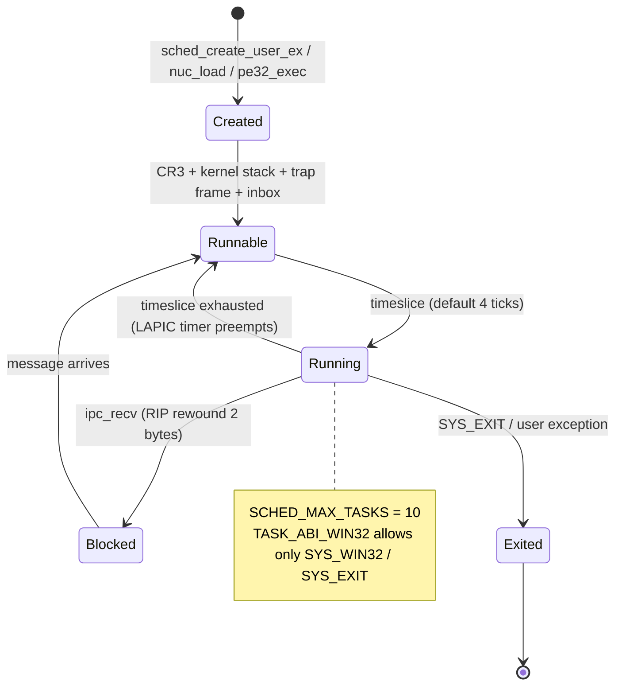

### Syscall ABI

`syscall` → `kernel/trap.c` → `g_syscalls[]` → `sys_*`. Convention: `rax` number, `rdi/rsi/rdx/r10` args, negative return = error. User pointers copied page-by-page; unknown numbers logged once per number then refused. Full table in [ABI.md](ABI.md) §2.

---

## 4. Filesystem and storage

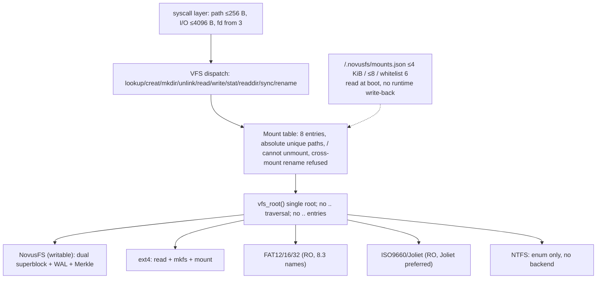

Mount whitelist (`rootfs_layout.h:138-144`): `/`, `/disk0/1`, `/media/cdrom0/usb0/usb1`. Runtime `mount`/`umount` do not write back `mounts.json` (would break Merkle).

NovusFS: magic `NOVS`, version `0x00030000`, 4 KiB blocks, 1024 inodes × 128 B, 56 B names, 7 direct + single/double indirect; WAL 64 blocks with CRC-32 and commit; Merkle 64 B SHA-256 nodes, 64 per block, covering bitmap+inode+data (not WAL or itself).

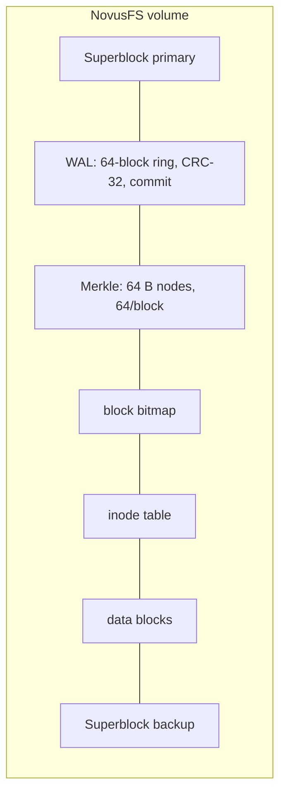

Block device stack: `blkdev` abstracts 512 B sectors with UEFI bounce; AHCI, NVMe, IDE(PIO), USB xHCI+BOT, UHCI HID-only and memimg (live root staged by boot) backends.

---

## 5. Graphics, windows and compositing

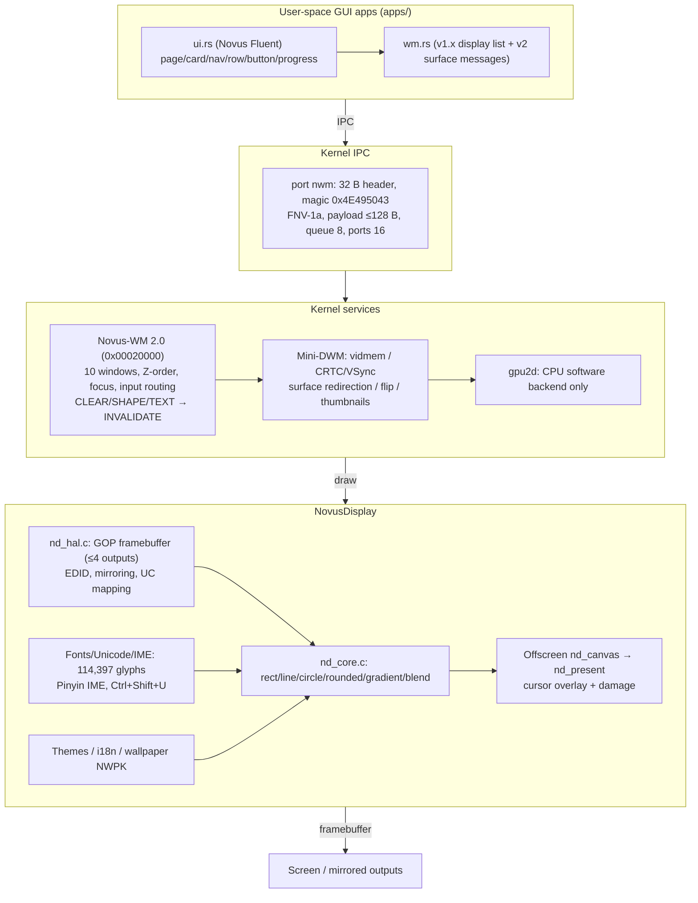

### One GUI frame

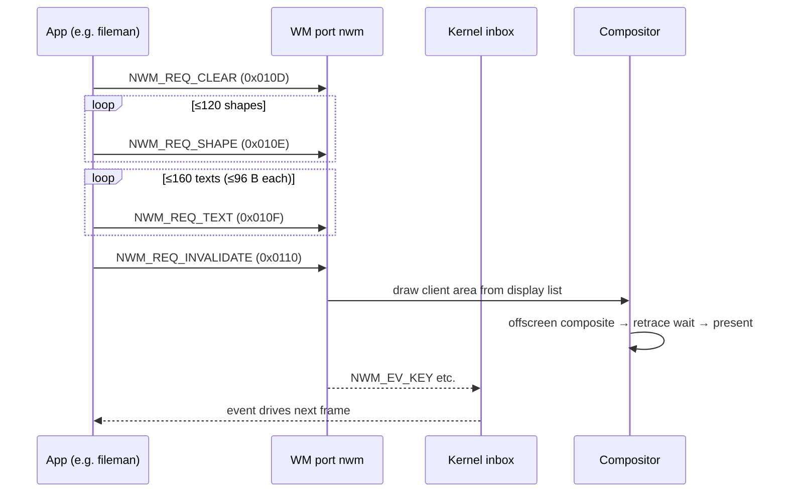

### Mini-DWM v2 surface redirection

v2 messages are additive — v1.x clients keep display lists:

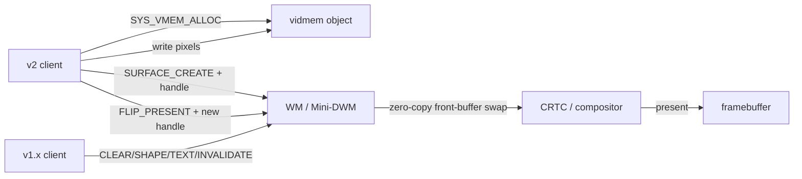

---

## 6. Network and security

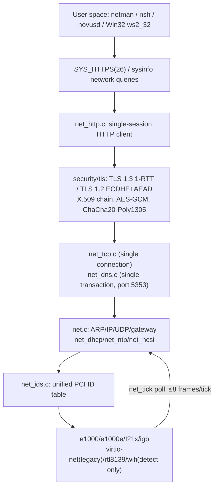

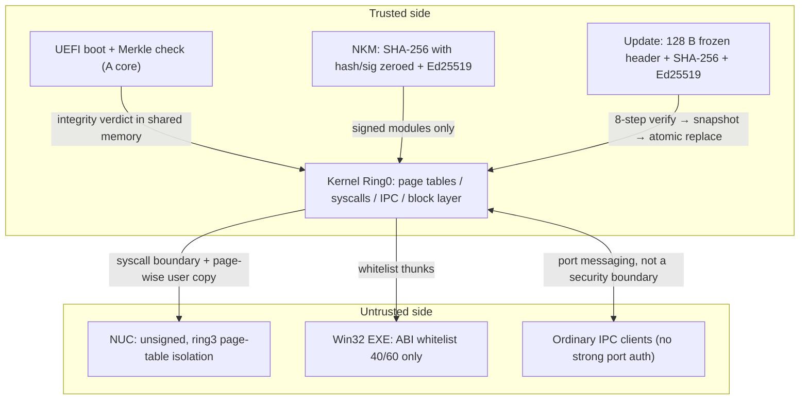

Spec goals not yet landed: CAP 128-bit least privilege, Secure Boot, strong IPC port auth, runtime key rotation, hardware TRNG. See [SECURITY.md](SECURITY.md) §5.

---

## 7. User space

`apps/` is `no_std`, allocator-free, dependency-free: fixed arrays/slices; panic prints COM1 and `exit(3)`; flat image linked at `0x400000`; `objcopy -O binary` → `xxd -i` → `k_app_<name>`.

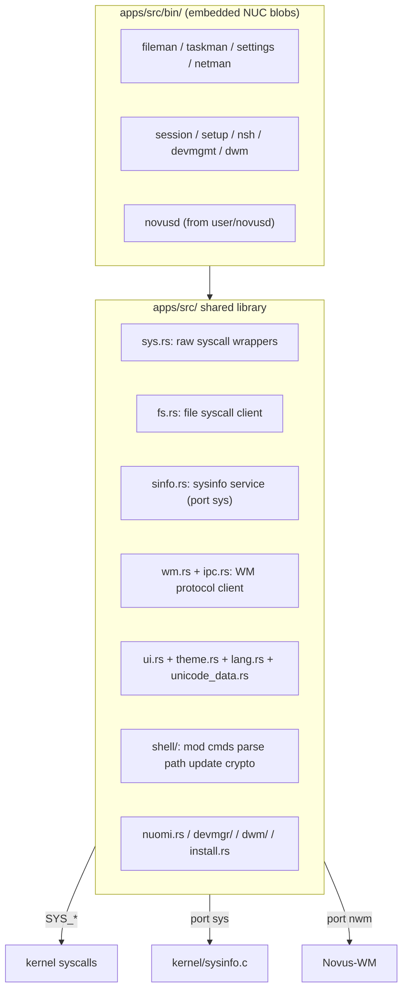

Registration chain (four edits to add an app): `apps/src/bin/name.rs` → `apps/Cargo.toml [[bin]]` → `Makefile APPS_NAMES` → `kernel/apps.c g_apps[]` **append at end** → optional `graphics/nd_demo.c` desktop entry.

nsh: keyboard events → shell line editor/history/vars/aliases → `parse.rs` (tokens, quotes, glob, redirection, pipes, `$(...)`) → 35 builtins writing via `out.write()` → display list. External apps launched via `sinfo::spawn_name()` — no fork/exec.

Multi-language execution: cppcc → NUC/PE32+/ELF64; boot-stage reads fixed `APPS/DEMO.NUC`; generic `./app.nuc` exec not implemented. nsh `nuomi` command runs `apps/src/nuomi.rs` directly.

---

## 8. Build and images

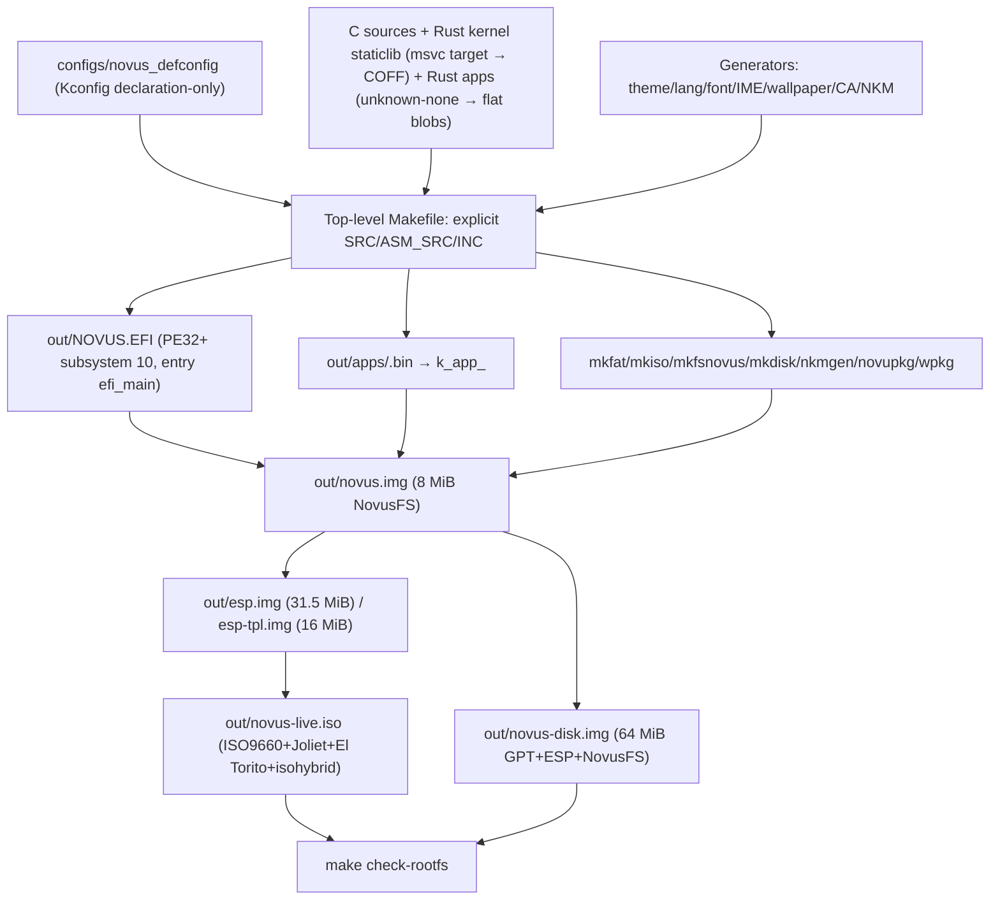

El Torito has a 16-bit sector count ⇒ boot item <32 MiB; live ESP = 31.5 MiB. Full details in [BUILD.md](BUILD.md).

---

## 9. End-to-end data flows

### Key press to screen pixel

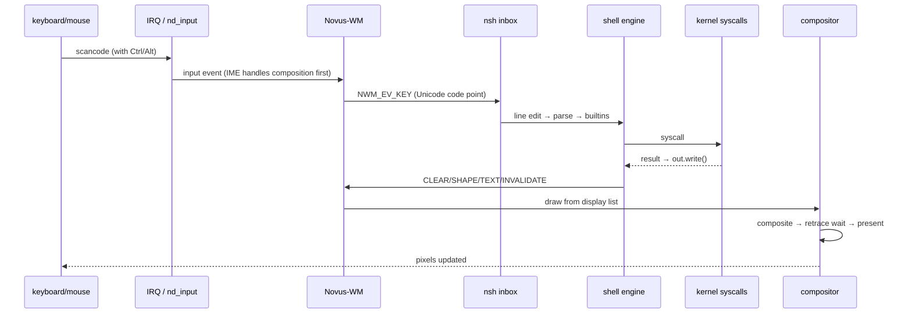

### File open to disk I/O

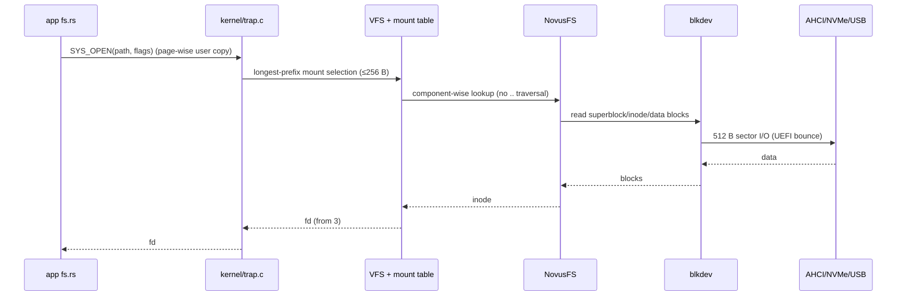

---

## 10. Constraint quick reference

| Constraint | Value | Source |
|---|---|---|
| Tasks / kernel stack / timeslice | 10 / 64 KiB / 4 ticks | `kernel/sched.h` |
| Path / I/O / fd base | 256 B / 4096 B / 3 | `kernel/trap.c:78-80` |
| Mounts / whitelist | 8 / 6 entries | `fs/vfs_mount.h:17`, `rootfs_layout.h` |
| NovusFS block/inode/name | 4 KiB / 1024×128 B / 56 B | `fs/novusfs/novusfs.h` |
| WAL / Merkle | 64 blocks / 64 B nodes, 64/block | `fs/novusfs/novusfs.h` |
| IPC header/payload/queue/ports | 32 B / ≤128 B / 8 / 16 | `kernel/ipc.h` |
| WM version/windows/shapes/texts | `0x00020000` / 10 / 120 / 160 | `nwm_proto.h:26-42` |
| GOP outputs / glyphs | 4 / 114,397 | `graphics/nd_hal.c`, `nd_font_uni.c` |
| App blob / stack | <128 KiB / 64 KiB–4 MiB | CONTRIBUTING §7.3 |
| nsh history/vars/aliases/pipes | 64/32/16/≤8 stages | `apps/src/shell/mod.rs` |
| Nuomi source/arena/depth | 6 KiB / 256 KiB / ~500 calls | `apps/src/nuomi.rs` |
| Live ESP | <32 MiB (31.5 MiB) | `tools/tools.mk` |

Known boundaries (see ROADMAP §4): two-core SMP only; single TCP/DNS-transaction and polling network; CPU-only 2D, no vblank, mirrored multi-output; IDE PIO/NVMe queue depth 4/USB BOT; CAP/Secure Boot/port auth/key rotation unimplemented; no generic `./app.nuc` exec; Win32 prototype.
