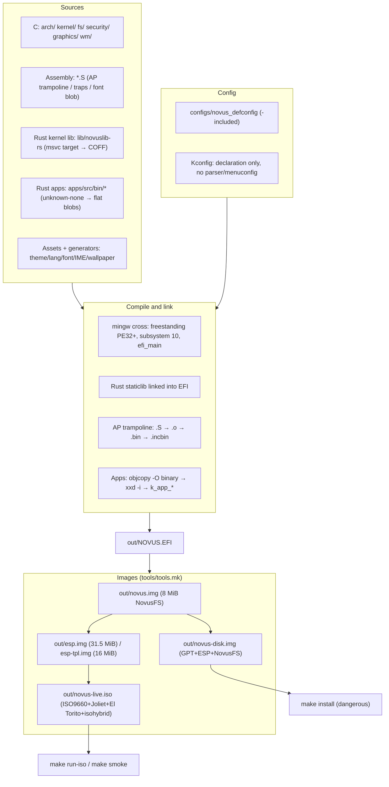
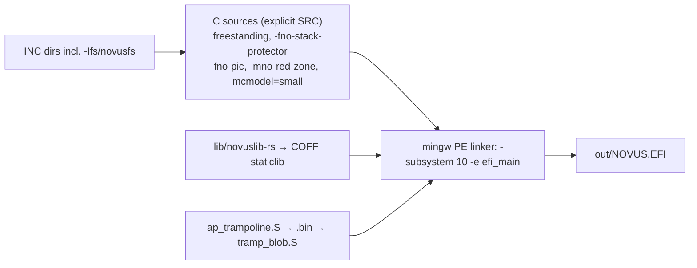
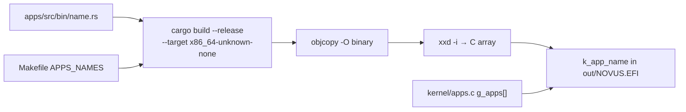
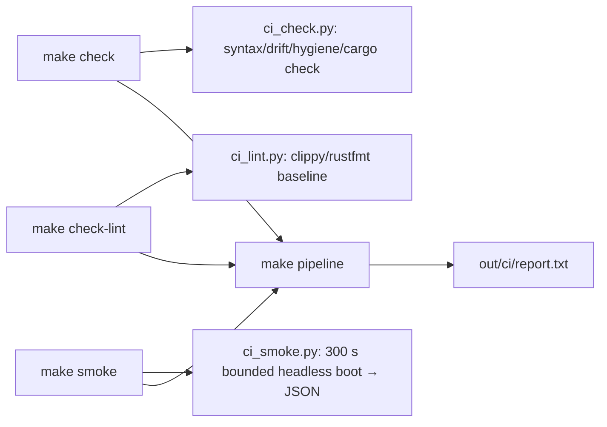

# Novus OS Build Guide

> Version v1.0 (2026-11-27)
> 中文版本：[../BUILD.md](../BUILD.md) · [Index](INDEX.md)
>
> Commands and variables come from the top-level Makefile, `tools/tools.mk` and `tools/ci.mk`.

## Contents

1. [Quick start](#1-quick-start)
2. [Build pipeline overview](#2-build-pipeline-overview)
3. [Environment setup](#3-environment-setup)
4. [Configuration system](#4-configuration-system)
5. [Target quick reference](#5-target-quick-reference)
6. [Build process details](#6-build-process-details)
7. [Artifacts and size limits](#7-artifacts-and-size-limits)
8. [Generated assets](#8-generated-assets)
9. [Running and installing](#9-running-and-installing)
10. [Validation and local CI](#10-validation-and-local-ci)
11. [Overridable variables](#11-overridable-variables)
12. [Incremental builds and cleanup](#12-incremental-builds-and-cleanup)
13. [Troubleshooting](#13-troubleshooting)

---

## 1. Quick start

```sh
# One-time dependencies (Ubuntu/Debian)
sudo apt install -y build-essential gcc-mingw-w64-x86-64 g++-mingw-w64-x86-64 \
  binutils-mingw-w64-x86-64 mingw-w64 qemu-system-x86 ovmf python3 xxd
rustup target add x86_64-pc-windows-msvc
rustup target add x86_64-unknown-none

# Build kernel + apps
make

# Build live ISO and validate
make iso
make check-rootfs

# Boot QEMU (headless, serial to terminal)
make run
```

Success: `out/NOVUS.EFI` exists; `check-rootfs` green; serial shows `[ND] demo desktop painted` and `[HALT] entering the scheduler`.

## 2. Build pipeline overview



Key point: the top-level Makefile compiles/links; image targets are defined in `tools/tools.mk`, included at the bottom so `all` remains the default target.

## 3. Environment setup

| Tool | Purpose | Failure if missing |
|---|---|---|
| `x86_64-w64-mingw32-gcc`, `objcopy` | Cross compile and PE32+ link | `Makefile:56-62` errors immediately |
| Rust + `rustup` | Kernel lib and apps | Link/app build failure |
| `x86_64-pc-windows-msvc` target | Kernel Rust static lib (COFF) | Link failure |
| `x86_64-unknown-none` target | App flat NUC blobs | App build failure |
| `make`, host `gcc`, Python 3, `xxd` | Host tools/generators/blob conversion | Target-specific failure |
| QEMU, OVMF, `qemu-img` | run/run-iso/smoke | Cannot boot |

Why `msvc` target for kernel Rust: `x86_64-unknown-none` emits ELF objects that cannot link into a PE image; `msvc` emits COFF consumed directly by mingw ld (`Makefile:296-306`).

Optional: `socat` (wm-churn), `openssl` (update/E2E), Pillow (wpgen), GNU Unifont hex + ibus Pinyin table (not distributed), PowerShell 7 (Windows QEMU tests), `subst` ASCII drive for Chinese paths.

WSL: `source "$HOME/.cargo/env"` or export the toolchain directory explicitly. Override prefix with `make CROSS=<prefix>`.

## 4. Configuration system

- `configs/novus_defconfig` is the **only** effective config source (`Makefile:70` `-include`).
- Top-level `Kconfig` is declaration-only; no parser/menuconfig; new options must be synced manually.
- `y`/`n` become macros `1`/`0` (`Makefile:245-247`); source lists are pinned; gate features with `#if CONFIG_NOVUS_*`.
- `depends on` is not validated: ensure `IRQ→SCHED`, `GUI→DISPLAY`, `WM→GUI+IPC`, `WIN32→SCHED`.
- `CONFIG_USER_MOCHI` and `CONFIG_USER_CPPCC` may both occupy the `APPS/DEMO.NUC` slot; no `user/mochi` submodule currently.
- `CONFIG_NOVUS_NTP=y` by default: NTP via UDP/123 hourly after DHCP.

### E2E flag consistency (important)

`E2E=1` adds test roots and HTTPS probes. A stamp records the full flag string (`Makefile:281-294`); switching flags forces a full rebuild to avoid mixed objects.

```sh
# Wrong: mixed objects
make            # E2E=0
make E2E=1 smoke

# Correct: one flag for the whole chain
make clean
make E2E=1
make E2E=1 smoke
# Back to production
make clean
make
```

Production images must never include test anchors (`security/novu/cabundle_e2e.c` only with `E2E=1`, `Makefile:225-229`).

New config checklist: declare in Kconfig; default in defconfig; use `#if CONFIG_NOVUS_XXX`; check dependency order; sync docs/README.

## 5. Target quick reference

### Core

| Target | Result |
|---|---|
| `make` / `make all` | `out/NOVUS.EFI` (default, prints banner first) |
| `make banner` | Config summary only |
| `make clean` | Remove `build/`, `out/`, `esp/` |

### Images and running

| Target | Result |
|---|---|
| `make novus-img` | `out/novus.img` (8 MiB NovusFS) |
| `make esp` | `out/esp.img` (31.5 MiB) and `out/esp-tpl.img` (16 MiB) |
| `make iso` | `out/novus-live.iso`; prints path if already current |
| `make iso-force` | Unconditionally delete and rebuild ISO |
| `make run` | Build and boot QEMU (`MEM=4G`); with `CONFIG_USER_CPPCC=y` runs `cppcc-demo` first and stages `APPS/DEMO.NUC` |
| `make run-iso` | Boot from ISO, optional second disk |
| `make disk-img` | `out/novus-disk.img` (64 MiB GPT+ESP+NovusFS) |
| `make install DEVICE=/dev/sdX` | `dd` overwrites target device — **dangerous** |
| `make iso-testapp` / `run-testapp` / `test-testapp` | testapp ISO build/boot/validation |
| `make check-rootfs` | Validate ISO/ESP/system tree, fonts, metadata |

### Host and language tools

`make tools` (mkfat/mkiso/mkfsnovus/mkdisk/wpkg/novupkg + cppcc), `make cppcc`, `make cppcc-tools`, `make cppcc-demo`, `make cppcc-cabi`, `make cppcc-to-win64`, `make cppcc-to-linux`, `make wpkg-img`, `make nkm-test-module`, `make theme`, `make mochi-tools`/`nuc-apps` (only when `user/mochi` exists).

### Validation

`make check` (syntax/drift/hygiene/cargo check), `make check-lint` (clippy/rustfmt baseline), `make check-lint-update` (explicitly refresh baseline), `make smoke` (300 s bounded headless boot), `make pipeline`/`make ci` (check → lint → build → smoke, writes `out/ci/report.*`).

## 6. Build process details

### Kernel link



- All C files must be explicitly in `Makefile` `SRC`; assembly in `ASM_SRC`; new dirs in `INC` — no auto-discovery.
- Object names derived from paths by replacing separators with underscores (`Makefile:274-279`); duplicate names collide.
- AP trampoline is 16-bit, <4 KiB, no relocations; last 24 B = CR3/AP stack/`ap_main`.

### App blobs



- Link address fixed `0x400000`; `nuc_spawn_blob()` maps there, so absolute references need no relocation.
- Blob <128 KiB; stack 64 KiB–4 MiB; `apps.stamp` tracks `apps/src/**`, `apps/Cargo.toml`, `apps/link.ld`, `apps/.cargo/config.toml`.
- `g_apps[]` append only; Win32 samples have separate path via `build/win32_blobs.h`.

### Image packaging order

1. `mkfsnovus` compiles kernel `fs/novusfs/*.c` verbatim (with kputs/kmalloc/blkdev stubs) → `out/novus.img` + Merkle.
2. `mkfat` → `out/esp-tpl.img` (16 MiB) and `out/esp.img` (31.5 MiB), 8.3 names only.
3. `mkiso` → ISO9660+Joliet dual trees, El Torito no-emulation EFI boot, isohybrid.
4. `mkdisk` compiles `kernel/gpt.c` → GPT+ESP+NovusFS disk image.
5. `check_rootfs.py` runs ~435 assertions on three image sets.

Wallpaper JPEGs do **not** enter the EFI image: `wpkg` packs `assets/backgrounds-screen/` (resampled to 2560 px) into `WALLPAPERS.PKG`, read by boot stage into reserved pages. This keeps live ESP under 32 MiB; missing package falls back to a flat-color gradient.

## 7. Artifacts and size limits

| Artifact | Notes | Constraint |
|---|---|---|
| `out/NOVUS.EFI` | UEFI PE32+ kernel with AP trampoline and Rust lib | — |
| `out/apps/<name>.bin` | Flat app image | **<128 KiB**, link `0x400000` |
| `out/novus.img` | 8 MiB NovusFS with `/Novus/fonts/font.bin` | `SYS_SIZE_MB=8` |
| `out/esp-tpl.img` | 16 MiB installer template ESP | `ESP_TPL_SIZE_MB=16` |
| `out/esp.img` | 31.5 MiB live FAT ESP | **<32 MiB** (El Torito 16-bit sector count) |
| `out/novus-live.iso` | ISO9660+Joliet+El Torito+isohybrid | — |
| `out/novus-disk.img` | 64 MiB GPT+ESP+NovusFS | `DISK_SIZE_MB=64` |
| `out/cppcc/hello.nuc` | M7 smoke program | staged as `APPS/DEMO.NUC` |
| `out/qemu-smoke*` | Screenshots, serial logs, JSON | — |
| `out/ci/report.*` | Local CI reports | — |

Never commit `build/`, `out/`, `esp/`, `target/`, `*.o`, OVMF VARS copies or temp logs.

## 8. Generated assets

| Source | Command | Output |
|---|---|---|
| `tools/themegen/theme.toml` | `make theme` | `graphics/nd_theme.[ch]`, `apps/src/theme.rs` |
| `tools/langgen/strings*.toml` | `python3 tools/langgen/langgen.py` | `graphics/nd_lang_dict.c`, `apps/src/lang_dict.rs` |
| Unifont hex | `python3 tools/fontgen/fontgen.py --bmp ... --upper ...` | `graphics/nd_font_data.bin` (3.5 MB), `nd_font_uni.c`, `apps/src/unicode_data.rs` |
| `tools/imegen/pinyin.txt` | `python3 tools/imegen/imegen.py --gen` | `graphics/nd_ime_dict.c` |
| `assets/` wallpapers | `python3 tools/wpgen/wpgen.py`, `make wpkg-img` | `assets/backgrounds-screen/`, `out/wallpapers.pkg` |
| Update roots | `python3 tools/cabundle/cabundle.py --pem ... --out ...` | `security/novu/cabundle.c` |
| NKM seed | `make nkm-test-module` | `security/nkm/nkm_test_module.h`, `out/test.nkm` |
| Icons SVG | `tools/icons/mkico.py` | `assets/icons/*.ico` (committed) |
| Boot logo | `tools/splash/mkbootlogo.py` | ARGB blob (no image decoder at boot) |

Generated files are committed; regenerate and commit after source changes; do not hand-edit them. New Chinese strings usually need font regeneration. `--check` detects drift. E2E certs only affect `cabundle_e2e.c`. Production CA changes need `import_roots.py --dry-run`. Never commit private keys/seeds.

## 9. Running and installing

### make run

Default `MEM=4G`, QEMU 2 cores; NIC default `e1000` with user-mode network (DHCP/DNS/NAT).

| Variable | Effect |
|---|---|
| `NOVUS_NIC` | `e1000` (default), `e1000e`, `virtio-net-pci`, `rtl8139`; `igb` on QEMU shows not connected |
| `DISPLAY` | gtk when set, else headless |
| `QEMU_BIN`/`OVMF_CODE`/`OVMF_VARS` | Explicit paths |

Serial markers: `[BOOT] UEFI boot started` → `[SHM] shared memory verified` → `[BOOT] mounts applied` → `[M3] integrity: PASS` → `[ND] demo desktop painted` → `[HALT] entering the scheduler`.

### make install (dangerous)

`make install DEVICE=/dev/sdX` — depends on `disk-img`, `dd` overwrites the whole device; explicit DEVICE and manual `yes` required. For testing use `scripts/run-install-test.sh` (writes `/tmp/novus-install-target.img`); `EN=1` English path, `FLOW=desktop` desktop path.

### Windows / WSL

Use `subst` ASCII drive for Chinese paths; `tools/icons/mkico.py` hardcodes a Windows ImageMagick path; `scripts/ci_check.py` rejects CRLF in `.sh`; several scripts contain `/home/dev/...` or fixed OVMF paths (see CONTRIBUTING §4.3).

## 10. Validation and local CI

```sh
# Host self-tests
bash scripts/display-selftest.sh
bash scripts/irq-selftest.sh
bash scripts/dwm-selftest.sh
python3 -m unittest discover -s scripts -p qemu_smoke_test.py
python3 -m unittest discover -s scripts -p novusimg_test.py
cargo test --manifest-path user/cppcc/Cargo.toml

# Clean rebuild and image checks
make clean && make iso
python3 scripts/inspect_img.py out/novus.img
python3 scripts/check_rootfs.py out

# QEMU
make disk-img
bash scripts/qemu-smoke.sh
bash scripts/qemu-smoke.sh --no-root --output out/qemu-smoke-no-root
scripts/wm-churn.sh 4G 20   # socat
```

```sh
make tools
build/tools/novupkg selftest
(cd tools/nkmgen && cargo run --quiet -- selftest)
python3 tools/updatesrv/selftest.py
python3 tools/themegen/themegen.py --check
python3 tools/langgen/langgen.py --check
```



No hosted CI — state unexecuted checks in PRs. QEMU smoke uses temp firmware vars and `-snapshot`; VNC only on `127.0.0.1:5901`; baselines in `scripts/baselines/qemu/{disk,no-root}`; missing/mismatch fails; **never** `--update-baseline` in normal regression; UI changes require manual per-image review.

Security-related build validation: `make`, `check-rootfs`, `nkm-test-module`, `novupkg selftest`, `nkmgen selftest`, `updatesrv selftest`; update/TLS also `tools/updatesrv/e2e-run.sh` then plain `make` to confirm production has no test anchors.

## 11. Overridable variables

| Variable | Default | Purpose |
|---|---|---|
| `CROSS` | `x86_64-w64-mingw32-` | Cross toolchain prefix |
| `MEM` | `4G` | QEMU memory |
| `E2E` | `0` | E2E test anchors |
| `HOSTCC`/`HOSTCFLAGS` | `gcc` / `-O2 -std=c11 -Wall -Wextra -D_GNU_SOURCE` | Host tools |
| `PYTHON` | `python3` | CI scripts |
| `SYS_SIZE_MB`/`ESP_TPL_SIZE_MB`/`ESP_SIZE_MB`/`DISK_SIZE_MB` | 8/16/31.5/64 | Image sizes |
| `NKM_SEED` | fixed | Test key seed — changing breaks embedded public key |
| `DEVICE` | none | `make install` target |
| `NOVUS_NIC` | `e1000` | QEMU NIC model |
| `DISPLAY` | empty | gtk when set |
| `SMOKE_TIMEOUT`/`SMOKE_SETTLE` | `300`/`15` | Bounded smoke test (hard cap 300) |
| `SMOKE_IMAGE` | `out/novus-live.iso` | Smoke input |

## 12. Incremental builds and cleanup

- `make` is incremental; objects in `build/`, with stamps for C/Rust/assembly.
- `apps.stamp` tracks only `apps/src/**` and three other paths; changes elsewhere do not trigger app rebuild.
- `E2E` switch forces full rebuild via flag stamp — never mix objects.
- `make clean` removes `build/`, `out/`, `esp/` but **not** `target/`; remove crate targets manually if needed.
- Release or large refactor: `make clean && make iso`.

## 13. Troubleshooting

| Symptom | Cause | Fix |
|---|---|---|
| `$(CC) not found in PATH` | mingw toolchain missing or prefix differs | Install `gcc-mingw-w64-x86-64` or `make CROSS=<prefix>` |
| Rust static lib missing | `x86_64-pc-windows-msvc` target missing | `rustup target add ...` |
| `undefined symbol k_app_*` | App not registered in Cargo/APPS_NAMES/g_apps | Check all four points |
| App blob >128 KiB | Allocator or large buffers | Fixed arrays; check `apps.stamp` |
| ISO size over limit | live ESP >32 MiB | Check `ESP_SIZE_MB`, wallpaper package, staged payloads |
| check-rootfs count mismatch | header 78 vs fsinfo/check 77 | Sync to `rootfs_layout.h` |
| Generator `--check` stale | TOML changed without regeneration | Regenerate and commit |
| No serial output | `CONFIG_NOVUS_DEBUG_SERIAL=n` or redirection | Check defconfig and run.sh |
| Boot stuck at splash | Framebuffer bind/map failure | Check last `nd_boot_stage` and `[ND]` logs |
| Smoke baseline mismatch | UI change or dynamic content | Never `--update-baseline` normally |
| qtest.sh "passes" but no mount | `|| true` swallowed failure | grep `/tmp/b_*.log` `[MOUNT]` |
| E2E contamination | Mixed `E2E=0/1` objects | `make clean`, consistent flags, final `E2E=0` build |
| Windows path failure | Chinese path or CRLF | `subst` ASCII drive; LF line endings |
