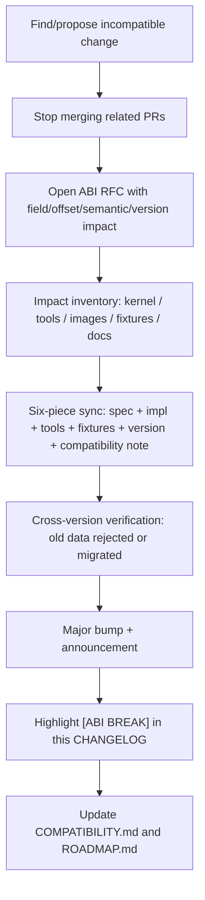

# Novus OS Changelog and Release Notes

> Version: v1.0 (compiled 2026-11-27)
> Current baseline: **V1.6-FinalSpec (frozen release)**, current main branch
> 中文版本：[../CHANGELOG.md](../CHANGELOG.md) · [Index](INDEX.md)
>
> Keep a Changelog style with one OS-specific rule: **ABI breaks must be highlighted and treated as OS-level major events**. The repo has no tags or release dates, so history is organized by milestone (M0–M12) and changes.md order; milestone numbers are not release version numbers.

---

## ABI change marker legend

| Marker | Meaning | Severity | Required action |
|---|---|---|---|
| **[ABI BREAK]** | Incompatible change to frozen format fields/offsets/encoding/version/semantics | **Highest — OS major event** | ABI RFC, major bump, six-piece sync, migration path, announcement |
| **[ABI-ADDITIVE]** | Append-only fields/message IDs/syscall numbers, old data still readable | Medium | Update spec, tools, fixtures, minor version |
| **[ABI-FIX]** | Fix implementation/spec mismatch without changing established layout or semantics | Medium | State "field offsets and ABI major unchanged" |
| **[DOC-ERRATA]** | Text fix only | Low | State which file is authoritative |
| **[ABI-PENDING]** | Known cross-end contract conflict, unresolved | High (release-blocking) | Close before release; never hide |

```text
> [!CAUTION]
> **ABI BREAK is an OS-level major event.**
> It is not "just another commit": kernel, host tools, images, test fixtures,
> spec docs, version number and compatibility note must all change;
> old images/apps/modules may break. Never smuggle an ABI break into a regular PR.
```

## Contents

1. [Version strategy](#1-version-strategy)
2. [Unreleased](#2-unreleased)
3. [Release notes: V1.6-FinalSpec](#3-release-notes-v16-finalspec)
4. [Change history](#4-change-history)
5. [ABI change event table](#5-abi-change-event-table)
6. [ABI break emergency process](#6-abi-break-emergency-process)
7. [How to write an ABI break entry](#7-how-to-write-an-abi-break-entry)
8. [Maintenance rules](#8-maintenance-rules)

---

## 1. Version strategy

- Spec version: `V1.6-FinalSpec` is the current frozen release; NUC/NKM/NUP/INS have independent V1.0 frozen versions.
- Major: field offset/length/encoding/version/semantics change → RFC + major bump.
- Minor: append-only, old versions still parse → minor bump.
- Errata: text-only correction, no version bump, but state "field offsets and ABI major unchanged".
- M0–M12 are development milestones, not release versions.

Frozen list (check [COMPATIBILITY.md](COMPATIBILITY.md) §2 before any change): NUC, NKM, NUP, INS, kernel IPC, Novus-WM IPC, Debug interface, update patches, rootfs layout, shared memory, syscall numbers.

## 2. Unreleased

> Unfinished items in the current worktree, including one **[ABI-PENDING]** release blocker.

### Added

- Unified engineering docs: `ROADMAP.md`, `ARCHITECTURE.md`, `COMPATIBILITY.md`, `CODESTYLE.md`, `CODE_OF_CONDUCT.md`, `BUILD.md`, `CHANGELOG.md`, `GLOSSARY.md`, `ABI.md`, `DRIVER-LICENSE.md` (+ English versions under `docs/en/`).
- `templates/`: GUI app / nsh command / Nuomi script skeletons.
- `apps/src/nuomi.rs`: `no_std` heapless Nuomi interpreter registered as nsh `nuomi`.
- `kernel/klog.c/h`: cross-phase log ring; boot splash shows firmware logs directly.
- Multiple QEMU NIC drivers and unified PCI ID table (`net_ids.c`, `net_virtio.c`, `net_rtl8139.c`).
- `DRIVER-LICENSE.md`: GPLv2 §10 additional permission for closed-source drivers.

### Changed

- App blob limit 64 KiB → 128 KiB; built-in app stack → `NUC_STACK_MAX` 4 MiB.
- Graphics presentation → offscreen compositing + whole-frame present; framebuffer UC mapping fixes real-hardware corruption.
- Wallpaper → programmatic vertical gradient (JPEG decoder has toolchain UB).
- Built-in apps → Rust `no_std` flat NUC blobs; session manager first, then desktop after login.

### Fixed

- `kernel/shared_mem.h` missing `wpkg_img_base/size` fields despite static assertions (link failure).
- Half-frame flicker: CLEAR/SHAPE/TEXT no longer trigger redraw; frame-end `INVALIDATE` commits once.
- e1000e MAC read order, igb descriptor/SRRCTL offsets, rtl8139 CAPR write value, DHCP timeout retry loop.

### [ABI-PENDING] release blockers

> [!CAUTION]
> **[ABI-PENDING] Update package header length mismatch: kernel frozen 128 B, `tools/novupkg` uses 144 B.**
> Field offsets are compatible but header length and `meta_offset` disagree; packages may be rejected.
> Fix per ROADMAP P0-02; **do not release a formal version until closed**.

- **[ABI-PENDING]** Update package contract (above).
- **[ABI-PENDING]** rootfs count: 78 in `rootfs_layout.h`, 77 in fsinfo/check (P0-04).
- **[ABI-PENDING]** WM protocol version: code `0x00020000`, docs still 1.0 (P0-01).
- **[ABI-PENDING]** NUC stack: kernel 64 KiB–4 MiB, cppcc README 64–256 KiB.
- **[ABI-PENDING]** Hardcoded dev keys in `apps/src/shell/update.rs` and `novu_verify.h` (P0-03).

## 3. Release notes: V1.6-FinalSpec

### Highlights

- **Boot**: UEFI two-phase A/B core start, splash and cross-phase logs, Merkle self-check.
- **Kernel**: PMM/MM/heap/per-process paging, preemptive scheduling, syscall ABI, NUC loader, IPC.
- **Filesystem**: NovusFS (WAL+Merkle+dual superblock), VFS single root, FAT/ISO9660/ext4 read-only backends.
- **Graphics**: NovusDisplay, nvgui, Win11-style desktop, full Unicode glyphs, Chinese Pinyin IME, Fluent theme, CN/EN i18n.
- **Apps**: 9 built-ins (fileman/taskman/settings/netman/session/setup/nsh/devmgmt/dwm), novusd, Nuomi.
- **Toolchain**: cppcc three targets, host image tools, local CI entries.
- **Compatibility**: Win32 PE32+ prototype (141 APIs), graphical installer, tiered incremental update system.

### ABI status table

| Format/protocol | Version | Status |
|---|---|---|
| NUC | V1.0 / `0x0100` | Stable; 48 B header is **[DOC-ERRATA]** |
| NKM | V1.0 / major 1 | Stable; hash rule unified **[ABI-FIX]** |
| NUP/INS | V1.0 | Frozen, no changes |
| Kernel IPC | `0x4E495043` | Stable |
| Novus-WM IPC | `0x00020000` (2.0) | Added v1.1/v1.2/v1.3/v2 messages **[ABI-ADDITIVE]** |
| Debug interface | file V1.0 / content V1.1 | Frozen baseline; implementation differences recorded |
| Update patches | V1.0 | Header contract conflict **[ABI-PENDING]** |
| rootfs layout | `rootfs_layout.h` truth | Count mismatch **[ABI-PENDING]** |
| Shared memory | NVSH v1.1, 8 KiB | Log-ring carve-out appended **[ABI-ADDITIVE]** |
| Syscalls | sparse frozen | New numbers appended **[ABI-ADDITIVE]** |

### Known limits (read before upgrading)

- Not Secure Boot; CAP, strong IPC port auth, hardware TRNG, runtime key rotation not landed.
- TCP single session, DNS single transaction, polling RX; WiFi detection only; no hardware 2D/vblank.
- NTFS no backend; ext4 read+mkfs; no `seek`/`truncate`/owner-rwx.
- Generic `./app.nuc` exec unimplemented; fixed boot-stage demo only.
- Win32 prototype: no disk DLL, 32-bit PE32, threads or SEH.
- Historical M0–M11 images get no security backports; no commercial support or contract SLA.

### Upgrade notes

1. Check [COMPATIBILITY.md](COMPATIBILITY.md) frozen list and current contract conflicts.
2. Same major version ⇒ old images/apps/modules should still load.
3. Do not use `novupkg` output for real update validation until the header conflict is closed.
4. Never mix `E2E=0/1` objects; `make clean` before switching.
5. Run `make check-rootfs` and QEMU smoke after upgrade; confirm no new `[WARN]`.

## 4. Change history

### M0 — Minimal UEFI boot

UEFI entry, A-core BSP, VGA text. Froze UEFI PE32+ image and shared-memory handoff basics.

### M1 — Memory, paging, SMP

PMM, paging, heap, AP trampoline and B-core wake. **[ABI-ADDITIVE]** shared memory frozen at 8 KiB @ `0x7E000`, NVSH v1.1 with static assertions. **[DOC-ERRATA]** full menuconfig deferred; Kconfig declaration-only.

### M2 — NovusFS minimal + WAL

NovusFS (dual superblocks, bitmap, inode table, 64-block CRC WAL), VFS, standard root tree, `.novusfs/fsinfo` and `mounts.json`. **[ABI-PENDING]** dir count 78 vs 77. Froze NovusFS v3 (`0x00030000`), 4 KiB blocks, 56 B names.

### M3 — Merkle, NKM, ISO Live, installer

> [!CAUTION]
> **[ABI-FIX] NKM hash rule unified — important signature-verification correction.**
> NKM SHA-256 **excludes the 32 B hash field and 64 B sig field**: zero both before digesting the rest, then verify Ed25519. Modules and signing tools not updated to this rule fail verification. This is a "unified hash rule" correction; field offsets and ABI major unchanged.

Added Merkle (64 B SHA-256 nodes, 64/block, root in dual superblocks), NKM loader + Ed25519 + `nkmgen`, ISO9660+El Torito+isohybrid live media and text installer. **[ABI-ADDITIVE]** shared memory appended `wpkg_img_base/size` at 0x308/0x310; `reserved` shortened 16 B, block still 8 KiB.

### M4 — Scheduler, processes, syscalls

Preemptive scheduler, per-task CR3 and 64 KiB kernel stacks, LAPIC timeslice, syscall gate, NUC loader (ring 3, segments, relocations, exception isolation). **[ABI-ADDITIVE]** syscalls 8–15 added; #2 `write` remains serial log.

### M5 — NovusDisplay and widgets

Framebuffer HAL, 2D software renderer, nvgui, desktop shell, boot logo. **[DOC-ERRATA]** hardware 2D and OpenGL/Vulkan/DX remain plans with no source hits.

### M6 — Novus-WM and IPC

Kernel IPC (ports, bounded queues, checksums, blocking receive) and Novus-WM. **[ABI-ADDITIVE]** WM IPC V1.0 frozen: 32 B header, magic `0x4E495043`, payload ≤128 B, queue 8, ports 16.

### M7 — cppcc

C++ subset compiler, NUC/PE32+/ELF64 backends, C ABI library. **[DOC-ERRATA]** NUC header unified at 48 B (`reserved` 16 B), explicitly "field offsets and ABI major unchanged". **[ABI-PENDING]** cppcc README stack 64–256 KiB vs kernel 64 KiB–4 MiB. **[ABI-PENDING]** generic `./app.nuc` exec missing.

### M8 — Built-in apps

fileman/taskman/settings/netman/session/nsh. **[ABI-ADDITIVE]** WM v1.1: CLEAR(0x010D)/SHAPE(0x010E)/TEXT(0x010F)/INVALIDATE(0x0110); frame must end with INVALIDATE. **[ABI-ADDITIVE]** syscalls 16–19 and 20–24.

### M9 — Win32 prototype + Win11 Chinese desktop

PE32+ loader (map at `0x50000000`, DIR64, name-based IAT), Win32 API gate and simulated registry. **[ABI-ADDITIVE]** `SYS_WIN32(40)`, `SYS_PE32_EXEC(41)`; `task_t` ABI tag; whitelist 40/60. **[ABI-ADDITIVE]** Win32 API whitelist grew from 15 to 141.

> [!CAUTION]
> **[ABI BREAK] Input event key-code migration.** `ND_KEY_*` moved above `0x110000` (`ND_KEY_BASE`); character keys carry Unicode code points directly, control keys no longer collide with `U+0100..U+010A`; Rust side uses `wm::KEY_*`.
> Impact: all clients parsing old key-code ranges must update. Both C/Rust sides and IME service were synced; old clients must be rebuilt.

### M10 — UI unification and graphical installer

Fluent theme tokens (light/dark/time), rounded display-list ops 6/7, six-page graphical installer. **[ABI-ADDITIVE]** WM v1.2 rounded shapes; sysinfo theme reply appends `mode/resolved/version`. **[ABI-ADDITIVE]** shared memory appended `esp_img_base/size` and `install_flags`; `SYS_SETUP(19)`.

### M11 — Multilingual, session and I/O

CN/EN switching with persistence, live no-login, seven-page installer, xHCI mass storage, 4-way GOP mirroring. **[ABI-ADDITIVE]** `SYSINFO_REQ_LANG(0x030F)`, `DISPLAY(0x0318)/RSP(0x0319)`, syscalls 25–27. **[ABI-PENDING]** multi-output mirrored only, not independent desktops.

### M12 — Device manager and Mini-DWM

devmgmt, modal property sheet, devtab, Mini-DWM surface redirection and software compositor. **[ABI-ADDITIVE]** WM v1.3 modal flag; window limit 10, display list 120/160. **[ABI-ADDITIVE]** WM v2.0 (`0x00020000`): SURFACE_CREATE/DESTROY, FLIP_PRESENT, BLT_SUBMIT, SET_EXCLUSIVE, THUMBNAIL; pixels never cross IPC. **[ABI-ADDITIVE]** syscalls 28–37. **[ABI-PENDING]** docs still say 1.0 and 8 windows.

### Current worktree (post-M12)

Splash log panel, four QEMU NICs, NCSI, full UTF-8/Unicode, developer templates, nsh Nuomi integration. **[ABI-ADDITIVE]** shared memory tail carve-out adds 4 KiB log ring; frozen fields untouched. **[ABI-ADDITIVE]** update system adds `SYS_UPDATE(25)`, `SYS_HTTPS(26)` and five channels (header conflict in §2).

## 5. ABI change event table

| Event | Phase | Marker | Impact | Status |
|---|---|---|---|---|
| Shared memory 8 KiB layout | M1 | [ABI-ADDITIVE] | boot↔kernel | Synced, static assertions |
| NovusFS v3 disk layout | M2 | frozen | all images | Stable; dir count pending |
| NKM hash rule unified | M3 | **[ABI-FIX]** | all NKM modules/tools | Synced |
| Shared memory wallpaper fields | M3 | [ABI-ADDITIVE] | boot↔kernel | Synced |
| Syscalls 8–15 | M4 | [ABI-ADDITIVE] | user headers | Synced |
| NUC header erratum | M7 | [DOC-ERRATA] | compiler/loader | Declared non-ABI |
| WM v1.1 display list | M8 | [ABI-ADDITIVE] | all GUI clients | Synced |
| Syscalls 16–24 | M8 | [ABI-ADDITIVE] | user space | Synced |
| **Input key-code migration** | **M9** | **[ABI BREAK]** | **all input clients, IME, terminal** | **Synced C/Rust; old clients rebuild** |
| Win32 ABI tag/API expansion | M9 | [ABI-ADDITIVE] | Win32 tasks | Synced |
| WM v1.2 rounded shapes | M10 | [ABI-ADDITIVE] | GUI clients | Synced |
| Shared memory install fields | M10 | [ABI-ADDITIVE] | boot↔installer | Synced |
| i18n/display sysinfo | M11 | [ABI-ADDITIVE] | settings/installer | Synced |
| Syscalls 25–27 | M11 | [ABI-ADDITIVE] | update/HTTPS | Synced |
| WM v1.3 modal | M12 | [ABI-ADDITIVE] | device manager | Synced |
| WM v2.0 surface | M12 | [ABI-ADDITIVE] | DWM/v2 clients | Synced; doc erratum pending |
| Syscalls 28–37 | M12 | [ABI-ADDITIVE] | Mini-DWM | Synced |
| Log ring carve-out | current | [ABI-ADDITIVE] | boot↔splash | Frozen fields untouched |
| Update header 128 vs 144 | current | **[ABI-PENDING]** | update cross-end contract | **Open, release-blocking** |

## 6. ABI break emergency process

> [!CAUTION]
> Once an ABI break is confirmed, follow this process immediately. Never "fix it later".



Six pieces: spec, kernel impl, host tools, test fixtures, version number, compatibility note. Announcement must state: which format/field/semantics changed and from what to what; which old artifacts break (images/apps/modules/packages); migration path and commands; version numbers and compatibility window; CVE decision if affecting released versions (see [SECURITY.md](SECURITY.md)).

## 7. How to write an ABI break entry

```markdown
> [!CAUTION]
> **[ABI BREAK] `<format>` `<field/protocol>` — one-line incompatibility.**
>
> - **Change**: from X to Y (offset, length, encoding, version).
> - **Affected artifacts**: which old images/apps/modules/packages break.
> - **Required actions**: version bump, six-piece sync, migration commands.
> - **Compatibility window**: transitional support for old and new?
> - **Evidence**: RFC link / spec version / test fixtures.
```

Anti-patterns (not allowed): "adjusted header layout", "bumped protocol version while at it", "fixed signature calculation (old modules should still work, right?)" — these hide OS-level major events and silently break downstream toolchains, images and fixtures.

## 8. Maintenance rules

1. On PR merge, add an item under Unreleased; ABI changes must carry a marker.
2. At release, move Unreleased into a version section and update release notes + ABI status table.
3. `[ABI-PENDING]` items must include a ROADMAP task number; closing requires verification method.
4. `changes.md` keeps development detail (topic → path bullets → verification); this file keeps user/downstream conclusions.
5. File errata on doc/code conflicts, stating which file is authoritative — never silently rewrite history.
