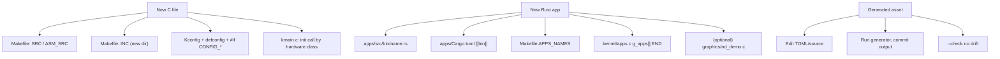
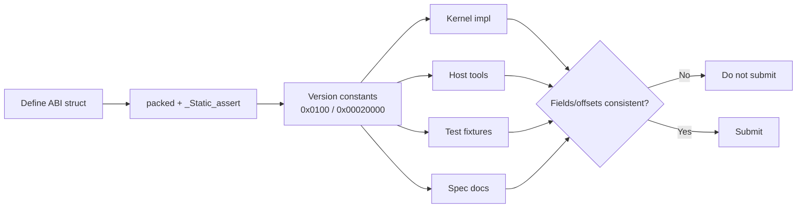

# Novus OS Code Style

> Version: v1.0 (2026-11-27)
> Derived from real source conventions, not invented aesthetics. The repo has no unified `clang-format`, `rustfmt.toml` or `.editorconfig`; **rule one is to follow the existing style of the file**.
> 中文版本：[../CODESTYLE.md](../CODESTYLE.md) · [Index](INDEX.md)

## Contents

1. [General rules](#1-general-rules)
2. [C code](#2-c-code)
3. [Rust code](#3-rust-code)
4. [Assembly and boot code](#4-assembly-and-boot-code)
5. [File and directory organization](#5-file-and-directory-organization)
6. [Cross-language naming](#6-cross-language-naming)
7. [ABI and frozen format code](#7-abi-and-frozen-format-code)
8. [Logging and error messages](#8-logging-and-error-messages)
9. [Comments and docs](#9-comments-and-docs)
10. [Subsystem-specific rules](#10-subsystem-specific-rules)
11. [Anti-patterns](#11-anti-patterns)
12. [Pre-submit checklist](#12-pre-submit-checklist)

---

## 1. General rules

1. **Follow local style**: no mass reformatting for personal preference; one PR per change.
2. **No new warnings**: C and host tools must not add `-Wall -Wextra` warnings; self-tests use `-Werror`.
3. **No external dependencies**: apps are `no_std`, allocator-free, no third-party crates; justify exceptions in an Issue.
4. **Do not break frozen boundaries**: NUC/NKM/NUP/INS/IPC/Debug/update fields, offsets and versions.
5. **Comments explain "why"**, not "what" — code should say what; comments record frozen decisions, hardware quirks and degradation reasons.

Fact priority: source/build results > frozen specs > changes.md/CONTRIBUTING > README early plans > process docs.

## 2. C code

### 2.1 Indentation, braces, line width

K&R style with **2-space indentation** (see `kernel/kmain.c`, `kernel/ipc.h`):

```c
/* Correct: 2-space indent, brace on same line, braces even for one line */
static void syscall_dispatch(trap_frame_t *f) {
  UINT32 i;
  task_t *t = sched_current();

  if (t == 0) {
    return;
  }
  for (i = 0; i < count; i++) {
    do_work(i);
  }
}
```

- 2 spaces, never Tab.
- Opening brace on the same line; `else` on the closing brace line.
- Braces even for single-line bodies.
- Pointers: `type *name` (star next to variable).
- Target ~80 columns; align continued args.
- Do not reformat old files wholesale.

### 2.2 Naming

| Object | Rule | Examples |
|---|---|---|
| Functions | `snake_case` | `syscall_dispatch`, `novusfs_mount` |
| Locals | `snake_case`; short names only for loops | `i`, `fb_phys`, `map_size` |
| Globals | `g_` prefix | `g_syscalls[]`, `g_unknown_calls` |
| Macros/constants | `UPPER_SNAKE`, numeric constants suffixed `u`/`ull` | `IPC_MAGIC`, `IPC_PAYLOAD_MAX 128u` |
| Types | `snake_case_t` or UEFI uppercase | `vfs_fs_t`, `task_t`; `UINT64`, `EFI_STATUS` |
| Struct fields | `snake_case` | `payload_len`, `fb_phys` |
| Files | `snake_case.c` with module prefix | `net_e1000.c`, `vfs_mount.c` |
| Header guards | `<FILE>_H` | `#ifndef NOVUS_IPC_H` |

Prefix families: `nd_*` graphics, `nwm_*` WM, `nuc_*` loader, `nkm_*` module, `novusfs_*`/`vfs_*` filesystem, `net_*` network, `sys_*` syscall impls, `cmd_*` shell (Rust too), `blkdev_*` block layer, `devtab_*` device table.

### 2.3 Headers and includes

```c
/** Short module description with design rationale and constraints. */

#ifndef NOVUS_IPC_H
#define NOVUS_IPC_H

#include "uefi.h"
#include "kernel.h"

/* declarations ... */

#endif
```

- Every `.c` has a matching `.h`; private functions may be `static` in `.c`.
- Headers self-contained; include their own dependencies.
- Include order: own header → kernel common → submodule headers (dependency order, not alphabetical).
- Headers contain declarations, types, macros and small `static inline`; no variable definitions.
- Kernel symbols used by NKM must be in `nksym_table`.
- New `.c` must be added to `Makefile` `SRC` (assembly to `ASM_SRC`, new dirs to `INC`). **No auto-discovery.**

### 2.4 Types and numbers

- Use UEFI fixed-width types: `UINT8/UINT16/UINT32/UINT64/UINTN/INT64/BOOLEAN`; never bare `int`/`long` for disk/ABI fields.
- ABI structs must be `__attribute__((packed))` with `_Static_assert` for total length and key offsets (`security/nkm/nkm.c:49-66`, `fs/vfs_mount.h:39`).
- Numeric constants suffixed `u`; 64-bit addresses `ull`.
- Booleans: `BOOLEAN`/`UINT8`, not `bool`.

### 2.5 Errors and return values

- Syscall implementations return negative error codes (`NOVUS_EINVAL`, `IPC_EBUSY`).
- Init functions return `int`: 0 success, nonzero failure; caller decides WARN degradation.
- Other functions: pointer → `NULL` on failure; count → `-1` on failure.
- Error constants written as `(-1)` in macros to avoid precedence issues.
- Hardware unsupported: return `ENODEV` or log "unsupported" honestly — **never pretend success** (GPU 2D vendor entries, virtio 1.0-only, igb on QEMU).
- Resource handles: `0`/`NULL` invalid; fds start at 3.
- User pointers: never dereference; copy page-by-page under task CR3.

### 2.6 Memory and concurrency hard rules

- In ISRs: **no** `sti`, sleep, scheduling, allocation, protocol stack or logging — only clear own interrupt source; EOI handled by framework.
- `kmalloc()` is page-granularity (4 KiB rounding, ≤256 MiB / 256 records) — **not** a small-object slab.
- Block device objects must have static storage and remain valid after registration; 512 B sectors to upper layers.
- Shared data: bounded spinlocks; timeout degrades rather than infinite wait.
- Framebuffers: `mm_map_phys(..., MM_MAP_UC)` and `wbinvd` when needed.
- MMIO/DMA buffers use explicit PMM, not `kmalloc`.

### 2.7 Logging

Use `kputs()` (mirrors to VGA, COM1, log ring, optional fb console), not raw `vga_puts`/`serial_puts`. Prefix table in §8.

## 3. Rust code

### 3.1 Runtime constraints

`apps/` is `no_std`, allocator-free, dependency-free flat NUC images:

```rust
//! Novus OS - user-space runtime. `no_std`, no allocator, no dependencies.

#![no_std]

pub mod ipc;
pub mod fs;
pub mod sinfo;
pub mod sys;
```

- **Forbidden**: `Vec`, `String`, `Box`, `format!`, `std::*` — use fixed arrays/slices; buffers on stack or static.
- Blob **<128 KiB**; stack 64 KiB–4 MiB; link address `0x400000`.
- Profile: `panic=abort, opt-level=s, lto=true, strip=true` (2021 edition).
- Each binary exports `#[no_mangle] extern "C" _start`; no runtime initializes stack/env.
- `panic` prints `[APP] panic` to COM1 and calls `exit(3)`; no backtrace — debug with `sys::write(b"...\n")`.
- No kernel addresses, backtraces, key material or reproducible payloads in public logs.

### 3.2 Indentation, naming, modules

- 4 spaces; follow rustfmt defaults (run `cargo fmt` where possible).
- Modules/functions/vars `snake_case`; types/enums/traits `UpperCamelCase`; constants `UPPER_SNAKE_CASE`.
- Module docs with `//!`, public items with `///`.
- Section comments follow existing style: `/* ---- output helpers ---- */`.
- `pub mod` centralized in `lib.rs`.
- `#[cfg(target_os = "none")]` separates bare-metal from host tests.

### 3.3 Output and commands (nsh)

```rust
fn put_dec(out: &mut dyn Sink, mut v: u64) {
    if v == 0 {
        putc(out, b'0');
        return;
    }
    let mut tmp = [0u8; 20];
    // ...
}
```

- Builtin signature: `fn cmd_xxx(shell: &mut Shell, cmd: &Cmd, stdin: &[u8], out: &mut dyn Sink) -> i32`.
- **Output only via `out.write()`**; never `println!` (pipes and `$(...)` capture would miss it).
- `stdin` is a complete buffer (≤4 KiB), not a stream; `MAX_ARGS=40`, word ≤256 B.
- Return value is `$?`: 0 success, 127 not found, others custom.
- Environment via `shell.set_var()`; launch apps via `sinfo::spawn_name()` — no fork/exec.
- Add commands: function after other `cmd_*` in `cmds.rs`, before `BUILTINS`, then register one line.
- Names: letters/digits/underscore only — **no `-`** (`k_app_<name>` must be a valid C identifier).

### 3.4 unsafe

- Use `unsafe` only for syscall wrappers, IPC wire parsing and framebuffer access; comment why it is safe.
- Do not bypass blob 128 KiB, IPC 128 B, path 256 B limits via `unsafe`.
- Generated files (`theme.rs`, `lang_dict.rs`, `unicode_data.rs`) carry "regenerate from TOML, do not edit" headers.

## 4. Assembly and boot code

- Files use `.S`, added to `ASM_SRC`.
- Comment register usage, stack layout and ABI.
- AP trampoline: 16-bit, <4 KiB, no relocations; last 24 B = CR3/AP stack/`ap_main`.
- `syscall; ret` layout is ABI (`ipc_recv` rewinds RIP by 2) — never change casually.
- Use `.data` not `.bss` for state that must survive `kernel_entry` clearing `.bss`.
- Font blob via `.incbin` (3.5 MB not given to C compiler).

## 5. File and directory organization



- `g_apps[]` **append only** — indices reused by old sysinfo `/apps`; prefer `apps_launch_name()`.
- Win32 images use separate `g_win32[]` — never shift `g_apps[]`.
- Generated files are committed; regenerate and commit after source changes.
- Never commit `build/`, `out/`, `esp/`, `target/`, `*.o`, OVMF VARS copies or temp logs.

Directory responsibilities:

| Dir | Contains |
|---|---|
| `arch/x86_64/` | UEFI entry, boot stage3, kernel entry, AP trampoline, assembly stubs |
| `kernel/` | scheduler, syscalls, memory, IRQ, drivers, network, Win32/PE, installer, session |
| `fs/` | VFS, NovusFS, FAT, ISO9660, ext4, mounts, rootfs layout |
| `security/` | NKM signing, TLS, novu update, CA bundle |
| `graphics/` | NovusDisplay, nvgui, desktop, fonts, themes, IME, wallpaper |
| `wm/novus-wm/` | in-kernel compositor and protocol; `nwm_proto.h` is truth |
| `apps/` | Rust `no_std` apps and runtime |
| `user/` | Nuomi reference, cppcc, win32compat, novusd, ssl certs |
| `tools/` | host image/package/signing/generator tools |
| `scripts/` | self-tests, QEMU tests, image checks, local CI |

> No `system/`, `drivers/`, `user/shell/`, `user/micropython/` — do not create them.

## 6. Cross-language naming

| Object | C | Rust | Notes |
|---|---|---|---|
| Function | `snake_case()` | `snake_case()` | same |
| Local | `snake_case` | `snake_case` | same |
| Global | `g_name` | `NAME` static | Rust prefers constants |
| Constant | `UPPER_SNAKE` + `u` | `UPPER_SNAKE` | suffix only in C |
| Type | `foo_t` / `UINT64` | `Foo` | C uses fixed-width UEFI types |
| Macro | `UPPER_SNAKE` | `const` preferred | avoid `macro_rules!` |
| Module/file | `net_e1000.c` | `net_e1000.rs` | lowercase underscore |
| Log prefix | `[BOOT]` etc. | same | apps use `[APP]` |
| Port name | `"nwm"`, `"sys"` | same | static strings |

## 7. ABI and frozen format code



- Frozen field changes require RFC + major bump + six-piece sync: spec, kernel, tools, fixtures, version, compatibility note.
- Text errata explicitly state "field offsets and ABI major unchanged" (e.g. NUC header = 48 B erratum).
- IPC header 32 B / magic `0x4E495043` / payload ≤128 B; WM `0x00020000`; NUC `0x0100`; NKM 208 B.
- Path ≤256 B, single I/O ≤4096 B, fd from 3 — size all user buffers accordingly.
- Unknown syscalls logged once per number then refused; never silently ignore bad input.

## 8. Logging and error messages

| Prefix | Source | Typical content |
|---|---|---|
| `[BOOT]` | `kernel/kmain.c` | Init phase beacons |
| `[SHM]`/`[M3]`/`[MRKL]` | shared memory / Merkle | Handoff and integrity results |
| `[ND]`/`[CRTC]` | NovusDisplay | Framebuffer, compositing, retrace, self-test |
| `[NOVS]`/`[WAL]` | NovusFS | Superblock, transactions, warnings |
| `[BLK]`/`[USB]`/`[NET]`/`[DNS]`/`[NCSI]` | Drivers/network | Enumeration, link, DHCP/DNS/NCSI |
| `[SMP]`/`[PMM]`/`[HEAP]` | scheduler/memory | AP wake, allocation warnings |
| `[APP]` | apps | panic and trace points |
| `[WARN]` | any | Degradation path; must be stated in PR |

Rules:

1. Kernel uses `kputs()`; user space uses `out.write()`/`sys::write()`.
2. Messages start with module prefix; register new prefixes in the Debug manual.
3. Unsupported hardware honestly says `unsupported`/`ENODEV`, never logs success.
4. WARN means "continuable but limited", **not** test pass; PR must list WARNs observed.
5. No kernel addresses, backtraces, key material or reproducible attack payloads.

## 9. Comments and docs

**Must comment**: frozen decisions, hardware quirks, order dependencies, degradation reasons, odd-but-necessary code, public API preconditions.

**Do not comment**: line-by-line translation; "added a variable"; large blocks of dead commented code.

Forms: C file headers `/** ... */`; C sections `/* ---- name ---- */`; Rust module `//!`, items `///`, sections same `/* ---- */`. Keep language consistent within a file. Comments must be updated with code.

Docs: `changes.md` convention = topic title → path-precise bullets → verification results, listing unexecuted items. Update README/docs when config/build/API changes. File errata stating which file is authoritative when conflicts arise.

## 10. Subsystem-specific rules

### Kernel and drivers

- Init order is hard: PMM → MM → heap → display → storage → devtab → IPC → FS → NKM → SMP → scheduler.
- PCI BAR probing after storage drivers, before network stack.
- NovusFS self-test/live-root mount before AP wake.
- `irq_register(line, flags, isr, device, name)`; ≤4 handlers per GSI, shared lines same trigger.
- Device manager reads only `devtab_refresh()` tree.

### Filesystem

- VFS single root; no `..` traversal elimination; directories have no `..` entries.
- 8 mount entries; absolute unique paths; cross-mount `rename` refused.
- `mounts.json` ≤4 KiB / ≤8 / whitelist; runtime `mount`/`umount` **no write-back**.
- NovusFS frozen: do not move existing blocks; WAL 64 blocks, Merkle 64 B nodes/64 per block.
- FAT/ISO9660 read-only: write/delete/rename fail; FAT 8.3 only.

### GUI and windows

- Pixel format `0xAARRGGBB`; offscreen composite then present; draw only to `nd_canvas()`.
- Frame: `CLEAR` → `SHAPE`/`TEXT` → **`INVALIDATE`**; retry `IPC_EBUSY`.
- ≤120 shapes / ≤160 texts, text run ≤96 B, title ≤24 B, ≤10 windows.
- Text width via `nd_text_width()`/`ui::width()`; no "bytes × 6"; Chinese at code-point boundaries.
- Colors only via semantic tokens; no literal values.
- Draw only on events/theme changes; idle `sys::yield_now()`.
- Input events go through IME before focus window; `Ctrl+Space` and `Ctrl+Shift+U` validate code points.

### Security

Follow the nine hard rules in [SECURITY.md](SECURITY.md) §6 (no bypassing signatures, explicit length checks, no ISR logging, no expanding mount whitelist, CAP is not implemented, etc.). Security fixes add "bad input rejected" regression tests first.

## 11. Anti-patterns

| Don't | Do | Why |
|---|---|---|
| `Vec`/`String`/`format!` in apps | Fixed arrays + `out.write()` | No allocator, <128 KiB blob |
| `println!` for command output | `out.write(s.as_bytes())` | Pipes/capture miss it |
| `serial_puts()` instead of `kputs()` | `kputs()` | Four-way mirroring and locking |
| Sleep/alloc/log in ISR | Only clear IRQ, defer to tick | Deadlock/scheduler corruption |
| WB framebuffer writes | `MM_MAP_UC` + `wbinvd` | Real-hardware corruption |
| Dereference user pointers | Page-by-page copy under CR3 | Invalid user address |
| Bare `int` for disk/ABI fields | `UINT32`/`INT64` | Cross-toolchain layout |
| Frozen struct without `_Static_assert` | Add assertions | Prevent drift |
| Reference old `system/`/`drivers/` | Real source map | Directories don't exist |
| App names with `-` | letters/digits/underscore | `k_app_<name>` must be valid C |
| Insert into middle of `g_apps[]` | Append | Index reuse |
| Hand-edit `theme.rs`/`lang_dict.rs` | Regenerate from TOML | Overwritten next run |
| `--update-baseline` in normal regression | Only for intentional UI changes + manual review | Baseline is a gate |
| Log success for unsupported hardware | Honest `ENODEV` | "Pretend to work" causes silent corruption |
| Mass reformat old files | Only necessary lines | Reviewable, revertable PRs |

## 12. Pre-submit checklist

```text
[ ] Followed existing file style (indent/braces/naming/comments)
[ ] No new -Wall -Wextra warnings in C
[ ] Rust app still no_std, allocator-free, no third-party deps, blob < 128 KiB
[ ] New files registered in Makefile / Cargo.toml / g_apps[] etc.
[ ] No frozen format touched; if touched, six-piece sync and RFC done
[ ] ABI struct has packed + _Static_assert (if applicable)
[ ] ISR has no sleep/alloc/schedule/log; user pointers copied page-by-page
[ ] Log prefixes used; unsupported hardware refused honestly; WARNs stated in PR
[ ] Colors/text width/display list follow GUI rules; frame ends with INVALIDATE
[ ] Generated files regenerated, --check no drift
[ ] README/docs/changes.md updated to real implementation
[ ] No build/out/esp/target/*.o, private keys, machine paths or temp changes
[ ] PR lists commands actually run and those not run
```
