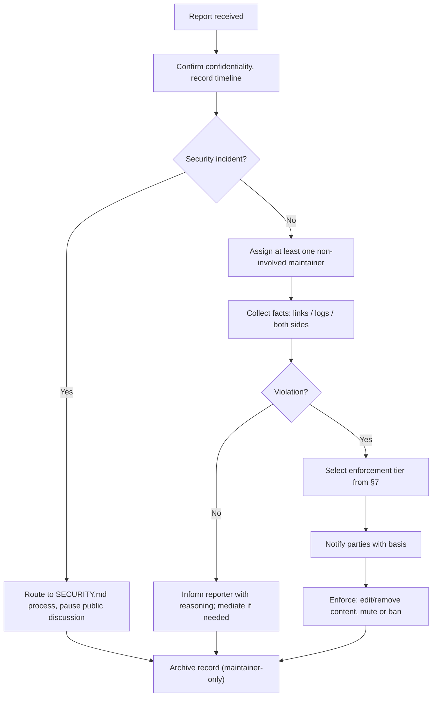

# Novus OS Code of Conduct

> Version: v1.0 (2026-11-27)
> Applies to: all project spaces (issues, PRs, code review, discussions, commit messages, docs, and public representation)
> 中文版本：[../CODE_OF_CONDUCT.md](../CODE_OF_CONDUCT.md) · [Index](INDEX.md)

## Contents

1. [Our pledge](#1-our-pledge)
2. [Scope](#2-scope)
3. [Our standards](#3-our-standards)
4. [Technical collaboration rules](#4-technical-collaboration-rules)
5. [Reporting](#5-reporting)
6. [Process](#6-process)
7. [Enforcement tiers](#7-enforcement-tiers)
8. [Maintainer responsibilities](#8-maintainer-responsibilities)
9. [Relationship to other rules](#9-relationship-to-other-rules)
10. [Attribution and license](#10-attribution-and-license)

---

## 1. Our pledge

We pledge that everyone participating in Novus OS — regardless of age, body size, visible or invisible disability, ethnicity, gender identity and expression, experience level, education, socio-economic status, nationality, appearance, race, religion, or sexual orientation — has a harassment-free experience.

We commit to behaving in ways that build an open, welcoming, diverse, inclusive and healthy community. We welcome differing viewpoints, but insist on **criticize ideas, not people**: you may strongly disagree with a design decision, but may not demean the person who proposed it.

Novus OS is a from-scratch, self-developed OS project. We especially value a culture of writing down design rationale, admitting unknowns, and honestly recording degradation and unfinished items. Using "the project is ambitious" to suppress legitimate questions, or "the spec is frozen" to refuse compatibility discussion, does not conform to this Code.

## 2. Scope

This Code applies to all project spaces and to individuals representing the project or community in public. Representation includes using an official email, posting via official social accounts, or serving as a designated representative at events.

It does not apply to unrelated private interactions; however, private conduct that harms community members or affects project collaboration may still be handled under this Code.

## 3. Our standards

### Expected behavior

- Use friendly, inclusive language; avoid judgments based on gender, race, region, education or experience.
- Respect differing views and experience: "I don't understand the rationale for this design" beats "this design is obviously wrong".
- Accept constructive feedback gracefully; "thanks for pointing that out, I'll fix it" needs no qualifier.
- Put community interest first: one PR per change, sync docs with code, list unexecuted checks honestly.
- Be patient with newcomers: explain "why" rather than just saying "read the spec".
- Give specific, actionable review feedback: paths, line numbers and improvement directions.

### Unacceptable behavior

- Sexualized language or imagery, and any form of sexual attention or hints.
- Personal attacks, insults or derogatory comments; attacks on political views.
- Harassment, stalking or threats, public or private.
- Publishing others' real names, addresses, emails, IM accounts or other personal information without explicit permission (doxxing).
- Derogatory labels or "people like you" phrasing in reviews, issues or commit messages.
- Dismissing contributions based on experience, education, institution or native language.
- Persistently ignoring reasonable requests (e.g. to stop a behavior or stop spamming unrelated issues).
- Deliberately harmful contributions: sabotage, backdoors, credential theft, leaking private keys or undisclosed vulnerabilities.
- Using the "self-developed" constraint as a weapon against others, or mocking the project for keeping it.

> Security issues must follow [SECURITY.md](SECURITY.md) private disclosure. Do not post reproducible attack payloads, private keys or seeds in public issues.

## 4. Technical collaboration rules

| Scenario | Expected | Non-compliant |
|---|---|---|
| ABI / frozen format changes | Open an Issue, give a compatibility statement, follow RFC and bump version | Silently change field offsets and dismiss review with "it works" |
| Doc/code conflicts | Submit an erratum stating which file is authoritative | Mock old docs, or force code to match outdated plans |
| Real hardware vs QEMU | State test environment and unexecuted items | Dismiss real-hardware observations with "QEMU passed" or vice versa |
| Unfinished features | Mark "not implemented / partial" | Present spec goals as implemented capability |
| Hardware compatibility reports | Give model, firmware and driver logs | Vague "that NIC just doesn't work" without logs |
| Code review | Concrete suggestions | Large unexplained rewrites; identity-based instead of technical arguments |
| Self-development boundary | Discuss licensing and alternatives in an Issue | Turn "no external dependencies" into a personal attack or belief test |
| Newcomer questions | Give a shortest reading path and runnable commands | Condescending "just read the README" |

**Disagreement order**: confirm facts (source/build logs) → confirm goals (frozen spec/security policy) → discuss solutions. If facts cannot be agreed, post both sides' evidence for third-party review rather than repeating positions.

## 5. Reporting

Contact maintainers via:

1. Prefer: explicitly request maintainer intervention in the relevant Issue/PR; if the person is involved, use another public channel or private contact.
2. Private report: use the hosting platform's private reporting or DM (contact details should be published in the repository; if not, request them in an issue without disclosing sensitive details).
3. Security incidents: follow [SECURITY.md](SECURITY.md), not a regular issue.

Include: what happened, timeline, location (issue/PR/chat), links or screenshots, and desired outcome. Reports are handled **confidentially**; reporter identity is not disclosed without consent.

> Do not use public shaming, doxxing or retaliatory commits to resolve problems — those are themselves unacceptable.

## 6. Process

- Investigators must not be involved in the incident.
- Give the reported party a chance to state their case, but do not replace factual judgment with "both sides are equally wrong".
- Act in reasonable time; temporary measures may precede full investigation.
- Minimize personal data; records are maintainer-only.

## 7. Enforcement tiers

| Tier | Applies to | Action |
|---|---|---|
| 1. Private correction | A single unintentional remark, mild off-topic or experience-based judgment | Private explanation and correction request; no public naming |
| 2. Public clarification | Public misunderstanding or factual error needing correction | Maintainer clarification; request correction or withdrawal |
| 3. Warning | Repeated inappropriate behavior, harassment signs, ignoring reasonable requests | Formal written warning; possible temporary restriction |
| 4. Temporary ban | Serious harassment, threats, personal attacks, malicious spam | Fixed-term ban from project spaces; conditions for reinstatement |
| 5. Permanent ban | Persistent/extreme harassment, threats, doxxing, malicious sabotage or security attacks | Permanent ban; notify platforms or authorities if needed |

Consider severity, repetition, targeting of vulnerable parties, impact on participation, and willingness to change. Tiers may be combined.

## 8. Maintainer responsibilities

- Maintainers clarify and enforce this Code fairly, consistently and promptly.
- They may delete, edit or reject contributions not conforming to this Code.
- Involved maintainers must recuse themselves; if all are involved, ask a trusted non-maintainer.
- Maintainers must not use authority for personal gain, suppress technical dissent or conceal their own violations.
- Records are kept minimally for consistency and appeal review.

**Appeal**: the sanctioned party may appeal through the same private channel, stating facts and reasons. Review is by a non-involved maintainer; repeated appeals without new evidence may be closed with explanation.

## 9. Relationship to other rules

- This Code governs **how people interact**; technical disputes follow the fact priority in [CONTRIBUTING.md](CONTRIBUTING.md) and [COMPATIBILITY.md](COMPATIBILITY.md).
- Technical disagreement is not a violation; using identity, emotional pressure or harassment to advance a technical position is.
- Security disclosures follow [SECURITY.md](SECURITY.md); do not disclose personal information or reproducible payloads there either.
- Code submission rules are in [CODESTYLE.md](CODESTYLE.md); formatting disputes are not Code violations, but refusal of review, malicious rewrites or personalization are.

## 10. Attribution and license

Based on the [Contributor Covenant](https://www.contributor-covenant.org/) framework, adapted to Novus OS with a project-specific technical collaboration section.

GPLv2 applies to the project; see `../LICENSE` and `../COPYING`. This Code text may be copied and adapted for other self-developed projects with project-specific clauses replaced.
