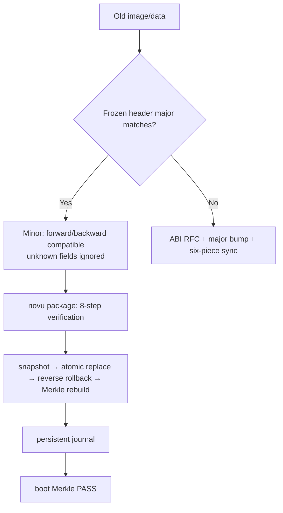
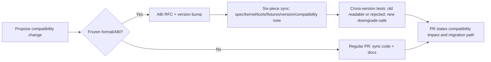

# Novus OS Compatibility Matrix

> Version v1.0 (2026-11-27)
> 中文版本：[../COMPATIBILITY.md](../COMPATIBILITY.md) · [Index](INDEX.md)
>
> Covers hardware, media, filesystem, binary/ABI, software ecosystem, toolchain and cross-version compatibility. "Not implemented" and "partial" are stated honestly — spec goals are not current capabilities.

## Contents

1. [Commitment and levels](#1-commitment-and-levels)
2. [Frozen format baseline](#2-frozen-format-baseline)
3. [Hardware compatibility](#3-hardware-compatibility)
4. [Media and image compatibility](#4-media-and-image-compatibility)
5. [Filesystem compatibility](#5-filesystem-compatibility)
6. [Binary and ABI compatibility](#6-binary-and-abi-compatibility)
7. [Software ecosystem compatibility](#7-software-ecosystem-compatibility)
8. [Toolchain and build environment](#8-toolchain-and-build-environment)
9. [Cross-version upgrade and data compatibility](#9-cross-version-upgrade-and-data-compatibility)
10. [Security compatibility boundary](#10-security-compatibility-boundary)
11. [Known incompatibilities](#11-known-incompatibilities)
12. [Validation matrix](#12-validation-matrix)
13. [Change process](#13-change-process)
14. [References and terms](#14-references-and-terms)

---

## 1. Commitment and levels

Official boundary ([SECURITY.md](SECURITY.md) §1): M0–M11 historical images get **no security backports**; physical hardware deployment has **no production security guarantee**; no commercial support/SLA.

| Level | Meaning |
|---|---|
| **Guaranteed compatible** | Frozen format, bidirectional compatibility within a major version, with static assertions + fixtures |
| **Conditionally compatible** | Main path works with explicit preconditions/degradation (hardware/config/resolution/backend) |
| **Partially compatible** | Subset implemented, rest explicitly rejected or diagnosed |
| **Not compatible** | No implementation, explicit refusal (`ENODEV`/`NOVUS_EINVAL`) |
| **Needs verification** | Docs conflict with each other or code — see ROADMAP §0.3 |

Fact priority: source/build > frozen specs > changes.md/CONTRIBUTING > README early plans > process docs.

## 2. Frozen format baseline

| Format/protocol | Frozen version | Key parameters | Change rule |
|---|---|---|---|
| Novus spec | V1.6-FinalSpec | 19 parts; Debug manual content V1.1 | Errata don't change offsets/major |
| NUC | V1.0 / `0x0100` | 48 B header, `NUC!`, major 1 | ABI RFC + major bump |
| NKM | V1.0 / major 1 | 208 B (`0xD0`), SHA-256+Ed25519 | Sync assertions/nkmgen/spec/docs |
| NUP | V1.0 frozen | 64 B header, `NUP!` | Extension bumps Version |
| INS | V1.0 frozen | INI-style UTF-8 `Version=1` | Extension bumps Version |
| Kernel IPC | `0x4E495043` | 32 B header, payload ≤128 B, queue 8, ports 16 | No private message/layout changes |
| Novus-WM IPC | code `0x00020000` (2.0) | v1.1 display list, v1.2 rounded, v1.3 modal, v2 surface | Add messages only |
| Debug interface | file V1.0 / content V1.1 | Frozen baseline | Parameter/error-code level frozen |
| Update patches | V1.0 | 128 B header, four magics, three patch types + `.novu`, five channels | Permanently frozen |
| rootfs layout | `rootfs_layout.h` truth | 78 directories | Sync all images/checks |
| Shared memory | NVSH v1.1 | 8 KiB @ `0x7E000` | Append only to `0x2F0` reserved tail |
| Syscalls | sparse frozen | 1–7, 8–15, 16–27, 28–37, 40/41, 60 | Append only |

### Current contract conflicts (must resolve before release)

| Conflict | Two sides | Handling |
|---|---|---|
| Update header length | kernel 128 B vs `novupkg` 144 B | Kernel frozen header wins; fix novupkg (P0-02) |
| rootfs dir count | header 78 vs fsinfo/check 77 | `rootfs_layout.h` wins (P0-04) |
| WM protocol | code `0x00020000` vs docs 1.0 | Code wins; erratum (P0-01) |
| Minimum RAM | README/defconfig 2 GiB vs CONTRIBUTING 4 GiB | 2 GiB boot refusal, 4 GiB working line |
| NUC stack | kernel 64 KiB–4 MiB vs cppcc README 64–256 KiB | Kernel wins |
| Win32 API count | early 15 vs M9 doc 141 | M9 doc wins (141) |

## 3. Hardware compatibility

### Platform

| Item | Requirement/status |
|---|---|
| Architecture | x86_64, UEFI PE32+ kernel (`efi_main`) |
| Firmware | UEFI, El Torito no-emulation boot; no CSM/Legacy BIOS |
| RAM | ≥2 GiB (lower refuses boot); LowMem 2–6 GiB; Full ≥6 GiB |
| Physical RAM limit | PMM 256 KiB bitmap, ~8 GiB |
| Secure Boot | Not implemented — no signed firmware chain |
| Multi-AP | A/B two cores only; SIPI failure degrades to single-core |

### Display and GPU

| Item | Status |
|---|---|
| GOP framebuffer | Guaranteed — captured before ExitBootServices; primary + up to 4 mirrored outputs |
| EDID | Conditional — preferred timing, digital/analog link; DP/eDP/HDMI not distinguished |
| VGA fallback | Guaranteed — character console when no framebuffer; splash skipped for >4 GiB framebuffer |
| Cache attributes | Fixed — all framebuffers `MM_MAP_UC` + `wbinvd` |
| Vsync | Partial — VGA `0x3DA` probe + bounded wait; no hardware flip/vblank; tearing not eliminated |
| 2D acceleration | Not compatible — vendor `intel_init()/amd_init()/nvidia_init()` all `ENODEV`; CPU only |
| Mini-DWM HW backend | Not compatible — `CONFIG_NOVUS_DWM_HW=n` |
| OpenGL/Vulkan/DX | Not compatible — README §11.3 is planning only |
| Multi-monitor | Partial — mirrored, not independent desktops |
| JPEG wallpaper | Partial — decoder has toolchain UB; gradient fallback |

### Storage controllers

| Controller | Status | Implemented | Missing |
|---|---|---|---|
| UEFI Block I/O | Guaranteed | `blkdev_t`, 512 B sectors to upper layers | 4Kn via bounce |
| AHCI | Conditional | Basic I/O, idle spin-down | NCQ, multi-slot, IRQ completion, `power_state` |
| NVMe | Conditional | Basic I/O, queue depth 4 | PRP list, deeper queues |
| IDE/ATA | Conditional | PIO | DMA; power query unavailable on QEMU |
| USB xHCI | Conditional | xHCI 1.1, BOT CBW/CSW, READ10/WRITE10 | UASP, hub, USB3 stream, hotplug, `power_state` |
| UHCI | Partial | HID boot protocol | High-speed/EHCI-only unsupported |
| ATAPI | Not compatible | — | Not implemented |

### NIC matrix (QEMU 10.0.13)

| Model | Status |
|---|---|
| `e1000`/`e1000e` | Guaranteed — 82540EM/82574L, DHCP/DNS/NCSI pass |
| `virtio-net-pci` | Guaranteed — legacy virtio; 1.0-only (`0x1041`) skipped |
| `rtl8139` | Guaranteed — CAPR must be read-pointer − 16 |
| `igb` (real 82576/82580/I350) | Conditional — QEMU never sets `STATUS.LU`, shows "not connected" |
| `vmxnet3`/`ne2k_pci`/`pcnet` | Not compatible |
| I225/I226 (igc), RTL8168/8125 | Not compatible |
| Wireless (AX200/210/211, MT7921/2) | Partial — enumeration/naming `wlanN` only; no firmware/802.11/WPA2 |

Network protocol compatibility: ARP/IP/UDP/gateway forwarding work; TCP is a **single-connection** client with no window scaling/options/congestion control, 1 s retransmit ×3; DNS single-transaction A query on fixed port 5353; RX via `net_tick()` polling, ≤8 frames/tick; no listener/concurrent connections.

### USB/input/peripherals

xHCI mass storage conditional (BOT, not UASP); USB HID guaranteed; touchpad conditional (I²C HID); PS/2 guaranteed; COM1 guaranteed (main debug output). Audio, camera, Bluetooth, WWAN — not compatible.

## 4. Media and image compatibility

| Format | Status | Constraints |
|---|---|---|
| `out/NOVUS.EFI` | Guaranteed | PE32+ subsystem 10, entry `efi_main` |
| ESP FAT16/32 | Guaranteed | `mkfat`, **8.3 names only**, 512 B sectors |
| ISO9660 | Guaranteed | `mkiso`, no Rock Ridge |
| Joliet | Guaranteed | Preferred; long names only here; non-ASCII shown as `?` |
| El Torito | Guaranteed | no-emulation EFI; 16-bit sector count ⇒ boot item **<32 MiB** |
| isohybrid | Guaranteed | Same image writable to USB |
| live ESP | Fixed | 31.5 MiB; installer template 16 MiB |
| `novus-disk.img` | Default 64 MiB | GPT + ESP + NovusFS |
| Windows host paths | Conditional | Use `subst` ASCII drive; `mkico.py` hardcodes Windows ImageMagick |
| `make install DEVICE=...` | Dangerous | Explicit DEVICE + manual `yes`; `dd` overwrites entire device |

Installer limits: no USB hub/UAS/hotplug/USB3 streams; disks with non-Novus partition tables refused; installed ESP lacks `ESP.IMG`; install mode does not start login/session.

## 5. Filesystem compatibility

| Backend | Status | Read | Write | Limits |
|---|---|---|---|---|
| NovusFS | Guaranteed (writable root) | yes | yes | Dual superblock, 64-block WAL, Merkle; frozen |
| FAT12/16/32 | Partial (RO) | yes | refused | 8.3 only, 512 B sectors, `FAT_MAX_NODES=128` |
| ISO9660/Joliet | Partial (RO) | yes | refused | Joliet preferred, non-ASCII `?` |
| ext4 | Partial | yes | read+mkfs+mount | htree write missing; journal replay/sparse/xattr/checksums later |
| NTFS | Not compatible | — | — | enum only, no backend |

VFS semantics: single root; 8 mount entries; no `..` traversal elimination; no `..` entries; `mounts.json` ≤4 KiB/≤8/whitelist; runtime `mount`/`umount` no write-back (protects Merkle). Not implemented: `seek`, `truncate`, unlink on some paths, owner/rwx permissions, cross-backend `rename`.

NovusFS frozen data: magic `NOVS`, version `0x00030000`, 4 KiB blocks, 1024 inodes × 128 B, 56 B names, 7 direct + single/double indirect; WAL 64 blocks CRC-32 + commit; Merkle 64 B SHA-256 nodes, 64/block, covering bitmap+inode+data (not WAL/self). Merkle excludes WAL/self; WAL replay is not a strict superblock-refresh gate — not full crash consistency/anti-rollback.

## 6. Binary and ABI compatibility

### Syscalls

1–7 yield/write/getpid/IPC; 8–15 file ops; 16–19 power/session/setup; 20–24 unlink/rename/mount/umount/mounts; 25–27 update/https/console; 28–37 DWM; 40/41 Win32/PE32; 60 exit. Convention: `rax` number, `rdi/rsi/rdx/r10` args, negative = error, user pointers copied page-wise. `write(2)` is serial log, not file write.

### NUC

48 B header, `NUC!`, ABI `0x0100`; ≤16 segments (only TEXT executable, rest NX); `R_X86_64_32`/`R_X86_64_PC32` only (type 3 reserved → `NOVUS_EINVAL`); stack header-clamped 64 KiB–4 MiB; entry `text.vaddr + entry_point`; unsigned; fixed boot-stage `APPS/DEMO.NUC` path. Generic exec unimplemented. W^X not fully enforced (non-TEXT pages still writable).

### NKM

`NKM!`, 208 B header, ABI major 1; SHA-256 with `[0x50,0xB0)` zeroed, Ed25519 over 32 B digest; segments 1–16, deps ≤8, symbols ≤64, relocations ≤256, modules ≤16, root keys ≤4; 64-bit absolute relocations only; load order bounds→digest→signature→dependencies→map→relocate→init; one dev key, no rotation.

### IPC/WM

IPC: 32 B header, magic `0x4E495043`, FNV-1a, payload ≤128 B, queue 8, ports 16, inbox = pid. WM `0x00020000`; v1.x requests `0x0101`–`0x0110`, v2 `0x0111`–`0x0116`, replies `0x0001`/`0x0002`, events `0x0201`–`0x0206`; 10 windows, 120 shapes/160 texts, 96 B text run, 24 B title; frame `CLEAR`→`SHAPE`/`TEXT`→`INVALIDATE`; modal flag `NWM_F_CREATE_MODAL=0x1`.

## 7. Software ecosystem compatibility

### cppcc C++ support matrix

| Target | Output | Stage |
|---|---|---|
| NUC V1.0 | `*.nuc` | Baseline, continuing |
| Windows x64 | PE32+ console | Phase 1 complete, **not real-hardware verified** |
| Linux x64 | ELF64 dynamic (glibc) | Phase 1 complete, hello/C++11 smoke executed locally |

Phase 0 (done): single-TU preprocessing, object macros, `#include`, `#pragma once`, conditionals; functions/globals/POD structs/enum/typedef/`static_assert`; basic types/pointers/1-D arrays/references/`auto`; expressions/control flow/range-for/aggregate init/`sizeof`/`nullptr`; builtins; SysV x86_64 codegen; ≤6 args.

Phase 1 (done): Rust API, C ABI static lib, target-independent object model, PE32+/ELF64 backends, old CLI compatibility.

Phase 2 (in progress): done — `-std=c++11` check, `using`, `enum class`, `static_assert`, range-for fixes, const pointer fix. Missing — multi-TU linking, trailing return, `constexpr`, class members/ctors/access control, inheritance/vtables, templates, full overload resolution, move semantics.

Phase 3 (planned): exceptions, RTTI, `new`/`delete`, float, standard headers/minimal runtime, full Win64 CRT/glibc PLT.

C++98 STL port: 122 libstdc++ imports, ~20 implemented, 85 `msvcrt.dll` missing; exceptions are macro-simulated single-context without nested propagation/`catch` type matching; `fstream` uses in-process staging table (not durable); `signal`/`atexit` placeholders.

### Nuomi

| Dimension | Host C (`user/Nuomi_pl/`) | Device (`apps/src/nuomi.rs`) |
|---|---|---|
| Runtime | With GC, `nuomi -c` NUC toolchain | `no_std`, heapless, libm-free, bump arena, no GC |
| JSON/HTTP/process/window primitives | Yes (HTTP/process partly Windows only) | **None** |
| Input | Supported | No `input`, `key` always `nil` |
| Math | Full | `sqrt` self-computed, `pow` integer exponent only |
| Advanced features | macros/modules/exceptions missing | Same |
| Escapes | `\r`/`\0`/`\xHH` missing | Same |
| Types | No dictionary, `{}`→`nil` | Same |
| Args | No varargs/default | Same |

Device limits: source 6 KiB, arena 256 KiB (128 KiB env reclaimable), depth 1500 (~500 calls), 24 args, 24 bindings, 64 literals, 1024 B format buffer; loops that repeatedly `cons` exhaust the arena.

### Win32 compatibility

Implemented (141 APIs per M9 doc): PE32+ x86-64 at `0x50000000`, DIR64 relocations, name-based IAT; console/tick/Sleep/error codes/command line/module base; registry R/W; heap/VirtualAlloc; user32 windows/messages/timers/coordinates/cursor/focus; gdi32 drawing/shapes, TEB/TLS, screen/font metrics, text layout incl. `DT_WORDBREAK`; file/dir enumeration; LoadLibrary/GetProcAddress; controls (STATIC/BUTTON/EDIT, WM_COMMAND, GetDlgItem), MessageBoxA, menus; resource APIs; version compatibility; ws2_32 handshake/address/error codes; per-process address space and ABI tag, `%fs` TEB; `/exe` virtual directory.

Not implemented: arbitrary-path disk EXE (images from embedded `build/win32_blobs.h`); 32-bit PE32 (`0x014C`) — loader recognizes and refuses; 16-bit COM/NE/LE; ordinal/delay imports, real DLL mapping from disk, PE TLS directory, multithreading, SEH; `DialogBox`/`DLGTEMPLATE`, `TrackPopupMenu`, `LoadMenuA` from resource templates, `&` menu underlines, child window procedures, `SendMessage` synchronous semantics; ws2_32 transport (returns `WSAENETDOWN`); `crypt32`, `comctl32`, `ole32`, `shell32`. Not a full sandbox: no full process isolation, safe DLL loading, exception handling, threads or file permissions.

Other: MicroPython roadmap only; Mochi submodule missing; `dir`/`copy`/`del` aliases off by default.

## 8. Toolchain and build environment

| Tool | Requirement |
|---|---|
| Cross toolchain | `x86_64-w64-mingw32-gcc`, `objcopy`; `make CROSS=<prefix>` |
| Rust | rustup + `x86_64-pc-windows-msvc` (kernel COFF) + `x86_64-unknown-none` (app blobs) |
| Host | `make`, `gcc`, Python 3, `xxd` |
| QEMU/OVMF | `qemu-system-x86_64`, `qemu-img`, OVMF_CODE/VARS; smoke 2 cores/3–4 GiB, VNC 127.0.0.1:5901 |
| Optional | socat, openssl, Pillow, Unifont hex, ibus Pinyin, PowerShell 7 |

Local CI: `make check` (syntax/drift/hygiene/cargo check), `make check-lint` (clippy/rustfmt baseline), `make smoke` (300 s bounded), `make pipeline`/`ci`. **No hosted CI** — state unexecuted checks in PRs.

Machine-specific scripts: `qtest.sh`, `scripts/build-all.sh`, `build-img.sh`, `rebuild-kernel.sh`, `tools/updatesrv/e2e-run.sh`, `run.sh`, `run-iso.sh`, `font_smoke.sh`, `wm-churn.sh`, `run-install-test.sh` contain `/home/dev/...` or fixed OVMF paths. Other limits: screenshot baselines need manual review; `check_rootfs.py:28` hardcodes count; `wm-churn.sh` uses fixed coordinates; `qtest.sh`/`rebuild-kernel.sh` swallow failures with `|| true`; headless `mouse_move` doesn't drive guest cursor and `sendkey` is unreliable.

## 9. Cross-version upgrade and data compatibility

NUC minor up/down compatible; major change incompatible (RFC + bump). NovusFS disk format frozen — don't move existing blocks. Update patches frozen. Failed updates: 3-retry state machine landed; blacklist/gray/scheduling unimplemented. Key rotation: NKM one dev key, no runtime rotation; update dev key hardcoded — replace before shipping. Downgrade not promised; M0–M11 images get no security backports. Runtime `mount`/`umount` do not write back `mounts.json` and are lost after reboot (intentional). Settings are not persisted.

## 10. Security compatibility boundary

| Capability | Status |
|---|---|
| NUC ring3 page isolation, user pointer checks | Implemented |
| NKM SHA-256+Ed25519 | Implemented; one dev key, no rotation |
| Update SHA-256+Ed25519 | Implemented |
| TLS chain + hostname check | Partial, not full WebPKI |
| NovusFS Merkle + WAL CRC | Implemented; not full anti-rollback/crash consistency |
| Mount whitelist, RO volume protection | Implemented |
| Win32 ABI whitelist | Implemented; prototype layer |
| CAP least privilege | **Spec goal, not implemented** |
| IPC port auth | No strong auth |
| Secure Boot / signed firmware chain | Not implemented |
| Runtime key import/rotation, cert revocation | Not implemented |
| Secure RNG / hardware TRNG | Not implemented |
| Gray rollout/scheduling/self-healing | Partially defined, not implemented |

TLS/WebPKI boundary: no CRL/OCSP revocation, name constraints, path length, full keyUsage; no client certs, HTTP/2, QUIC, 0-RTT; P-384/P-521 roots unavailable; only 66 of 160 roots supported; `SYS_HTTPS` hostname resolution is minimal. Cannot claim "can communicate with any public secure update service".

## 11. Known incompatibilities

| Class | Items |
|---|---|
| Hardware | Multi-AP SMP; hardware 2D / Mini-DWM HW backend; OpenGL/Vulkan/DX; hardware flip/vblank; independent multi-monitor |
| NICs | vmxnet3, ne2k_pci, pcnet, igc, r8168/8125, virtio 1.0-only; real wireless |
| Storage | AHCI NCQ/IRQ, NVMe PRP/deep queues, IDE DMA, USB UASP/hub/USB3, ATAPI, `power_state` |
| FS | NTFS backend; FAT/ISO writes; htree write; journal replay/sparse/xattr/checksums; `seek`/`truncate`/permissions; cross-backend rename |
| Execution | Generic `./app.nuc`; 32-bit PE32; 16-bit COM/NE/LE; disk DLL; ordinal/delay imports; PE TLS; threads/SEH |
| Languages | C++ classes/templates/exceptions/RTTI/new/float/STL/multi-TU; Nuomi macros/modules/exceptions and device JSON/HTTP/process/window primitives; MicroPython; Mochi |
| Security | CAP, Secure Boot, port auth, key rotation, TRNG, full WebPKI, Win32 sandbox |
| Update | Smart scheduling, gray rollout, blacklist, server reporting |
| Engineering | Hosted CI; `make menuconfig`; distributed font/IME sources |

## 12. Validation matrix

| Change | Minimum | Additional |
|---|---|---|
| Any | `make`, `check-rootfs` | List commands in PR |
| Kernel boot/scheduler/IRQ | + `irq-selftest.sh` | QEMU smoke, `irq-qemu-test.ps1` |
| FS/dirs/images | + `inspect_img.py out/novus.img` | `disk-img`, smoke, `font_smoke.sh` |
| GUI/themes/fonts/IME | full QEMU smoke | `wm-churn.sh 4G 20`, generators `--check`, screenshot review |
| Storage | `make iso` | `qtest.sh`, manual `[MOUNT]` |
| Installer | `make iso` | `run-install-test.sh 256`, `EN=1`, `FLOW=desktop` |
| NIC/network | `make` | Each `NOVUS_NIC=<model>` DHCP/DNS/NCSI |
| Update/TLS/CA | normal build | `updatesrv/selftest.py`, `novupkg selftest`, E2E |
| NKM/NUC/ABI | normal build | `nkmgen selftest`, `make nkm-test-module` |
| cppcc | `cargo test --manifest-path user/cppcc/Cargo.toml` | `make cppcc-demo` + `make run` serial markers |
| Nuomi | host reference + nsh | `test-linux.sh`, `tests/nuc/run-tests.py` |
| Cross-version data | old image boot + Merkle | update apply + rollback + journal recovery |

Assertions: static assertions in NKM (`nkm.c:49-66`) and mount struct (`vfs_mount.h:39`); generator `--check` clean; screenshot baselines missing/mismatch fails; ABI changes update six pieces.

## 13. Change process

Hard rules: never bypass NKM/update signature checks; explicit syscall length/bounds/user-pointer checks; no ISR sleep/alloc/log/protocol stack; no expanding mount whitelist/writing back mounts.json/making RO backends writable; Win32 whitelist is not process isolation; frozen format changes bump version + sync tools/assertions/fixtures/docs; errata state "offsets and major unchanged".

## 14. References and terms

Terms: ABI compatibility (binary interfaces interpretable across versions); forward compatibility (new data readable by current kernel, unknown fields ignored); backward compatibility (old data readable by new kernel); frozen format (fixed fields/semantics/version, RFC + major bump to change); degradation (WARN + continue, not panic); whitelist (allow-listed paths/APIs/ports, rest refused); partial compatibility (subset works, rest explicitly rejected and diagnosed).

Authoritative sources: README.md, SECURITY.md, CONTRIBUTING.md, changes.md, ROADMAP.md, ARCHITECTURE.md, `docs/NUC ... V1.0.md`, `docs/NKM ... V1.0.md`, `docs/Novus-WM 与 IPC 协议规范 V1.0.md`, `docs/C++11 支持矩阵.md`, `docs/M9 Win32 兼容层原型.md`, `docs/根目录结构与挂载规范.md`, `docs/存储驱动与HDD休眠-2026-11-18.md`.
