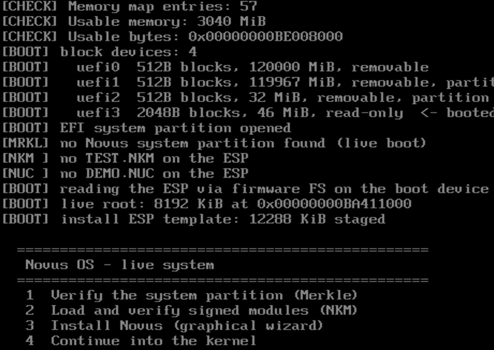
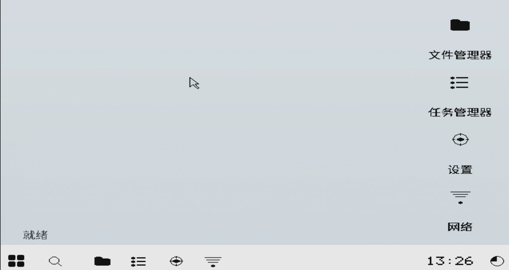
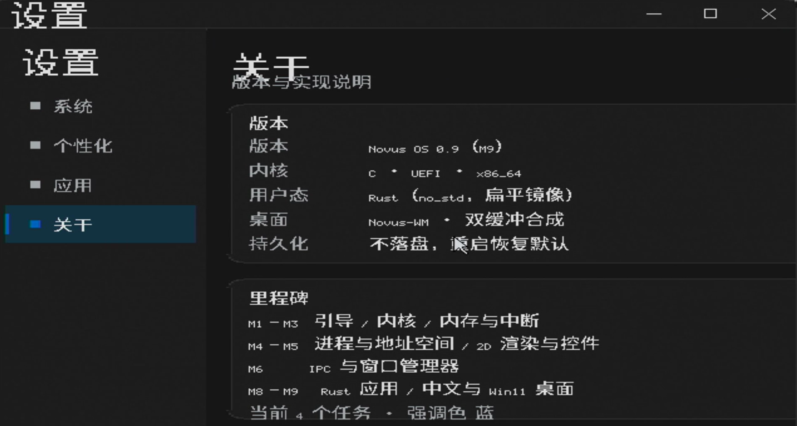
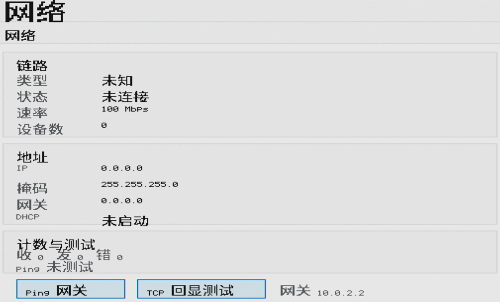
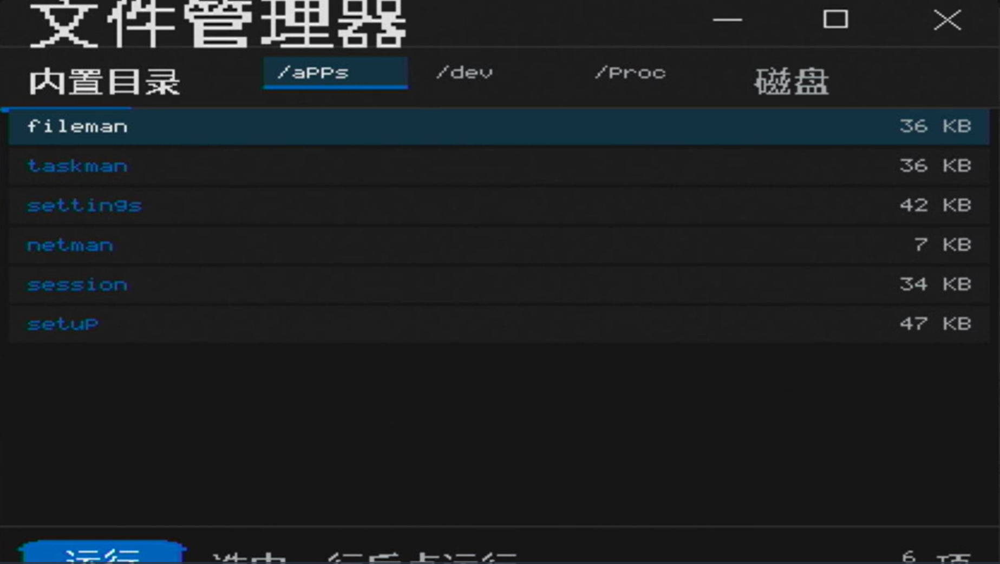
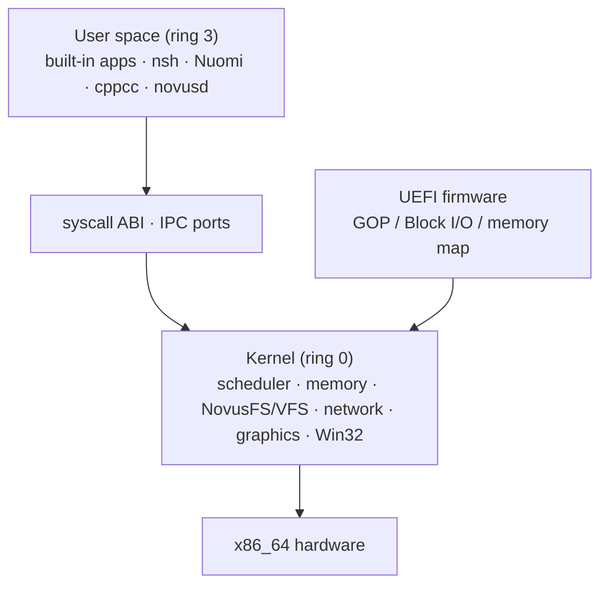

# Novus OS

**A from-scratch x86_64 UEFI desktop operating system.**

Kernel, filesystem, graphics stack, window manager, executable format, module signing and update system — all self-developed, with no external open-source dependencies. GPLv2.

<div align="center">

| [中文](../README.md) | [English](README.md) |
| :---: | :---: |
| Click to switch | **Current version** |

[All English docs](INDEX.md)

</div>

> Current baseline: **V1.6-FinalSpec (frozen release)** · Development stages M0–M12 rolled out, some capabilities still evolving
> Minimum 2 GiB RAM (4–8 GiB recommended) · Runs under QEMU/OVMF · See [ROADMAP.md](ROADMAP.md) for detailed status

---

## Why Novus OS

| Highlight | Description |
|---|---|
| **Fully self-developed, ring 0 to user space** | C kernel + Rust `no_std` built-in apps; preemptive scheduling, per-process page tables, frozen syscall ABI |
| **Its own filesystem** | NovusFS: write-ahead log (WAL), Merkle integrity tree, dual superblocks, fsck repair priorities |
| **Its own graphics stack** | NovusDisplay: UEFI GOP multi-output, offscreen compositing, full Unicode glyphs, Chinese Pinyin IME, Fluent themes |
| **Its own window protocol** | Novus-WM 2.0: window management, IPC messages, Mini-DWM surface redirection with zero-copy flip |
| **Its own executable format** | NUC: maps x86_64 native machine code into ring 3 — no virtual machine, no bytecode interpreter |
| **Signing & update system** | NKM kernel modules with Ed25519 signatures + novu tiered incremental updates (full/hotfix/NPA/app patches) |
| **Compatibility layer prototype** | Win32 PE32+ loader with 141 APIs and simulated registry; runs self-contained Windows samples |
| **Developer-friendly** | Three extension templates (GUI app / shell command / Nuomi script); 2–4 edits to plug in |

---

## Screenshots

| Boot | Desktop |
|---|---|
|  |  |

| Settings | Network Manager |
|---|---|
|  |  |

| File Manager |
|---|
|  |

---

## Quick Start

```sh
# Dependencies (Ubuntu/Debian)
sudo apt install -y build-essential gcc-mingw-w64-x86-64 g++-mingw-w64-x86-64 \
  binutils-mingw-w64-x86-64 mingw-w64 qemu-system-x86 ovmf python3 xxd
rustup target add x86_64-pc-windows-msvc
rustup target add x86_64-unknown-none

# Build and boot
make
make run
```

A successful boot prints `[ND] demo desktop painted` and `[HALT] entering the scheduler`.
Full setup, target list and troubleshooting: [BUILD.md](BUILD.md).

---

## Documentation Map

| I want to… | Go here |
|---|---|
| Understand layering and data flow | [ARCHITECTURE.md](ARCHITECTURE.md) |
| Know what is done and what is not | [ROADMAP.md](ROADMAP.md) |
| Look up a term, abbreviation or module name | [GLOSSARY.md](GLOSSARY.md) |
| Check the implemented ABI | [ABI.md](ABI.md) |
| Check hardware / format / language compatibility | [COMPATIBILITY.md](COMPATIBILITY.md) |
| Write a closed-source device driver | [DRIVER-LICENSE.md](DRIVER-LICENSE.md) |
| Check version history and highlighted **ABI BREAKs** | [CHANGELOG.md](CHANGELOG.md) |
| Learn building, packaging, running and testing | [BUILD.md](BUILD.md) |
| Start contributing | [CONTRIBUTING.md](CONTRIBUTING.md) |
| Check C/Rust coding style | [CODESTYLE.md](CODESTYLE.md) |
| Read the community code of conduct | [CODE_OF_CONDUCT.md](CODE_OF_CONDUCT.md) |
| Report a security issue / read security boundaries | [SECURITY.md](SECURITY.md) |
| Read frozen format specifications | [../](../) (Chinese originals) |

> **New contributor path**: GLOSSARY → ARCHITECTURE → BUILD → CONTRIBUTING.

---

## Status at a Glance

| Milestone | Theme | Status |
|---|---|---|
| M0–M6 | Boot, memory, filesystem, Merkle, scheduler, graphics, IPC/WM | Completed |
| M7 | cppcc C++ subset compiler | Base complete, C++11 core work in progress |
| M8 | Built-in system apps (files/tasks/settings/network/session/terminal) | Completed |
| M9 | Win32 compatibility prototype + Win11 Chinese desktop | Prototype complete |
| M10 | Fluent theme + graphical installer | Implemented |
| M11 | Multilingual, session split, USB/display I/O | Phase 1 complete |
| M12 | Device manager + Mini-DWM | Implemented |

**Important boundaries** (see [ROADMAP.md](ROADMAP.md) §4 and [SECURITY.md](SECURITY.md) §5):

- Not Secure Boot; CAP least-privilege, strong IPC port authentication and hardware TRNG remain specification goals.
- Single TCP session, single-transaction DNS, WiFi detection only; no hardware 2D, no vblank interrupt.
- Generic `./app.nuc` exec is not implemented; only the boot-stage fixed demo path exists.

---

## Architecture at a Glance



Full layering, boot order, data flow and image structure: [ARCHITECTURE.md](ARCHITECTURE.md).

---

## Design Principles

1. **Self-developed only**: no external open-source kernels/libraries (embedded Unifont glyph data is a documented exception).
2. **Unidirectional dependencies**: decoupled modules, no cycles; clear driver and protocol layers.
3. **Frozen ABI**: NUC/NKM/NUP/INS/IPC field layouts and versions are frozen, backward compatible within a major version.
4. **Graceful degradation**: user bugs must not crash the kernel; minor errors log WARN and continue rather than panic.
5. **Honest documentation**: unfinished items, known limits and doc/code conflicts must be written down — never present a specification goal as implemented capability.

---

## Directory Layout

```text
arch/x86_64/   UEFI entry, boot stages, AP trampoline, assembly stubs
kernel/        scheduler, syscalls, memory, drivers, network, Win32/PE, installer
fs/            VFS, NovusFS, FAT, ISO9660, ext4
security/      NKM signing, TLS, update verification, CA bundle
graphics/      NovusDisplay, widgets, desktop, fonts, themes, IME
wm/novus-wm/   window manager and protocol server
apps/          Rust no_std built-in apps, nsh, Nuomi
user/          Nuomi_pl, cppcc, win32compat, novusd
tools/         host-side image/package/signing/generator tools
scripts/       self-tests, QEMU tests, image checks, local CI
docs/          design and frozen format specifications
```

There is no `system/`, `drivers/` or `user/shell/` directory — those were early plans. See [CONTRIBUTING.md](CONTRIBUTING.md) §1.2 for the real layout.

---

## Contributing

- Start with [CONTRIBUTING.md](CONTRIBUTING.md): environment, validation matrix and PR rules.
- Newcomers can start from the three paths in `templates/` without reading the kernel first.
- Coding style: [CODESTYLE.md](CODESTYLE.md); community rules: [CODE_OF_CONDUCT.md](CODE_OF_CONDUCT.md).
- **Do not** post security issue details publicly — report privately per [SECURITY.md](SECURITY.md).

---

## License

GPLv2. Contributors retain copyright; all modified source must be distributed under the project terms. See `../LICENSE` and `../COPYING`.

Third parties may distribute **closed-source device drivers** under an additional permission granted per GPLv2 §10. Conditions: [DRIVER-LICENSE.md](DRIVER-LICENSE.md) — drivers still require signatures and must only use frozen ABIs.
