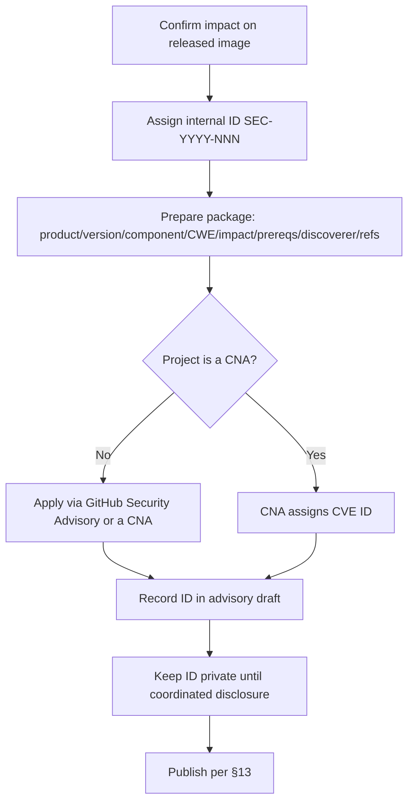

# Novus OS Security Policy

> Version: v1.0 (2026-11-27, expanded)
> 中文版本：[../SECURITY.md](../SECURITY.md) · [Index](INDEX.md)
>
> Describes security boundaries, known limits, vulnerability reporting and mandatory rules. Paired with [CONTRIBUTING.md](CONTRIBUTING.md). Source and frozen specs win over text.

## Contents

1. [Support scope](#1-support-scope)
2. [Reporting vulnerabilities](#2-reporting-vulnerabilities)
3. [Security model and trust boundaries](#3-security-model-and-trust-boundaries)
4. [Cryptography, keys and updates](#4-cryptography-keys-and-updates)
5. [Implemented vs spec goals](#5-implemented-vs-spec-goals)
6. [Contributor security rules](#6-contributor-security-rules)
7. [Security validation](#7-security-validation)
8. [Open source license](#8-open-source-license)
9. [PGP key and encrypted communication](#9-pgp-key-and-encrypted-communication)
10. [Vulnerability severity](#10-vulnerability-severity)
11. [Security response SLA](#11-security-response-sla)
12. [CVE process](#12-cve-process)
13. [Public disclosure policy](#13-public-disclosure-policy)
14. [No public 0day exploitation](#14-no-public-0day-exploitation)
15. [Final notes](#15-final-notes)

---

## 1. Support scope

| Object | Status |
|---|---|
| Current main branch / V1.6-FinalSpec | Current baseline; security issues fixed by priority |
| M0–M11 historical milestone images | Historical reference only; no security backports guaranteed |
| Custom branches, external images, private signing keys | Out of scope |
| Physical hardware deployment | Project validates mainly on QEMU/UEFI; no production security guarantee |

Experimental OS — no commercial support, no bug bounty, no **contractual** SLA. However the project has **internal response targets** (§11): first response, confirmation and fix targets by severity for privately reported issues meeting reproduction requirements. Not a legal promise.

---

## 2. Reporting vulnerabilities

**Do not post vulnerability details, usable PoCs, private keys or seeds in public issues, PRs, `changes.md` or discussions.**

Use the platform's private vulnerability reporting / Security Advisory if available. Otherwise open an issue with **no technical details** titled e.g. "Request for private security contact", and wait for private contact info.

Include when possible: affected commit/image version and build command; subsystem (`kernel/`, `security/nkm`, `security/novu`, `security/tls`, `fs/`, IPC/WM, update service); prerequisites (Ring 0, local user, specific image, QEMU config, network position); impact (privilege escalation, OOB read/write, signature bypass, info leak, DoS); reproduction steps/serial logs/screenshots (PoC via private channel only); suggested fix or code location.

Maintainers confirm, assess, coordinate a fix; avoid public details until a fix or mitigation is released. After release, credit is possible in PR/changes.md, but never disclose privately provided attack material.

Follow-up rules: [§9 PGP](#9-pgp-key-and-encrypted-communication), [§10 severity](#10-vulnerability-severity), [§11 SLA](#11-security-response-sla), [§12 CVE](#12-cve-process), [§13 disclosure](#13-public-disclosure-policy), [§14 0day ban](#14-no-public-0day-exploitation).

---

## 3. Security model and trust boundaries

### 3.1 Boot and integrity

1. UEFI entry initializes serial/console and block devices, checks ≥2 GiB RAM.
2. A core validates system files during early self-check; tampering stops boot.
3. NovusFS uses dual superblocks, CRC-32 and Merkle tree.
4. WAL records carry CRC; only committed transactions are replayed, then Merkle root is recomputed and compared with superblock.

**This is not Secure Boot**: no signed firmware chain, no UEFI Secure Boot integration, no defense against firmware-level or already-Ring-0 attackers.

Merkle does not cover the WAL area or Merkle area itself; superblocks rely on dual copies and CRC, not Merkle leaves. WAL replay is not a strict gate for superblock refresh — do not call this complete crash consistency or anti-rollback.

### 3.2 Ring 0 / Ring 3 isolation

- Built-in apps are Rust `no_std` flat NUC images in ring 3 with independent CR3/page tables.
- NUC is unsigned; isolation relies on page tables and syscall boundary.
- One syscall table: `kernel/trap.c:g_syscalls[]`, sparse and frozen.
- User pointers are never dereferenced directly: `user_read_byte()`/`user_copy()` check ranges, translate under task CR3 and verify user access rights.
- Paths ≤256 B, I/O ≤4096 B; unknown syscalls return error and log, never silently succeed.
- NUC entry, segments, relocations and permission bits are boundary-checked; only TEXT executable, rest NX.
- User stack limited 64 KiB–4 MiB; stack overflow must fail, never fall back to kernel addresses.

### 3.3 IPC, windows and GUI

IPC/WM are functional protocols, **not** a strong security boundary:

- IPC headers have magic, length and checksum; port table, queues and payloads have fixed limits.
- Port `"nwm"` uses a versioned protocol; display-list messages have length/count limits.
- No CAP-based port authorization; ordinary user space can call IPC syscalls.
- Clients must not pass kernel addresses, uninitialized lengths or out-of-protocol display items.
- Changing IPC/WM must keep layout, magic, version and length checks consistent.

### 3.4 Filesystem and mounts

- VFS has one syscall-visible root; mount table switches backends by prefix.
- `fs/novusfs/rootfs_layout.h` is the single truth source.
- Mount paths must match whitelist; table fixed at 8; `/` cannot unmount; cross-mount `rename` refused.
- FAT and ISO9660 are read-only; writes/deletes/renames must fail.
- `/.novusfs/mounts.json` is not written back at runtime (would break boot Merkle check).
- VFS does no `..` traversal elimination; directory implementations must not add special entries.

### 3.5 Win32 compatibility layer

Prototype, not a full sandbox:

- PE32+ mapped at `0x50000000`, DIR64 relocations, IAT filled by name.
- `TASK_ABI_WIN32` tasks allow only `SYS_WIN32(40)` and `SYS_EXIT(60)`; all other syscalls refused.
- `win32_syscall` re-checks task ABI type.
- Registry is simulated with a plain file.
- Full process isolation, DLL safe loading, exception handling, threads and file permission model are not implemented.

---

## 4. Cryptography, keys and updates

### 4.1 NKM kernel modules

Must be signed:

- SHA-256 over whole file with `[0x50,0xB0)` (32 B hash + 64 B sig) zeroed before digest.
- Ed25519 signs the 32-byte digest, not the whole file.
- Trusted public key compiled into kernel.
- Load order: bounds → digest → signature → dependencies → map → relocate → init.
- Offsets/lengths/ABI major fixed by `_Static_assert` and header checks.
- NUC is unsigned; NKM signatures do not replace Ring 3 isolation.

Forbidden: default-enabling `NKM_FLAG_ALLOW_UNSIGNED`; compiling test keys/modules into release images; changing only the signing tool or only the loader without updating spec/static assertions; generating "production" keys from fixed dev seeds; lowering check order, skipping dependencies or relaxing segment permissions to "fix" load failure.

> Currently one development key, no runtime import/rotation. "Admin session only" for `NKM_FLAG_ALLOW_UNSIGNED` is a spec goal — no full admin authentication exists; do not treat it as an implemented control.

> Closed-source drivers use the [DRIVER-LICENSE.md](DRIVER-LICENSE.md) exception but **are not exempt** from any requirement here: signing, bounds, load order and ABI version checks apply to all NKM modules. Closed source ≠ unchecked.

### 4.2 Updates and TLS

- Update packages verified for magic, version, UUID binding, ranges, SHA-256 and Ed25519 in user space.
- Dev signing root compiled in `security/novu/novu_verify.c`; packager `--key` is a dev/test seed, not production key management.
- TLS chain validation supports validity, `is_ca`, signature algorithm subset, root validity and hostname check; X.509 parses only necessary fields.
- Production roots from `tools/cabundle/roots.pem` → `security/novu/cabundle.c`; empty root set fails closed.
- E2E test anchor only generates `cabundle_e2e.c`, compiled only with `E2E=1`; production builds must never contain test anchors.
- Current TLS is not full WebPKI: no CRL/OCSP revocation, name constraints, path length, full keyUsage, client certs, HTTP/2, QUIC or 0-RTT.
- RNG is hash-DRBG seeded by caller; deterministic fallback when unseeded; kernel seeds from scheduler tick etc. Do not claim hardware entropy or high-entropy TRNG.

### 4.3 Test keys and private key rules

- `tools/updatesrv/*.key` assets are QEMU E2E only — never for production signing or OS images.
- `.gitignore` covers `private/*.pem|key|crt`, `tools/updatesrv/*.key`, `security/tls/*.key`, `user/ssl/*.key`; historical test private keys must not be copied or reused.
- `NKM_SEED`, `novupkg --key`, `nkmgen keygen` fixed seeds are for self-test/development only.
- Never print private keys, seeds or full private cert contents in docs/logs/serial/screenshots/PRs.
- Production CA changes require `tools/cabundle/import_roots.py --dry-run` review then offline generation; test CAs must not enter production `cabundle.c`.
- Suspected production key leak: stop using the key, rotate signing root and all signed modules/packages, regenerate affected images.

---

## 5. Implemented vs spec goals

| Item | Current status |
|---|---|
| NUC ring3 isolation, user pointer checks | Implemented |
| NKM SHA-256 + Ed25519 | Implemented; one dev key, no rotation |
| Update SHA-256 + Ed25519 | Implemented |
| TLS chain + hostname check | Partial, not full WebPKI |
| NovusFS Merkle + WAL CRC | Implemented; not full anti-rollback/crash consistency |
| Mount whitelist, read-only volume protection | Implemented |
| Win32 ABI whitelist | Implemented; layer still prototype |
| CAP least-privilege model | **Spec goal, not implemented** — do not rely on it |
| IPC port authorization | No strong auth |
| Secure Boot / signed firmware chain | Not implemented |
| Runtime key import/rotation, cert revocation | Not implemented |
| Secure RNG / hardware TRNG | Not implemented |
| Tiered rollout, scheduled update, self-healing | Partially defined; not implemented capabilities |

README and specs retain early target descriptions; file errata when conflicting — never relax implementation checks based on them.

---

## 6. Contributor security rules

1. Never bypass/downgrade/conditionalize NKM or update signature checks; debug switches must not enter default builds.
2. Syscalls must explicitly check length, bounds and user pointers; new calls sync `g_syscalls[]`, user headers and specs.
3. No sleep, allocation, logging or protocol-stack calls in interrupt context.
4. Do not expand mount whitelist, write back `mounts.json` or make read-only backends writable.
5. Do not treat the Win32 API whitelist as general process isolation.
6. Do not commit private keys, seeds, test roots into production CA set, or machine-specific absolute paths.
7. Frozen format changes (NUC/NKM/NUP/INS/IPC) require version bump + sync tools, static assertions, fixtures and docs.
8. Security fixes add regression tests first — verify "bad input rejected", not only happy path.
9. Never output kernel addresses, backtraces, key material or reproducible attack payloads in public logs.
10. New dependencies require license and supply-chain review; project stays self-developed.

---

## 7. Security validation

```sh
make
make check-rootfs
make nkm-test-module
build/tools/novupkg selftest
(cd tools/nkmgen && cargo run --quiet -- selftest)
python3 tools/updatesrv/selftest.py
bash scripts/display-selftest.sh
python3 -m unittest discover -s scripts -p qemu_smoke_test.py
make disk-img
bash scripts/qemu-smoke.sh
bash scripts/qemu-smoke.sh --no-root --output out/qemu-smoke-no-root
```

Update/TLS changes also run `bash tools/updatesrv/e2e-run.sh` then a plain `make` to confirm production (`E2E=0`) has no E2E anchors. All related `make` calls must consistently use `E2E=1` or none, to avoid mixed objects. Full matrix in [CONTRIBUTING.md](CONTRIBUTING.md) §4.

---

## 8. Open source license

GPLv2. Security fixes follow GPLv2 distribution; contributors retain copyright. See `../LICENSE`, `../COPYING`. Closed-source drivers may use the GPLv2 §10 additional permission in [DRIVER-LICENSE.md](DRIVER-LICENSE.md), still subject to signature and frozen ABI requirements.

---

## 9. PGP key and encrypted communication

> Mandatory OS project infrastructure: a verifiable security contact key.

### Current status (must be stated honestly)

**No official security email or PGP key has been published yet.** Until that changes:

- Do not email PoCs/exploits/sensitive logs to anyone claiming to be the security team.
- First use the platform's private vulnerability reporting, or a detail-free issue titled "Request for private security contact".
- Do not generate a "project key" yourself and claim it is official — only a maintainer-published/signed key is trustworthy.

### Mandatory publication locations once established

| Location | Content |
|---|---|
| §9.3 below | ASCII-armored public key |
| `security/pgp/` | `<keyid>.asc` — public key only, **never** private key |
| project release page/docs site (if any) | Fingerprint + download link (independent trust source) |
| release signing notes | Which artifacts this key signs — distinct from NKM/update signing keys |

### Public key info (to be filled)

| Field | Value |
|---|---|
| Purpose | Encrypt security reports / verify release artifacts |
| Contact email | To be published (prefer dedicated `security@`, not personal) |
| Algorithm | Prefer Ed25519 (`22`), or RSA 4096 |
| Fingerprint | To be published (full 40 hex digits, never short ID) |
| Creation/expiry | To be published (set expiry, rotate ahead of time) |
| Backup verification channel | To be published (≥2 independent channels) |

```text
-----BEGIN PGP PUBLIC KEY BLOCK-----

(To be published by maintainers; do not encrypt sensitive material to any
self-proclaimed official key before this is filled in.)

-----END PGP PUBLIC KEY BLOCK-----
```

Usage: verify fingerprint via independent channel before encrypting; maintainers should encrypt sensitive replies to the reporter's key; PGP report-encryption key, NKM signing key, update signing key and TLS CA are **four separate key sets**; when rotating, keep old keys in a history table marked "retired + date"; never commit private keys/passwords/seeds.

---

## 10. Vulnerability severity

Severity drives SLA. Attack prerequisites and conditions must be in the report.

| Level | Definition | Typical cases | Priority |
|---|---|---|---|
| **Critical** | Ring 0 from arbitrary user space without interaction, or bypass of signature trust chain | syscall user-pointer check bypass → arbitrary kernel R/W; NKM/update signature bypass; Merkle bypass written to disk; PE32 loader OOB mapping | Highest |
| **High** | Local user or specific config, but privilege escalation, cross-process OOB or persistence | NUC segment permission error → writable executable pages; IPC/WM identity forgery or cross-window drawing; VFS path escape beyond whitelist; Win32 ABI bypass | High |
| **Medium** | Info leak, limited DoS, strong prerequisites | kernel logs leak addresses/key material; IPC queue exhaustion stalls a window; NIC driver hangs on malformed packets; update state machine stuck | Medium |
| **Low** | Limited impact, physical/debug access, or theoretical | splash shows extra firmware logs; inconsistent error codes; doc/security mismatch without exploitable path | Low |

Modifiers: each additional prerequisite (Ring 0, physical access, specific QEMU NIC, installed system partition, network) may lower priority one tier; impact scope (all images > live only > specific hardware > debug builds); exploitability (reproducible steps > theoretical; in-the-wild evidence → highest, skip normal disclosure wait); multiple medium issues composing into a high impact are graded at the combined level.

**Boundary**: CAP, Secure Boot, IPC port auth and TRNG are **not implemented** (§5); grade reports against current implementation, not spec text.

Out of scope/downgraded: attacker already has Ring 0; issues only in historical images absent from main; custom branches/private keys/private images; mere build failures, typos or style issues (normal issue).

---

## 11. Security response SLA

Internal response targets, not commercial contracts; no bug bounty. Clock starts when a complete report per §2 is received.

| Level | First response | Confirm/grade | Fix or mitigation | Release/disclosure |
|---|---|---|---|---|
| **Critical** | ≤24 h | ≤72 h | ≤7 days | coordinated disclosure ≤30 days |
| **High** | ≤48 h | ≤7 days | ≤30 days | ≤60 days |
| **Medium** | ≤5 business days | ≤14 days | ≤90 days or next milestone | ≤90 days |
| **Low** | ≤10 business days | ≤30 days | no hard deadline, backlog | with regular release notes |

Clock rules: pauses when reproduction info is missing; resumes after reporter supplies it; if maintainers cannot reproduce they may pause and request logs/ images; key rotation/multi-format sync may justify extending the coordinated window with notice; in-the-wild exploitation voids SLA — go straight to emergency process with mitigation first and earlier disclosure; maintainers must report delays honestly, not go silent.

Temporary mitigations before a fix: disable config switches (e.g. `CONFIG_NOVUS_WIN32`), refuse a module class, tighten mount whitelist, temporarily disable network. Every mitigation must be recorded in `changes.md` with impact and must not become a permanent solution.

---

## 12. CVE process

### When to apply

Must apply if affecting a released image's security boundary (ring3 escape, signature bypass, integrity bypass), remotely triggerable, or requiring users to install/update third-party components. Development-branch-only issues absent from any released image need no CVE but must record why. One root cause = one CVE; independent root causes get separate IDs.

### Steps



Internal `SEC-YYYY-NNN` maps 1:1 to CVE IDs in a private ledger. CVE IDs stay private before coordinated disclosure — never in public issues, commits, changes.md or release notes. Application materials contain **no** exploit code, PoC, payload or key material — only impact-level technical description. CVE text is written by maintainers without directly reproducible details; discoverers may be credited after disclosure with consent. Rejected/pending IDs do not delay fixes.

GHSA: create a draft linked to the CVE when using private GitHub reporting. Public advisory includes CVE ID, affected/fixed versions, impact overview, mitigation, credit — no exploit details. `changes.md` says only "fixed security issue (CVE-XXXX-YYYY), see advisory", never root cause or trigger path.

---

## 13. Public disclosure policy

Default: **coordinated disclosure**.

1. Report via private channel; maintainers confirm and grade.
2. Agree a disclosure date within §11 tier limits.
3. Publish only after fix is merged, images rebuilt and verified.
4. Advisory includes CVE/GHSA ID, affected/fixed versions, impact overview, mitigation, credit and timeline.
5. After publication, discussion of fix approach is allowed, but no privately supplied exploit code/PoC/step-by-step attack tutorial.

Early disclosure exceptions: exploited in the wild; details already public; urgent user action needed (key rotation, stop using an image); reporter explicitly requests immediate disclosure and maintainers confirm no greater harm. Maintainer decides and records reasons; notify reporter where possible.

Allowed to publish: vulnerability class (e.g. "missing user-pointer check"), affected component/version, CWE, fix commit hash, mitigation config, credit. Forbidden: step-by-step reproduction, exploit code, PoC, payload, concrete offset/address combinations, key material/private keys/seeds, personal information.

```text
[ ] Fix merged and images rebuilt
[ ] All make calls consistent E2E flag; production image has no test anchors
[ ] Advisory contains no directly reproducible details
[ ] CVE/GHSA ID linked (or reason recorded)
[ ] Reporter notified, credit approach confirmed
[ ] changes.md states conclusion + link only, no root cause or trigger path
```

Maintainers keep a private timeline ledger (received, first response, grading, reproduction, fix, release, publication) for consistency and postmortems; no personal info is public.

---

## 14. No public 0day exploitation

> Red line. A 0day is an unfixed vulnerability; its exploitation material (exploit code, PoC, step-by-step trigger, usable payload) must never be published.

### Forbidden

- Publishing exploit code, PoCs, scripts or step-by-step reproduction for unfixed bugs in public issues, PRs, discussions, changes.md, docs, commit messages or release notes.
- Public "technical hints" with concrete offsets, addresses or syscall sequences even without full code.
- Using "academic research", "test only" or "already fixed so I can post it" to release details that have not completed §13.
- Selling/transferring/demonstrating unfixed exploit techniques, or demanding bug bounty or other benefit (the project offers no bounty).
- Using 0days for unauthorized testing against others' systems, CI environments, other contributors or hosting platforms.
- Retaliatory disclosure: publishing details or personal info due to dissatisfaction with enforcement.

### Correct behavior

- Submit full technical material including PoC only via §2's private channel; encrypt with §9's key when available.
- Public issues may say at most "found a security issue, requesting private contact" — no details beyond the subsystem.
- Wait for fix and coordinated disclosure before discussing; discussion focuses on the fix.
- If a 0day is already exploited in the wild, privately notify maintainers with evidence — do not forward the message or exploit tool.

### Enforcement

Violation is severe misconduct under [CODE_OF_CONDUCT.md](CODE_OF_CONDUCT.md): warning, temporary or permanent ban. Maintainers may immediately delete content, lock discussion and revert commits containing exploit code — deletion does not end the incident; the bug still must be fixed. Unauthorized access/malware distribution may be reported to platforms or authorities. Good-faith research is distinguished by private disclosure, limited scope and avoiding actual harm; the project welcomes the former and never shelters the latter.

---

## 15. Final notes

This document and added sections are maintained by maintainers; conflicts with a frozen format spec resolve in favor of the spec and current source, with a file errata. Response targets should be checked in postmortems; if repeatedly missed, either publish reasons or adjust targets — never silently relax them.
