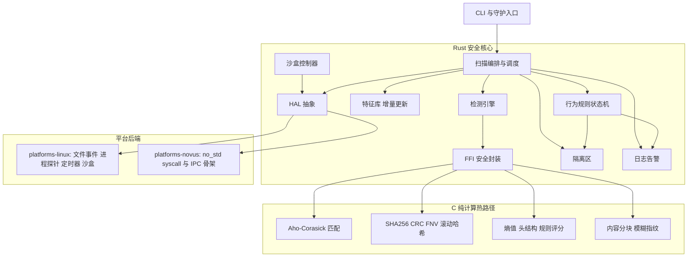

## 产品概述

一套面向类裸机部署的高性能安全防护守护程序，覆盖实时防护、按需扫描、定时扫描、恶意代码识别、变种识别、行为拦截、隔离执行、隔离区管理、日志告警与规则库增量更新。系统需支持能力降级：当底层事件采集、进程追踪或系统调用探针不可用时，自动退化为按需与定时扫描，并记录降级原因。

## 核心功能

- 实时、按需、定时三类扫描流程，支持优先级调度、资源限额与扫描结果汇总。
- 特征码、启发式规则、模糊哈希与内容分块结合的恶意软件检测，支持病毒变种同源识别。
- 特征库和规则库加载、校验、版本管理、增量更新、原子替换与回滚。
- 可疑程序隔离执行环境，并观察其进程、文件与系统调用行为。
- 三层行为监控与拦截：进程行为、文件行为、系统调用行为。
- 隔离区管理：可疑文件隔离、元数据保存、恢复、删除与容量控制。
- 结构化日志与告警：事件记录、严重级别、去重、限流与通知输出。
- 可复现构建、单元测试、集成测试与端到端样本验证流程。

## 技术栈选择

| 层次 | 选型 | 理由 |
| --- | --- | --- |
| C 层 | C11、固定缓冲、无动态分配语义的热路径代码 | 负责单遍匹配、哈希、启发式评分、模糊指纹等性能敏感计算；便于静态链接与移植到 freestanding 环境 |
| Rust 层 | Rust 1.99、core 采用 no_std 兼容写法，平台层可用 std | 负责安全封装、状态机、调度、策略、隔离区与模块编排；用类型系统约束 FFI 与资源生命周期 |
| WSL 构建 | x86_64-unknown-linux-gnu、glibc 全静态、gcc -static | 当前环境无 musl 工具链，glibc 静态 libc.a 已存在，离线可复现 |
| 平台后端 | platforms/linux 与 platforms/novus 两套可替换后端 | 核心零 Linux 依赖；WSL 上验证 Linux 后端，Novus OS 侧由用户后续人工合并 |
| 测试 | 自研极简 C harness、Rust 内置测试、脚本端到端测试 | 避免引入 cmocka、外部 crate 或系统服务依赖 |
| 发布形态 | 单一静态守护程序，可选 no_std 用户程序骨架 | WSL 可直接运行；Novus OS 侧满足 128 KiB blob、4 MiB 栈上限约束 |


## 实施策略

整体策略是“纯计算核心 + 安全编排核心 + 可替换平台 HAL”。C 核心只处理字节流和固定结构，不访问文件、进程、网络或内核接口；Rust 核心只做安全封装、策略与调度，不直接嵌入 Linux API；所有文件路径、事件源、时钟、进程、隔离与告警输出都通过 HAL 抽象注入。Linux 后端提供 fanotify/inotify、proc 扫描、可选 eBPF 与 ptrace、namespaces/seccomp 沙盒，并在能力不足时自动降级。Novus OS 后端只依赖其现有 syscall 与 IPC 能力，缺失能力以轮询、固定钩子或明确的未实现状态标注。

性能关键点：特征匹配采用 Aho-Corasick 单遍扫描，复杂度约为 O(扫描字节数 + 命中数)；模糊哈希采用滚动哈希与内容定义分块，复杂度约为 O(扫描字节数)；扫描任务采用分片队列与背压，实时事件高优先级，普通目录扫描低优先级。所有核心缓冲区固定容量，避免分配器依赖和长启动初始化。

## 架构设计



## C 与 Rust 职责边界

| 边界 | C 负责 | Rust 负责 |
| --- | --- | --- |
| 系统调用 | core 不调用；platform/linux 可调用 | core 不调用；通过 HAL 调用平台实现 |
| 样本解析 | 头部解析、熵值、字符串特征、哈希、AC 匹配、模糊指纹 | 规则解释、置信度融合、判定策略、结果聚合 |
| 内存 | 固定静态池与调用方提供的缓冲 | RAII 句柄、边界检查、生命周期约束 |
| 错误 | 返回 i32 错误码：0 成功、负值错误、正值计数 | 映射为内部错误枚举并记录上下文 |
| 并发 | 无共享可变状态，函数可重入但需外部同步 | 工作队列、背压、优先级、任务取消与限流 |
| FFI | 只暴露 C ABI 和定长结构 | 只通过 thin unsafe wrapper 调用，外部使用安全接口 |


FFI 约定：

- 跨边界结构全部为 `#[repr(C)]` 或等价 C struct，只含定长整数、指针和长度。
- 字符串统一为 UTF-8 字节缓冲，接口使用指针加长度，不传 C 字符串。
- 不透明句柄由 C 静态池创建，Rust 侧用 RAII 包裹；禁止跨层释放对方内存。
- 所有输入缓冲仅在调用期间有效；回调不得递归进入同一引擎实例，不得阻塞超过限定时间。
- 回调事件包含事件类型、进程号、对象标识、数据长度和数据指针，数据由平台后端保证生命周期。
- 所有公共 C 函数必须校验空指针、长度上限和容量上限。

关键接口骨架：

```c
typedef struct nd_engine nd_engine;

typedef struct nd_event {
    int32_t kind;
    int32_t pid;
    uint64_t object_id;
    uint32_t len;
    const uint8_t *data;
} nd_event;

typedef struct nd_scan_result {
    int32_t verdict;
    int32_t rule_id;
    uint64_t offset;
    uint32_t confidence;
    uint32_t reserved;
} nd_scan_result;

typedef int32_t (*nd_event_cb)(const nd_event *event, void *ctx);

int32_t nd_engine_create(nd_engine **out, const uint8_t *cfg, uint32_t cfg_len);
void nd_engine_destroy(nd_engine *engine);
int32_t nd_db_load(nd_engine *engine, const uint8_t *db, uint32_t db_len);
int32_t nd_scan_chunk(nd_engine *engine, const uint8_t *buf, uint32_t len, int is_last, nd_scan_result *out);
int32_t nd_fuzzy_digest(const uint8_t *buf, uint32_t len, uint8_t *out32);
int32_t nd_heuristic_score(const uint8_t *buf, uint32_t len, uint32_t *score);
int32_t nd_register_event_cb(nd_engine *engine, nd_event_cb cb, void *ctx);
```

HAL 关键契约以文本定义：文件系统提供打开、读取、写入、关闭、状态、目录遍历、创建、删除、重命名；事件源提供注册、拉取、能力状态与降级原因；进程控制提供进程标识、启动请求、结束请求与权限探测；时钟提供单调 tick 与定时器注册；沙盒提供创建、施加策略、运行、等待、读取日志、销毁；告警提供结构化事件写出。每个方法返回定长错误码或容量化结果，不使用动态集合类型。

## 模块划分

| 模块 | 输入 | 输出 | 依赖 | 测试策略 |
| --- | --- | --- | --- | --- |
| C 扫描热路径 | 字节块、规则表、长度与容量 | 命中偏移、规则号、启发式分数、模糊指纹 | 无系统依赖 | C 单元测试覆盖空输入、边界长度、重叠命中、超大输入裁剪 |
| Rust FFI 封装 | C 指针、长度、句柄 | 安全扫描接口、RAII 句柄、错误枚举 | C core | Rust 单测覆盖空指针模拟、错误码映射、生命周期释放 |
| 特征库管理 | 签名包、版本号、校验摘要 | 可查询特征库、更新结果、回滚状态 | SHA256、CRC、HAL 文件接口 | 正例库、损坏包、版本回退、缺字段、增量合并测试 |
| 检测引擎 | 样本字节、规则、配置 | 判定、置信度、分类、命中证据 | C 热路径、特征库 | EICAR 正例、良性负例、混淆样本、变种样本测试 |
| 扫描编排 | 路径、事件、定时任务 | 扫描任务、结果汇总、取消与限流 | HAL、检测引擎、隔离区、日志 | 并发顺序无关测试、背压测试、取消测试 |
| 行为监控 | 进程、文件、系统调用事件流 | 风险评分、拦截决策、告警事件 | HAL 事件源、规则状态机 | 事件序列回放测试、误报抑制、去重限流测试 |
| 沙盒控制器 | 可疑程序路径、策略、资源限额 | 隔离执行结果、行为日志、退出状态 | HAL 进程与沙盒接口 | 策略越权测试、超时测试、日志完整性测试 |
| 隔离区 | 命中文件、元数据、恢复请求 | 隔离记录、恢复文件、删除结果 | HAL 文件系统、日志 | 往返恢复一致性、权限保持、容量上限测试 |
| 日志告警 | 结构化事件、严重级别 | 日志持久化、通知输出、去重统计 | HAL 输出接口 | 事件不丢、限流、严重级别过滤测试 |
| 增量更新 | 更新包、当前版本 | 新库、原子替换、回滚点 | 特征库、HAL 文件接口 | 断流、校验失败、版本旧于当前、原子替换失败测试 |
| Linux 平台后端 | 内核事件、proc 信息、定时器 | HAL 统一事件与文件操作 | libc 与 Linux 接口，仅平台目录 | 能力探测、降级、fanotify 失败回退、沙盒权限不足测试 |
| Novus 平台骨架 | Novus syscall 与 IPC 能力 | no_std HAL 实现与构建约束 | 只读参考 Novus OS | 目标编译检查、体积检查、能力缺口清单评审 |
| CLI 与守护入口 | 命令参数、配置文件 | scan、monitor、quarantine、update、status、logs、sandbox 命令结果 | Rust 核心与平台层 | 命令解析、退出码、端到端样本流程测试 |


## 关键技术选型理由

- Aho-Corasick：适合大量固定特征单遍匹配，避免逐规则重复扫描，命中复杂度与命中数线性相关。
- 内容定义分块与模糊指纹：用固定容量指纹表达文件结构相似性，支撑变种识别，同时避免外部哈希库。
- 固定容量数据结构：兼容 Novus OS 无分配器约束，降低碎片化与启动开销，便于体积预算。
- HAL 分层：Linux 与 Novus 差异全部收敛到平台后端，Core 可以在两套环境中复用。
- glibc 全静态：当前 WSL 已具备静态 libc，避免联网安装 musl 工具链，保证离线复现。
- 零外部 crate：降低供应链风险、构建不确定性与 Novus OS 迁移成本。
- 自动降级：实时源、探针或沙盒能力不可用时，核心检测仍可用，并在日志中标注原因。

## 实施注意事项

- 核心目录不得出现 Linux 头文件、procfs 路径、fanotify、eBPF、ptrace、seccomp 或 pthread 引用；由脚本自动审计。
- C 热循环避免重复分配、重复建表和跨边界大结构拷贝；自动机在扫描会话开始前构建一次。
- 日志使用统一结构化事件，严重级别为 debug、info、warn、error、alert；告警去重按规则号、对象标识和时间窗口执行。
- 路径处理对用户态做长度、空组件、符号链接与重复根目录校验；Novus 侧遵循单根路径且禁止生成 `..` 语义。
- 更新包先校验版本、长度、CRC 与 HMAC-SHA256，再写临时文件、原子替换、失败回滚。
- 不修改 Novus OS 仓库；只在 platforms/novus 与文档中提供可手工合并到 user 目录的代码和说明。
- 静态构建后用 file 与 ldd 校验；Novus 构建后用尺寸脚本校验镜像小于 128 KiB。

## 目录结构

```text
NovusDefender/
├── CODEBUDDY.md                         # [保留] 现有项目蓝图，不改动
├── README.md                            # [新建] 项目总览、快速开始、命令示例、架构入口
├── Makefile                             # [新建] C 库、Rust 程序、静态链接、测试、lint、size-check 总入口
├── rust-toolchain.toml                  # [新建] 固定 Rust 1.99.1 与 gnu 目标
├── Cargo.toml                           # [新建] Rust workspace，成员包含 core、platform-api、linux、novus、cli
├── .gitignore                           # [新建] 忽略 build、out、target、临时样本
├── docs/
│   ├── ARCHITECTURE.md                  # [新建] 整体架构、数据流、并发模型、降级策略
│   ├── FFI.md                           # [新建] C ABI、所有权、错误码、回调约束
│   ├── HAL.md                           # [新建] HAL 方法、能力位、降级矩阵
│   ├── MODULES.md                       # [新建] 每个模块输入输出、依赖、测试策略
│   ├── ROADMAP.md                       # [新建] 六阶段路线图与本轮交付范围
│   ├── NOVUS_PORTING.md                 # [新建] 手工合并到 Novus OS user 目录的映射、限制和体积预算
│   └── TESTING.md                       # [新建] 测试分层、样本说明、端到端流程
├── c/
│   ├── core/
│   │   ├── include/
│   │   │   ├── nd_types.h               # [新建] 定长类型、错误码、verdict、能力常量
│   │   │   ├── nd_engine.h              # [新建] 引擎生命周期与数据库加载接口
│   │   │   ├── nd_scan.h                # [新建] 分块扫描与结果结构接口
│   │   │   ├── nd_hash.h                # [新建] SHA256、CRC32、FNV、滚动哈希接口
│   │   │   ├── nd_heuristic.h           # [新建] 熵值、头部结构、风险评分接口
│   │   │   └── nd_fuzzy.h               # [新建] 内容分块与模糊指纹接口
│   │   ├── src/
│   │   │   ├── ac.c                     # [新建] Aho-Corasick 自动机构建与单遍匹配
│   │   │   ├── scanner.c                # [新建] 分块扫描、重叠窗口、命中合并
│   │   │   ├── hash.c                   # [新建] 纯 C 摘要与校验实现
│   │   │   ├── heuristic.c              # [新建] 字节熵、可疑节区、脚本特征评分
│   │   │   ├── fuzzy.c                  # [新建] 滚动分块、指纹生成、相似度比较
│   │   │   ├── format.c                 # [新建] PE、ELF、脚本头部的平台无关解析
│   │   │   └── pool.c                   # [新建] 固定对象池与容量检查
│   │   └── tests/
│   │       ├── test_harness.h           # [新建] 极简断言与用例注册宏
│   │       ├── test_harness.c           # [新建] 用例执行、日志与退出码
│   │       ├── test_ac.c                # [新建] AC 匹配边界与重叠用例
│   │       ├── test_hash.c              # [新建] 已知摘要和 CRC 用例
│   │       ├── test_heuristic.c         # [新建] 熵值与头部评分用例
│   │       ├── test_fuzzy.c             # [新建] 变种相似度和阈值用例
│   │       ├── test_scanner.c           # [新建] 分块扫描与 EICAR 命中用例
│   │       └── eicar.inc                # [新建] EICAR 标准测试字节数组
│   └── platform/
│       ├── linux/
│       │   ├── include/
│       │   │   └── nd_linux_platform.h # [新建] Linux 后端内部接口与能力状态
│       │   └── src/
│       │       ├── platform.c           # [新建] HAL C 侧 glue 与条件编译入口
│       │       ├── fanotify.c           # [新建] fanotify 初始化、权限探测、失败降级
│       │       ├── inotify.c            # [新建] inotify 目录监控与事件规范化
│       │       ├── polling.c            # [新建] 无事件能力时的定时轮询扫描源
│       │       ├── procmon.c            # [新建] procfs 进程采样与进程事件映射
│       │       ├── ebpf_probe.c         # [新建] 可选 eBPF 加载失败安全降级
│       │       ├── ptrace_probe.c       # [新建] 可选 ptrace 追踪失败安全降级
│       │       ├── sandbox.c            # [新建] namespaces 与 seccomp 可用时隔离执行
│       │       └── timer.c              # [新建] 定时扫描触发与周期配置
│       └── novus/
│           └── src/
│               └── nd_novus_stub.c      # [新建] freestanding 可编译占位，等待手工合并
├── rust/
│   ├── nd-core/
│   │   ├── Cargo.toml                  # [新建] no_std 核心 crate 配置与测试特性
│   │   ├── build.rs                    # [新建] 调用本地 gcc/ar 构建 C 静态库
│   │   └── src/
│   │       ├── lib.rs                   # [新建] no_std 入口、模块声明、核心配置
│   │       ├── ffi.rs                   # [新建] extern C 声明、RAII 句柄、错误映射
│   │       ├── types.rs                 # [新建] verdict、事件、策略、结果定长结构
│   │       ├── signature.rs             # [新建] 签名库解析、查询与合并
│   │       ├── heuristic.rs             # [新建] 启发式规则评分与阈值策略
│   │       ├── fuzzy.rs                 # [新建] 模糊指纹封装与相似度判定
│   │       ├── detection.rs             # [新建] 多检测器融合、置信度与分类
│   │       ├── scanner.rs               # [新建] 单文件、目录、流式扫描流程
│   │       ├── scheduler.rs             # [新建] 固定容量任务队列、优先级与背压
│   │       ├── behavior.rs              # [新建] 三层行为事件状态机与拦截规则
│   │       ├── sandbox.rs               # [新建] 沙盒会话状态与结果解析
│   │       ├── quarantine.rs            # [新建] 隔离记录、恢复、删除与容量控制
│   │       ├── logging.rs               # [新建] 结构化事件、去重、限流
│   │       ├── update.rs                # [新建] 更新包校验、版本比较、回滚
│   │       ├── policy.rs                # [新建] 策略配置、能力开关、降级策略
│   │       └── util/
│   │           ├── fixedbuf.rs          # [新建] 固定容量缓冲与切片视图
│   │           ├── crc.rs               # [新建] CRC 辅助
│   │           ├── sha256.rs            # [新建] Rust 侧摘要辅助与更新校验
│   │           └── path.rs              # [新建] 路径规范化和安全校验
│   ├── nd-platform-api/
│   │   ├── Cargo.toml                  # [新建] HAL 抽象 crate
│   │   └── src/lib.rs                   # [新建] HAL trait、能力位、平台错误定义
│   ├── nd-platform-linux/
│   │   ├── Cargo.toml                  # [新建] std 平台后端 crate
│   │   └── src/
│   │       ├── lib.rs                   # [新建] Linux HAL 装配与能力探测
│   │       ├── fs.rs                    # [新建] 文件读取、写入、原子替换、目录遍历
│   │       ├── events.rs                # [新建] 文件事件接入与降级原因记录
│   │       ├── process.rs               # [新建] 进程采样、启动与结束封装
│   │       ├── syscall_probe.rs         # [新建] eBPF 与 ptrace 可用性封装
│   │       ├── sandbox.rs               # [新建] 沙盒后端 Rust 控制面
│   │       ├── timer.rs                 # [新建] 定时扫描任务
│   │       └── logging.rs               # [新建] 控制台与文件日志输出
│   ├── nd-platform-novus/
│   │   ├── Cargo.toml                  # [新建] no_std Novus 骨架 crate
│   │   └── src/
│   │       ├── lib.rs                   # [新建] Novus HAL 入口与能力声明
│   │       ├── syscalls.rs              # [新建] 已确认 syscall 编号包装
│   │       ├── fs.rs                    # [新建] 单根 VFS 读写与目录遍历
│   │       ├── ipc.rs                   # [新建] sysinfo 启动请求映射
│   │       ├── events.rs                # [新建] 轮询或钩子事件源骨架
│   │       ├── sandbox.rs               # [新建] 受信能力受限沙盒占位实现
│   │       └── app.rs                   # [新建] _start、panic、协作式调度入口骨架
│   ├── nd-cli/
│   │   ├── Cargo.toml                  # [新建] WSL 守护程序与 CLI crate
│   │   └── src/main.rs                  # [新建] scan、monitor、schedule、quarantine、update、status、logs、sandbox 命令
│   └── nd-tests/
│       ├── Cargo.toml                  # [新建] Rust 集成测试 crate
│       └── tests/
│           ├── detection.rs             # [新建] 检测、误报、变种测试
│           ├── update.rs                # [新建] 更新、校验、回滚测试
│           ├── quarantine.rs            # [新建] 隔离恢复一致性测试
│           └── e2e.rs                   # [新建] 端到端扫描流程测试
├── schemas/
│   ├── sigdb_v1.md                     # [新建] 特征库二进制格式说明
│   ├── update_v1.md                    # [新建] 增量包与回滚格式说明
│   └── event_v1.md                     # [新建] 结构化事件格式说明
├── tests/
│   ├── data/
│   │   ├── eicar.txt                   # [新建] EICAR 正例样本
│   │   ├── benign.txt                  # [新建] 良性负例样本
│   │   ├── variant_a.bin               # [新建] 变种对照样本
│   │   ├── sigdb_v1.bin                # [新建] 测试特征库
│   │   ├── update_v2.bin               # [新建] 合法增量包
│   │   └── corrupt_update.bin          # [新建] 损坏更新包
│   └── e2e/
│       ├── scan_flow.sh                # [新建] 样本扫描到隔离恢复端到端脚本
│       └── update_flow.sh              # [新建] 增量更新与回滚端到端脚本
└── scripts/
    ├── build-static.sh                 # [新建] glibc 全静态构建封装
    ├── test-all.sh                     # [新建] C、Rust、端到端统一测试入口
    ├── check-static.sh                 # [新建] file 与 ldd 静态链接校验
    ├── check-core-purity.sh            # [新建] core 平台依赖审计
    ├── size-check.sh                   # [新建] Novus 目标镜像体积检查
    └── env.sh                          # [新建] RUSTUP_HOME、CARGO_HOME 与工具路径设置
```

## 实施路线图

1. 骨架与契约：建立 workspace、构建脚本、C 静态库、FFI、HAL、日志与基础测试，完成空扫描流程。
2. 检测核心：实现 AC 匹配、哈希、启发式、模糊指纹、特征库加载与 EICAR 正例验证。
3. 扫描与更新：实现按需、定时、实时事件接入、优先级调度、增量更新、校验与回滚。
4. 行为与沙盒：实现行为事件状态机、三层拦截决策、沙盒控制器与 Linux 后端能力探测降级。
5. 隔离与告警：实现隔离区、恢复删除、结构化日志、告警去重限流和 CLI 管理命令。
6. 验证与迁移：完成统一测试、静态校验、端到端流程、Novus OS 骨架、能力缺口清单与体积预算。

## Novus OS 迁移映射

| HAL 能力 | Novus OS 可用基础 | 适配方式 |
| --- | --- | --- |
| 文件读写 | syscall 8、9、10、11、12 | 按 stat 取大小后固定缓冲循环读取，写入使用 fwrite |
| 目录遍历 | syscall 13、14 | opendir 后循环 readdir，遇到结束标记停止 |
| 隔离文件 | syscall 20、21 | 同目录 rename 优先，失败时复制到隔离目录并删除原文件 |
| 创建目录 | syscall 15 | 初始化隔离区、日志目录与状态目录 |
| 进程启动 | sysinfo IPC SPAWN 与 SPAWN_NAME | 沙盒控制器发起启动请求，记录返回状态 |
| 日志 | syscall 2 与 syscall 10 | 控制台写入与文件写入双通道，默认限流 |
| 定时器 | 无专用 syscall | 协作式 tick 与 yield 轮询，生产环境可后续扩展内核定时器 |
| 实时文件事件 | 无事件通知 | HAL 标注不支持，退化为定时轮询扫描 |
| 系统调用追踪 | 无通用探针 | 仅保留行为事件接口与规则状态机，等待 OS 侧钩子 |
| 沙盒隔离 | 有 Win32 ABI 限制雏形与 PID 能力模型 | 先实现策略状态与受限能力声明，具体隔离依赖后续 OS 接口 |


体积预算：Novus 用户程序镜像目标小于 128 KiB，栈上限小于 4 MiB；核心采用固定表、固定队列、压缩签名格式、关闭调试符号、panic=abort、opt-level=s、lto、单代码生成单元。因 Novus OS 用户程序没有分配器，所有 Rust 核心与 C 核心接口只接受调用方提供的定长缓冲。

## Agent Extensions

### SubAgent

- **code-explorer**
- Purpose: 在实现前复核本仓库与只读 Novus OS 的 HAL 契约、syscall 边界、构建约束和平台依赖分布。
- Expected outcome: 产出精确的映射清单、禁止依赖清单与迁移注意事项，避免把 Linux 专属能力渗入核心，并保证不修改 Novus OS 仓库。