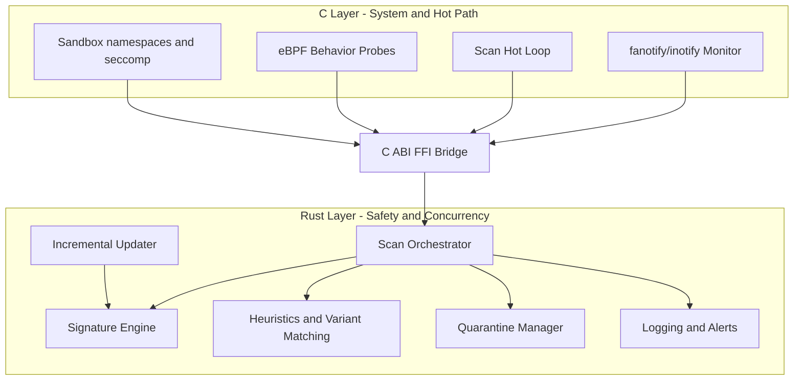

## User Requirements

- 执行 `/init` 命令生成本仓库的 CodeBuddy 指引。经只读探查确认：工作区为空，且不存在 `AGENTS.md`、`CODEBUDDY.md`、`CLAUDE.md`、`README.md` 及任何 Cursor/Copilot 规则文件，因此按命令规则新建一个 `CODEBUDDY.md`（而非给出改进建议）。
- 文件必须以如下文本开头：`# CODEBUDDY.md This file provides guidance to CodeBuddy when working with code in this repository.`
- 文件需包含常用命令章节（构建、lint、测试、运行单个测试），每条命令描述不超过 100 词。
- 文件需包含高层架构章节，不超过 1600 词，聚焦需要读多个文件才能理解的“大图”架构。
- 必须把用户列出的全部设计产出完整纳入文件：整体架构设计、模块划分、C/Rust 职责边界与接口（FFI）约定、关键技术选型理由、分阶段实现路线图，以及每个模块的输入/输出、依赖关系与测试策略。
- 遵守约束：不重复、不写显而易见的通用建议、不罗列易发现的文件结构、不编造仓库中不存在的文件事实。

## Product Overview

- 交付物是一份 `CODEBUDDY.md` 指引文档，面向未来的 CodeBuddy Agent，描述一套面向 WSL Linux、接近裸机部署（静态链接、无重型运行时依赖）、能力对标 360 与卡巴斯基的高性能混合语言杀毒软件。
- 本次仅产出该文档，不创建源码或构建脚本；文档中的命令与架构均为该规划项目的权威说明。

## Core Features

- 命令章节：可复现的 WSL 构建、lint、全量测试与单测运行命令。
- 架构章节：整体架构、模块划分、C/Rust 职责边界与 FFI 约定、技术选型理由、分阶段路线图、各模块输入/输出/依赖/测试策略。
- 合规校验：固定开头前缀、命令与架构字数上限、无泛泛内容与虚构信息。

## Tech Stack Selection

- 交付物形态：仓库根目录单个 Markdown 文件 `CODEBUDDY.md`。
- 文档所描述的项目技术栈：C11 负责内核接口与性能热路径（fanotify/inotify、ptrace、seccomp、eBPF、原始系统调用、扫描热循环）；Rust 2021 负责安全解析、并发编排与状态管理；两者通过 C ABI FFI 桥接；musl 静态链接；Makefile（C）配合 Cargo（Rust）；目标平台 WSL Debian Linux。

## Implementation Approach

- 一次性编写 `CODEBUDDY.md`，分两大区块：常用命令区、架构区。由于仓库为空、无既有约定，架构内容完全来自用户显式需求，作为后续实现的权威蓝图。
- 关键决策：命令区给出面向“规划中项目”的可执行命令（make/cargo 及其 lint/test 变体），并说明单测运行方式；架构区用分层视角描述模块与数据流，避免逐文件罗列。
- 性能与可靠性：文档强调并发扫描、低资源占用、快速启动的设计意图，以及 FFI 层显式内存所有权与错误码约定，降低后续实现偏差。

## Implementation Notes

- 文件首行必须逐字为指定前缀，不得改写。
- 架构区严格控制在 1600 词以内，命令区每条描述不超过 100 词。
- 不编造仓库尚不存在的文件/API；对规划内容用“拟建/应实现”措辞，避免伪装成现状。
- 不包含通用开发建议或虚构章节（Common Development Tasks/Tips/Support）。

## Architecture Design

文档将呈现如下大图：C 层承担系统交互与热路径，Rust 层承担安全与并发，FFI 为边界；上层为扫描与检测引擎、特征库增量更新、沙盒、行为监控、隔离区、日志告警。



## Directory Structure

```
//wsl.localhost/Debian/home/dev/NovusDefender/
└── CODEBUDDY.md  # [NEW] 仓库根指引文件。开头为固定前缀；命令区给出构建/lint/全量测试/单测命令及说明；架构区描述整体架构、模块划分、C/Rust 职责与 FFI 约定、选型理由、分阶段路线图、各模块输入输出/依赖/测试策略；遵守字数与内容约束。
```