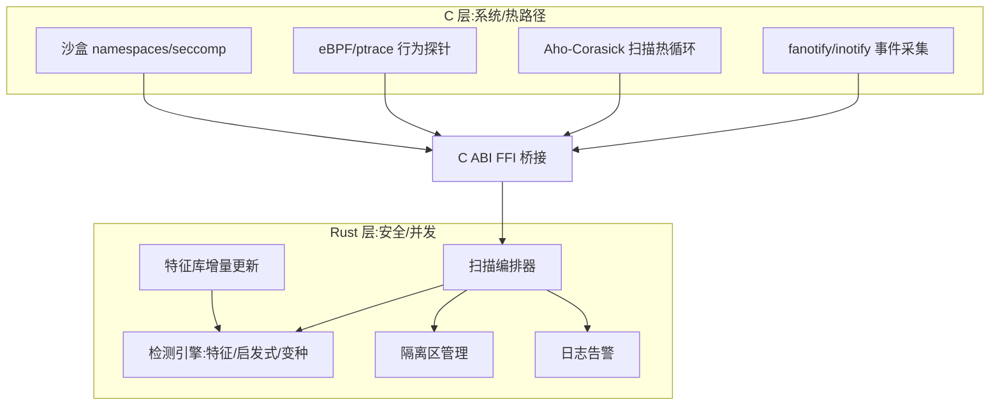

# CODEBUDDY.md This file provides guidance to CodeBuddy when working with code in this repository.

> 仓库当前为空。以下为项目的目标架构、职责边界与开发约定，是后续实现的权威蓝图；文中命令与模块均为拟建内容，实现时按此约定落地。目标：面向 WSL Debian、静态链接、无重型运行时依赖、能力对标主流商业杀软的高性能 C/Rust 混合引擎。

## 常用命令

### 构建
```bash
make BUILD=release                                        # 编译 C 层，产出静态库
cargo build --release --target x86_64-unknown-linux-musl  # 编译 Rust 层
make link                                                 # 静态链接为单文件守护进程
```
约定根目录 Makefile 驱动 C 层、Cargo 驱动 Rust 层，最终用 musl 静态链接成单一可执行文件。为可复现，应固定 Rust 工具链与编译/链接标志，并把 musl 目标作为唯一发布目标。

### Lint
```bash
make lint                    # clang-tidy 与 -Wall -Wextra -Werror
cargo clippy -- -D warnings
cargo fmt -- --check
```
C 侧严格告警并接 clang-tidy；Rust 侧 clippy 零警告、rustfmt 一致。FFI 边界用 cbindgen 保证头文件与 Rust 声明同步，防止 ABI 漂移。

### 测试（全量）
```bash
make test                    # C 层单元测试（cmocka）
cargo test --all             # Rust 单元与集成测试
make test-e2e                # 端到端：样本扫描 → 隔离 → 恢复
```
测试分三层：C 单测、Rust 单测/集成、无害样本端到端流程。CI 应在干净 WSL 环境从零构建后跑完全部测试，确保可复现。

### 单个测试
```bash
cargo test --lib signature::tests::exact_match -- --exact --nocapture
make test-one NAME=scan_hot_loop
```
Rust 用路径过滤并加 `--exact --nocapture`，C 用 `make test-one NAME=<case>`；两者均输出日志以定位扫描/检测逻辑。

## 架构

### 分层大图


C 管内核交互与热路径；Rust 解析样本、编排并发与状态。跨层只经 FFI：C 采集上送，Rust 决策下发拦截。

### C/Rust 职责边界与 FFI 约定
- 边界：C 管 fd/句柄/mmap 与底层循环；Rust 管特征库、调度状态、隔离区元数据与策略。Rust 不调 syscall，C 不解析样本。
- ABI：仅 C ABI；Rust 用 `extern "C"`+`#[no_mangle]`，跨边界结构用 `#[repr(C)]` 与定长整数，禁止 `String`/`Vec`/trait 越界。
- 所有权：不透明句柄由 Rust 分配，C 仅持指针；字符串用「指针+长度」UTF-8 缓冲，统一经 Rust 导出的 `*_free` 释放，严禁跨层 `free`。
- 错误与回调：返回 `i32`，`0` 成功、负值仿 errno、正值计数；事件由 C 注册的函数指针回调，标明线程与重入约束。

### 模块规格

| 模块(层) | 输入 | 输出 | 依赖 | 测试策略 |
|---|---|---|---|---|
| FM(C) 事件采集 | fanotify/inotify 事件 | 路径+事件回调 | FFI 回调注册 | 造增删改断言事件序列 |
| HS(C) 扫描热循环 | fd/缓冲 | 命中偏移与集合 | 检测引擎匹配表 | 吞吐基准；边界与超大文件 |
| BP(C) 行为探针 | eBPF/ptrace 事件 | 进程-文件-系统调用流 | seccomp 过滤器 | 白名单样本校验精度开销 |
| BX(C) 沙盒 | 可执行文件+策略 | 受限进程句柄与日志 | namespaces/seccomp | 越权访问应被拒并留痕 |
| OR(R) 扫描编排 | 路径/定时/实时请求 | 任务分派与汇总 | FM/HS、SE、QU、LG | 并发顺序无关性与背压 |
| SE(R) 检测引擎 | 字节流+特征/规则 | 判定、置信度、变种归类 | 特征库加载器 | EICAR 类样本测正例误报 |
| UP(R) 增量更新 | 签名包+版本 | 原子替换后的库 | SE、QU(校验回滚) | 断网/损坏包/版本回退 |
| QU(R) 隔离区 | 命中文件 | 隔离/恢复/删除结果 | BP 句柄、LG | 往返恢复一致性与权限 |
| LG(R) 日志告警 | 各模块事件 | 结构化日志与通知 | 全模块 | 事件不丢、告警去重 |

### 关键技术选型
- C11+直接 syscall：贴近内核、无 GC 停顿，适合 fanotify/eBPF 与热循环。
- Rust 2021：解析样本与特征库时内存安全；并发编排替代手写同步。
- musl 静态链接：近裸机部署，消除 glibc 依赖。
- Aho-Corasick：单遍匹配海量特征，保证吞吐。
- 内容定义分块+模糊哈希：支撑变种与同源识别。
- eBPF+seccomp/namespaces：低开销可观测与隔离。
- 并发：扫描分片并行，实时事件走高优先级，限额控资源。

### 分阶段路线图
1. 骨架与契约：构建系统、FFI 桥接、守护框架，跑通空扫描。
2. 扫描与特征检测：按需扫描、特征加载、精确匹配（EICAR 验证）。
3. 实时与更新：fanotify 实时、定时扫描、增量更新与回滚。
4. 启发式与变种：规则引擎、模糊哈希、置信度评级。
5. 沙盒与行为拦截：隔离执行、eBPF 采集、三层拦截。
6. 隔离区/告警与加固：隔离管理、日志告警、权限收敛。
