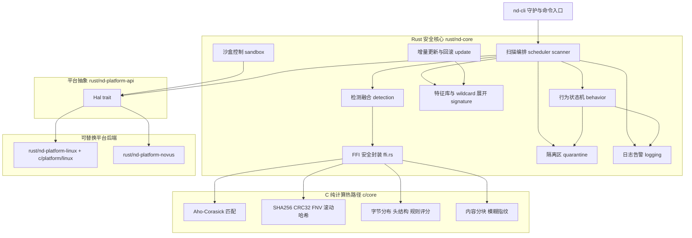

# 整体架构

## 设计目标

- 核心与操作系统解耦：检测算法、编排、策略、状态机不含平台 API。
- 类裸机部署：单一静态可执行文件；Novus OS 侧镜像小于 128 KiB、栈小于 4 MiB。
- 高性能：Aho-Corasick 单遍匹配、内容定义分块模糊哈希、固定容量队列与背压。
- 可降级：事件/探针/沙盒能力不足时自动退化为按需与定时扫描，并记录原因。

## 数据流

1. **按需/定时扫描**：CLI 读取或生成特征库 → `Engine::load_db` → `scanner::scan_tree` 通过 HAL 遍历文件 → 分块送入 C 扫描器 → 融合签名命中、启发式评分与模糊指纹 → 命中则写入隔离区并发出告警。
2. **实时防护**：Linux 后端探测 fanotify；可用时启动监听线程，否则回退到目录轮询与 `/proc` 进程采样 → `Hal::events_next` → `behavior::BehaviorState` 输出 Allow/Deny/Quarantine → 日志与隔离。
3. **增量更新**：校验魔数、版本、长度、CRC32 与 SHA-256 → 写临时文件 → 原子重命名替换活动库 → 失败时保留备份并支持回滚。
4. **沙盒**：`sandbox::start` 通过 HAL 创建受限上下文并启动进程；Linux 在具备 `CAP_SYS_ADMIN` 时启用更强的隔离，否则以清理环境变量的策略模式运行，并在日志标明降级。

## 并发与背压

- 扫描任务由 `scheduler::TaskQueue` 管理（固定 64 项），实时任务优先级 0、按需 1、定时 2；队列满时新任务被拒绝，形成背压。
- 实时事件在独立线程采集，经有界队列交给主循环；行为状态机是纯函数式状态更新，无共享可变全局状态。
- C 热路径函数无共享可变状态，可重入；跨块状态仅保存在 `nd_engine` 实例内，由 Rust 侧独占持有。

## 技术选型理由

| 选型 | 理由 |
| --- | --- |
| Aho-Corasick | 大量特征单遍匹配，复杂度 O(n + 命中数)，避免逐规则重复扫描 |
| CRC32 + SHA-256（纯 C） | 更新包完整性与样本指纹，不引入 OpenSSL 等外部依赖 |
| 内容定义分块 + 32 字节 XOR 折叠指纹 | 以固定容量表达文件结构相似性，支撑变种同源识别 |
| 固定容量结构 | 兼容 Novus OS 无分配器环境，降低碎片与启动开销 |
| HAL 分层 | Linux 与 Novus 的差异全部收敛到平台后端，核心可复用 |
| glibc 全静态 | 当前 WSL 已具备静态 libc，离线可复现；避免联网安装 musl |
| 零外部 crate | 降低供应链与构建不确定性，便于迁移 |
| 自动降级 | 能力缺失时核心检测仍可用，并明确记录原因 |
